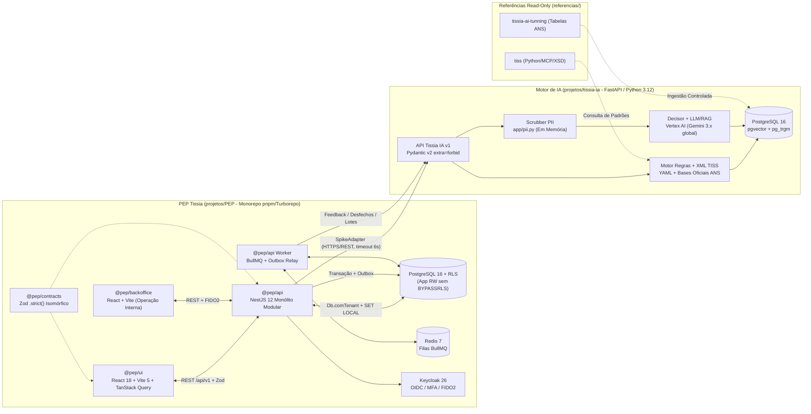
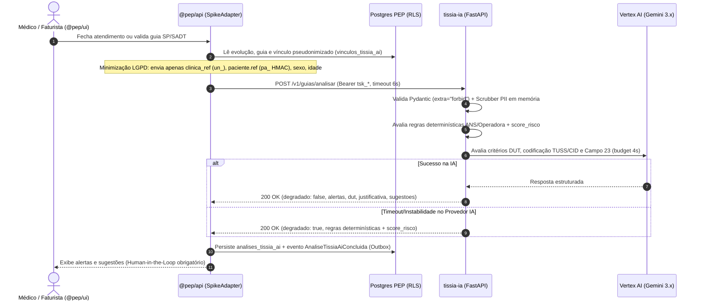
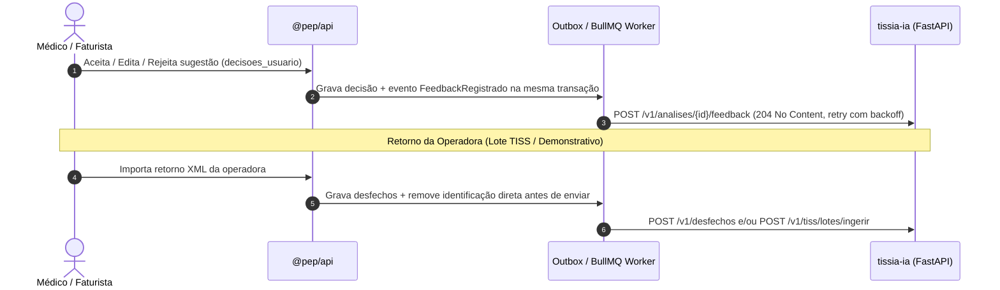

# Arquitetura Macro do Ecossistema Tissia

Visão consolidada da arquitetura distribuída entre o **PEP Tissia** (`projetos/PEP`, monorepo TypeScript) e o motor de IA anti-glosa **Tissia IA** (`projetos/tissia-ia`, backend FastAPI/Python).

## 1. Topologia de Serviços e Limites de Domínio

## 2. Fluxos Críticos Entre `PEP` e `tissia-ia`

### 2.1 Fluxo Síncrono de Análise Anti-Glosa (`POST /v1/guias/analisar`)

### 2.2 Fluxo Assíncrono Pós-Decisão e Faturamento (`Outbox` + `BullMQ`)

## 3. Pontos de Entrada da Documentação

- **Índice Mestre:** [[MOC-Index]]
- **Hub do PEP (`projetos/PEP`):** [[hub-pep-tissia]] · [[modelo-de-dados-pep]] · [[integracoes-externas]]
- **Hub do Motor de IA (`projetos/tissia-ia`):** [[hub-tissia-ia]] · [[runbook-operacao-ia]]
- **Contratos entre Serviços:** [[manual-integracao-tissia-ia-v1]] · [[mapeamento-pep-tissia-ia]] · [[indice-contratos-e-schemas]]
- **Governança e Segurança:** [[conformidade-regulatoria]] · [[ADR-PEP-0005-spike-adapter]] · [[ADR-IA-0007-minimizacao-de-dados]]

