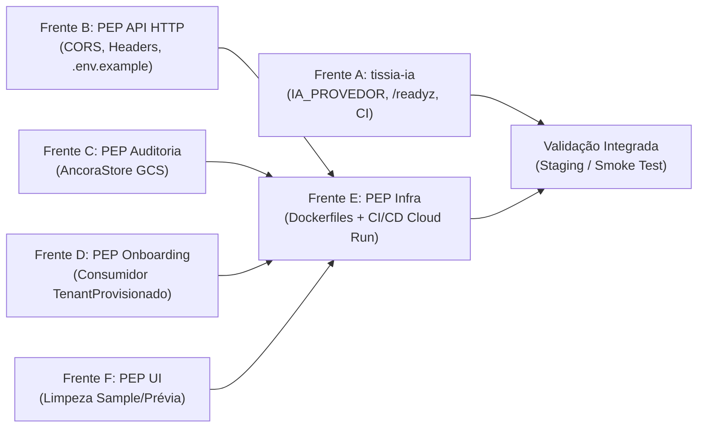

# Auditoria de Prontidão para MVP e Plano de Orquestração Multi-Agente

> **Objetivo:** Consolidar os bloqueadores críticos (**P0**), pendências de Dia 1 (**P1**) e cortes de escopo identificados na auditoria do ecossistema (`PEP` + `tissia-ia`), estruturados em **frentes paralelizáveis** para execução por múltiplos agentes coordenados.

---

## 1. Veredito de Prontidão

- **Status:** `NÃO PRONTO`
- **Resumo Executivo:** A base de código central (`projetos/PEP` e `projetos/tissia-ia`) está madura em domínio, contratos e segurança lógica — `pnpm typecheck` (5/5 pacotes), `pnpm deps` (0 violações em 172 módulos) e `ruff check` passam limpos, com guardas rígidas de `NODE_ENV=production` em `apps/api/src/comum/config.ts` e proteção anti-PII/SSRF. Entretanto, faltam peças críticas de produção no `PEP` (Dockerfiles e CI de deploy, CORS na API principal, consumidor de `TenantProvisionado` e âncora de auditoria persistente fora do disco local) e ajuste no deploy do `tissia-ia` (que atualmente sobe sem `IA_PROVEDOR=vertex`).

---

## 2. Mapa de Frentes para Orquestração Multi-Agente

As frentes abaixo foram isoladas por **repositório** e **fronteira de arquivos** para permitir execução paralela com mínimo risco de conflito de merge.

### Regras Gerais Obrigatórias para Todos os Agentes
- Seguir estritamente o protocolo em `AGENTS.md` na raiz do workspace (domínio, comentários e commits em `pt-BR`).
- **Nunca** modificar arquivos em `referencias/` ou `projetos/tissia-ia/.docs/`.
- **Não** alterar contratos HTTP `v1` entre `PEP` e `tissia-ia` sem consultar [[manual-integracao-tissia-ia-v1]] e [[mapeamento-pep-tissia-ia]].
- Cada agente trabalha em sua própria frente e valida com os comandos do respectivo repositório antes de encerrar.

---

### Frente A — `tissia-ia`: IA Real no Deploy, `/readyz` e Segurança HTTP
- **Repositório:** `projetos/tissia-ia`
- **Prioridade:** `P0` + `P1`
- **Arquivos-alvo:**
  - `.github/workflows/ci.yml`
  - `app/config.py`
  - `app/main.py`
  - `tests/` (novos testes para `/readyz` e configurações)
- **Problemas Endereçados:**
  1. **[P0] Deploy sem Vertex AI ativo:** `Settings.IA_PROVEDOR` tem default `"local"` (`app/config.py:31`) e os jobs `deploy-staging` e `deploy-prod` em `.github/workflows/ci.yml` não definem `IA_PROVEDOR=vertex`, fazendo o serviço subir em produção apenas com heurísticas locais (`degradado: true`).
  2. **[P0/P1] Validação de modelos Vertex:** conferir e garantir via variáveis de deploy os nomes vigentes de `GEMINI_MODEL` e `GEMINI_MODEL_QUALIDADE` (`app/config.py:27-28`, [[ADR-IA-0010-vertex-global-e-gemini-3x|ADR-IA-0010]]).
  3. **[P1] Healthcheck sem checagem de banco:** `/healthz` em `app/main.py:127-136` não testa conectividade com o PostgreSQL.
  4. **[P1] CORS opcional:** avaliar/habilitar `CORSMiddleware` controlado por variável de ambiente caso haja consumo direto por navegador/extensão.
- **Critérios de Aceite:**
  - [ ] `.github/workflows/ci.yml` injeta `IA_PROVEDOR=vertex` em `deploy-staging` e `deploy-prod`.
  - [ ] Novo endpoint `/readyz` executa `SELECT 1` no Postgres e retorna `503` em caso de falha (mantendo `/healthz` leve).
  - [ ] `uv run ruff check . && uv run ruff format --check . && uv run pytest` passam 100%.

---

### Frente B — `PEP` (`@pep/api`): CORS, Headers de Segurança, Rate Limit e `.env.example`
- **Repositório:** `projetos/PEP`
- **Prioridade:** `P0` + `P1`
- **Arquivos-alvo:**
  - `apps/api/src/app.ts`
  - `apps/api/src/comum/config.ts`
  - `apps/api/.env.example`
  - `apps/api/test/` (teste HTTP de CORS/headers)
- **Problemas Endereçados:**
  1. **[P0] API principal sem CORS e headers:** `apps/api/src/app.ts` (`criarApp()`) não configura `app.enableCors(...)`, `X-Frame-Options`, `X-Content-Type-Options` nem rate limit (ao contrário de `apps/api/src/backoffice.ts`). Chamadas cross-origin de `@pep/ui` para `@pep/api` falharão no navegador.
  2. **[P1] `.env.example` incompleto:** `apps/api/.env.example` possui apenas 11 linhas e omite variáveis exigidas em `NODE_ENV=production` por `apps/api/src/comum/config.ts` (`PII_CHAVE_MESTRA`, `TISSIA_AI_SAL_PACIENTE`, `TISSIA_AI_URL`, `TISSIA_AI_API_KEY`, `AUDITORIA_ANCORA_DIR`, `WORKER_EMBUTIDO`, `PLATAFORMA_DATABASE_URL`, `BO_*`).
- **Critérios de Aceite:**
  - [ ] `criarApp()` configura `enableCors` com origem(ns) vinda(s) de variável de ambiente (`PEP_ORIGEM_UI`), headers de segurança e rate limit básico.
  - [ ] `apps/api/.env.example` documenta todas as variáveis de `config.ts` com comentários claros para dev vs. produção (sem segredos reais).
  - [ ] `pnpm --filter @pep/api typecheck && pnpm --filter @pep/api test` passam.

---

### Frente C — `PEP` (`@pep/api`): Persistência Externa da Âncora de Auditoria
- **Repositório:** `projetos/PEP`
- **Prioridade:** `P0`
- **Arquivos-alvo:**
  - `apps/api/src/modulos/auditoria/selagem.ts`
  - `apps/api/src/worker-runtime.ts`
  - `apps/api/src/comum/config.ts`
  - `apps/api/test/` (teste unitário/contrato da nova `AncoraStore`)
- **Problemas Endereçados:**
  1. **[P0] Âncora em disco local efêmero:** `AncoraEmArquivo` (`apps/api/src/modulos/auditoria/selagem.ts:19-30`) grava arquivos `.jsonl` em disco local (`AUDITORIA_ANCORA_DIR`). Em Cloud Run, o disco é efêmero e não compartilhado entre réplicas, invalidando a verificação de integridade da trilha na subida do worker.
- **Critérios de Aceite:**
  - [ ] Implementada `AncoraStore` persistente para produção (ex.: Google Cloud Storage com Object Lock/retenção bloqueada), selecionada por configuração quando em `NODE_ENV=production` ou quando bucket estiver configurado.
  - [ ] `AncoraEmArquivo` preservada apenas para `development`/`test`/demo.
  - [ ] Testes de selagem e verificação da cadeia continuam verdes.

---

### Frente D — `PEP` (`@pep/api`): Onboarding de Clínicas e Convite (`TenantProvisionado`)
- **Repositório:** `projetos/PEP`
- **Prioridade:** `P0`
- **Arquivos-alvo:**
  - `apps/api/src/worker-runtime.ts`
  - `apps/api/src/modulos/notificacoes/` (ou módulo de e-mail/onboarding)
  - `apps/api/src/modulos/organizacao/`
  - `apps/api/src/comum/config.ts`
- **Problemas Endereçados:**
  1. **[P0] Evento `TenantProvisionado` sem consumidor:** `OrganizacaoService` (`apps/api/src/modulos/organizacao/organizacao.service.ts:75`) emite `TenantProvisionado` no outbox transacional, mas `consumidoresDe()` em `worker-runtime.ts` não possui consumidor registrado. Novas clínicas criadas no backoffice não disparam e-mail de convite nem criam usuário no Keycloak automaticamente.
- **Critérios de Aceite:**
  - [ ] Consumidor idempotente (`processarUmaVez`) registrado em `consumidoresDe()` tratando `TenantProvisionado`.
  - [ ] Integração com provedor SMTP transacional (configurável via env; fallback/captura em dev) e criação/convite no Keycloak Admin API (ou fluxo explicitamente documentado se o MVP inicial usar provisionamento assistido).
  - [ ] Sem vazamento de PII em logs (`comum/logger.ts`).

---

### Frente E — `PEP` (Infra & CI/CD): Dockerfiles de Produção e Deploy Cloud Run
- **Repositório:** `projetos/PEP`
- **Dependências:** Coordenar após estabilização das variáveis de ambiente das Frentes B, C e D.
- **Prioridade:** `P0`
- **Arquivos-alvo:**
  - Dockerfiles de produção (ex.: `apps/api/Dockerfile`, `apps/ui/Dockerfile`, `apps/backoffice/Dockerfile` ou `infra/prod/`)
  - `.github/workflows/ci.yml` (ou novo workflow de deploy)
- **Problemas Endereçados:**
  1. **[P0] Sem build de produção containerizado:** só existem `infra/demo/Dockerfile.pep` e `infra/demo/Dockerfile.ui` (demo). O `ci.yml` atual (`linha 32`) ainda traz o comentário `# build/push das imagens, migração e deploy (Cloud Run) entram com a infra GCP (ADR-PEP-0009)`.
- **Critérios de Aceite:**
  - [ ] Imagens multi-stage enxutas (usuário não-root) para `@pep/api` (suportando entrypoints `main`, `worker` e `backoffice`), `@pep/ui` e `@pep/backoffice`.
  - [ ] Pipeline CI/CD executa `db:migrate` + `db:rls` com usuário adequado antes de promover nova revisão no Cloud Run (`southamerica-east1`, [[ADR-PEP-0009-hospedagem-gcp-sao-paulo|ADR-PEP-0009]]).

---

### Frente F — `PEP` (`@pep/ui` e `@pep/backoffice`): Limpeza de `<Sample />` e Ajustes de UI do Piloto
- **Repositório:** `projetos/PEP`
- **Prioridade:** `P1`
- **Arquivos-alvo:**
  - `apps/ui/src/pages/Home.tsx`
  - `apps/ui/src/pages/Login.tsx`
  - `apps/ui/src/pages/Agenda.tsx`
  - `apps/ui/src/modulos/faturamento/ImprimirPendente.tsx`
- **Problemas Endereçados:**
  1. **[P1] Selos `<Sample />` ("Dados ilustrativos") em fluxos ativos:** presentes em `Home.tsx`, `Login.tsx`, `Agenda.tsx` e `ImprimirPendente.tsx`. Podem gerar insegurança ou confusão nas clínicas piloto.
- **Critérios de Aceite:**
  - [ ] Remover `<Sample />` nos blocos que já possuem dados reais ou substituir/ocultar cartões estritamente não implementados de acordo com a política de prévia da [[RFC-PEP-015-frontend|RFC-PEP-015]].
  - [ ] `pnpm --filter @pep/ui typecheck && pnpm --filter @pep/ui build && pnpm --filter @pep/ui test` passam.

---

## 3. Pendências de Dia 1 Adicionais (P1 — Monitorar nas primeiras 48h)

- **Rate limit e jobs em memória no `tissia-ia` e `backoffice.ts`:**
  - `TokenBucketLimiter` (`projetos/tissia-ia/app/uso.py:30-73`) e `criarRateLimit` (`projetos/PEP/apps/api/src/backoffice.ts:16-40`) operam em memória local do processo; em múltiplas réplicas o limite é por instância.
  - Jobs assíncronos (`SPK-03`) em `projetos/tissia-ia/app/jobs.py` usam `BackgroundTasks` no processo HTTP; manter `min-instances >= 1` no Cloud Run em produção (como já configurado em `ci.yml:124`) e evitar escalar a zero com jobs em andamento.

---

## 4. Cortes de Escopo — O que NÃO Fazer Agora

1. **Módulos reservados sem domínio implementado (`AssinaturaModule` e `IntegracoesModule`)** — `apps/api/src/modulos/assinatura/assinatura.module.ts` e `apps/api/src/modulos/integracoes/integracoes.module.ts` (ICP-Brasil é P2 e integrações externas são P3).
2. **Streaming WebSocket do Scribe (Etapa 2 da [[SPK-04-requisitos-do-scribe|SPK-04]])** — Manter transcrição por trechos HTTP (~12 s), já validada para o piloto ([[ADR-PEP-0025-decisoes-scribe-e-ops-tissia-ai|ADR-PEP-0025]]).
3. **Telas de operação da Spike no Backoffice (`B2`, telas 06–17)** — `apps/backoffice/src/App.tsx:31-43` permanece estático até > 10 clínicas ou 1º integrador externo.
4. **Lembretes por WhatsApp e importadores de concorrentes** — Ações inertes de prévia em `Agenda.tsx` e `Pacientes.tsx` não bloqueiam o MVP.
5. **Migração de `TokenBucketLimiter` para Redis** — Só necessária quando houver múltiplos integradores externos de alto volume no `tissia-ia`.

---

## 5. Checklist Consolidado de Verificação (Gate Pré-Deploy)

- [ ] `projetos/tissia-ia`: `uv run ruff check . && uv run ruff format --check . && uv run pytest`
- [ ] `projetos/PEP`: `pnpm typecheck && pnpm deps && pnpm build && pnpm test`
- [ ] Conferência de ambiente em `staging` (`NODE_ENV=production`, `AUTH_MODE=oidc`, `IA_PROVEDOR=vertex`, `OPS_HABILITADO=true/false`, secrets no Secret Manager)
- [ ] Smoke test ponta a ponta: Login Keycloak + MFA → Atendimento → Análise `tissia-ia` com Gemini real → Fechamento de guia → Auditoria selada com âncora persistente.

