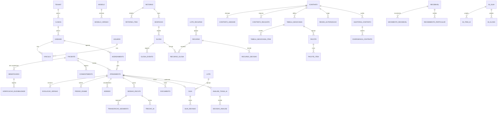

# Modelo de dados do PEP

Núcleo do §7 do design de produto, alinhado aos schemas Drizzle em `projetos/PEP/apps/api/src/modulos/*/schema.ts` e às migrações em `apps/api/drizzle/`. Detalhes operacionais e de regras ficam na RFC de cada módulo; aqui ficam as convenções, relações, entidades reais vs. planejadas e regras transversais.

---

## 1. Convenções

| Regra | Detalhe |
| :--- | :--- |
| Chave primária | `uuid` v7 (ordenável por tempo), gerado na aplicação (exceto referências com PK natural como `operadoras.registro_ans`, `ref_orientacao_recurso.grupo`, `auditoria_interna.id` identity e chaves compostas) |
| Tenant | Toda tabela de domínio (inclusive tabelas filhas) tem `tenant_id uuid NOT NULL` com RLS forçado (`nullif(current_setting('app.tenant_id', true), '')::uuid`, [[RFC-PEP-000-fundacoes\|RFC-PEP-000]] e [[ADR-PEP-0017-orm-drizzle-rls\|ADR-PEP-0017]]). Exceções globais: `usuarios`, `operadoras`, `ref_campos_guia`, `ref_dominios_tiss`, `ref_cargas`, `ref_orientacao_recurso`, `bi_mapa_alerta_glosa` e `auditoria_interna` (`app_plataforma`). Em `modelos`, a cópia por clínica (`origem = 'catalogo'`) mantém `tenant_id NOT NULL` com RLS uniforme |
| Fronteira entre módulos | Cada módulo declara seu schema em `apps/api/src/modulos/<dominio>/schema.ts`. **Chaves estrangeiras (`REFERENCES`) só existem dentro do mesmo módulo**; referências para entidades de outro módulo são colunas `uuid` validadas na camada de serviço ([[ADR-PEP-0017-orm-drizzle-rls\|ADR-PEP-0017]]) |
| Escopo | `clinica_id` e/ou `unidade_id` quando o dado pertence a um local |
| Tempo | `criado_em timestamptz NOT NULL DEFAULT now()`; `atualizado_em` só em tabela mutável |
| Autoria | `criado_por uuid` / `autor_id uuid` (usuário) nas tabelas clínicas, contratuais e de faturamento |
| Exclusão | Dado clínico e de faturamento **nunca** é apagado nem tem soft delete: correção = nova versão, adendo, movimento ou estorno. Cadastros usam `ativo boolean` |
| Dinheiro | **`bigint` / `integer` em centavos inteiros (`*_centavos`) em BRL** nas tabelas transacionais (`faturamento`, `retorno`, `contratos`, `financeiro` e na planejada `esquecidas`). Projeções de leitura do módulo `bi` (`bi_guias`, `bi_itens_ia`, `bi_glosas`) usam `numeric(12,2)` |
| Códigos | TUSS, CID, Tabela 38 e Registro ANS como `text`, validados contra as bases de referência vigentes ([[RFC-PEP-021-dados-de-referencia-ans\|RFC-PEP-021]] / [[ADR-PEP-0024-dados-de-referencia-ans\|ADR-PEP-0024]]) |
| PII | Colunas de PII direta cifradas por tenant (KMS / `comum/cifra.ts`); busca por hash (`cpf_hash`) ou sufixo (`cpf_final`, `carteira_final`) |
| Retenção | Prontuário: mínimo 20 anos (Lei nº 13.787/2018) **[validar]**; faturamento: 5 anos após o pagamento **[validar]**; logs de acesso: 5 anos **[validar]** |

---

## 2. Diagrama

---

## 3. Entidades por módulo

### 3.1 Organização, Identidade, Backoffice, Auditoria e Infraestrutura

| Módulo | Tabela | Colunas-chave | Tenant | PII | Retenção |
| :--- | :--- | :--- | :--- | :--- | :--- |
| `organizacao` | `tenants` | `nome`, `situacao` (`ativa\|teste\|suspensa\|encerrada`), `plano_rotulo`, `cs_responsavel`, `suspensao_pendente_por` | — (raiz) | Não | Contrato |
| `organizacao` | `clinicas` | `nome`, `cnpj`, `registro_cnes` | Sim | Não | Contrato |
| `organizacao` | `unidades` | `clinica_id`, `nome`, `modo_ia` (`desligado\|silencioso\|assistido`) | Sim | Não | Contrato |
| `organizacao` | `convites` | `email`, `perfil` (`administrador`), `unidade_ids`, `expira_em`, `aceito_em` ([[RFC-PEP-018-backoffice-clinicas-e-onboarding\|RFC-PEP-018]]) | Sim | E-mail de contato | 1 ano |
| `organizacao` | `acessos_suporte` | `solicitante_sub`, `escopo`, `duracao_min`, `motivo`, `estado`, `decidido_por`, `expira_em` | Sim | Não | Contrato |
| `organizacao` | `uso_diario` | PK `(tenant_id, unidade_id, dia)`, `medicos_ativos`, `analises`, `aceitos`, `editados`, `rejeitados` | Sim | Não | Contrato |
| `backoffice` | `auditoria_interna` | `id` (identity), `ator_sub`, `papeis`, `sessao_id`, `ambiente`, `acao`, `alvo_tipo`, `alvo_id`, `dados`, `hash` ([[RFC-PEP-017-backoffice-fundacoes-e-acesso\|RFC-PEP-017]]) | — (plataforma) | Não | 5 anos **[validar]** |
| `identidade` | `usuarios` | `keycloak_sub`, `nome`, `email`, `conselho`, `numero_conselho`, `uf_conselho`, `ativo` | Global | Sim (profissional) | Enquanto ativo + 5 anos |
| `identidade` | `vinculos` | `usuario_id`, `unidade_id`, `perfil`, `padrao`, `valido_ate`, `expira_em` | Sim | Não | Idem |
| `auditoria` | `auditoria_eventos` | `ator_id`, `acao`, `recurso_tipo`, `recurso_id`, `paciente_id`, `campos`, `motivo`, `ip`, `user_agent`, `ocorrido_em`, `sequencia`, `hash_anterior`, `hash` ([[RFC-PEP-014-plataforma-lgpd-auditoria\|RFC-PEP-014]]) | Sim | Não (só ids/nomes de campo) | ≥ prazo do prontuário |
| `auditoria` | `auditoria_verificacoes` | `verificado_em`, `ok`, `eventos`, `falha_sequencia`, `motivo` | Sim | Não | Idem |
| `notificacoes` | `notificacoes`, `notificacoes_leituras` | `categoria`, `tipo`, `titulo`, `corpo`, `link`, `permissao`; leitura por `(notificacao_id, usuario_id)` | Sim | Não | Operacional |
| `comum` | `outbox`, `eventos_processados` | `tipo`, `versao`, `agregado_id`, `payload`, `publicado_em`; dedupe por `(consumidor, evento_id)` | Sim | Não | 30 dias após publicado |

### 3.2 Pacientes

| Módulo | Tabela | Colunas-chave | Tenant | PII | Retenção |
| :--- | :--- | :--- | :--- | :--- | :--- |
| `pacientes` | `pacientes` | `nome_civil`, `nome_social`, `nascimento`, `sexo_tiss`, `alergias`, `cpf` (cifrado), `cpf_hash`, `cpf_final`, `cns` (cifrado), `celular` (cifrado), `email` (cifrado), `canal_preferido`, `responsavel_id` | Sim | **Sim** | Prontuário |
| `pacientes` | `beneficiarios` | `paciente_id`, `operadora_nome`, `registro_ans`, `numero_carteira` (cifrada), `carteira_final`, `plano`, `acomodacao`, `titularidade`, `validade`, `principal`, `ativo` | Sim | **Sim** | Prontuário |
| `pacientes` | `verificacoes_elegibilidade` | `beneficiario_id`, `resultado`, `escopo`, `carencia_ate`, `motivo`, `fonte`, `protocolo`, `verificado_por`, `verificado_em` | Sim | Não | 5 anos |
| `pacientes` | `consentimentos` | `paciente_id`, `finalidade` (`tratamento\|escuta_ambiental\|whatsapp\|cid_em_atestado`), `versao_termo`, `canal`, `concedido_em`, `revogado_em` | Sim | Sim | Prontuário |

### 3.3 Agenda e Prontuário

| Módulo | Tabela | Colunas-chave | Tenant | PII | Retenção |
| :--- | :--- | :--- | :--- | :--- | :--- |
| `agenda` | `salas` | `unidade_id`, `nome`, `compartilhada` | Sim | Não | Operacional |
| `agenda` | `agendamentos` | `unidade_id`, `profissional_id`, `sala_id`, `paciente_id`, `beneficiario_id`, `tipo`, `particular`, `encaixe`, `procedimento_tuss`, `inicio`, `fim`, `status`, `elegibilidade`, `autorizacao_status` (`EXCLUDE USING gist` na migração `0012`) | Sim | Indireta | 5 anos |
| `prontuario` | `atendimentos` | `unidade_id`, `paciente_id`, `profissional_id`, `agendamento_id`, `convenio`, `modelo_versao_id`, `status`, `iniciado_em`, `fechado_em` | Sim | Indireta | Prontuário |
| `prontuario` | `evolucao_versoes` | `atendimento_id`, `versao`, `conteudo` (`jsonb`), `texto_plano`, `autor_id`, `comando_id` (append-only por trigger) | Sim | Sim (clínico) | Prontuário |
| `prontuario` | `pedidos_exame` | `atendimento_id`, `tuss`, `termo`, `quantidade`, `indicacao_clinica` (1–500) | Sim | Sim (clínico) | Prontuário |
| `prontuario` | `adendos` | `atendimento_id`, `texto`, `justificativa` (≥ 10), `origem` (`online\|offline`), `autor_id`, `comando_id` (append-only, migração `0013`) | Sim | Sim | Prontuário |
| `prontuario` | `consentimentos_gravacao` | `atendimento_id`, `paciente_id`, `decisao` (`aceito\|recusado`), `termo_versao`, `registrado_por` ([[RFC-PEP-013-voz-ambiental\|RFC-PEP-013]]) | Sim | Sim | Prontuário |
| `prontuario` | `sessoes_escuta` | `unidade_id`, `atendimento_id`, `estado`, `duracao_s`, `marcas` (`jsonb`), `estruturacao` (`jsonb`), `trilha_anexada` (zero retenção de áudio) | Sim | Sim (clínico) | Prontuário |
| `prontuario` | `transcricao_segmentos` | `sessao_id`, `ordem`, `inicio_s`, `fim_s`, `locutor`, `texto`, `clinico` | Sim | Sim (clínico) | Prontuário |
| `prontuario` | `trechos_ia` | `sessao_id`, `secao` (`s\|o\|a\|p`), `ordem`, `texto`, `origens` (`jsonb`), `status` (`pendente\|aceito\|editado\|descartado`), `texto_final`, `termos_novos` (`jsonb`), `decidido_por`, `decidido_em` | Sim | Sim (clínico) | Prontuário |

### 3.4 Modelos, Documentos, Assinatura e Referências ANS

| Módulo | Tabela | Colunas-chave | Tenant | PII | Retenção |
| :--- | :--- | :--- | :--- | :--- | :--- |
| `modelos` | `modelos` | `especialidade`, `nome`, `origem` (`catalogo\|clinica`), `ativo`, `curadoria_pendente` | Sim (catálogo copiado por tenant) | Não | Indefinida |
| `modelos` | `modelo_versoes` | `modelo_id`, `versao`, `status` (`rascunho\|publicada\|arquivada`), `definicao` (`jsonb`), `publicada_em`, `publicada_por` | Sim | Não | Indefinida |
| `modelos` | `modelo_compartilhamentos` | PK `(tenant_id, modelo_id, profissional_id)` | Sim | Não | Indefinida |
| `documentos` | `documentos` | `unidade_id`, `atendimento_id`, `tipo` (`receita\|atestado\|encaminhamento\|resumo_paciente`), `conteudo` (`jsonb`), `status` (`rascunho\|revisado\|assinado`), `assinado_em`, `assinado_por` | Sim | Sim | Prontuário |
| `assinatura` | `assinaturas` *(planejada)* | Previsto na [[RFC-PEP-011-assinatura-icp-brasil\|RFC-PEP-011]] (ainda sem `schema.ts` no banco) | Sim | Não | Prontuário |
| `referencias` | `ref_campos_guia` | PK `(versao_ref, documento, ordem)`, `termo`, `numero_campo`, `nome_campo`, `condicao`, `dominio_tabela` ([[RFC-PEP-021-dados-de-referencia-ans\|RFC-PEP-021]]) | Global | Não | Permanente |
| `referencias` | `ref_dominios_tiss` | PK `(versao_ref, tabela, codigo)`, `termo`, `vigencia_inicio`, `vigencia_fim`, `fim_implantacao` (inclui Tabela 38) | Global | Não | Permanente |
| `referencias` | `ref_cargas` | `base`, `versao_ref`, `sha256`, `contagens` (`jsonb`), `carregado_por`, `carregado_em` | Global | Não | Permanente |

### 3.5 Faturamento e Módulo `tissia-ai` (`SpikeAdapter`)

Implementado em `apps/api/src/modulos/faturamento/schema.ts` e `apps/api/src/modulos/tissia-ai/schema.ts` (migrações `0002`, `0004`, `0008`, `0009`, `0023`, `0026`, `0028`, `0033` e `0034`). Todos os valores monetários são armazenados em centavos inteiros (`*_centavos`), e procedimentos/CIDs da revisão ficam em `jsonb` / `text[]` dentro de `guias` e `guia_revisoes` (substituindo as tabelas normalizadas `guia_procedimentos` e `guia_cids` previstas inicialmente).

| Módulo | Tabela | Colunas-chave | Tenant | PII | Retenção |
| :--- | :--- | :--- | :--- | :--- | :--- |
| `faturamento` | `guias` | `unidade_id`, `atendimento_id` (unique), `paciente_id`, `profissional_id`, `beneficiario_id`, `operadora_nome`, `numero_prestador`, `tipo` (`sp_sadt\|consulta`), `status`, `risco`, `score_risco`, `analise_estado`, `prazo_envio_dias`, `pendencia_principal`, `valor_total_centavos` (`integer`), `revisao_atual`, `motivo_cancelamento`, `lote_id`, `responsavel_id`, `cids` (`text[]`), `itens` (`jsonb`: `[{ tuss, quantidade, indicacaoClinica }]`) | Sim | Indireta | 5 anos |
| `faturamento` | `guia_revisoes` | `guia_id` (FK `guias.id`), `numero`, `itens` (`jsonb`), `cids` (`text[]`), `indicacao_clinica` (≤ 500), `dados` (`jsonb`), `origem` (`manual\|sugestao_tissia_ai\|sistema`), `autor_id`, `criado_em` (append-only por trigger) | Sim | Sim (clínico) | 5 anos |
| `faturamento` | `lotes` | `unidade_id`, `tipo` (`sp_sadt\|consulta`), `registro_ans`, `operadora_nome`, `numero` (≤ 12), `competencia`, `versao_tiss`, `status` (`validado\|enviado\|descartado`), `qtd_guias`, `valor_total_centavos` (`integer`), `xml` (`bytea`), `xml_sha256`, `hash_tiss`, `checagem` (`jsonb`), `enviado_em`, `canal_envio`, `protocolo` | Sim | Indireta (XML) | 5 anos |
| `faturamento` | `sequencias` | PK `(tenant_id, unidade_id, nome)`, `valor` (`bigint`) — contadores atômicos por unidade (`lote`, `guia`, `lote_recurso`, `recibo`) | Sim | Não | Permanente |
| `faturamento` | `lote_sintetico_guias` | `unidade_id`, `caso_golden_id`, `operadora_nome`, `especialidade`, `codigo_tuss`, `dut_numero`, `cid`, `conformidade_dut`, `desfecho` (`paga\|glosada`), `alerta_previo`, `motivo_glosa`, `valor_centavos` (`integer`) | Sim | Não | Demo / 5 anos |
| `tissia-ai` | `analises_tissia_ai` | `unidade_id`, `atendimento_id`, `tissia_ai_analise_id`, `estado` (`completa\|parcial\|falhou`), `resposta` (`jsonb` — alertas, critérios DUT e sugestões), `payload` (`jsonb`), `modo` (`silencioso\|assistido`), `profissional_id`, `exibida_em`, `criado_em` | Sim | Não (só refs) | 5 anos |
| `tissia-ai` | `decisoes_analise` | `analise_id` (FK `analises_tissia_ai.id`), `item_id`, `acao` (`aceito\|editado\|rejeitado`), `texto_final`, `usuario_id`, `criado_em`, `feedback_enviado_em` | Sim | Sim (texto final) | 5 anos |
| `tissia-ai` | `tissia_ai_config_unidade` | `unidade_id` (PK), `bloquear_envio_com_bloqueante`, `exigir_motivo_ao_ignorar`, `mostrar_informativos` | Sim | Não | Contrato |
| `tissia-ai` | `tissia_ai_config_profissional` | PK `(unidade_id, profissional_id)`, `modo` (`silencioso\|assistido`) | Sim | Não | Contrato |

### 3.6 Retorno e Glosas

Implementado em `apps/api/src/modulos/retorno/schema.ts` (migração `0041_retorno_e_glosas.sql` — 10 tabelas reais; [[RFC-PEP-007-retorno-e-glosas|RFC-PEP-007]]).

| Tabela | Colunas-chave | Tenant | PII | Retenção |
| :--- | :--- | :--- | :--- | :--- |
| `retornos` | `unidade_id`, `registro_ans`, `operadora_nome`, `tipo` (`analise_conta\|pagamento`), `versao_tiss`, `numero_demonstrativo`, `data_demonstrativo`, `competencia`, `origem` (`upload\|webservice`), `arquivo_objeto`, `arquivo_hash`, `xsd_valido`, `xsd_erros` (`jsonb`), `estado`, `erro_importacao`, `duracao_ms`, `qtd_itens`, `qtd_vinculados`, `faturado_centavos`, `pago_centavos`, `glosado_centavos`, `qtd_divergencias`, `lote_numeros` (`text[]`), `tissia_ai_ingestao`, `tissia_ai_ingerido_em`, `importado_por` | Sim | Indireta | 5 anos |
| `retorno_itens` | `retorno_id` (FK `retornos.id`), `ordem`, `numero_guia_prestador`, `numero_guia_operadora`, `guia_id`, `lote_id`, `codigo_tuss`, `data_execucao`, `quantidade` (`numeric(8,2)`), `informado_centavos`, `pago_centavos`, `glosa_centavos`, `codigo_glosa`, `codigo_glosa_reconhecido`, `codigo_glosa_descricao`, `motivo_texto`, `contrato_centavos`, `tabela_versao_id`, `situacao`, `tratamento`, `tratado_por`, `tratado_em` | Sim | Não | 5 anos |
| `desfechos` | `guia_id`, `retorno_id` (FK `retornos.id`), `recurso_id`, `origem` (`demonstrativo\|manual\|recurso`), `status` (`pago\|glosado_parcial\|glosado_total`), `cobrado_centavos`, `glosado_centavos`, `codigo_glosa_principal`, `tissia_ai_estado`, `tissia_ai_enviado_em`, `registrado_por`, `criado_em` | Sim | Não | 5 anos |
| `glosas` | `unidade_id`, `guia_id`, `retorno_item_id` (unique FK `retorno_itens.id`), `desfecho_id` (FK `desfechos.id`), `registro_ans`, `profissional_id`, `tipo` (`glosa\|divergencia`), `codigo_tuss`, `data_execucao`, `codigo_glosa`, `motivo_texto`, `glosado_centavos`, `recuperado_centavos`, `prazo_recurso`, `prazo_origem`, `status`, `aceite_justificativa`, `responsavel_id` | Sim | Não | 5 anos |
| `glosa_eventos` | `glosa_id` (FK `glosas.id`), `de`, `para`, `motivo`, `usuario_id`, `criado_em` (append-only) | Sim | Não | 5 anos |
| `lotes_recurso` | `unidade_id`, `registro_ans`, `numero`, `status` (`aberto\|gerado\|enviado`), `formato` (`pacote_portal\|xml_tiss`), `pacote_objeto`, `pacote_hash`, `protocolo`, `enviado_em`, `criado_por` | Sim | Não | 5 anos |
| `recursos` | `unidade_id`, `guia_id`, `registro_ans`, `status`, `texto`, `limite_caracteres`, `texto_origem` (`manual\|ia_aceito\|ia_editado`), `evidencias` (`jsonb`), `anexos` (`jsonb`), `tissia_ai_recurso_id`, `sugestao` (`jsonb`), `lote_recurso_id` (FK `lotes_recurso.id`), `resultado` (`revertido_total\|revertido_parcial\|mantido`), `recuperado_centavos`, `criado_por` | Sim | Sim (clínico) | 5 anos |
| `recurso_glosas` | PK `(recurso_id, glosa_id)`, FKs para `recursos.id` e `glosas.id` | Sim | Não | 5 anos |
| `recurso_decisoes` | `recurso_id` (FK `recursos.id`), `acao` (`aceito\|editado\|descartado`), `texto_final`, `usuario_id`, `criado_em` (append-only) | Sim | Sim (texto final) | 5 anos |
| `ref_orientacao_recurso` | `grupo` (PK), `documentos` (`text[]`), `texto` | Global | Não | Permanente |

### 3.7 Contratos

Implementado em `apps/api/src/modulos/contratos/schema.ts` (migrações `0043_contratos_completo.sql` e `0044_contratos_imutabilidade.sql` — 12 tabelas reais; [[RFC-PEP-008-contratos|RFC-PEP-008]]).

| Tabela | Colunas-chave | Tenant | PII | Retenção |
| :--- | :--- | :--- | :--- | :--- |
| `operadoras` | `registro_ans` (PK), `razao_social`, `nome_fantasia`, `cnpj`, `modalidade`, `uf`, `ativa`, `versao_ref`, `atualizado_em` (CADOP ANS) | Global | Não | Permanente |
| `contratos` | `clinica_id`, `registro_ans`, `numero`, `vigencia_inicio`, `vigencia_fim`, `versao_tiss`, `canal_envio`, `prazo_envio_dias`, `prazo_resposta_autorizacao_dias_uteis`, `validade_senha_dias`, `prazo_recurso_dias`, `limite_texto_recurso`, `retorno_sem_cobranca_dias`, `documento_objeto`, `documento_hash`, `documento_cifrado`, `ativo` | Sim | Não | Vigência + 5 anos |
| `contrato_unidades` | PK `(contrato_id, unidade_id)`, FK `contratos.id` | Sim | Não | Idem |
| `contrato_reajustes` | `contrato_id` (FK `contratos.id`), `percentual` (`numeric(6,3)`), `inicio`, `tabela_gerada_id`, `observacao`, `criado_por` | Sim | Não | Idem |
| `tabelas_negociadas` | `contrato_id` (FK `contratos.id`), `versao`, `vigencia_inicio`, `origem`, `status` (`rascunho\|publicada` — imutável após publicada pela `0044`), `arquivo_objeto`, `qtd_itens`, `publicada_por`, `publicada_em` | Sim | Não | Idem |
| `tabela_negociada_itens` | PK `(tabela_id, codigo_tuss)`, FK `tabelas_negociadas.id`, `descricao`, `valor_centavos` (`bigint`), `limite_por_guia`, `exige_autorizacao`, `observacoes` | Sim | Não | Idem |
| `pacotes` | `tabela_id` (FK `tabelas_negociadas.id`), `codigo`, `descricao`, `valor_centavos` (`bigint`) | Sim | Não | Idem |
| `pacote_itens` | PK `(pacote_id, codigo_tuss)`, FK `pacotes.id`, `quantidade_max` | Sim | Não | Idem |
| `precos_faturamento` | `unidade_id`, `registro_ans`, `codigo_tuss`, `valor_centavos` (`bigint`), `vigencia_inicio`, `vigencia_fim`, `origem` (`manual\|aplicado_do_contrato\|importacao`), `tabela_origem_id` | Sim | Não | Idem |
| `regras_autorizacao` | `contrato_id` (FK `contratos.id`), `nome`, `codigos_tuss` (`text[]`, índice GIN), `tipo` (`sempre\|eletivo\|acima_de_quantidade\|nao_exige`), `parametros` (`jsonb`), `vigencia_inicio`, `vigencia_fim` | Sim | Não | Idem |
| `auditorias_contrato` | `contrato_id` (FK `contratos.id`), `unidade_id`, `tabela_id`, `gatilho`, `estado`, `tissia_ai_estado`, `tissia_ai_payload_hash`, `total_itens`, `qtd_divergencias`, `impacto_mensal_centavos`, `regras_criadas_tissia_ai`, `iniciada_em`, `concluida_em` | Sim | Não | Idem |
| `divergencias_contrato` | `auditoria_id` (FK `auditorias_contrato.id`), `codigo_tuss`, `tipo`, `fonte`, `contrato_centavos`, `sistema_centavos`, `volume_90d`, `impacto_mensal_centavos`, `detalhe` (`jsonb`) | Sim | Não | Idem |

### 3.8 Receita Esquecida *(Planejada — ainda não criada)*

> **Status no banco:** **Planejada** (ainda não criada em `schema.ts` nem em migrações Drizzle). Especificação completa em [[RFC-PEP-009-receita-esquecida|RFC-PEP-009]].

As 3 tabelas previstas para o submódulo `faturamento/esquecidas` (todas com `tenant_id uuid NOT NULL`, RLS forçado e valores em `*_centavos bigint`) são:
- `config_receita_esquecida`: `unidade_id` (PK), `ativo`, `hora_execucao`, `janela_dias`, `tuss_executaveis` (`text[]`), `tuss_consulta`, `prazo_envio_padrao_dias`, `dias_retorno_padrao`, `max_analises_por_execucao`.
- `execucoes_receita_esquecida`: `id`, `unidade_id`, `gatilho` (`agendado | manual`), `janela_inicio`, `janela_fim`, `status`, `tissia_ai_estado`, contagens e `valor_em_risco_centavos`.
- `pendencias_cobranca`: `id`, `unidade_id`, `atendimento_id`, `paciente_id`, `profissional_id`, `operadora_id`, `tipo`, `origem`, `codigo_tuss`, `descricao`, `historico_tissia_ai`, `analise_spike_id`, `sugestao_item_id`, `guia_id`, `guia_id_reservado`, `valor_estimado_centavos`, `prazo_envio`, `status`, `motivo_nao_cobrar`.

### 3.9 Financeiro

Parcialmente implementado em `apps/api/src/modulos/financeiro/schema.ts` (migrações `0039_financeiro_particular_simples.sql` e `0040_financeiro_particular_triggers.sql` — 5 tabelas já criadas para a fatia 1 da [[RFC-PEP-010-financeiro-e-repasse|RFC-PEP-010]]).

**Tabelas já criadas (fatia 1 — `0039` / `0040`):**

| Tabela | Colunas-chave | Tenant | PII | Retenção |
| :--- | :--- | :--- | :--- | :--- |
| `config_financeiro` | `unidade_id` (PK), `prazo_pagamento_padrao_dias`, `dia_pagamento_repasse`, `atualizado_por`, `atualizado_em` | Sim | Não | Contrato |
| `tabela_particular` | `unidade_id`, `chave` (`consulta\|retorno\|procedimento\|<TUSS>`), `descricao`, `valor_centavos` (`bigint`), `vigencia_inicio`, `vigencia_fim`, `criado_por` | Sim | Não | 5 anos |
| `recebiveis` | `unidade_id`, `origem` (`guia\|particular`), `guia_id`, `lote_id`, `operadora_id`, `atendimento_id`, `paciente_id`, `profissional_id`, `competencia_producao` (`char(7)`), `data_emissao`, `vencimento_previsto`, `valor_previsto_centavos` (`bigint`), `saldo_centavos` (`bigint`), `status` (`aberto\|pago_parcial\|pago\|glosado_total\|baixado`) | Sim | Indireta | 5 anos |
| `movimentos_recebivel` | `recebivel_id` (FK `recebiveis.id`), `tipo` (`glosa\|estorno_glosa\|recebimento\|estorno_recebimento\|baixa`), `valor_centavos` (`bigint > 0`), `data_efetiva`, `origem_ref`, `motivo`, `criado_por` (append-only por trigger + `REVOKE`) | Sim | Não | 5 anos |
| `recebimentos_particulares` | `unidade_id`, `recebivel_id` (FK `recebiveis.id`), `valor_centavos` (`bigint > 0`), `desconto_centavos`, `forma` (`dinheiro\|pix\|cartao_debito\|cartao_credito\|outro`), `numero_recibo`, `recebido_em`, `recebido_por`, `estornado_em`, `estornado_por`, `motivo_estorno` | Sim | Não | 5 anos |

**Tabelas planejadas (fatias 2–5 da [[RFC-PEP-010-financeiro-e-repasse|RFC-PEP-010]], ainda não criadas):**
- **Contas a pagar (fatia 2):** `contas_pagar`, `recorrencias_pagar`.
- **Conciliação bancária OFX (fatia 4):** `contas_bancarias`, `extratos_importados`, `lancamentos_bancarios` (com `descricao_cifrada bytea`), `conciliacoes`, `conciliacao_alvos`.
- **Repasse médico (fatias 3 e 5):** `regras_repasse`, `repasses`, `itens_repasse`.

### 3.10 BI / Painel do Gestor

Implementado em `apps/api/src/modulos/bi/schema.ts` (migração `0042_bi_projecoes.sql` — 5 tabelas reais; [[RFC-PEP-012-painel-do-gestor|RFC-PEP-012]]). Sem PII de paciente nem texto clínico; valores monetários em `numeric(12,2)`.

| Tabela | Colunas-chave | Tenant | PII | Retenção |
| :--- | :--- | :--- | :--- | :--- |
| `bi_guias` | `guia_id` (PK), `unidade_id`, `profissional_id`, `operadora_id`, `operadora_nome`, `tipo`, `origem` (`atendimento\|manual\|receita_esquecida`), `numero_prestador`, `atendimento_em`, `competencia` (`char(7)`), `status`, `modo_ia` (`desligado\|silencioso\|assistido`), `analise_referencia_id`, `analise_exibida_em`, `ultima_decisao_medico_em`, `valor_faturado`, `enviada_em`, `desfecho`, `desfecho_em`, `valor_pago`, `valor_glosado`, `valor_evitado`, `valor_teria_sido_evitado`, `recalculado_em` | Sim | Não | 5 anos |
| `bi_itens_ia` | PK `(guia_id, chave)` (FK `bi_guias.guia_id` cascade), `item_tipo` (`alerta\|sugestao_cid\|sugestao_tuss\|justificativa`), `alerta_tipo`, `severidade`, `codigo_tuss`, `motivos_glosa` (`text[]`), `exibido`, `decisao`, `decisao_papel`, `decidido_em`, `valor_item` | Sim | Não | 5 anos |
| `bi_glosas` | PK `(guia_id, ordem)` (FK `bi_guias.guia_id` cascade), `codigo_tuss`, `codigo_glosa`, `valor_glosado`, `teria_sido_evitada` | Sim | Não | 5 anos |
| `bi_producao_diaria` | PK `(tenant_id, unidade_id, profissional_id, dia)`, `atendimentos` | Sim | Não | 5 anos |
| `bi_mapa_alerta_glosa` | PK `(alerta_tipo, codigo_glosa, vigencia_inicio)`, `vigencia_fim`, `validado_por` (mapeamento alerta Spike → Tabela 38) | Global | Não | Permanente |

---

## 4. Regras de imutabilidade

1. **Evolução:** cada salvamento gera uma linha em `evolucao_versoes` (`versao` sequencial por `atendimento_id`). Nenhum `UPDATE`/`DELETE` em `evolucao_versoes` (garantido por trigger e por `REVOKE UPDATE, DELETE` no papel `app_rw`).
2. **Atendimento fechado:** depois de `fechado_em`, a evolução só muda por **adendo** (`adendos`, também append-only por trigger na migração `0013`).
3. **Autoria por trecho:** `trechos_ia` registra a decisão do médico (`pendente | aceito | editado | descartado`) e `termos_novos` na trilha da sessão de escuta ([[RFC-PEP-013-voz-ambiental|RFC-PEP-013]], CFM).
4. **Guia:** cada salvamento relevante cria `guia_revisoes` nova (append-only por trigger na migração `0023`); itens (`jsonb`) e CIDs (`text[]`) pertencem integralmente à revisão. O `guia_ref` na Spike usa `"gu_" + guias.id` (ou `"at_" + atendimentos.id` na análise automática ao fechar atendimento).
5. **Análise da Spike:** `analises_tissia_ai` guarda a resposta completa (`resposta` jsonb) e o payload enviado (`payload` jsonb) mesmo no modo silencioso, com `modo` efetivo congelado no momento da análise e `exibida_em` para o BI. Decisões do usuário são registradas em `decisoes_analise` (última decisão por `(analise_id, item_id)` reenvia feedback se alterada).
6. **Faturamento enviado e Retorno:** guia em lote enviado não muda; correção = nova guia ou recurso. `retornos`, `retorno_itens`, `desfechos`, `glosa_eventos` e `recurso_decisoes` preservam histórico append-only das decisões e transições.
7. **Contratos e Financeiro:** `tabelas_negociadas` publicada torna-se imutável por trigger (`0044`), assim como `precos_faturamento` (nova vigência encerra `vigencia_fim`). `movimentos_recebivel` é estritamente append-only (`0040`), e `recebimentos_particulares` só aceita transição única de estorno (`NULL → valor`).

---

## 5. Vínculo com a Spike

- O identificador pseudonimizado do paciente é calculado deterministicamente por clínica via `HMAC-SHA256` em `tissia-ai.service.ts` (`ref = "pa_" + base32(HMAC-SHA256(paciente_id, sal_da_clinica))[0:24]`, formato dos refs em [[RFC-PEP-005-spike-adapter|RFC-PEP-005]] §mapeamento: `un_`, `pa_`, `gu_`, `at_`), sem tabela `vinculos_tissia_ai` materializada no banco até haver necessidade de rotação versionada de sal (`sal_versao`). O sal é por **Clínica (`clinica_id` = CNPJ controlador)** — compartilhado entre as Unidades daquela Clínica, mas distinto entre Clínicas diferentes do mesmo Tenant.
- `"un_" + unidades.id` é o `clinica_ref` enviado à Spike (uma unidade = uma clínica na Spike).
- `"gu_" + guias.id` (ou `"at_" + atendimentos.id` no disparo automático de fechamento) é o `guia_ref` opaco (uuid v7), nunca o número da guia na operadora.
- Para a Spike saem apenas: `clinica_ref`, `guia_ref`, `paciente.ref`, `sexo`, `idade`, especialidade, operadora (`registro_ans`), CIDs, procedimentos, evolução do atendimento (truncada a 20.000 caracteres) e indicação clínica. Ver [[RFC-PEP-005-spike-adapter|RFC-PEP-005]].

---

## 6. Auditoria "quem viu"

- Toda leitura de prontuário (atendimento, evolução, documento, anexo) grava `auditoria_eventos` (`acao = 'prontuario.visualizado'`) **de forma síncrona e fail-closed** na mesma requisição ([[RFC-PEP-014-plataforma-lgpd-auditoria|RFC-PEP-014]]: falha na auditoria aborta a leitura com `503`). Para evitar contenção de lock serial entre leituras simultâneas do mesmo tenant, a inserção é append-only sem lock e o encadeamento criptográfico (`sequencia`, `hash_anterior`, `hash`) é selado em blocos curtos a cada minuto pelo worker, com âncora diária em Object Storage com retenção bloqueada. Registra uma linha por abertura de tela, não por campo lido.
- Revelar PII mascarada (CPF, CNS) grava `auditoria_eventos` (`cpf.revelado`) com justificativa obrigatória.
- Leitura da trilha pelo DPO também é auditada; ações internas do backoffice são gravadas em `auditoria_interna` (`app_plataforma`, migração `0045`).

---

## 7. Outbox

Tabela única `outbox` + tabela de deduplicação `eventos_processados (consumidor, evento_id)` ([[RFC-PEP-000-fundacoes|RFC-PEP-000]], [[ADR-PEP-0008-eventos-outbox-bullmq|ADR-PEP-0008]]), payload apenas com IDs, códigos e totais numéricos:

- **Organização, Identidade e Backoffice:** `TenantProvisionado`, `ClinicaCriada`, `ConviteAdministradorEnviado`, `UnidadeAtivada`, `VinculoCriado`, `AcessoSuporteSolicitado`, `AcessoSuporteDecidido`
- **Pacientes e Agenda:** `PacienteCriado`, `BeneficiarioAtualizado`, `ElegibilidadeVerificada`, `ConsentimentoRevogado`, `AgendamentoCriado`, `AgendamentoAlterado`, `PacienteChegou`, `AtendimentoIniciado`
- **Prontuário e Documentos:** `EvolucaoVersionada`, `AdendoRegistrado`, `AtendimentoFechado`, `DocumentoAssinado` *(e planejado `GuiaAssinada` na `RFC-PEP-011`)*
- **Tissia AI e Faturamento:** `AnaliseTissiaAiConcluida`, `FeedbackRegistrado`, `GuiaRascunhoCriada`, `GuiaRevisada`, `GuiaStatusAlterado`, `GuiaAtribuida`, `LoteGerado`, `LoteEnviado`, `LoteDescartado`
- **Retorno e Glosas:** `RetornoRecebido`, `RetornoImportado`, `DesfechoRegistrado`, `RetornoConciliado`, `RecursoEnviado`
- **Contratos:** `ContratoAtualizado`, `AuditoriaContratoConcluida`
- **Financeiro:** `RecebimentoRegistrado` *(e planejado `RepasseAprovado` na `RFC-PEP-010`)*
- **Receita Esquecida *(planejados na `RFC-PEP-009`)*:** `ExecucaoReceitaEsquecidaConcluida`, `PendenciaCobrancaDecidida`
