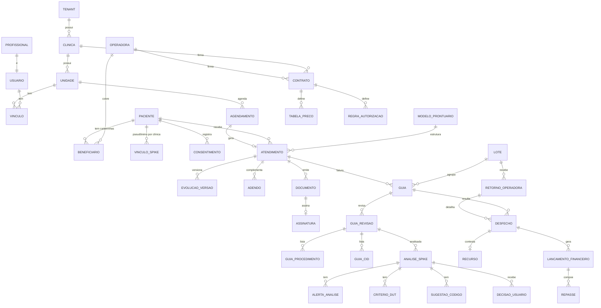

# Modelo de dados do PEP

Núcleo do §7 do design de produto, por módulo. Detalhe de colunas fica na RFC de cada módulo; aqui ficam as entidades, as relações e as regras que valem para todas.

## Convenções

| Regra | Detalhe |
| :--- | :--- |
| Chave primária | `uuid` v7 (ordenável por tempo), gerado na aplicação |
| Tenant | Toda tabela de domínio (inclusive tabelas filhas) tem `tenant_id uuid NOT NULL` com RLS forçado (`nullif(current_setting('app.tenant_id', true), '')::uuid`, RFC-PEP-000 e ADR-PEP-0017). Exceções globais: `usuarios`, tabelas de referência (TUSS, CID, operadoras). Exceção mista: `modelos` (`tenant_id IS NULL` = catálogo curado somente leitura) |
| Fronteira entre módulos | Cada módulo declara seu schema em `apps/api/src/modulos/<dominio>/schema.ts`. **Chaves estrangeiras (`REFERENCES`) só existem dentro do mesmo módulo**; referências para entidades de outro módulo são colunas `uuid` validadas na camada de serviço |
| Escopo | `clinica_id` e/ou `unidade_id` quando o dado pertence a um local |
| Tempo | `criado_em timestamptz NOT NULL DEFAULT now()`; `atualizado_em` só em tabela mutável |
| Autoria | `criado_por uuid` (usuário) em toda tabela clínica e de faturamento |
| Exclusão | Dado clínico e de faturamento **nunca** é apagado nem tem soft delete: correção = nova versão, adendo ou estorno. Cadastros usam `ativo boolean` |
| Dinheiro | `numeric(12,2)` em BRL |
| Códigos | TUSS, CID, Tabela 38 e Registro ANS como `text`, validados contra a tabela de referência vigente |
| PII | Colunas de PII direta cifradas por tenant (KMS); busca por hash (`cpf_hash`) |
| Retenção | Prontuário: mínimo 20 anos (Lei 13.787/2018) **[validar]**; faturamento: 5 anos após o pagamento **[validar]**; logs de acesso: 5 anos **[validar]** |

## Diagrama

## Entidades por módulo

| Módulo | Tabela | Colunas-chave | Tenant | PII | Retenção |
| :--- | :--- | :--- | :--- | :--- | :--- |
| organizacao | `tenants` | `nome`, `plano`, `flags` | — (raiz) | Não | Contrato |
| organizacao | `clinicas` | `cnpj`, `cnes`, `razao_social` | Sim | Não | Contrato |
| organizacao | `convites` | `email`, `perfil`, `unidade_ids`, `expira_em` (plataforma, [[RFC-PEP-018-backoffice-clinicas-e-onboarding\|RFC-PEP-018]]) | Sim | E-mail de contato | 1 ano |
| organizacao | `acessos_suporte` | `solicitante_sub`, `escopo`, `estado`, `expira_em` (plataforma) | Sim | Não | Contrato |
| organizacao | `uso_diario` | `unidade_id`, `dia`, contagens (plataforma) | Sim | Não | Contrato |
| backoffice | `auditoria_interna` | `ator_sub`, `acao`, `alvo`, `hash` ([[RFC-PEP-017-backoffice-fundacoes-e-acesso\|RFC-PEP-017]]) | — (plataforma) | Não | 5 anos **[validar]** |
| organizacao | `unidades` | `clinica_id`, `nome`, `tissia_ai_clinica_ref` (modo da IA fica em `tissia_ai_config_unidade`, RFC-PEP-005) | Sim | Não | Contrato |
| identidade | `usuarios` | `keycloak_sub`, `email`, `conselho`, `numero_conselho` | Global | Sim (profissional) | Enquanto ativo + 5 anos |
| identidade | `vinculos` | `usuario_id`, `unidade_id`, `perfil` | Sim | Não | Idem |
| pacientes | `pacientes` | `nome`, `nome_social`, `cpf_cifrado`, `cpf_hash`, `cns_cifrado`, `nascimento`, `sexo_tiss` | Sim | **Sim** | Prontuário |
| pacientes | `beneficiarios` | `paciente_id`, `registro_ans`, `carteirinha_cifrada`, `plano`, `validade`, `principal` | Sim | **Sim** | Prontuário |
| pacientes | `elegibilidades` | `beneficiario_id`, `resultado`, `motivo`, `verificado_em`, `fonte` | Sim | Não | 5 anos |
| pacientes | `consentimentos` | `paciente_id`, `finalidade`, `versao_termo`, `concedido_em`, `revogado_em` | Sim | Sim | Prontuário |
| tissia-ai | `vinculos_tissia_ai` | `tenant_id`, `tipo`, `ref`, `clinica_id`, `entidade_id_cifrado`, `sal_versao` | Sim | Liga PII ↔ pseudônimo | Prontuário |
| agenda | `agendamentos` | `unidade_id`, `profissional_id`, `sala_id`, `paciente_id`, `inicio`, `fim`, `status`, `beneficiario_id` | Sim | Indireta | 5 anos |
| agenda | `autorizacoes_previas` | `agendamento_id`, `codigo_tuss`, `status`, `senha_mascarada`, `validade` | Sim | Não | 5 anos |
| prontuario | `atendimentos` | `agendamento_id`, `paciente_id`, `profissional_id`, `modelo_versao_id`, `versao_atual`, `status`, `fechado_em` | Sim | Indireta | Prontuário |
| prontuario | `evolucao_versoes` | `atendimento_id`, `versao`, `conteudo` (jsonb SOAP/modelo), `autoria`, `texto_plano`, `hash` | Sim | Sim (clínico) | Prontuário |
| prontuario | `adendos` | `atendimento_id`, `texto`, `justificativa`, `autor_id` | Sim | Sim | Prontuário |
| modelos | `modelos`, `modelo_versoes` | `especialidade`, `versao`, `definicao` (jsonb), `status` | Misto (`NULL` = catálogo) | Não | Indefinida |
| documentos | `documentos` | `atendimento_id`, `tipo` (receita, pedido, atestado, resumo), `conteudo`, `pdf_objeto` | Sim | Sim | Prontuário |
| assinatura | `assinaturas` | `documento_id` ou `evolucao_versao_id`, `certificado_serial`, `padrao`, `assinado_em`, `trilha_revisao` | Sim | Não | Prontuário |
| faturamento | `guias` | `atendimento_id`, `tipo` (consulta, sp_sadt, internacao), `guia_ref`, `status`, `lote_id`, `revisao_atual` | Sim | Indireta | 5 anos |
| faturamento | `guia_revisoes` | `guia_id`, `numero`, `beneficiario_id`, `indicacao_clinica` (≤ 500), `origem` (médico, faturista, sistema) | Sim | Sim (clínico) | 5 anos |
| faturamento | `guia_procedimentos` | `guia_revisao_id`, `codigo_tuss`, `quantidade`, `valor_unitario` | Sim | Não | 5 anos |
| faturamento | `guia_cids` | `guia_revisao_id`, `codigo_cid`, `principal` | Sim | Não | 5 anos |
| tissia-ai | `analises_tissia_ai` | `guia_revisao_id`, `analise_id` (Spike), `versao_bases`, `risco`, `score_risco`, `degradado`, `modo` (silencioso, assistido), `latencia_ms`, `resposta` (jsonb) | Sim | Não (só refs) | 5 anos |
| tissia-ai | `alertas_analise` | `analise_spike_id`, `alerta_id`, `tipo`, `severidade`, `procedimento_tuss`, `fonte` | Sim | Não | 5 anos |
| tissia-ai | `criterios_dut` | `analise_spike_id`, `codigo_tuss`, `numero_dut`, `criterio_id`, `status`, `evidencia` | Sim | Sim (trecho literal) | 5 anos |
| tissia-ai | `sugestoes_codigo` | `analise_spike_id`, `tipo` (tuss, cid), `codigo`, `situacao`, `confianca`, `evidencia` | Sim | Sim (trecho) | 5 anos |
| tissia-ai | `decisoes_usuario` | `analise_spike_id`, `item_id`, `acao`, `texto_final`, `papel`, `usuario_id`, `enviado_spike_em` | Sim | Sim (texto final) | 5 anos |
| faturamento | `lotes` | `operadora`, `numero_lote`, `versao_tiss`, `xml_objeto`, `status`, `protocolo`, `enviado_em` | Sim | Indireta (XML) | 5 anos |
| retorno | `retornos_operadora` | `lote_id`, `xml_objeto`, `importado_em`, `versao_tiss` | Sim | Indireta | 5 anos |
| retorno | `desfechos` | `guia_id`, `retorno_id`, `status` (pago, glosado_parcial, glosado_total), `valor_cobrado`, `valor_glosado`, `codigo_glosa` (Tabela 38) | Sim | Não | 5 anos |
| retorno | `recursos` | `desfecho_id`, `prazo`, `status`, `argumento`, `evidencias` (refs) | Sim | Sim (clínico) | 5 anos |
| contratos | `contratos` | `clinica_id`, `registro_ans`, `vigencia_inicio`, `vigencia_fim`, `documento_objeto` | Sim | Não | Vigência + 5 anos |
| contratos | `tabelas_preco` | `contrato_id`, `codigo_tuss`, `valor`, `vigencia` | Sim | Não | Idem |
| contratos | `regras_autorizacao` | `contrato_id`, `codigo_tuss`, `exige_autorizacao`, `observacoes` | Sim | Não | Idem |
| financeiro | `lancamentos` | `origem` (desfecho, particular, despesa), `valor`, `competencia`, `status` | Sim | Não | 5 anos |
| financeiro | `repasses` | `profissional_id`, `competencia`, `base_recebida`, `glosas_descontadas`, `valor` | Sim | Não | 5 anos |
| auditoria | `auditoria_eventos` | `ator`, `acao`, `recurso_tipo`, `recurso_id`, `paciente_id`, `motivo`, `ip`, `ocorrido_em`, `hash_anterior`, `hash` (particionada por mês, RFC-PEP-014) | Sim | Não (só ids) | ≥ prazo do prontuário |
| comum | `outbox`, `eventos_processados` | ver RFC-PEP-000 | Sim | Não | 30 dias após publicado |

## Regras de imutabilidade

1. **Evolução:** cada salvamento gera uma linha em `evolucao_versoes` (`versao` sequencial por `atendimento_id`, `hash` do conteúdo + hash da versão anterior). `atendimentos.versao_atual` aponta para a última. Nenhum `UPDATE`/`DELETE` em `evolucao_versoes` (garantido por trigger e por `REVOKE UPDATE, DELETE` no papel `app_rw`).
2. **Atendimento fechado:** depois de `fechado_em`, a evolução só muda por **adendo** (autor, data, justificativa). Versões continuam existindo para o histórico até o fechamento.
3. **Autoria por trecho:** `evolucao_versoes.autoria` marca trechos como `humano`, `ia_sugerida` ou `ia_editada`, com referência à análise/sugestão de origem (CFM, RFC-PEP-004).
4. **Guia:** cada salvamento relevante cria `guia_revisoes` nova; procedimentos e CIDs pertencem à revisão. O `guia_ref` da Spike é `"gu_" + guias.id`, estável entre revisões, para a Spike vincular o histórico.
5. **Análise da Spike:** `analises_tissia_ai` guarda a resposta completa (`resposta` jsonb) mesmo no modo silencioso, vinculada à revisão analisada. Decisões do usuário são inserções, nunca edições.
6. **Faturamento enviado:** guia em lote enviado não muda; correção = nova guia ou recurso.

## Vínculo com a Spike

- `vinculos_tissia_ai` tem chave primária `(tenant_id, tipo, ref)`. Para pacientes, `ref = "pa_" + base32(HMAC-SHA256(paciente_id, sal_da_clinica))[0:24]` (formato dos refs em RFC-PEP-005 §mapeamento: `un_`, `pa_`, `gu_`, `at_`). O sal é por **Clínica (`clinica_id` = CNPJ controlador)** no KMS — compartilhado entre as Unidades daquela Clínica, mas distinto entre Clínicas diferentes do mesmo Tenant; `sal_versao` permite rotação (refs antigas continuam válidas para desfechos de análises antigas).
- `"un_" + unidades.id` é o `clinica_ref` enviado à Spike (uma unidade = uma clínica na Spike).
- `"gu_" + guias.id` é o `guia_ref` opaco (uuid v7), nunca o número da guia na operadora.
- Para a Spike sai apenas: `clinica_ref`, `guia_ref`, `paciente.ref`, `sexo`, `idade`, especialidade, operadora (`registro_ans`), CIDs, procedimentos, evolução do atendimento (truncada a 20.000 caracteres) e indicação clínica. Ver RFC-PEP-005.

## Auditoria "quem viu"

- Toda leitura de prontuário (atendimento, evolução, documento, anexo) grava `auditoria_eventos` (`acao = 'prontuario.visualizado'`) **de forma síncrona e fail-closed** na mesma requisição (RFC-PEP-014: falha na auditoria aborta a leitura com `503`). Para evitar contenção de lock serial entre leituras simultâneas do mesmo tenant, a inserção é append-only sem lock e o encadeamento criptográfico (`hash_anterior` / `hash`) é selado em blocos curtos a cada minuto pelo worker, com âncora diária em Object Storage com retenção bloqueada. `# ponytail:` uma linha por abertura de tela, não por campo lido.
- Revelar PII mascarada (CPF, CNS) grava `auditoria_eventos` (`cpf.revelado`) com justificativa obrigatória.
- Leitura da trilha pelo DPO também é auditada.

## Outbox

Tabela única `outbox` (RFC-PEP-000), payload só com ids e códigos. Eventos canônicos: AtendimentoFechado, EvolucaoVersionada, GuiaRascunhoCriada, GuiaRevisada, AnaliseTissiaAiConcluida, FeedbackRegistrado, GuiaAssinada, LoteGerado, LoteEnviado, RetornoImportado, DesfechoRegistrado.
