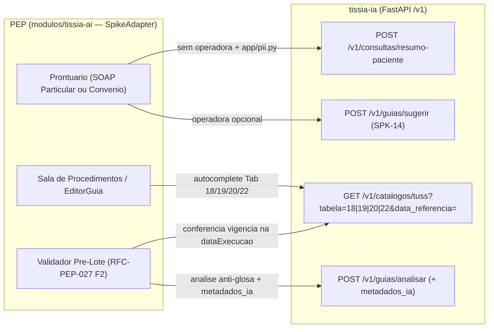

# SPK-15 — Metadados de Governança IA (CFM 2.454/2026), Resumo do Paciente via SOAP, Tabelas TUSS de Despesas/Vigência e Reforço Particular

**Status:** Proposta · **Destino:** repo `tissia-ai` · **Necessária para:** governança auditável de IA clínica ([[RFC-PEP-026-blindagem-regulatoria-autoria-sigilo-e-governanca-ia|RFC-PEP-026]] / CFM 2.454/2026 **[validar]**), geração de resumo do paciente fora da Escuta Ambiental ([[RFC-PEP-025-estacao-enfermagem-assinatura-exames-resumo-e-baixa-checkout|RFC-PEP-025]]), validação de vigência da Tabela 22 e despesas acessórias Tabelas 18/19/20 ([[RFC-PEP-027-motor-tiss-autorizacao-outras-despesas-e-cbhpm|RFC-PEP-027]]) e sugestão proativa em atendimentos particulares ([[SPK-14-sugestao-de-codigos-e-indicacao-a-partir-da-evolucao|SPK-14]])
**Relacionadas:** [[manual-integracao-tissia-ia-v1|Manual API v1]], [[mapeamento-pep-tissia-ia|Mapeamento PEP ↔ tissia-ia]], [[SPK-04-requisitos-do-scribe|SPK-04]], [[SPK-09-catalogo-tuss|SPK-09]], [[SPK-14-sugestao-de-codigos-e-indicacao-a-partir-da-evolucao|SPK-14]], [[ADR-IA-0007-minimizacao-de-dados|ADR-IA-0007]], [[ADR-IA-0008-human-in-the-loop|ADR-IA-0008]], [[ADR-IA-0010-vertex-global-e-gemini-3x|ADR-IA-0010]], [[ADR-PEP-0005-spike-adapter|ADR-PEP-0005]], [[ADR-PEP-0033-governanca-ia-cfm-2454-e-seguranca-prescricao|ADR-PEP-0033]], [[ADR-PEP-0034-motor-tiss-autorizacao-outras-despesas-e-cbhpm|ADR-PEP-0034]]

---

## 1. Problema

A auditoria conjunta do PEP e da integração `PEP` ↔ `tissia-ia`, somada às especificações da [[RFC-PEP-025-estacao-enfermagem-assinatura-exames-resumo-e-baixa-checkout|RFC-PEP-025]], [[RFC-PEP-026-blindagem-regulatoria-autoria-sigilo-e-governanca-ia|RFC-PEP-026]] e [[RFC-PEP-027-motor-tiss-autorizacao-outras-despesas-e-cbhpm|RFC-PEP-027]], revelou **4 lacunas contratuais aditivas** na API `v1` da `tissia-ia`:

1. **Ausência de metadados de rastreabilidade do modelo de IA nas respostas `/v1`:**
   - Hoje as respostas da `tissia-ia` retornam `versao_bases` e `origem_ia` (`"llm" | "local"`), mas não informam **qual modelo, versão do modelo, versão de prompt e provedor** geraram cada sugestão clínica ou de faturamento. Para atender requisitos de transparência, auditoria clínica e governança de sistemas de IA em medicina (Resolução CFM nº 2.454/2026 **[validar requisitos jurídicos finais]**), o PEP precisa persistir esses metadados junto a cada análise, estruturação, sugestão ou recurso aceito pelo médico/faturista.
2. **Impossibilidade de gerar resumo em linguagem acessível ao paciente a partir do SOAP (sem Escuta Ambiental):**
   - Atualmente o resumo ao paciente só é produzido dentro do fluxo de estruturação da Escuta Ambiental (`POST /v1/consultas/estruturar`, [[SPK-04-requisitos-do-scribe|SPK-04]]). Em consultas registradas diretamente no prontuário SOAP (sem gravação de áudio), o PEP não dispõe de rota dedicada na `tissia-ia` para gerar uma sugestão de resumo em linguagem clara para o paciente, seja em atendimento de convênio ou particular ([[RFC-PEP-025-estacao-enfermagem-assinatura-exames-resumo-e-baixa-checkout|RFC-PEP-025]], Parte 3).
3. **Catálogo TUSS sem consulta de vigência por data de referência e sem garantia de carga/campos das Tabelas 18, 19 e 20:**
   - Embora `GET /v1/catalogos/tuss` e `GET /v1/catalogos/tuss/{codigo}` (`app/api/catalogos.py`) já declarem o parâmetro `tabela` (`Literal["18", "19", "20", "22", ...]`), o filtro de vigência atual usa sempre `date.today()` (`app/catalogo.py:280,464`) e o schema de resposta (`ItemCatalogoTuss` / `DetalheCatalogoTussResponse`) não expõe `tabela`, `vigencia_inicio`, `vigencia_fim` nem `vigente_na_data`.
   - Para a [[RFC-PEP-027-motor-tiss-autorizacao-outras-despesas-e-cbhpm|RFC-PEP-027]] (F2 e F3), o PEP precisa: (a) validar se um código da Tabela 22 estava vigente na **data de execução da guia** (que pode ser retroativa), e (b) buscar códigos e termos oficiais das **Tabelas 18 (Taxas/Diárias/Gases), 19 (Materiais/OPME) e 20 (Medicamentos)** para `<ans:outrasDespesas>`.
4. **Reforço contratual para atendimento Particular na sugestão proativa (`SPK-14`):**
   - Enquanto `POST /v1/guias/sugerir` ([[SPK-14-sugestao-de-codigos-e-indicacao-a-partir-da-evolucao|SPK-14]]) não é implementado, o PEP não consegue oferecer sugestão proativa de CID/exames/indicação para pacientes particulares sem inventar `registro_ans`, nem possui `sugestao_id` + `metadados_ia` estáveis para fechar a trilha de auditoria de decisões médicas.

---

## 2. Princípios Invariantes da Proposta

Todas as adições abaixo preservam estritamente os contratos da API `v1` da `tissia-ia`:
- **100% aditivas:** nenhum campo existente é removido, renomeado ou tem seu tipo alterado; consumidores standalone da `v1` continuam operando sem quebra.
- **Entrada estrita (`extra="forbid"`):** todo novo payload Pydantic v2 rejeita chaves desconhecidas com HTTP `422`.
- **Minimização de dados e PII ([[ADR-IA-0007-minimizacao-de-dados|ADR-IA-0007]] / [[ADR-PEP-0005-spike-adapter|ADR-PEP-0005]]):** nenhuma rota aceita nome, CPF, CNS, carteirinha, telefone ou data de nascimento; todo texto livre (`evolucao_clinica`, `soap`) passa obrigatoriamente pelo scrubber `app/pii.py` antes de qualquer chamada ao LLM; nenhum corpo ou texto clínico é gravado em logs.
- **Continuidade operacional:** falha ou timeout do provedor de LLM **nunca** devolve HTTP `5xx` — responde `200 OK` com `degradado: true`.
- **Provedores permitidos ([[ADR-IA-0010-vertex-global-e-gemini-3x|ADR-IA-0010]]):** em produção, apenas Vertex AI (`VERTEX_LOCATION=global`, modelos Gemini 3.x vigentes) ou fallback determinístico `local`.
- **Headers oficiais:** autenticação `tsk_test_` / `tsk_live_` e telemetria via headers `X-Tissia-*`.

---

## 3. Especificação Aditiva na API `/v1`

### 3.1 Metadados de Governança IA (`metadados_ia`) em todas as respostas `/v1`

Adicionar o objeto opcional/aditivo `metadados_ia` nas respostas de:
- `POST /v1/guias/analisar` (`AnalisarGuiaResponse`)
- `POST /v1/guias/sugerir` ([[SPK-14-sugestao-de-codigos-e-indicacao-a-partir-da-evolucao|SPK-14]])
- `POST /v1/consultas/estruturar` (`EstruturarResponse`)
- `POST /v1/glosas/recurso/sugerir` (`GerarRecursoResponse`)
- `POST /v1/consultas/resumo-paciente` (seção 3.2 abaixo)

```json
{
  "metadados_ia": {
    "modelo": "gemini-3.0-flash",
    "versao_modelo": "gemini-3.0-flash-001",
    "versao_prompt": "justificativa-spsadt-v2.4",
    "provedor": "vertex_ai"
  }
}
```

**Contrato de campos (`MetadadosIA`):**

| Campo | Tipo | Obrigatoriedade | Descrição |
| :--- | :--- | :--- | :--- |
| `modelo` | `string` (`1..80`) | Obrigatório no objeto | Identificador lógico do modelo Gemini 3.x vigente (ou `"deterministico"` quando `provedor = "local"`) |
| `versao_modelo` | `string` (`1..120`) | Obrigatório no objeto | Versão/checkpoint exata retornada ou configurada no Vertex AI (ex.: `gemini-3.0-flash-001`, ou versão do motor local) |
| `versao_prompt` | `string` (`1..80`) | Obrigatório no objeto | Identificador semântico imutável do template de prompt em `app/prompts/` (ou `"regras-v1"` quando puramente determinístico) |
| `provedor` | `Literal["vertex_ai", "local"]` | Obrigatório no objeto | Provedor efetivamente executado; quando a chamada degradou para fallback local, retorna `"local"` |

- **Regra para pipelines multi-etapa (ex.: `/v1/guias/analisar`):** `metadados_ia` reflete o modelo/prompt principal da etapa generativa executada; opcionalmente pode incluir `etapas: Record<string, MetadadosEtapaIA>` no futuro de forma aditiva.
- **Governança regulatória (`[validar]`):** o conjunto `{ modelo, versao_modelo, versao_prompt, provedor }` somado ao `versao_bases` e à decisão humana (`aceito | editado | rejeitado` + timestamp + usuário no PEP) forma a trilha auditável para a Resolução CFM nº 2.454/2026 **[validar aderência final com jurídico]**.

---

### 3.2 Geração de Resumo para o Paciente a partir do SOAP (`POST /v1/consultas/resumo-paciente`)

Novo endpoint síncrono e aditivo em `app/api/consultas.py`, para gerar uma sugestão de resumo em linguagem simples e acolhedora para o paciente a partir da evolução SOAP já salva (sem depender de Escuta Ambiental).

#### Request (`ResumoPacienteRequest`, `extra="forbid"`)

```json
{
  "clinica_ref": "un_0196f8e2-...",
  "atendimento_ref": "at_0196f8e9-...",
  "paciente": {
    "ref": "pa_8f2a9c...",
    "sexo": "F",
    "idade": 42
  },
  "especialidade": "ortopedia",
  "soap": {
    "subjetivo": "Dor em joelho direito há 3 semanas após torção leve...",
    "objetivo": "Edema discreto, sem derrame volumoso, estabilidade ligamentar preservada...",
    "avaliacao": "Suspeita de lesão meniscal medial sem sinais de alarme agudo.",
    "plano": "Repouso relativo, crioterapia 15 min 3x/dia, analgésico conforme prescrição, retorno após exame."
  },
  "opcoes": {
    "nivel_leitura": "simples",
    "incluir_sinais_alerta": true,
    "limite_caracteres": 1500
  }
}
```

- **`operadora` deliberadamente ausente/não exigida:** suporta atendimentos **particulares** e de **convênio** indistintamente.
- **Limites de entrada:** cada campo de `soap` opcional (ao menos um não vazio), soma total de texto limitada a `20.000` caracteres e corpo HTTP até `64 KB`.
- **Scrubber obrigatório:** todo o conteúdo de `soap` passa por `app/pii.py` antes do envio ao Vertex AI.
- **Rigor clínico ([[ADR-IA-0008-human-in-the-loop|ADR-IA-0008]]):** o prompt proíbe introduzir diagnósticos, posologias, exames ou condutas que não constem no `soap` informado.

#### Response (`ResumoPacienteResponse`, HTTP `200 OK`)

```json
{
  "resumo_id": "0196f8f1-...",
  "versao_bases": "2026-09",
  "degradado": false,
  "texto": "Na consulta de hoje, avaliamos a dor no seu joelho direito após a torção recente...",
  "orientacoes_chave": [
    "Manter repouso relativo da articulação nos próximos dias",
    "Aplicar compressa de gelo por 15 minutos, 3 vezes ao dia",
    "Seguir a medicação conforme a receita entregue",
    "Agendar retorno com o resultado do exame solicitado"
  ],
  "sinais_alerta": [
    "Procure avaliação médica antes do retorno se houver piora importante da dor, inchaço acentuado ou bloqueio do joelho"
  ],
  "metadados_ia": {
    "modelo": "gemini-3.0-flash",
    "versao_modelo": "gemini-3.0-flash-001",
    "versao_prompt": "resumo-paciente-soap-v1.0",
    "provedor": "vertex_ai"
  },
  "aviso_legal": "Sugestões geradas por IA de apoio. Revisão humana obrigatória antes da entrega ao paciente."
}
```

- **Comportamento em falha/timeout do LLM:** retorna `200 OK` com `degradado: true`, `texto: ""`, `orientacoes_chave: []`, `sinais_alerta: []`, `metadados_ia: { modelo: "deterministico", versao_modelo: "fallback-v1", versao_prompt: "sem-ia", provedor: "local" }`. Nunca retorna `5xx`.
- **Feedback humano opcional (aditivo):** `POST /v1/consultas/resumos/{resumo_id}/feedback` com `{ acao: "aceito" | "editado" | "rejeitado", texto_final?: string }` para mensurar taxa de aceite e qualidade clínica.
- **Latência-alvo:** `p95 <= 4 s` (PEP chama com timeout de `6 s`, [[ADR-PEP-0005-spike-adapter|ADR-PEP-0005]]).

---

### 3.3 Extensão do Catálogo TUSS (`/v1/catalogos/tuss` — Tabelas 18/19/20 e Vigência por Data)

Evolução estritamente aditiva sobre [[SPK-09-catalogo-tuss|SPK-09]] (`app/api/catalogos.py` e `app/catalogo.py`):

#### Query parameters aditivos

| Rota | Parâmetro | Tipo / Default | Comportamento |
| :--- | :--- | :--- | :--- |
| `GET /v1/catalogos/tuss` | `tabela` | `'22' \| '18' \| '19' \| '20'` (padrão `'22'`) | Mantém compatibilidade com os demais valores já existentes no enum interno; garante ingestão completa e validada em `data/MANIFEST.yaml` das Tabelas **18** (Taxas/Diárias/Gases), **19** (Materiais/OPME) e **20** (Medicamentos) |
| `GET /v1/catalogos/tuss` e `GET /v1/catalogos/tuss/{codigo}` | `data_referencia` | `YYYY-MM-DD` (opcional; default = data atual em `America/Sao_Paulo`) | Avalia a vigência do código na data informada (`inicio_vigencia <= data_referencia AND (fim_vigencia IS NULL OR fim_vigencia >= data_referencia)`), suportando conferência retroativa na data de execução da guia |
| `GET /v1/catalogos/tuss/{codigo}` | `incluir_nao_vigentes` | `bool` (opcional; default `false`) | Quando `true`, em vez de responder `404` para um código que existe na base mas venceu antes da `data_referencia`, retorna `200 OK` com `vigente_na_data: false`, `vigencia_inicio` e `vigencia_fim` — permitindo ao PEP exibir mensagem precisa ao faturista (*"Código TUSS encerrado em AAAA-MM-DD"*) |

#### Campos aditivos nas respostas (`ItemCatalogoTuss` e `DetalheCatalogoTussResponse`)

```json
{
  "codigo_tuss": "<TUSS_EXEMPLO>",
  "tabela": "19",
  "termo": "Descrição oficial ANS do item",
  "grupo": "Materiais e OPME",
  "tem_dut": false,
  "vigencia_inicio": "2021-04-01",
  "vigencia_fim": null,
  "vigente_na_data": true,
  "unidade_medida_padrao": "UN",
  "versao_bases": "2026-09"
}
```

- **Proveniência obrigatória:** todos os arquivos das Tabelas TUSS 18, 19, 20 e 22 devem constar em `data/MANIFEST.yaml` com SHA-256 validado no startup da `tissia-ia`. Nenhum código pode ser inventado ou sintetizado.
- **Desempenho esperado:** consulta determinística em banco (`CatalogoTuss` com índice composto `(tabela, codigo_tuss)` e trigram no termo), `p95 <= 80 ms`.

---

### 3.4 Reforço Contratual para Atendimento Particular em `POST /v1/guias/sugerir` (SPK-14)

Confirma e complementa a [[SPK-14-sugestao-de-codigos-e-indicacao-a-partir-da-evolucao|SPK-14]] com os requisitos de governança e auditoria do PEP:

1. **`operadora` estritamente opcional:** `operadora: OperadoraInput | None = None`. Quando omitida (atendimento particular), a `tissia-ia` executa normalmente a extração de CID-10, sugestão de exames/procedimentos da Tabela 22 e redação da indicação clínica sem exigir `registro_ans`.
2. **`sugestao_id` garantido + `metadados_ia` obrigatório na resposta:** toda resposta `200 OK` de `/v1/guias/sugerir` retorna `sugestao_id` (UUID v4/v7 persistido na tabela `sugestoes` da `tissia-ia`) e `metadados_ia` (seção 3.1), permitindo ao PEP vincular cada aceite/edição/rejeição do médico (`POST /v1/guias/sugerir/{sugestao_id}/feedback`) à versão exata do modelo e do prompt.
3. **Sem efeito colateral em `analises`:** chamadas a `/v1/guias/sugerir` nunca criam linha na tabela `analises` e nunca consomem cota de análise anti-glosa de guia.

---

## 4. Fluxo de Integração `PEP` ↔ `tissia-ia`



---

## 5. Impacto no PEP (`apps/api/src/modulos/tissia-ai/` e `@pep/contracts`)

- **Isolamento preservado ([[ADR-PEP-0005-spike-adapter|ADR-PEP-0005]]):** apenas `apps/api/src/modulos/tissia-ai/` conhece as novas rotas e campos; os módulos `prontuario`, `documentos` e `faturamento` consomem métodos tipados do `TissiaAiService` / `CatalogoService`.
- **Persistência de `metadados_ia` no PEP:** salvar `{ modelo, versao_modelo, versao_prompt, provedor }` nas tabelas de trilha do PEP (`analises_tissia_ai`, `sessoes_escuta`, `recursos` e tabela de trilha de sugestões/resumos da `RFC-PEP-025`/`026`) com tolerância a `null` enquanto a `tissia-ia` ainda estiver em rollout.
- **Resumo do paciente (`RFC-PEP-025`):** `POST /api/v1/atendimentos/:id/documentos/resumo-sugestao` lê a última versão do SOAP no servidor (nunca aceita texto arbitrário do browser), envia apenas `clinica_ref`, `atendimento_ref`, `paciente` minimizado e `soap` para `POST /v1/consultas/resumo-paciente`, e degrada silenciosamente para edição manual se `degradado: true` ou timeout > 6 s.
- **Catálogo multi-tabela e vigência (`RFC-PEP-027`):** `CatalogoService` amplia o cache em memória para chave `(tabela, q_ou_codigo, data_referencia, versao_bases)`. Em caso de indisponibilidade da `tissia-ia`, mantém fallback seguro sem bloquear o atendimento ou faturamento.

---

## 6. Critérios de Aceite e Verificação

- [ ] **Snapshot OpenAPI:** `projetos/tissia-ia/tests/snapshots/openapi_v1.json` atualizado de forma 100% aditiva, sem breaking changes nos schemas existentes.
- [ ] **Metadados CFM:** testes automatizados confirmam presença e formato de `metadados_ia` em `/v1/guias/analisar`, `/v1/guias/sugerir`, `/v1/consultas/estruturar`, `/v1/glosas/recurso/sugerir` e `/v1/consultas/resumo-paciente` (tanto no caminho `vertex_ai` quanto em degradação `local`).
- [ ] **Resumo SOAP:** `POST /v1/consultas/resumo-paciente` aceita particular e convênio (sem `operadora`), aplica `app/pii.py`, rejeita campos extras com `422`, e retorna `200 OK` com `degradado: true` quando o LLM falha ou excede timeout.
- [ ] **Tabelas TUSS 18/19/20 e Vigência:** `GET /v1/catalogos/tuss?tabela=19` e `tabela=20` retornam itens reais carregados de `data/` (SHA-256 verificado no `MANIFEST.yaml`); `GET /v1/catalogos/tuss/{codigo}?data_referencia=...&incluir_nao_vigentes=true` distingue corretamente código vigente de código encerrado na data de execução.
- [ ] **Particular na SPK-14:** `POST /v1/guias/sugerir` sem campo `operadora` retorna `sugestao_id`, `metadados_ia`, CIDs, TUSS e indicação clínica sem criar registro em `analises`.
- [ ] **Zero PII em logs:** suíte de testes de privacidade valida que nenhum texto de `soap`, nome ou CPF aparece nos logs estruturados da `tissia-ia`.

---

## 7. Decisões a Tomar (time `tissia-ia`)

1. **Tabelas TUSS 18/19/20 em `data/`:** confirmar o tamanho dos arquivos oficiais da ANS (especialmente Tabela 19 — Materiais/OPME e Tabela 20 — Medicamentos, que têm dezenas de milhares de linhas) e garantir que a ingestão em `CatalogoTuss` use apenas busca léxica/trigram (sem necessidade de gerar embeddings `pgvector` para 18/19/20 na primeira entrega, reduzindo custo e tempo de carga).
2. **Tabela de persistência de resumos (`resumos_paciente`):** definir se o histórico técnico do `resumo_id` (sem armazenar texto clínico cru pós-resposta, apenas hashes/métricas/metadados ou seguindo a mesma política de retenção de `estruturacoes`) fica em tabela dedicada ou reutiliza o mecanismo de `estruturacoes`.
3. **Detalhe de `metadados_ia` em pipelines compostos:** confirmar se `metadados_ia` único no topo basta para a primeira versão de conformidade CFM 2.454/2026 **[validar]** ou se também exporemos `metadados_por_etapa` já nesta entrega.
