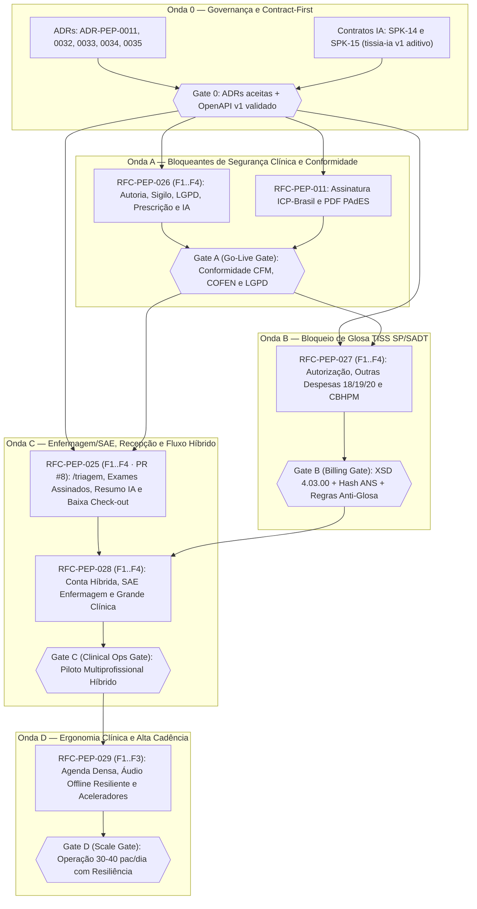

# Auditoria Clínica, Regulatória, TISS e UX do PEP Tissia — 2026-11

**Data da auditoria:** 21/11/2026 · **Escopo:** `projetos/PEP` (`@pep/api`, `@pep/ui`, `@pep/contracts`, worker e integrações com `tissia-ia`) · **Classificação de prontidão para produção:** **`CRÍTICO` (Não apto a Go-Live assistencial/faturamento real sem execução das Ondas 0, A e B)**

> **Contexto documental:** Este documento consolida os achados técnicos verificados diretamente no código-fonte de `projetos/PEP` em 21/11/2026, estabelece a matriz completa de rastreabilidade até as ADRs, RFCs e propostas de contrato `SPK-*`, e define o sequenciamento em ondas com *gates* objetivos de saída para entrada em piloto clínico real.

---

## 1. Resumo Executivo da Auditoria (21/11/2026)

### 1.1 Veredito de Maturidade

O PEP Tissia alcançou uma **fundação arquitetural sólida** nos aspectos de isolamento multi-tenant via PostgreSQL RLS (`ADR-PEP-0003` / `ADR-PEP-0017`), modularidade do monorepo (`ADR-PEP-0018`), validação estrutural XSD TISS 4.03.00 e separação conceitual entre `PEP` e `tissia-ia` (`ADR-PEP-0005`).

Contudo, a inspeção linha a linha do código-fonte revelou **lacunas estruturais bloqueantes** para operação real em clínica ou policlínica brasileira, resultando no veredito global **`CRÍTICO`** para entrada em produção assistencial e faturamento real:

- **Sem assinatura digital ICP-Brasil ativa:** `assinatura.module.ts` é um módulo vazio; documentos clínicos são marcados como `assinado` apenas por uma coluna booleana/enum no banco, e impressões saem via `window.print()` sem CRM/UF/RQE, dados da unidade (CNPJ/CNES) nem selo criptográfico verificável.
- **Brechas de autoria, sigilo médico e governança de IA:** não há validação estrita de autoria em operações de prontuário/fechamento, profissionais podem autodeclarar CRM/COREN/CBO sem verificação, a triagem sobrescreve o registro anterior via `onConflictDoUpdate` (perdendo histórico e autoria), recursos de glosa anexam texto integral da evolução clínica em PDF artesanal corrompido para acentuação, o painel LGPD exibe contadores fictícios e a escuta ambiental usa modelo clínico hardcoded (`MODELO_ORTOPEDIA_JOELHO`) sem metadados de governança de IA.
- **Risco elevado de glosa no TISS SP/SADT:** o gerador XML fixa `codigoTabela = '22'` e `reducaoAcrescimo = '1.00'`, omite `<ans:dadosAutorizacao>`, `<ans:outrasDespesas>` (tabelas 18/19/20) e regras CBHPM (via de acesso, técnica, porte/UCO), trata ausência de senha apenas como aviso e usa prazo de envio hardcoded em 4 dias.
- **Impossibilidade de fluxo híbrido e operação de clínica média/grande:** o financeiro proíbe recebimento particular em atendimentos de convênio (inviabilizando coparticipação/procedimento avulso na mesma consulta), a triagem é limitada a um drawer com checkboxes booleanos sem SAE/COFEN e a agenda com slots de `160px` não escala para 30–40 pacientes/dia.

### 1.2 Síntese dos 4 Pilares Inspecionados

| Pilar | Severidade | Pontos Fortes Verificados | Principais Bloqueios Identificados |
| :--- | :---: | :--- | :--- |
| **1. Conformidade CFM × COFEN × LGPD** | **`CRÍTICO`** | RLS com `Db.comTenant`, imutabilidade de evoluções por versionamento/adendo (`ADR-PEP-0007`), pseudonimização na fronteira da IA (`ADR-PEP-0005`) | Assinatura ICP-Brasil inexistente (`assinatura.module.ts` vazio); autodeclaração livre de CRM/COREN; sobrescrita de triagem sem trilha/autoria; exposição de evolução integral em ZIP de glosa; check-out com acesso amplo a documento clínico; painel LGPD ilustrativo; governança de IA sem metadados de modelo/prompt/versão |
| **2. Fluxo Híbrido & Grande Clínica** | **`ALTO`** | Separação inicial de papéis triagem/check-out (`ADR-PEP-0031`) e pedido externo vs. execução local (`ADR-PEP-0030`) | Bloqueio explícito de recebimento particular em atendimento de convênio (`financeiro.service.ts:422-423`); precificação particular considera apenas 1 item (`LIMIT 1`); agenda sem múltiplos recursos/etapas; enfermagem sem estação dedicada e sem Processo de Enfermagem (SAE); check-out sem baixa explícita |
| **3. Faturamento TISS SP/SADT & Glosas** | **`CRÍTICO`** | Motor XML TISS 4.03.00 validado contra XSD local e separação consulta vs. SP/SADT (`ADR-PEP-0029`) | Ausência de `<ans:dadosAutorizacao>` (senha/validade), `<ans:outrasDespesas>` (tabelas 18/19/20) e regras CBHPM (`viaAcesso`, `tecnicaUtilizada`, `reducaoAcrescimo`); `prazoEnvioDias` fixo em `4`; `carater` fixo em `'eletivo'`; ausência de senha só gera aviso; PDF de recurso artesanal truncado e sem UTF-8 |
| **4. UX Clínica & Ergonomia (30–40 pac/dia)** | **`ALTO`** | Editor SOAP fluido, atalhos de teclado na escuta (`P`/`M`), estrutura de componentes padronizada (`@pep/ui`) | Grade da agenda com `ALTURA_LINHA = 160` px (baixa densidade); `filaAudioOffline` em IndexedDB desconectada de `Voz.tsx` (perda de áudio em oscilação de rede); `Atendimento.tsx` não recarrega ao trocar de ID na mesma instância; `Prontuario.tsx` exibe hora agendada como hora de chegada; `Layout.tsx` com `"Unidade Centro"` fixo e botão de ajuda inoperante; agendamento sem autocomplete TUSS nem cadastro rápido |

---

## 2. Matriz Completa de Rastreabilidade

> **Convenções:**
> - **Severidade:** `CRÍTICO` (bloqueia Go-Live assistencial/faturamento), `ALTO` (compromete operação real ou gera glosa/retrabalho severo), `MÉDIO` (degrada cadência clínica ou governança operacional).
> - **Normas:** referências regulatórias marcadas com `**[validar]**` exigem conferência jurídica final com o conselho/assessoria antes da homologação comercial.
> - Os destinos técnicos em `RFC-PEP-026..029`, `ADR-PEP-0032..0035` e `SPK-15` compõem o pacote de especificação pós-auditoria na mesma branch documental; a `RFC-PEP-025` corresponde à fatia imediata já aberta (PR #8).

| ID | Pilar | Severidade | Achado Técnico | Evidência no Código (`projetos/PEP`) | Norma / Risco | Destino Técnico | Onda |
| :--- | :--- | :---: | :--- | :--- | :--- | :--- | :---: |
| **AUD-01** | Conformidade | `CRÍTICO` | Rota `/atendimento/:id` protegida no roteador cliente apenas por `<RequerSessao>`, sem guarda declarativa de permissão (`prontuario:ler` / `prontuario:escrever`) por perfil | `apps/ui/src/App.tsx:132` | LGPD Art. 46 (menor privilégio) e sigilo médico (CEM Art. 73) **[validar]**; exposição indevida de tela clínica a perfis administrativos | [[RFC-PEP-026-blindagem-regulatoria-autoria-sigilo-e-governanca-ia\|RFC-PEP-026]] · [[ADR-PEP-0032-autoria-clinica-sigilo-e-trilha-selada-obrigatoria\|ADR-PEP-0032]] | **Onda A** |
| **AUD-02** | Conformidade / UX | `ALTO` | `carregou = useRef(false)` carrega a evolução apenas uma única vez por montagem do componente; trocar `:id` na rota reutiliza conteúdo do paciente anterior ou bloqueia sincronização concorrente | `apps/ui/src/pages/Atendimento.tsx:135-146` | Segurança do paciente (risco grave de contaminação cruzada de prontuário entre pacientes consecutivos) | [[RFC-PEP-026-blindagem-regulatoria-autoria-sigilo-e-governanca-ia\|RFC-PEP-026]] · [[RFC-PEP-029-ergonomia-clinica-resiliencia-e-aceleradores-produtividade\|RFC-PEP-029]] | **Onda A / D** |
| **AUD-03** | Conformidade | `CRÍTICO` | Checagem `conflitosAlergia` faz apenas busca por substring simples (`includes`) entre texto livre de alergia e nome/princípio ativo, sem classe terapêutica, reatividade cruzada, interações medicamentosas ou dose | `packages/contracts/src/documentos.ts:114-120` | Segurança do paciente (evento adverso grave por falso negativo, ex.: alergia a `"Penicilina"` vs. `"Amoxicilina"`) e responsabilidade técnica médica | [[RFC-PEP-026-blindagem-regulatoria-autoria-sigilo-e-governanca-ia\|RFC-PEP-026]] · [[ADR-PEP-0033-governanca-ia-cfm-2454-e-seguranca-prescricao\|ADR-PEP-0033]] | **Onda A** |
| **AUD-04** | Conformidade | `CRÍTICO` | Fluxo de assinatura e finalização em `Documentos.tsx` dispara assinatura sem desafio criptográfico/ICP-Brasil, bloqueia alergia apenas por substring sem política de override justificado, não diferencia receita controlada/antimicrobianos e não assina pedidos de exame | `apps/ui/src/pages/Documentos.tsx:240-267`, `apps/ui/src/pages/Documentos.tsx:510-529` | Lei 14.063/2020, Portaria SVS/MS 344/1998, RDC Anvisa 471/2021 e Resolução CFM 2.299/2021 **[validar]**; invalidade jurídica da receita eletrônica | [[RFC-PEP-011-assinatura-icp-brasil\|RFC-PEP-011]] · [[ADR-PEP-0011-assinatura-icp-brasil\|ADR-PEP-0011]] · [[RFC-PEP-025-estacao-enfermagem-assinatura-exames-resumo-e-baixa-checkout\|RFC-PEP-025]] · [[RFC-PEP-026-blindagem-regulatoria-autoria-sigilo-e-governanca-ia\|RFC-PEP-026]] · [[ADR-PEP-0033-governanca-ia-cfm-2454-e-seguranca-prescricao\|ADR-PEP-0033]] | **Onda A / C** |
| **AUD-05** | Conformidade | `CRÍTICO` | `carregar()` não valida autoria (`a.profissionalId === ctx.usuarioId`) nem delegação explícita; `fechar()` encerra atendimento sem selo de integridade/assinatura qualificada e sem registrar hash imutável de autoria + conselho vigente | `apps/api/src/modulos/prontuario/prontuario.service.ts:117-122`, `apps/api/src/modulos/prontuario/prontuario.service.ts:433-495` | Resolução CFM 1.821/2007 (NGS2 / integridade e autoria) e CFM 1.638/2002 **[validar]**; risco de alteração/fechamento de prontuário por terceiro | [[RFC-PEP-026-blindagem-regulatoria-autoria-sigilo-e-governanca-ia\|RFC-PEP-026]] · [[ADR-PEP-0032-autoria-clinica-sigilo-e-trilha-selada-obrigatoria\|ADR-PEP-0032]] · [[RFC-PEP-011-assinatura-icp-brasil\|RFC-PEP-011]] | **Onda A** |
| **AUD-06** | Conformidade | `CRÍTICO` | `documentos.service.ts` apenas grava `status = 'assinado'` sem assinatura ICP-Brasil, sem validar CRM ativo do signatário e expondo payload integral do documento assinado em `obterParaImpressaoCheckout` sem controle de sigilo/PDF selado | `apps/api/src/modulos/documentos/documentos.service.ts:52-131`, `apps/api/src/modulos/documentos/documentos.service.ts:242-273` | Lei 14.063/2020, CFM 2.299/2021 **[validar]** e LGPD Art. 11 (dados sensíveis de saúde); documento sem validade legal e risco de vazamento no balcão | [[RFC-PEP-011-assinatura-icp-brasil\|RFC-PEP-011]] · [[ADR-PEP-0011-assinatura-icp-brasil\|ADR-PEP-0011]] · [[RFC-PEP-026-blindagem-regulatoria-autoria-sigilo-e-governanca-ia\|RFC-PEP-026]] · [[ADR-PEP-0032-autoria-clinica-sigilo-e-trilha-selada-obrigatoria\|ADR-PEP-0032]] | **Onda A** |
| **AUD-07** | Conformidade | `CRÍTICO` | Impressão clínica depende de `window.print()` em HTML sem identificação completa do estabelecimento (CNPJ, CNES, endereço), sem CRM/UF/RQE do médico, sem QR Code/URL de validação e sem assinatura digital embutida (PAdES) | `apps/ui/src/pages/documentos/FolhaDocumentoImpressao.tsx:28-90` | Resolução CFM 2.299/2021 e validação de prescrição em farmácias (ITI/VIDaaS/Portal de Validação) **[validar]**; recusa em farmácias e auditorias | [[RFC-PEP-011-assinatura-icp-brasil\|RFC-PEP-011]] · [[RFC-PEP-025-estacao-enfermagem-assinatura-exames-resumo-e-baixa-checkout\|RFC-PEP-025]] · [[RFC-PEP-026-blindagem-regulatoria-autoria-sigilo-e-governanca-ia\|RFC-PEP-026]] | **Onda A / C** |
| **AUD-08** | Conformidade | `CRÍTICO` | Módulo `AssinaturaModule` está completamente vazio (`@Module({})`), confirmando ausência total do motor de assinatura ICP-Brasil no runtime | `apps/api/src/modulos/assinatura/assinatura.module.ts` | CFM 1.821/2007 e Lei 14.063/2020 **[validar]**; ausência de validade jurídica de documentos digitais e prontuário sem papel | [[RFC-PEP-011-assinatura-icp-brasil\|RFC-PEP-011]] · [[ADR-PEP-0011-assinatura-icp-brasil\|ADR-PEP-0011]] | **Onda A** |
| **AUD-09** | Conformidade / Operação | `ALTO` | `worker-runtime.ts` não registra consumidores para selagem/carimbo de tempo/assinatura assíncrona, trilha selada de auditoria/expurgo LGPD nem reconciliação assíncrona de autorizações TISS | `apps/api/src/worker-runtime.ts:34-46` | LGPD Art. 15–16 (término de tratamento/expurgo) e CFM 1.821/2007 **[validar]**; ausência de garantias assíncronas de integridade e retenção | [[RFC-PEP-026-blindagem-regulatoria-autoria-sigilo-e-governanca-ia\|RFC-PEP-026]] · [[RFC-PEP-011-assinatura-icp-brasil\|RFC-PEP-011]] · [[RFC-PEP-027-motor-tiss-autorizacao-outras-despesas-e-cbhpm\|RFC-PEP-027]] | **Onda A / B** |
| **AUD-10** | Conformidade | `CRÍTICO` | `GET checkout/documentos/:documentoId/impressao` exige apenas `@RequerPermissao('agenda:ler')`, permitindo a qualquer usuário com leitura de agenda baixar conteúdo estruturado de documentos clínicos sem permissão granular de check-out nem controle de via impressa | `apps/api/src/modulos/documentos/checkout.controller.ts:33-38` | LGPD Art. 6º III (necessidade) e CEM Art. 73 (sigilo profissional) **[validar]**; violação de escopo mínimo no balcão | [[RFC-PEP-026-blindagem-regulatoria-autoria-sigilo-e-governanca-ia\|RFC-PEP-026]] · [[ADR-PEP-0032-autoria-clinica-sigilo-e-trilha-selada-obrigatoria\|ADR-PEP-0032]] · [[RFC-PEP-025-estacao-enfermagem-assinatura-exames-resumo-e-baixa-checkout\|RFC-PEP-025]] | **Onda A / C** |
| **AUD-11** | Conformidade / Glosas | `CRÍTICO` | `gerarPdfSimples` gera PDF 1.4 artesanal sem suporte UTF-8 (quebra acentos pt-BR e trunca em 48 linhas × 95 caracteres) e `gerarPacoteLote` inclui a evolução clínica integral (`evolucao.textoPlano`) no ZIP enviado à operadora sem recorte mínimo/mascaramento nem aceite médico | `apps/api/src/modulos/retorno/glosas.service.ts:64-93`, `apps/api/src/modulos/retorno/glosas.service.ts:800-854` | LGPD Art. 6º III / Art. 11, Resolução CFM 1.614/2001 (auditoria médica / sigilo) **[validar]** e indeferimento de recurso por documento ilegível/truncado | [[RFC-PEP-026-blindagem-regulatoria-autoria-sigilo-e-governanca-ia\|RFC-PEP-026]] · [[ADR-PEP-0032-autoria-clinica-sigilo-e-trilha-selada-obrigatoria\|ADR-PEP-0032]] · [[RFC-PEP-027-motor-tiss-autorizacao-outras-despesas-e-cbhpm\|RFC-PEP-027]] | **Onda A / B** |
| **AUD-12** | Conformidade | `ALTO` | `GET /api/v1/lotes/:id/xml` permite download de lote TISS contendo dados de beneficiários apenas com `guias:ler` sem registrar evento na trilha de auditoria de exportação nem segregar permissão de exportação | `apps/api/src/modulos/faturamento/lotes.controller.ts:57-58` | LGPD Art. 37 e Art. 48 (rastreabilidade de acesso/exportação de dados pessoais sensíveis em lote) | [[RFC-PEP-026-blindagem-regulatoria-autoria-sigilo-e-governanca-ia\|RFC-PEP-026]] · [[ADR-PEP-0032-autoria-clinica-sigilo-e-trilha-selada-obrigatoria\|ADR-PEP-0032]] | **Onda A** |
| **AUD-13** | Conformidade | `CRÍTICO` | `PUT /api/v1/me/dados-profissionais` com `@RequerPermissao()` vazio permite que qualquer usuário autenticado autodeclare ou altere livremente conselho (CRM/COREN), número, UF e CBO sem validação administrativa ou auditoria | `apps/api/src/modulos/identidade/identidade.controller.ts:98-118` | Risco de exercício irregular/falsidade ideológica em guias TISS e receitas médicas (CFM/COFEN/ANS); glosa por divergência cadastral | [[RFC-PEP-026-blindagem-regulatoria-autoria-sigilo-e-governanca-ia\|RFC-PEP-026]] · [[ADR-PEP-0032-autoria-clinica-sigilo-e-trilha-selada-obrigatoria\|ADR-PEP-0032]] | **Onda A** |
| **AUD-14** | Conformidade | `ALTO` | `criarVinculo` cria vínculos clínicos (`medico`, `enfermagem`) sem exigir conselho profissional validado, sem registrar `auditoria.registrar` e sem checar governança de acumulação de perfis | `apps/api/src/modulos/identidade/identidade.service.ts:191-215` | Segregação de funções, rastreabilidade administrativa (LGPD Art. 37) e conformidade CFM/COFEN para habilitação assistencial | [[RFC-PEP-026-blindagem-regulatoria-autoria-sigilo-e-governanca-ia\|RFC-PEP-026]] · [[ADR-PEP-0032-autoria-clinica-sigilo-e-trilha-selada-obrigatoria\|ADR-PEP-0032]] | **Onda A** |
| **AUD-15** | Conformidade / Enfermagem | `CRÍTICO` | `triagem.service.ts` usa `onConflictDoUpdate` sobre `triagens.agendamentoId`, sobrescrevendo sinais vitais, queixa e `autorId` sem versionamento nem adendo, destruindo autoria e histórico assistencial da enfermagem | `apps/api/src/modulos/triagem/triagem.service.ts:91-101` | Resolução COFEN 736/2024 (Processo de Enfermagem / SAE) e Resolução COFEN 429/2012 (registro em prontuário) **[validar]**; quebra de imutabilidade clínica (`ADR-PEP-0007`) | [[RFC-PEP-026-blindagem-regulatoria-autoria-sigilo-e-governanca-ia\|RFC-PEP-026]] · [[ADR-PEP-0032-autoria-clinica-sigilo-e-trilha-selada-obrigatoria\|ADR-PEP-0032]] · [[RFC-PEP-028-jornada-hibrida-grande-clinica-e-sae-enfermagem\|RFC-PEP-028]] · [[ADR-PEP-0035-conta-hibrida-por-item-e-processo-enfermagem-sae\|ADR-PEP-0035]] | **Onda A / C** |
| **AUD-16** | Conformidade / IA | `CRÍTICO` | `escuta.service.ts` acopla `MODELO_ORTOPEDIA_JOELHO` hardcoded na estruturação SOAP e não persiste metadados de governança de IA (modelo, versão do prompt, `estruturacaoId`, confiança, aviso de apoio à decisão e consentimento vinculado) | `apps/api/src/modulos/prontuario/escuta.service.ts:67-225` | Resolução CFM 2.454/2026 (governança de IA em medicina) **[validar]** e LGPD Art. 20 (transparência); inutilizável fora de ortopedia de joelho | [[RFC-PEP-026-blindagem-regulatoria-autoria-sigilo-e-governanca-ia\|RFC-PEP-026]] · [[ADR-PEP-0033-governanca-ia-cfm-2454-e-seguranca-prescricao\|ADR-PEP-0033]] · [[SPK-14-sugestao-de-codigos-e-indicacao-a-partir-da-evolucao\|SPK-14]] · [[SPK-15-metadados-modelo-resumo-soap-e-tabelas-tuss-despesas\|SPK-15]] | **Onda 0 / A** |
| **AUD-17** | UX / Conformidade | `ALTO` | `Voz.tsx` envia chunks em cadeia de Promises em memória (`fila.current`) descartando áudio em caso de erro de rede (só dispara `toast.error`), mantém fluxo de consulta exemplo na tela clínica e não exibe metadados de modelo IA / estado de consentimento na revisão | `apps/ui/src/pages/Voz.tsx:49-57`, `apps/ui/src/pages/Voz.tsx:122-225` | Perda de registro assistencial em oscilação de rede; transparência de uso de IA (CFM 2.454/2026 **[validar]**) e erro operacional por texto demo em produção | [[RFC-PEP-026-blindagem-regulatoria-autoria-sigilo-e-governanca-ia\|RFC-PEP-026]] · [[RFC-PEP-029-ergonomia-clinica-resiliencia-e-aceleradores-produtividade\|RFC-PEP-029]] | **Onda A / D** |
| **AUD-18** | TISS / Faturamento | `CRÍTICO` | `lote-xml.ts` fixa `codigoTabela = '22'` e `reducaoAcrescimo = '1.00'`, não gera `<ans:dadosAutorizacao>` (senha/validade/nº guia operadora), não gera `<ans:outrasDespesas>` (tabelas TUSS 18/19/20), omite `<ans:viaAcesso>` / `<ans:tecnicaUtilizada>` e possui `hashTiss` pendente de conferência oficial ANS | `apps/api/src/modulos/faturamento/lote-xml.ts:50-115` | Padrão TISS 4.03.00 (ANS RN 501/2022 **[validar]**); glosa automática em procedimentos com senha, cirurgias múltiplas/CBHPM, materiais/medicamentos e taxas de sala | [[RFC-PEP-027-motor-tiss-autorizacao-outras-despesas-e-cbhpm\|RFC-PEP-027]] · [[ADR-PEP-0034-motor-tiss-autorizacao-outras-despesas-e-cbhpm\|ADR-PEP-0034]] · [[SPK-15-metadados-modelo-resumo-soap-e-tabelas-tuss-despesas\|SPK-15]] | **Onda 0 / B** |
| **AUD-19** | TISS / Faturamento | `CRÍTICO` | `faturamento.service.ts` fixa `prazoEnvioDias = 4` (ignora prazo contratual da operadora), assume `carater = 'eletivo'` hardcoded na checagem de autorização prévia, emite apenas `severidade: 'aviso'` quando falta senha obrigatória e usa `onConflictDoNothing` em `(atendimentoId, tipo)` | `apps/api/src/modulos/faturamento/faturamento.service.ts:275`, `apps/api/src/modulos/faturamento/faturamento.service.ts:444-456` | Glosa por ausência de autorização prévia (código de glosa por falta de senha), perda de prazo contratual de faturamento e risco de não geração de guia adicional | [[RFC-PEP-027-motor-tiss-autorizacao-outras-despesas-e-cbhpm\|RFC-PEP-027]] · [[ADR-PEP-0034-motor-tiss-autorizacao-outras-despesas-e-cbhpm\|ADR-PEP-0034]] | **Onda B** |
| **AUD-20** | TISS / Faturamento | `ALTO` | `validarGuiaLocal` valida obrigatoriedade/formato básicos, mas não checa regras de autorização prévia bloqueante, compatibilidade CBO × TUSS, excludentes, itens de `outrasDespesas` (tabelas 18/19/20) nem regras de via de acesso/percentual CBHPM | `packages/contracts/src/validacao-guia.ts:131-215` | Padrão TISS 4.03.00; envio de lote sintaticamente válido no XSD porém glosado no mérito/regra de negócio pela operadora | [[RFC-PEP-027-motor-tiss-autorizacao-outras-despesas-e-cbhpm\|RFC-PEP-027]] · [[ADR-PEP-0034-motor-tiss-autorizacao-outras-despesas-e-cbhpm\|ADR-PEP-0034]] | **Onda B** |
| **AUD-21** | TISS / Contratos | `ALTO` | `contratos.service.ts` aplica apenas valor unitário fixo por código TUSS em `precos_faturamento`, sem suporte a tabela CBHPM (porte, UCO, filme, banda/deflator), regras de via de acesso (50%/70%/100%), tabelas de materiais/medicamentos (Brasíndice/Simpro) nem prazos contratuais propagados ao faturamento | `apps/api/src/modulos/contratos/contratos.service.ts:979-1038` | Subfaturamento ou glosa por divergência de tabela contratada (especialmente procedimentos cirúrgicos, infiltrações, curativos e exames com contraste) | [[RFC-PEP-027-motor-tiss-autorizacao-outras-despesas-e-cbhpm\|RFC-PEP-027]] · [[ADR-PEP-0034-motor-tiss-autorizacao-outras-despesas-e-cbhpm\|ADR-PEP-0034]] | **Onda B** |
| **AUD-22** | Fluxo Híbrido / Financeiro | `CRÍTICO` | `garantirRecebivelParticular` precifica o atendimento usando apenas 1 código (`LIMIT 1` em `pedidos_exame` ou agendamento) e `registrarRecebimento` lança erro 422 se `atend.convenio === true`, impedindo qualquer cobrança particular/coparticipação no mesmo atendimento | `apps/api/src/modulos/financeiro/financeiro.service.ts:258-301`, `apps/api/src/modulos/financeiro/financeiro.service.ts:422-423` | Inviabiliza o modelo financeiro real de clínicas brasileiras (consulta convênio + procedimento/taxa/exame particular ou coparticipação) e gera perda direta de receita | [[RFC-PEP-028-jornada-hibrida-grande-clinica-e-sae-enfermagem\|RFC-PEP-028]] · [[ADR-PEP-0035-conta-hibrida-por-item-e-processo-enfermagem-sae\|ADR-PEP-0035]] | **Onda C** |
| **AUD-23** | Grande Clínica / Agenda | `ALTO` | `agenda.service.ts` modela o agendamento de forma rígida (1 profissional + 1 sala opcional, transições lineares simples), sem controle de conflito de sala/equipamento, múltiplos estágios assistenciais (recepção → pré-exame/enfermagem → consultório → sala de procedimento) nem fila de espera/encaixe governada | `apps/api/src/modulos/agenda/agenda.service.ts:183-316` | Gargalo operacional em clínicas multiponto e policlínicas; choque de reserva de sala/aparelho (USG, ECG, sala de pequenas cirurgias) | [[RFC-PEP-028-jornada-hibrida-grande-clinica-e-sae-enfermagem\|RFC-PEP-028]] · [[ADR-PEP-0035-conta-hibrida-por-item-e-processo-enfermagem-sae\|ADR-PEP-0035]] | **Onda C** |
| **AUD-24** | UX / Grande Clínica | `ALTO` | Grade da agenda usa `ALTURA_LINHA = 160` px por slot de 30 min com ações inline em todo cartão (baixa densidade, scroll excessivo para 30–40 pac/dia), sem filtros rápidos de etapa/status e com `PainelCheckoutDia` acumulando todos os atendidos sem baixa explícita | `apps/ui/src/pages/Agenda.tsx:38`, `apps/ui/src/pages/Agenda.tsx:227-388` | Fadiga operacional na recepção em alta cadência; perda de visibilidade de gargalos de espera e check-outs realmente pendentes | [[RFC-PEP-025-estacao-enfermagem-assinatura-exames-resumo-e-baixa-checkout\|RFC-PEP-025]] · [[RFC-PEP-028-jornada-hibrida-grande-clinica-e-sae-enfermagem\|RFC-PEP-028]] · [[RFC-PEP-029-ergonomia-clinica-resiliencia-e-aceleradores-produtividade\|RFC-PEP-029]] | **Onda C / D** |
| **AUD-25** | UX / Enfermagem | `ALTO` | `Prontuario.tsx` bloqueia perfis sem `prontuario:escrever` com tela genérica (em vez de direcionar enfermagem à estação `/triagem`) e exibe `Chegou às {horaBr(proximo.inicio)}` usando a hora **agendada** em vez do timestamp real de chegada (`check-in`) | `apps/ui/src/pages/Prontuario.tsx:45-55`, `apps/ui/src/pages/Prontuario.tsx:107` | Informação clínica/operacional incorreta para priorização da fila médica (mascara atrasos reais na sala de espera) e fricção de navegação da enfermagem | [[RFC-PEP-025-estacao-enfermagem-assinatura-exames-resumo-e-baixa-checkout\|RFC-PEP-025]] · [[RFC-PEP-029-ergonomia-clinica-resiliencia-e-aceleradores-produtividade\|RFC-PEP-029]] | **Onda C / D** |
| **AUD-26** | Enfermagem / UX | `ALTO` | `TriagemDrawer.tsx` confina a enfermagem em um drawer dentro da Agenda com sinais vitais básicos e checkboxes booleanos (`alergiasRevistas`, `medicacoesRevistas`), sem cadastro estruturado de alergias/medicações contínuas, sem classificação de risco nem etapas do Processo de Enfermagem (SAE) | `apps/ui/src/pages/agenda/TriagemDrawer.tsx:174-352` | Resolução COFEN 736/2024 (SAE / 5 etapas do Processo de Enfermagem) **[validar]**; falha na alimentação real da trava de alergias na prescrição médica | [[RFC-PEP-025-estacao-enfermagem-assinatura-exames-resumo-e-baixa-checkout\|RFC-PEP-025]] · [[RFC-PEP-028-jornada-hibrida-grande-clinica-e-sae-enfermagem\|RFC-PEP-028]] · [[ADR-PEP-0035-conta-hibrida-por-item-e-processo-enfermagem-sae\|ADR-PEP-0035]] | **Onda C** |
| **AUD-27** | Fluxo Híbrido / Recepção | `ALTO` | `CheckoutDrawer.tsx` não possui ação de conclusão/baixa do check-out, não suporta recebimento de itens particulares/coparticipação em atendimento híbrido e não lista/imprime pedidos de exame assinados | `apps/ui/src/pages/agenda/CheckoutDrawer.tsx:52-128` | Fila de check-out sem fechamento operacional; paciente sai sem guia de exame assinada ou sem cobrança de item avulso | [[RFC-PEP-025-estacao-enfermagem-assinatura-exames-resumo-e-baixa-checkout\|RFC-PEP-025]] · [[RFC-PEP-028-jornada-hibrida-grande-clinica-e-sae-enfermagem\|RFC-PEP-028]] | **Onda C** |
| **AUD-28** | UX / Recepção | `MÉDIO` | `NovoAgendamento.tsx` exige digitação manual de código TUSS de 8 dígitos sem autocomplete, aceita apenas 1 procedimento previsto, não oferece cadastro rápido de paciente inline nem exibe alerta imediato de retorno/autorização prévia | `apps/ui/src/pages/agenda/NovoAgendamento.tsx:92-146` | Aumento do tempo de atendimento no balcão/telefone e erro de codificação TUSS na origem (gerando retrabalho no faturamento) | [[RFC-PEP-028-jornada-hibrida-grande-clinica-e-sae-enfermagem\|RFC-PEP-028]] · [[RFC-PEP-029-ergonomia-clinica-resiliencia-e-aceleradores-produtividade\|RFC-PEP-029]] | **Onda C / D** |
| **AUD-29** | UX / Operação | `MÉDIO` | `Layout.tsx` exibe `"Unidade Centro"` hardcoded na barra superior (em vez da unidade ativa da sessão), status de bases ANS estático e botão `"Ajuda e atalhos"` sem ação vinculada | `apps/ui/src/Layout.tsx:177-198` | Erro de contexto em clínicas multi-unidade (usuário opera na unidade errada achando estar em outra) e controle de UI inoperante | [[RFC-PEP-029-ergonomia-clinica-resiliencia-e-aceleradores-produtividade\|RFC-PEP-029]] | **Onda D** |
| **AUD-30** | Resiliência / LGPD | `ALTO` | `offline-audio-queue.ts` (buffer IndexedDB `tissia-audio-buffer`) existe no código mas não está integrado a `Voz.tsx`, além de armazenar `Blob` sem expiração automática (TTL) nem limpeza garantida em troca de sessão/logout | `apps/ui/src/app/offline-audio-queue.ts` | Perda de gravação clínica em queda de internet e risco LGPD de retenção residual de áudio clínico em estação compartilhada | [[RFC-PEP-026-blindagem-regulatoria-autoria-sigilo-e-governanca-ia\|RFC-PEP-026]] · [[RFC-PEP-029-ergonomia-clinica-resiliencia-e-aceleradores-produtividade\|RFC-PEP-029]] | **Onda A / D** |
| **AUD-31** | Conformidade / LGPD | `CRÍTICO` | Painel `"LGPD e consentimentos"` em `Plataforma.tsx` renderiza números estáticos ilustrativos (`312 aceitaram · 9 recusaram`, `1.084 ativos`, `204 ativos`, `2 abertas`, `dpo@clinica-exemplo`) sem persistência real nem fluxo de atendimento a direitos do titular | `apps/ui/src/modulos/plataforma/Plataforma.tsx:214-263` | LGPD Art. 8º (prova de consentimento), Art. 18 (direitos do titular / DSAR) e Art. 41 (DPO real da clínica) **[validar]**; não conformidade imediata em auditoria de privacidade | [[RFC-PEP-026-blindagem-regulatoria-autoria-sigilo-e-governanca-ia\|RFC-PEP-026]] · [[ADR-PEP-0032-autoria-clinica-sigilo-e-trilha-selada-obrigatoria\|ADR-PEP-0032]] | **Onda A** |

> **Observação sobre resumo ao paciente via IA fora da Escuta:** além dos achados acima, a [[RFC-PEP-025-estacao-enfermagem-assinatura-exames-resumo-e-baixa-checkout|RFC-PEP-025]] cobre a geração de resumo ao paciente a partir da evolução SOAP digitada (dependente de contrato *Contract-First* via [[SPK-15-metadados-modelo-resumo-soap-e-tabelas-tuss-despesas|SPK-15]]), alinhando o fluxo manual à mesma experiência da Escuta Ambiental.

---

## 3. Sequenciamento de Execução em Ondas (Pronto para Implementação)

O plano foi organizado para eliminar primeiro os **bloqueantes legais e de segurança do paciente**, depois os **bloqueantes de glosa TISS**, em seguida viabilizar a **operação real multiponto/híbrida e de enfermagem** e, por fim, elevar a **ergonomia e resiliência para alta cadência (30–40 pacientes/dia)**.

### Onda 0 — Pré-requisito de Governança e *Contract-First*
*Nenhuma linha de código de integração ou migração estrutural avança sem fechar este gate.*

1. **Aceite formal das ADRs estruturantes:**
   - Reativação/confirmação da [[ADR-PEP-0011-assinatura-icp-brasil|ADR-PEP-0011]] (assinatura ICP-Brasil A1/A3/nuvem e PAdES).
   - Aprovação da [[ADR-PEP-0032-autoria-clinica-sigilo-e-trilha-selada-obrigatoria|ADR-PEP-0032]] (autoria clínica estrita, segregação de sigilo no check-out/glosas e trilha selada obrigatória).
   - Aprovação da [[ADR-PEP-0033-governanca-ia-cfm-2454-e-seguranca-prescricao|ADR-PEP-0033]] (governança de IA conforme CFM 2.454/2026 **[validar]** e motor de segurança prescritiva por classe/princípio ativo/controle especial).
   - Aprovação da [[ADR-PEP-0034-motor-tiss-autorizacao-outras-despesas-e-cbhpm|ADR-PEP-0034]] (autorização prévia bloqueante, `<ans:outrasDespesas>` tabelas 18/19/20 e cálculo CBHPM).
   - Aprovação da [[ADR-PEP-0035-conta-hibrida-por-item-e-processo-enfermagem-sae|ADR-PEP-0035]] (conta híbrida por item — convênio + particular/coparticipação — e Processo de Enfermagem/SAE).
2. **Alinhamento *Contract-First* entre `PEP` e `tissia-ia`:**
   - Consolidar [[SPK-14-sugestao-de-codigos-e-indicacao-a-partir-da-evolucao|SPK-14]] (sugestão de códigos TUSS/CID e indicação clínica a partir da evolução com metadados de rastreabilidade).
   - Consolidar [[SPK-15-metadados-modelo-resumo-soap-e-tabelas-tuss-despesas|SPK-15]] (metadados de modelo/versão de prompt na resposta da IA, endpoint aditivo de resumo ao paciente a partir de SOAP sem escuta e catálogo TUSS para tabelas 18/19/20).
   - Validar compatibilidade aditiva contra `projetos/tissia-ia/tests/snapshots/openapi_v1.json` (sem quebrar `extra="forbid"`).

---

### Onda A — Bloqueantes de Segurança Clínica & Conformidade (*Go-Live Gate*)
*Impede entrada em produção até 100% de conclusão. Resolve os achados críticos de CFM, COFEN, LGPD, sigilo, prescrição e assinatura digital.*

1. **[[RFC-PEP-026-blindagem-regulatoria-autoria-sigilo-e-governanca-ia|RFC-PEP-026]] — Blindagem Regulatória, Autoria, Sigilo e Governança de IA:**
   - **F1 (Identidade, Autoria e RBAC/Sigilo):** bloquear autodeclaração livre de CRM/COREN/CBO (`identidade.controller.ts`), auditar criação de vínculos e download de XML de lote (`lotes.controller.ts`), impor guarda de permissão nas rotas UI (`App.tsx`), validar autoria estrita em `prontuario.service.ts` e restringir escopo de check-out (`checkout.controller.ts` / `documentos.service.ts`).
   - **F2 (Imutabilidade de Triagem, PDF/Sigilo em Glosas e Trilha LGPD Real):** eliminar sobrescrita destrutiva em `triagem.service.ts` (versionamento/adendo), substituir `gerarPdfSimples` por gerador PDF com UTF-8 completo e anexação seletiva/mascarada em recursos de glosa (`glosas.service.ts`), substituir dados ilustrativos de `Plataforma.tsx` por registros reais de consentimento, DPO do tenant e solicitações de titulares (DSAR) + consumidores de retenção/auditoria em `worker-runtime.ts` e limpeza/TTL de `offline-audio-queue.ts`.
   - **F3 (Segurança Prescritiva e Receituário):** evoluir `conflitosAlergia` para validação estruturada por princípio ativo/classe terapêutica e reatividade cruzada, adicionar suporte a receitas de controle especial/antimicrobianos e política auditada de justificativa clínica quando aplicável (`documentos.ts` / `Documentos.tsx`).
   - **F4 (Governança de IA e Multiespecialidade na Escuta):** remover `MODELO_ORTOPEDIA_JOELHO` hardcoded em `escuta.service.ts`, vincular modelo clínico do atendimento/especialidade, persistir metadados de modelo/versão/confiança/consentimento (`SPK-15`) e segregar fluxo demo de `Voz.tsx` fora de produção.
2. **[[RFC-PEP-011-assinatura-icp-brasil|RFC-PEP-011]] — Ativação de Assinatura Digital ICP-Brasil:**
   - Implementar efetivamente `apps/api/src/modulos/assinatura/assinatura.module.ts` + consumidor no `worker-runtime.ts`.
   - Integrar assinatura PAdES/ICP-Brasil (certificado em nuvem / A1-A3 conforme [[ADR-PEP-0011-assinatura-icp-brasil|ADR-PEP-0011]]) no fechamento de evoluções e na assinatura de receitas, atestados, encaminhamentos e pedidos de exame.
   - Substituir a folha de impressão HTML sem lastro (`FolhaDocumentoImpressao.tsx`) por PDF assinado com cabeçalho institucional (CNPJ/CNES/endereço), CRM/UF/RQE do profissional e QR Code/hash de verificação pública.

---

### Onda B — Bloqueio de Glosa TISS SP/SADT (*Billing Gate*)
*Garante faturamento TISS 4.03.00 pronto para envio real às operadoras sem glosas estruturais de regra de negócio.*

1. **[[RFC-PEP-027-motor-tiss-autorizacao-outras-despesas-e-cbhpm|RFC-PEP-027]] — Motor TISS: Autorização Prévia, Outras Despesas e CBHPM:**
   - **F1 (Autorização Prévia e Prazos Contratuais):** ler `prazoEnvioDias` do contrato vigente em vez do fallback hardcoded `4`, propagar `caraterAtendimento` real (eletivo vs. urgência), bloquear envio de guia sem senha quando contrato exigir autorização prévia e emitir `<ans:dadosAutorizacao>` completo no `lote-xml.ts`.
   - **F2 (Outras Despesas — Tabelas TUSS 18, 19 e 20):** estender modelo de guia e `lote-xml.ts` para emitir `<ans:outrasDespesas>` com códigos das tabelas 18 (taxas/diárias), 19 (materiais/OPME) e 20 (medicamentos), integrados ao catálogo `SPK-15` e sem hardcode de `codigoTabela = '22'`.
   - **F3 (Motor CBHPM e Contratos):** evoluir `contratos.service.ts` para suportar porte, UCO, filme, banda/deflator, regras de `<ans:viaAcesso>`, `<ans:tecnicaUtilizada>` e cálculo real de `<ans:reducaoAcrescimo>` (substituindo `'1.00'` fixo), além de validação local expandida em `validacao-guia.ts`.
   - **F4 (Conferência Oficial de Hash/XSD e Desdobramento de Guias):** homologar `hashTiss` contra lote de referência oficial ANS, ajustar política de múltiplas guias por atendimento (removendo colisão silenciosa de `onConflictDoNothing`) e garantir validação XSD 4.03.00 completa inclusive para `<ans:outrasDespesas>` e `<ans:dadosAutorizacao>`.

---

### Onda C — Enfermagem/SAE, Recepção & Fluxo Híbrido Real (*Clinical Ops Gate*)
*Destrava a rotina real de clínicas com recepção dedicada, equipe de enfermagem e faturamento híbrido.*

1. **[[RFC-PEP-025-estacao-enfermagem-assinatura-exames-resumo-e-baixa-checkout|RFC-PEP-025]] — Fatia Imediata (PR #8 em andamento):**
   - **F1:** Estação dedicada de Enfermagem (`/triagem`) com fila de chegadas e registro estruturado de alergias e medicações contínuas sincronizado com `pacientes.alergias`.
   - **F2:** Assinatura e impressão de Pedidos de Exame (`solicitação externa`) com liberação controlada no check-out.
   - **F3:** Geração de Resumo para o Paciente via IA também fora da Escuta Ambiental (`SPK-15`), com trava de revisão médica obrigatória.
   - **F4:** Baixa explícita de Check-out na Recepção (`checkout_concluido_em` / `checkout_concluido_por` e botão `"Concluir check-out"`).
2. **[[RFC-PEP-028-jornada-hibrida-grande-clinica-e-sae-enfermagem|RFC-PEP-028]] — Jornada Híbrida, Grande Clínica e SAE de Enfermagem:**
   - **F1 (Conta Híbrida por Item):** refatorar `financeiro.service.ts` (remover trava `if (atend.convenio) throw 422` e precificação `LIMIT 1`), permitindo coexistência de itens faturados via convênio (TISS) e itens particulares/coparticipação no mesmo atendimento, com recebimento direto no `CheckoutDrawer.tsx`.
   - **F2 (Processo de Enfermagem / SAE — COFEN 736/2024 **[validar]**):** evoluir `/triagem` com classificação de risco, histórico longitudinal de sinais vitais e registro estruturado das etapas do Processo de Enfermagem com assinatura/COREN.
   - **F3 (Agenda Multirrecurso e Etapas de Grande Clínica):** evoluir `agenda.service.ts` para reserva/conflito de salas e equipamentos, fila de espera/encaixe governada e rastreamento de estágios (chegada → triagem/pré-exame → consultório → sala de procedimento → check-out).
   - **F4 (Recepção Ágil e Pré-Validação na Origem):** aprimorar `NovoAgendamento.tsx` com autocomplete TUSS de múltiplos serviços previstos, cadastro rápido de paciente inline e alerta antecipado de janela de retorno/autorização prévia.

---

### Onda D — Ergonomia Clínica, Resiliência e Alta Cadência (30–40 pac/dia)
*Remove atritos diários para médicos e recepcionistas em clínicas de alto volume.*

1. **[[RFC-PEP-029-ergonomia-clinica-resiliencia-e-aceleradores-produtividade|RFC-PEP-029]] — Ergonomia Clínica, Resiliência e Aceleradores de Produtividade:**
   - **F1 (Agenda Densa e Fila Real):** reduzir densidade da grade (`ALTURA_LINHA` adaptativo/compacto), mover ações repetitivas para popover/menu contextual, adicionar filtros rápidos por status/etapa e corrigir `Prontuario.tsx:107` para exibir o horário real de chegada (`check-in`) e tempo de espera ao vivo.
   - **F2 (Resiliência de Áudio e Estado do Prontuário):** integrar `offline-audio-queue.ts` (IndexedDB com reenvio automático, backoff, TTL e limpeza no logout) ao fluxo de gravação de `Voz.tsx` e corrigir recarga/chaveamento de instância em `Atendimento.tsx` (eliminando bug de `carregou.current` e protegendo rascunhos contra perda).
   - **F3 (Contexto Multi-Unidade e Aceleradores):** exibir a unidade real ativa da sessão em `Layout.tsx` (removendo `"Unidade Centro"` hardcoded), conectar o modal de `"Ajuda e atalhos"` + status real das bases ANS e entregar aceleradores de alta cadência (macros SOAP, atalhos globais de navegação/prescrição e favoritos por profissional).

---

## 4. Mapa Visual de Dependências entre Ondas, ADRs, SPKs e RFCs

> **Leitura de paralelismo seguro:** Após o **Gate 0**, `RFC-PEP-026` e `RFC-PEP-011` podem evoluir em trilhas coordenadas na **Onda A**, e a fatia imediata `RFC-PEP-025` (PR #8) pode avançar em paralelo desde que incorpore o contrato de assinatura real (`RFC-PEP-011`) e o RBAC endurecido (`RFC-PEP-026`) antes de liberar produção. A entrada em piloto assistencial exige **Gate A + Gate B + Gate C** verdes.

---

## 5. Gates de Saída (*Definition of Done* por Onda)

Nenhuma onda é considerada concluída apenas por revisão de código. Cada gate exige evidência automatizada reproduzível via `pnpm typecheck`, `pnpm deps`, `pnpm test`, `pnpm --filter @pep/api openapi` e `pnpm e2e` no `PEP` (mais `uv run pytest` e snapshot OpenAPI no `tissia-ia` quando aplicável).

### 5.1 Gate 0 — Governança e *Contract-First*
- [ ] ADRs `ADR-PEP-0011`, `0032`, `0033`, `0034` e `0035` revisadas, com status `aceita` e referenciadas no [[MOC-Index|MOC-Index]] e no [[hub-pep-tissia|Hub PEP]].
- [ ] Propostas [[SPK-14-sugestao-de-codigos-e-indicacao-a-partir-da-evolucao|SPK-14]] e [[SPK-15-metadados-modelo-resumo-soap-e-tabelas-tuss-despesas|SPK-15]] aprovadas com payloads Zod `.strict()` (`@pep/contracts`) espelhados em Pydantic `extra="forbid"` (`tissia-ia`).
- [ ] Snapshot `openapi_v1.json` do `tissia-ia` atualizado de forma estritamente aditiva e testado sem regressão em consumidores standalone.
- [ ] Validação jurídica/regulatória registrada para os itens marcados como `**[validar]**` (CFM 1.821/2007, 2.299/2021, 2.454/2026, COFEN 736/2024, Portaria 344/1998, RDC 471/2021).

### 5.2 Gate A — Segurança Clínica, Conformidade & Assinatura (*Go-Live Gate*)
- [ ] **Testes de integração RBAC + RLS:** comprovar `403 Forbidden` quando recepção tenta ler conteúdo clínico bruto fora do PDF selado, quando médico tenta editar/fechar atendimento de outro profissional sem delegação, quando usuário tenta autodeclarar CRM/COREN/CBO sem aprovação administrativa e quando tenant A tenta acessar qualquer recurso do tenant B (`app_rw` sem `BYPASSRLS`).
- [ ] **Testes de imutabilidade e auditoria:** provar que nova triagem não sobrescreve `autorId` nem histórico anterior (versionamento/adendo), que download de XML de lote grava auditoria obrigatória e que o pacote de recurso de glosa gera PDF UTF-8 íntegro sem vazar evolução integral não autorizada.
- [ ] **Testes de prescrição e IA:** cobrir detecção de alergia por princípio ativo + classe terapêutica/reatividade cruzada (ex.: penicilina → amoxicilina), fluxo de receita controlada, remoção de `MODELO_ORTOPEDIA_JOELHO` hardcoded e persistência de metadados de governança de IA por sugestão/aceite.
- [ ] **Testes de assinatura ICP-Brasil (`RFC-PEP-011`):** emissão de PDF PAdES assinado (em ambiente de homologação com certificado de teste ICP-Brasil ou mock criptográfico verificável em CI + teste de homologação real antes do piloto) contendo CNES, CNPJ, CRM/UF/RQE e código/QR de verificação pública.
- [ ] **Testes LGPD:** painel `Plataforma.tsx` alimentado 100% por consultas reais ao banco (zero contadores hardcoded), consentimentos versionados persistidos e rotina de DSAR + expurgo/TTL validada no worker.
- [ ] **E2E Playwright:** jornada completa de bloqueio de acesso não autorizado em `/atendimento/:id`, prescrição com alerta de alergia cruzada, assinatura de documento e validação da via impressa.

### 5.3 Gate B — Motor TISS SP/SADT Anti-Glosa (*Billing Gate*)
- [ ] **Validação XSD TISS 4.03.00 real (`xmllint` / validador XSD em CI):** 100% dos XMLs gerados passam no XSD oficial da ANS para guias de Consulta, SP/SADT com `<ans:dadosAutorizacao>`, SP/SADT com `<ans:outrasDespesas>` (tabelas 18, 19 e 20) e SP/SADT com `<ans:viaAcesso>`, `<ans:tecnicaUtilizada>` e `<ans:reducaoAcrescimo>` diferente de `1.00`.
- [ ] **Homologação do `hashTiss`:** teste unitário determinístico comprovando equivalência exata do MD5 ISO-8859-1 do `<ans:epilogo>` contra um lote de referência oficial validado no validador/portal ANS.
- [ ] **Testes de regra contratual e bloqueio de glosa:** guia com procedimento sujeito a autorização prévia (caráter eletivo) sem senha é **bloqueada** antes do fechamento do lote; prazo de envio reflete o contrato vigente da operadora; cálculos CBHPM (porte/UCO/filme/via de acesso 50% e 70%) batem ao centavo em testes unitários.
- [ ] **Testes de integração de degradação:** com `tissia-ia` desligado ou retornando `degradado: true`, o faturamento TISS e a validação local (`validacao-guia.ts`) continuam operando sem HTTP `5xx`.

### 5.4 Gate C — Enfermagem/SAE, Recepção & Fluxo Híbrido (*Clinical Ops Gate*)
- [ ] **Testes de integração de conta híbrida:** um mesmo atendimento de convênio gera simultaneamente guia TISS para os procedimentos cobertos e recebível particular/coparticipação (com múltiplos itens) liquidado no check-out sem erro `422`.
- [ ] **Testes de fluxo de Enfermagem / SAE (`/triagem`):** enfermagem acessa `/triagem` como home padrão, registra sinais vitais + alergias estruturadas + medicações contínuas + etapas SAE com COREN; alergia cadastrada na triagem aciona imediatamente bloqueio na prescrição médica no mesmo atendimento.
- [ ] **Testes de agenda multirrecurso:** tentativa de reservar a mesma sala ou equipamento em horário sobreposto retorna `409 Conflict` determinístico; transições de estágio registram timestamps reais de chegada, triagem, atendimento e baixa de check-out.
- [ ] **E2E Playwright (piloto multiprofissional):** simulação ponta a ponta com 4 perfis reais (`recepcao` → `enfermagem` → `medico` → `recepcao` no check-out), incluindo assinatura e impressão de pedido de exame externo, resumo IA a partir de SOAP sem escuta, cobrança híbrida e conclusão de check-out.

### 5.5 Gate D — Ergonomia Clínica, Resiliência & Alta Cadência (*Scale Gate*)
- [ ] **Testes de resiliência offline (Playwright + rede simulada offline/intermitente):** gravação de voz em `Voz.tsx` enfileira chunks em `offline-audio-queue.ts` (IndexedDB) durante queda de rede, reenvia em ordem ao reconectar sem perda de segmento e limpa o banco local após encerramento ou logout (validando TTL LGPD).
- [ ] **Testes de integridade de sessão clínica no frontend:** alternância rápida entre atendimentos consecutivos (`/atendimento/:id1` → `/atendimento/:id2`) nunca mistura evolução SOAP, CIDs ou campos de modelo do paciente anterior (`Atendimento.tsx`).
- [ ] **Verificação de contexto e ergonomia:** `Layout.tsx` reflete dinamicamente a unidade ativa ao alternar unidade; `Prontuario.tsx` exibe horário real de check-in e tempo de espera; grade da agenda comporta 30–40 agendamentos/dia sem degradação de leitura ou FPS; modal de ajuda/atalhos funcional.
- [ ] **Critério final de liberação para piloto clínico real:** todos os gates 0, A, B, C e D verdes no pipeline CI, migrações estritamente aditivas validadas em banco limpo + banco migrado (`db:setup`), zero violações em `pnpm deps`, e *sign-off* conjunto de Engenharia, Diretoria Técnica Médica/Enfermagem e DPO/Jurídico.
