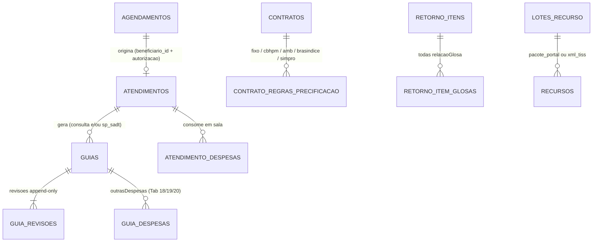
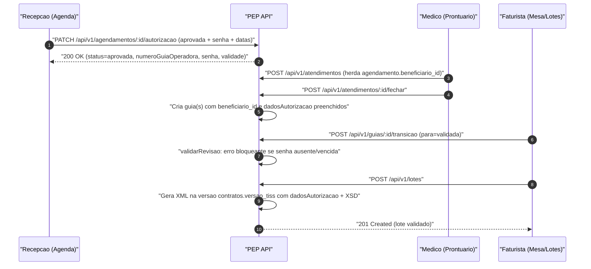

# RFC-PEP-027 — Motor TISS Completo: Autorização Prévia, Multi-Carteirinha, Multi-Versão, Outras Despesas, Recurso XML e CBHPM/AMB

**Fase:** P2 — Onda B: Bloqueio de Glosa TISS SP/SADT · **Status:** Implementada (F1–F4 entregues em 21/11/2026) · **ADRs:** [[ADR-PEP-0003-postgres-rls-multitenant|ADR-PEP-0003]], [[ADR-PEP-0005-spike-adapter|ADR-PEP-0005]], [[ADR-PEP-0012-motor-tiss|ADR-PEP-0012]], [[ADR-PEP-0017-orm-drizzle-rls|ADR-PEP-0017]], [[ADR-PEP-0018-monorepo-pnpm-turborepo|ADR-PEP-0018]], [[ADR-PEP-0019-drizzle-kit-migracoes-e-seed|ADR-PEP-0019]], [[ADR-PEP-0024-dados-de-referencia-ans|ADR-PEP-0024]], [[ADR-PEP-0027-indicacao-clinica-unica-por-atendimento|ADR-PEP-0027]], [[ADR-PEP-0028-resolvedor-de-dados-da-guia|ADR-PEP-0028]], [[ADR-PEP-0029-consulta-tiss-e-preco-de-contrato-na-guia|ADR-PEP-0029]], [[ADR-PEP-0030-separacao-pedido-externo-execucao-local-e-retorno|ADR-PEP-0030]], [[ADR-PEP-0034-motor-tiss-autorizacao-outras-despesas-e-cbhpm|ADR-PEP-0034]]
**Telas impactadas:** 03 (Agenda / Check-in), 05 (Atendimento / Sala de Procedimentos), 16 (Mesa do Faturista), 17 (Editor de Guia), 18 (Lotes TISS), 20 (Central de Glosas e Recursos), 21/22 (Contratos e Tabelas)
**Depende de:** [[RFC-PEP-006-guias-e-lotes-tiss|RFC-PEP-006]], [[RFC-PEP-007-retorno-e-glosas|RFC-PEP-007]], [[RFC-PEP-008-contratos|RFC-PEP-008]], [[RFC-PEP-023-faturamento-clinico-execucao-vs-solicitacao-e-retorno|RFC-PEP-023]], [[SPK-09-catalogo-tuss|SPK-09]], [[SPK-15-metadados-modelo-resumo-soap-e-tabelas-tuss-despesas|SPK-15]]

---

## 1. Contexto e Diagnóstico da Auditoria

A auditoria técnica realizada sobre o repositório `projetos/PEP` (`/home/pedro/dev/pedro/tissia`) demonstrou que o motor TISS atual cobre o caminho feliz de consultas e SP/SADT simples em TISS `4.03.00`, mas apresenta **falhas objetivas de integridade, precificação e conformidade TISS** que geram glosas imediatas em clínicas reais:

| Área | Arquivo / Ponto Auditado | Falha Atual | Impacto Operacional |
| :--- | :--- | :--- | :--- |
| **Multi-carteirinha** | `prontuario.service.ts:130,198,452,508` | Ignora `agendamentos.beneficiario_id` e busca `pac.beneficiarios.find((b) => b.principal)` | Guia, análise IA e janela de retorno atribuídos ao convênio errado |
| **Autorização prévia** | `agenda/schema.ts:42`, `validacao-guia.ts:72-78`, `lote-xml.ts:55-89` | Sem campos de autorização na agenda/guia; `<ans:dadosAutorizacao>` ausente no XML | Glosa 14xx garantida em SP/SADT sujeita a autorização |
| **Validação de senha** | `faturamento.service.ts:444-456` | Usa `dataAtendimento` em SP/SADT, fixa `carater = 'eletivo'`, ignora `validade_senha_dias` e emite só `aviso` | Guias sem senha ou com senha vencida são liberadas e entram em lote |
| **Poluição de análise** | `faturamento.service.ts:350,401`, `prontuario.service.ts:523` | Análise de pedidos `solicitacao_externa` propaga risco/pendência para a Guia de Consulta única | Falso alerta na Mesa do Faturista em consultas comuns |
| **Descrição TUSS** | `lote-xml.ts:79` | Fallback `` `Procedimento ${i.tuss}` `` quando código não está no catálogo demo | Glosa/rejeição por descrição genérica inválida |
| **Versão TISS** | `lote-xml.ts:112`, `lotes.service.ts:137,144`, `tiss-xsd.ts:29` | Usa constante `VERSAO_TISS_LOTE` (`4.03.00`) ignorando `contratos.versao_tiss` | Impossível faturar operadoras em `4.01.00` ou `4.02.00` |
| **Validações pré-lote** | `validacao-guia.ts:145-193`, `lotes.service.ts:98-125` | Não bloqueia carteira vencida, TUSS fora de vigência, Campo 23 vazio em SP/SADT, `limitePorGuia` ou `pacotes`; degrada silenciosamente sem `ref_campos_guia` | Glosas 10xx/17xx/18xx e glosas contratuais evitáveis |
| **Vigência e prazo** | `contratos.service.ts:1018`, `faturamento.service.ts:275` | `aplicarValores` grava `vigenciaInicio: hoje` em vez da vigência da tabela publicada; `criarRascunho` usa `prazoEnvioDias ?? 4` hardcoded | Preço errado em atendimento retroativo e SLA da Mesa distorcido |
| **Execução SP/SADT** | `lote-xml.ts:74-85`, `EditorGuia.tsx:693`, `prontuario.service.ts:436` | Sem horários, `viaAcesso`, `tecnicaUtilizada`, `reducaoAcrescimo` variável, `equipeSadt`; botão `+ Procedimento` desabilitado; `motivoCobrancaRetorno` não persistido | Perda de cobrança cirúrgica/ambulatorial e edição travada |
| **Despesas acessórias** | `lote-xml.ts:71-88` | Sem `<ans:outrasDespesas>` (Tabelas 18/19/20) e totalizador só emite `valorProcedimentos` + `valorTotalGeral` | Clínicas não faturam materiais, OPME, taxas e medicamentos |
| **Retorno e Recurso** | `retorno-xml.ts:238-248`, `glosas.service.ts:64-93,800-843` | `??=` descarta a 2ª `<relacaoGlosa>` em diante; PDF trunca em 48 linhas / 95 colunas; sem emissão XML TISS de Recurso de Glosa | Perda de motivos de glosa, PDFs cortados e retrabalho no portal |
| **Precificação e WS** | `contratos/schema.ts`, `integracoes/` | Apenas preço fixo por TUSS; `integracoes/` vazio sem contrato de Webservice TISS | Incapacidade de operar contratos CBHPM/AMB e futura automação WS |

---

## 2. Objetivo

Entregar, em **4 fatias sequenciais, aditivas e verificáveis (`F1` a `F4`)**, a conformidade ponta a ponta do Motor TISS do PEP para clínicas ambulatoriais e de procedimentos/SADT — bloqueando glosas estruturais antes da geração do lote, viabilizando despesas acessórias e precificação CBHPM/AMB, gerando XML oficial de Recurso de Glosa e preparando a porta hexagonal de Webservices TISS.

---

## 3. Escopo

### Dentro do escopo
- **F1:** Autorização prévia (Agenda → Prontuário → Guia → `<ans:dadosAutorizacao>`), fidelidade de `beneficiario_id`, validação bloqueante de senha/validade e isolamento de alertas de `solicitacao_externa` fora da Guia de Consulta.
- **F2:** Multi-versão TISS (`4.01.00`, `4.02.00`, `4.03.00`) com XSDs versionados, descrição TUSS oficial, validações pré-lote bloqueantes (carteira vencida, vigência TUSS, Campo 23, `limitePorGuia`, `pacotes`), correções em `aplicarValores` e `prazoEnvioDias`, execução SP/SADT completa (`equipeSadt`, horários, `viaAcesso`, `tecnicaUtilizada`, `reducaoAcrescimo`), botão `+ Procedimento` e persistência de `motivoCobrancaRetorno`.
- **F3:** Despesas acessórias (`guia_despesas`, `<ans:outrasDespesas>`, Tabelas 18/19/20, totalizadores completos), XML TISS de Recurso de Glosa (`ctm_recursoGlosa` / `RECURSO_GLOSA`), PDF multipágina sem truncamento, preservação integral de múltiplas `<relacaoGlosa>` no parser de retorno e prazo de recurso configurável (dias úteis × corridos + notificações).
- **F4:** Precificação CBHPM/AMB/Brasíndice/Simpro (Porte, CH, UCO, Filme, Banda, auxiliares e urgência) e porta hexagonal `ServicoWebserviceTiss` no módulo `integracoes/`.

### Fora do escopo
- Guias de Internação (`ctm_internacaoResumoGuia`), Honorário Individual avulso e Odontologia (`cto_*`).
- Anexos clínicos estruturados XML (OPME, Quimioterapia, Radioterapia) — continuam fora desta onda.
- Homologação comercial ou implementação de credenciais/certificados SOAP específicos de uma operadora concreta (apenas a porta `ServicoWebserviceTiss` + adaptador `NoopPortalAdapter` + testes de contrato entram em F4).
- Qualquer alteração em `referencias/` (somente leitura) ou envio de PII para `tissia-ia` (mantida integralmente a [[ADR-PEP-0005-spike-adapter|ADR-PEP-0005]]).

---

## 4. Visão Arquitetural e Fluxos





---

## 5. Especificação Detalhada por Fatia

> **Invariantes de Banco (válidas para F1..F4):**
> - Toda nova tabela possui `tenant_id uuid NOT NULL` e política RLS forçada (`ENABLE ROW LEVEL SECURITY` + `FORCE ROW LEVEL SECURITY` usando `current_setting('app.tenant_id', true)::uuid`), conforme [[ADR-PEP-0003-postgres-rls-multitenant|ADR-PEP-0003]] e [[ADR-PEP-0017-orm-drizzle-rls|ADR-PEP-0017]].
> - Toda migração é **estritamente aditiva** (sem `DROP COLUMN`, sem alterar tipo destrutivamente, com `DEFAULT` ou `NULL` para linhas existentes), conforme [[ADR-PEP-0019-drizzle-kit-migracoes-e-seed|ADR-PEP-0019]].
> - Sem FKs entre tabelas de módulos distintos; módulos nunca importam `schema.ts` de outro módulo (validar com `pnpm deps`, [[ADR-PEP-0018-monorepo-pnpm-turborepo|ADR-PEP-0018]]).

---

### Fatia F1 — Autorização Prévia & Multi-Carteirinha (Bloqueio de Glosa 14xx)

#### F1.1 Modelo de Dados (DDL SQL Aditivo + RLS)

```sql
-- Migração aditiva F1: autorização no agendamento e fidelidade de beneficiário no atendimento
ALTER TABLE agendamentos
  ADD COLUMN IF NOT EXISTS numero_guia_operadora text,
  ADD COLUMN IF NOT EXISTS data_autorizacao date,
  ADD COLUMN IF NOT EXISTS senha_autorizacao text,
  ADD COLUMN IF NOT EXISTS data_validade_senha date,
  ADD COLUMN IF NOT EXISTS ausencia_cod_validacao text,
  ADD COLUMN IF NOT EXISTS cod_validacao text,
  ADD COLUMN IF NOT EXISTS autorizacao_motivo_negativa text,
  ADD COLUMN IF NOT EXISTS autorizacao_atualizada_por uuid,
  ADD COLUMN IF NOT EXISTS autorizacao_atualizada_em timestamptz;

ALTER TABLE agendamentos
  ADD CONSTRAINT agend_numero_guia_op_len
    CHECK (numero_guia_operadora IS NULL OR char_length(numero_guia_operadora) BETWEEN 1 AND 20),
  ADD CONSTRAINT agend_senha_len
    CHECK (senha_autorizacao IS NULL OR char_length(senha_autorizacao) BETWEEN 1 AND 20),
  ADD CONSTRAINT agend_cod_validacao_len
    CHECK (cod_validacao IS NULL OR char_length(cod_validacao) BETWEEN 1 AND 10),
  ADD CONSTRAINT agend_validade_apos_autorizacao
    CHECK (data_validade_senha IS NULL OR data_autorizacao IS NULL OR data_validade_senha >= data_autorizacao);

ALTER TABLE atendimentos
  ADD COLUMN IF NOT EXISTS beneficiario_id uuid;

CREATE INDEX IF NOT EXISTS ix_atend_beneficiario
  ON atendimentos (tenant_id, beneficiario_id)
  WHERE beneficiario_id IS NOT NULL;
```

*(As tabelas `agendamentos` e `atendimentos` já possuem políticas RLS por `tenant_id` ativas e forçadas.)*

#### F1.2 Contratos HTTP e Schemas Zod `.strict()` (`@pep/contracts`)

1. **Extensão de `DadosGuiaSchema` e `CAMPOS_DADOS_GUIA` (`packages/contracts/src/validacao-guia.ts`):**
   - Adicionar ao grupo `'autorizacao'` (novo valor em `GrupoCampoGuia = 'beneficiario' | 'autorizacao' | 'solicitacao' | 'executante'`) na SP/SADT:
     - `numeroGuiaOperadora` (campo 3, `max(20)`)
     - `dataAutorizacao` (campo 4, tipo `'data'`)
     - `senha` (campo 5, `max(20)` — mover do grupo `'executante'` para `'autorizacao'`)
     - `dataValidadeSenha` (campo 6, tipo `'data'`)
     - `ausenciaCodValidacao` (opcional, domínio ANS `dm_ausenciaCodValidacao`, `max(2)`)
     - `codValidacao` (opcional, `max(10)`)
   - Adicionar `'agendamento'` em `OrigemDadoGuiaSchema` para rastrear campos herdados da autorização registrada na agenda.

2. **Novo endpoint de autorização no agendamento (`AgendaController`):**
   - **`PATCH /api/v1/agendamentos/:id/autorizacao`** (`@RequerPermissao('agenda:escrever')`, auditado com `agenda.autorizacao_atualizada`)
   - Payload Zod `.strict()` (`AtualizarAutorizacaoAgendamentoSchema`):
     ```ts
     export const AtualizarAutorizacaoAgendamentoSchema = z.object({
       status: z.enum(['nao_exige', 'pendente', 'aprovada', 'negada']),
       numeroGuiaOperadora: z.string().trim().min(1).max(20).nullable().optional(),
       dataAutorizacao: z.string().regex(/^\d{4}-\d{2}-\d{2}$/).nullable().optional(),
       senha: z.string().trim().min(1).max(20).nullable().optional(),
       dataValidadeSenha: z.string().regex(/^\d{4}-\d{2}-\d{2}$/).nullable().optional(),
       ausenciaCodValidacao: z.string().trim().min(1).max(2).nullable().optional(),
       codValidacao: z.string().trim().min(1).max(10).nullable().optional(),
       motivoNegativa: z.string().trim().min(3).max(500).nullable().optional(),
     }).strict().superRefine((v, ctx) => {
       if (v.status === 'aprovada') {
         if (!v.dataAutorizacao) ctx.addIssue({ code: 'custom', path: ['dataAutorizacao'], message: 'Data de autorização é obrigatória quando aprovada' })
         if (!v.senha && !v.numeroGuiaOperadora) ctx.addIssue({ code: 'custom', path: ['senha'], message: 'Informe a senha ou o número da guia na operadora' })
       }
       if (v.status === 'negada' && !v.motivoNegativa) {
         ctx.addIssue({ code: 'custom', path: ['motivoNegativa'], message: 'Informe o motivo da negativa da operadora' })
       }
       if (v.dataAutorizacao && v.dataValidadeSenha && v.dataValidadeSenha < v.dataAutorizacao) {
         ctx.addIssue({ code: 'custom', path: ['dataValidadeSenha'], message: 'Validade da senha não pode ser anterior à data de autorização' })
       }
     })
     ```
   - `GET /api/v1/agendamentos` e `GET /api/v1/agendamentos/:id` passam a incluir o objeto aditivo `autorizacao: { status, numeroGuiaOperadora, dataAutorizacao, senha, dataValidadeSenha, ausenciaCodValidacao, codValidacao, motivoNegativa }`.

#### F1.3 Mudanças nos Serviços e Motor XML

1. **Fidelidade de `beneficiario_id` (`ProntuarioService` e `DadosGuiaService`):**
   - Ao abrir atendimento (`ProntuarioService.abrir`), se houver `agendamentoId`, ler `ag.beneficiarioId` e persistir em `atendimentos.beneficiario_id`; se for atendimento avulso de convênio, aceitar `beneficiarioId` no DTO (fallback para `b.principal` apenas se não informado).
   - Em `ProntuarioService` (linhas `130`, `198`, `452`, `508`): criar helper `resolverBeneficiarioDoAtendimento(pac, a.beneficiarioId)` que procura primeiro `pac.beneficiarios.find((b) => b.id === a.beneficiarioId)` e só usa `b.principal` quando `a.beneficiarioId == null` (legado).
   - Em `DadosGuiaService.resolver` (`dados-guia.service.ts:125-168`): aceitar `beneficiarioId?: string | null` e `agendamentoId?: string | null` em `EntradaResolucaoDadosGuia`. Priorizar a carteirinha por `b.id === entrada.beneficiarioId` antes de `registroAns` ou `b.principal`. Quando o agendamento associado tiver autorização `aprovada`, preencher automaticamente `numeroGuiaOperadora`, `dataAutorizacao`, `senha`, `dataValidadeSenha`, `ausenciaCodValidacao` e `codValidacao` com origem `'agendamento'`.

2. **Serialização de `<ans:dadosAutorizacao>` (`lote-xml.ts:guiaSpSadt`):**
   - Emitir `<ans:dadosAutorizacao>` imediatamente após `<ans:cabecalhoGuia>` (posição exata no XSD `ctm_sp-sadtGuia` — linha 826 de `tissGuiasV4_03_00.xsd`) sempre que `d.dataAutorizacao` estiver presente (ou `d.senha` / `d.numeroGuiaOperadora` presentes, exigindo `d.dataAutorizacao` na validação):
     ```xml
     <ans:dadosAutorizacao>
       <ans:numeroGuiaOperadora>...</ans:numeroGuiaOperadora> <!-- opcional -->
       <ans:dataAutorizacao>AAAA-MM-DD</ans:dataAutorizacao> <!-- obrigatório no bloco -->
       <ans:senha>...</ans:senha> <!-- opcional -->
       <ans:dataValidadeSenha>AAAA-MM-DD</ans:dataValidadeSenha> <!-- opcional -->
       <ans:ausenciaCodValidacao>...</ans:ausenciaCodValidacao> <!-- opcional -->
       <ans:codValidacao>...</ans:codValidacao> <!-- opcional -->
     </ans:dadosAutorizacao>
     ```

3. **Correção de `FaturamentoService.validarRevisao` (`faturamento.service.ts:444-468`):**
   - **Data de referência:** usar `dataIsoValida(tipo === 'consulta' ? dados?.dataAtendimento : dados?.dataSolicitacao) ?? diaBr(g.criadoEm)` (nunca `dataAtendimento` para SP/SADT).
   - **Caráter real:** mapear `dados?.carater` (Tabela 23 da ANS) para `'eletivo' | 'urgencia'` (verificando termo da Tabela 23 carregada em `ref_dominios_tiss`, sem hardcode de `'eletivo'`).
   - **Regras bloqueantes de autorização:**
     - Se `exigeAutorizacao(regras, ...)` retornar `exige: true` e `!(dados?.senha ?? '').trim()` → emitir item com **`severidade: 'erro'`** (campo 5), bloqueando `validada` e geração de lote.
     - Se `dados?.senha` ou `dados?.numeroGuiaOperadora` estiver informado sem `dados?.dataAutorizacao` → **`severidade: 'erro'`** (campo 4: obrigatório pelo XSD `ct_autorizacaoSADT`).
     - **Validade da senha:** calcular a data-limite efetiva como `dados.dataValidadeSenha` (se informada) ou `dados.dataAutorizacao + contrato.validadeSenhaDias` (quando o contrato definir `validade_senha_dias` e `dataAutorizacao` existir). Se `dataExecucao > dataLimiteSenha` → **`severidade: 'erro'`** (campo 6: `"Senha de autorização vencida na data de execução"`).

4. **Isolamento de alertas de `solicitacao_externa` (`faturamento.service.ts:350,401` e `prontuario.service.ts:523`):**
   - `FaturamentoService.gerarGuiasDoAtendimento`: nunca atribuir `p.analise` de pedidos externos à Guia de Consulta (`comAnalise = g.tipo === 'sp_sadt'`).
   - `FaturamentoService.sincronizarAnalise`: só sincronizar espelho de risco/pendência na guia `sp_sadt` (remover o fallback `OR NOT EXISTS (... sp_sadt)` que contaminava a Guia de Consulta quando o atendimento só possuía pedidos `solicitacao_externa`).
   - Se uma Guia de Consulta pura tiver análise própria (sem pedidos externos, só código de consulta `10101012`), sincronizar apenas alertas referentes ao próprio TUSS da consulta.

#### F1.4 Fluxos de UI (F1)
- **Agenda / Check-in (tela 03):** exibir badge de autorização (`Pendente`, `Aprovada`, `Negada`, `Não exige`) no card do agendamento e botão `"Registrar autorização"` abrindo modal para informar status, número da guia na operadora, data de autorização, senha, validade e código de validação (ou motivo da negativa). Exibir alerta visual no check-in caso `autorizacaoStatus IN ('pendente', 'negada')`.
- **EditorGuia (tela 17):** nova seção `"Autorização prévia"` exibindo os campos 3, 4, 5, 6, `ausenciaCodValidacao` e `codValidacao`, com badge de origem `"Agenda"` quando autopreenchidos e destaque vermelho nos erros bloqueantes de senha ausente ou vencida.

---

### Fatia F2 — Integridade XML Multi-Versão, Validações Pré-Lote e Execução SP/SADT

#### F2.1 Modelo de Dados (DDL SQL Aditivo + RLS)

```sql
-- Migração aditiva F2: persistência do motivo de cobrança em retorno e versão TISS nos campos de referência
ALTER TABLE atendimentos
  ADD COLUMN IF NOT EXISTS motivo_cobranca_retorno text;

ALTER TABLE atendimentos
  ADD CONSTRAINT atend_motivo_cobranca_retorno_len
    CHECK (motivo_cobranca_retorno IS NULL OR char_length(motivo_cobranca_retorno) BETWEEN 5 AND 500);

-- Metadados de execução SP/SADT persistem no JSONB versionado `guia_revisoes.itens` (append-only)
-- e no espelho `guias.itens`, mantendo compatibilidade retroativa com itens legados `{ tuss, quantidade, indicacaoClinica }`.
-- Opcionalmente, índice auxiliar para consultas de pacotes/limites por guia:
CREATE INDEX IF NOT EXISTS ix_guias_unidade_tipo_status
  ON guias (tenant_id, unidade_id, tipo, status);
```

- **XSDs versionados em disco (`apps/api/ref/tiss/`):**
  - Estruturar diretórios `apps/api/ref/tiss/4.01.00/`, `apps/api/ref/tiss/4.02.00/` e `apps/api/ref/tiss/4.03.00/`, cada qual com os arquivos oficiais da ANS (`tissV4_01_00.xsd`, `tissV4_02_00.xsd`, `tissV4_03_00.xsd` e respectivos includes) registrados no `MANIFEST.json` de `apps/api/ref/` com URL oficial e SHA-256 ([[ADR-PEP-0024-dados-de-referencia-ans|ADR-PEP-0024]]).

#### F2.2 Contratos HTTP e Schemas Zod `.strict()` (`@pep/contracts`)

1. **Evolução de `ItemGuiaSchema` (`packages/contracts/src/faturamento.ts`):**
   ```ts
   export const MembroEquipeSadtSchema = z.object({
     grauParticipacao: z.string().regex(/^\d{2}$/), // Tabela 35 ANS (ex.: '00', '01', '06')
     tipoIdentificador: z.enum(['codigo_operadora', 'cpf']),
     identificador: z.string().trim().min(1).max(14),
     nomeProfissional: z.string().trim().min(1).max(70),
     conselho: z.string().trim().min(1).max(4), // Tabela 26
     numeroConselho: z.string().trim().min(1).max(15),
     ufConselho: z.string().trim().min(2).max(2), // Tabela 59
     cbo: z.string().trim().min(6).max(6), // Tabela 24
   }).strict()

   export const ItemGuiaSchema = z.object({
     tuss: z.string().regex(/^\d{8,10}$/),
     descricao: z.string().trim().min(1).max(150).optional(),
     quantidade: z.number().int().min(1).max(999), // quantidadeExecutada (compatibilidade retroativa)
     quantidadeSolicitada: z.number().int().min(1).max(999).optional(),
     quantidadeAutorizada: z.number().int().min(0).max(999).optional(),
     indicacaoClinica: z.string().max(500).default(''),
     dataExecucao: z.string().regex(/^\d{4}-\d{2}-\d{2}$/).optional(),
     horaInicial: z.string().regex(/^\d{2}:\d{2}:\d{2}$/).optional(),
     horaFinal: z.string().regex(/^\d{2}:\d{2}:\d{2}$/).optional(),
     viaAcesso: z.string().trim().min(1).max(2).optional(), // Tabela 61 (dm_viaDeAcesso)
     tecnicaUtilizada: z.string().trim().min(1).max(2).optional(), // Tabela 48 (dm_tecnicaUtilizada)
     reducaoAcrescimo: z.number().min(0.01).max(9.99).default(1.0),
     equipeSadt: z.array(MembroEquipeSadtSchema).max(20).optional(),
   }).strict()
   ```
2. **Fechamento de atendimento (`FecharAtendimentoSchema`):**
   - Quando `cobrarConsultaRetorno === true` em agendamento do tipo `'retorno'` dentro da janela sem cobrança, exigir `motivoCobrancaRetorno` (`min(5).max(500)`) e persistir em `atendimentos.motivo_cobranca_retorno`, expondo o campo no detalhe do atendimento e na trilha de auditoria.

#### F2.3 Mudanças nos Serviços, Validador e Motor XML

1. **Descrição oficial em `<ans:descricaoProcedimento>` (`lote-xml.ts:79`):**
   - Remover definitivamente o fallback `` `Procedimento ${i.tuss}` ``.
   - Ordem determinística de resolução da descrição oficial (até 150 caracteres):
     1. `item.descricao` (quando validada na revisão da guia);
     2. Termo oficial da Tabela 22 no catálogo da `tissia-ia` ([[SPK-09-catalogo-tuss|SPK-09]] / [[SPK-15-metadados-modelo-resumo-soap-e-tabelas-tuss-despesas|SPK-15]], com cache local);
     3. `pedidos_exame.termo` gravado no momento do pedido;
     4. `tabela_negociada_itens.descricao` do contrato vigente;
     5. `termoProcedimentoFaturamento(i.tuss)` (apenas códigos oficiais conhecidos como `10101012`).
   - Se nenhuma fonte fornecer descrição válida → **erro bloqueante pré-lote** (`"Procedimento <tuss> sem descrição oficial da Tabela 22"`).

2. **Multi-versão TISS (`tiss-xsd.ts`, `lote-xml.ts`, `lotes.service.ts`):**
   - `tiss-xsd.ts`: trocar singleton `carregado` por `Map<VersaoTissSuportada, Promise<{ lib, validador }>>` suportando `'4.01.00' | '4.02.00' | '4.03.00'`. Assinatura: `validarNoXsd(xml: Buffer, versao: VersaoTissSuportada = '4.03.00'): Promise<string[]>`.
   - `lote-xml.ts`: receber `versaoTiss` em `EntradaLoteXml`, emitir `<ans:Padrao>${e.versaoTiss}</ans:Padrao>` e aplicar diferenças estruturais controladas por versão (ex.: tags introduzidas na `4.03.00` como `centroConsumo` só emitidas quando `versaoTiss >= '4.03.00'`).
   - `lotes.service.ts`: consultar `contratos.versao_tiss` do contrato vigente da operadora na competência (fallback `'4.03.00'` se não houver contrato específico), gravar a versão efetiva em `lotes.versao_tiss` e validar tanto guia individual quanto lote final contra o XSD daquela versão.

3. **Validações bloqueantes pré-lote (`validacao-guia.ts`, `faturamento.service.ts`, `lotes.service.ts`):**
   - **Carteira vencida:** se `dados.validadeCarteira` for data ISO válida e `dados.validadeCarteira < dataExecucao` → **`severidade: 'erro'`** (campo 9 em SP/SADT / campo 5 em Consulta).
   - **Fim da degradação silenciosa de `ref_campos_guia`:** em `validarGuiaLocal`, manter `referenciaCarregada: false` como aviso apenas na edição de rascunho; porém em `FaturamentoService.transicionar(..., { para: 'validada' })` e `LotesService.criar`, quando `!validacao.referenciaCarregada`, **bloquear com HTTP `422`** (`"Base de referência da ANS não carregada: execute ref:carregar antes de liberar guias ou gerar lotes"`).
   - **Vigência real do TUSS na Tabela 22:** ao validar revisão para liberação ou montagem de lote, consultar vigência de cada código TUSS na `dataExecucao` via `SPK-15` (`/v1/catalogos/tuss/{codigo}?tabela=22&data_referencia=AAAA-MM-DD`, com cache por `(codigo, data)`). Código fora de vigência ou inexistente na Tabela 22 → **`severidade: 'erro'`**. Se `tissia-ia` estiver indisponível (`degradado`), registrar `aviso` não bloqueante em respeito à [[ADR-PEP-0005-spike-adapter|ADR-PEP-0005]].
   - **Campo 23 obrigatório em SP/SADT:** em `validarGuiaLocal`, quando `tipo === 'sp_sadt'` e houver ao menos um procedimento diferente de consulta (ou sempre que exigido por regra do contrato/TUSS com DUT), ausência de `indicacaoClinica` (ou `< 5` caracteres) → **`severidade: 'erro'`** (campo 23).
   - **Aplicação preventiva de `limitePorGuia` e `pacotes` do contrato:** em `validarRevisao`, consultar `tabela_negociada_itens.limite_por_guia` e `pacotes` / `pacote_itens` da tabela publicada vigente:
     - `item.quantidade > limitePorGuia` → **`severidade: 'erro'`** (`"Quantidade (${item.quantidade}) excede o limite contratual por guia (${limitePorGuia})"`).
     - `quantidadeAutorizada !== undefined && item.quantidade > item.quantidadeAutorizada` → **`severidade: 'erro'`**.
     - Itens da guia que compõem um pacote fechado do contrato sem usar o código do pacote → **`severidade: 'aviso'`** (ou **`'erro'`** configurável no contrato) indicando o código/valor do pacote aplicável.

4. **Correções de vigência e prazo (`contratos.service.ts:1018` e `faturamento.service.ts:275`):**
   - `ContratosService.aplicarValores`: usar `vigente.vigenciaInicio` como `vigenciaInicio` do novo registro em `precos_faturamento` (fechando o preço aberto anterior em `vigente.vigenciaInicio - 1 dia`, quando anterior à nova vigência, ou `vigente.vigenciaInicio` se mesma data). Se já existir preço com vigência posterior, retornar `409 Conflict` explícito em vez de sobrescrever silenciosamente.
   - `FaturamentoService.criarRascunho`: quando `g.prazoEnvioDias` não for passado explicitamente, buscar `contratos.prazo_envio_dias` do contrato vigente da operadora na unidade; usar fallback padrão `5` (igual ao default do schema) apenas quando não houver contrato cadastrado, eliminando o `4` hardcoded.

5. **Serialização completa de execução SP/SADT (`lote-xml.ts:74-86`):**
   - Emitir por item em `<ans:procedimentoExecutado>`: `sequencialItem`, `dataExecucao` (do item ou fallback da guia), `horaInicial?`, `horaFinal?`, `procedimento` (com `descricaoProcedimento` oficial), `quantidadeExecutada`, `viaAcesso?`, `tecnicaUtilizada?`, `reducaoAcrescimo` (formatado `0.00`, ex.: `0.50`, `1.00`, `1.30`), `valorUnitario`, `valorTotal` (calculado como `Math.round(valorUnitarioCentavos * quantidade * reducaoAcrescimo)`), e zero ou mais `<ans:equipeSadt>` usando as tags exatas do XSD `ct_identEquipeSADT` (`grauPart`, `codProfissional`, `nomeProf`, `conselho`, `numeroConselhoProfissional`, `UF`, `CBOS`).

#### F2.4 Fluxos de UI (F2)
- **`EditorGuia.tsx:693`:** habilitar o botão **`+ Procedimento`** para guias `sp_sadt` editáveis, abrindo combobox de busca incremental conectado ao catálogo TUSS (`GET /api/v1/catalogos/tuss` / `SPK-09`).
- **Linha de procedimento no `EditorGuia.tsx`:** adicionar painel expansível por item para `dataExecucao`, `horaInicial`/`horaFinal`, `quantidadeSolicitada`/`quantidadeAutorizada`/`quantidadeExecutada`, `viaAcesso` (Tabela 61), `tecnicaUtilizada` (Tabela 48), `reducaoAcrescimo` e seção `Equipe SP/SADT` (Tabela 35).
- **Modal de fechamento de retorno (`Atendimento.tsx`):** exibir campo obrigatório de justificativa quando o médico marcar `"Cobrar consulta mesmo sendo retorno"`, persistindo em `motivoCobrancaRetorno`.

---

### Fatia F3 — Despesas Acessórias (`<ans:outrasDespesas>`, Tabelas 18/19/20) e Recurso de Glosa XML TISS

#### F3.1 Modelo de Dados (DDL SQL Aditivo + RLS)

```sql
-- Migração aditiva F3.1: despesas consumidas no atendimento (sala de procedimentos)
CREATE TABLE IF NOT EXISTS atendimento_despesas (
  id uuid PRIMARY KEY,
  tenant_id uuid NOT NULL,
  unidade_id uuid NOT NULL,
  atendimento_id uuid NOT NULL REFERENCES atendimentos(id),
  codigo_despesa text NOT NULL, -- Tabela 25/dm_outrasDespesas: '01'=Gases, '02'=Medicamentos, '03'=Materiais, '05'=Diárias, '07'=Taxas/Aluguéis, '08'=OPME
  codigo_tabela text NOT NULL,  -- '18' | '19' | '20'
  codigo_item text NOT NULL,
  descricao text NOT NULL,
  data_execucao date NOT NULL,
  hora_inicial time,
  hora_final time,
  quantidade numeric(9,4) NOT NULL,
  unidade_medida text NOT NULL, -- dm_unidadeMedida (Tabela 60)
  registro_anvisa text,
  codigo_ref_fabricante text,
  autorizacao_funcionamento text,
  criado_por uuid NOT NULL,
  criado_em timestamptz NOT NULL DEFAULT now(),
  CONSTRAINT atd_desp_tabela CHECK (codigo_tabela IN ('18', '19', '20')),
  CONSTRAINT atd_desp_qtd_pos CHECK (quantidade > 0),
  CONSTRAINT atd_desp_desc_len CHECK (char_length(descricao) BETWEEN 1 AND 150)
);

CREATE INDEX IF NOT EXISTS ix_atd_despesas_atendimento
  ON atendimento_despesas (tenant_id, atendimento_id);

ALTER TABLE atendimento_despesas ENABLE ROW LEVEL SECURITY;
ALTER TABLE atendimento_despesas FORCE ROW LEVEL SECURITY;
CREATE POLICY p_atd_despesas_tenant ON atendimento_despesas
  USING (tenant_id = current_setting('app.tenant_id', true)::uuid)
  WITH CHECK (tenant_id = current_setting('app.tenant_id', true)::uuid);

-- Migração aditiva F3.2: despesas faturadas na guia SP/SADT (<ans:outrasDespesas>)
CREATE TABLE IF NOT EXISTS guia_despesas (
  id uuid PRIMARY KEY,
  tenant_id uuid NOT NULL,
  unidade_id uuid NOT NULL,
  guia_id uuid NOT NULL REFERENCES guias(id),
  revisao_numero integer NOT NULL,
  sequencial_item integer NOT NULL,
  codigo_despesa text NOT NULL, -- dm_outrasDespesas
  codigo_tabela text NOT NULL,  -- '18' | '19' | '20'
  codigo_item text NOT NULL,
  descricao text NOT NULL,
  data_execucao date NOT NULL,
  hora_inicial time,
  hora_final time,
  quantidade numeric(9,4) NOT NULL,
  unidade_medida text NOT NULL,
  reducao_acrescimo numeric(4,2) NOT NULL DEFAULT 1.00,
  valor_unitario_centavos bigint NOT NULL,
  valor_total_centavos bigint NOT NULL,
  item_vinculado integer,
  centro_consumo text,
  registro_anvisa text,
  codigo_ref_fabricante text,
  autorizacao_funcionamento text,
  origem_atendimento_despesa_id uuid,
  criado_em timestamptz NOT NULL DEFAULT now(),
  CONSTRAINT guia_desp_tabela CHECK (codigo_tabela IN ('18', '19', '20')),
  CONSTRAINT guia_desp_qtd_pos CHECK (quantidade > 0),
  CONSTRAINT guia_desp_valores_pos CHECK (valor_unitario_centavos >= 0 AND valor_total_centavos >= 0),
  CONSTRAINT ux_guia_desp_rev_seq UNIQUE (guia_id, revisao_numero, sequencial_item)
);

CREATE INDEX IF NOT EXISTS ix_guia_despesas_guia_rev
  ON guia_despesas (tenant_id, guia_id, revisao_numero);

ALTER TABLE guia_despesas ENABLE ROW LEVEL SECURITY;
ALTER TABLE guia_despesas FORCE ROW LEVEL SECURITY;
CREATE POLICY p_guia_despesas_tenant ON guia_despesas
  USING (tenant_id = current_setting('app.tenant_id', true)::uuid)
  WITH CHECK (tenant_id = current_setting('app.tenant_id', true)::uuid);

-- Migração aditiva F3.3: preservação de múltiplas <relacaoGlosa> por item de retorno
CREATE TABLE IF NOT EXISTS retorno_item_glosas (
  id uuid PRIMARY KEY,
  tenant_id uuid NOT NULL,
  retorno_item_id uuid NOT NULL REFERENCES retorno_itens(id),
  ordem smallint NOT NULL,
  codigo_glosa text,
  codigo_glosa_reconhecido boolean NOT NULL DEFAULT true,
  codigo_glosa_descricao text,
  motivo_texto text,
  glosa_centavos bigint NOT NULL,
  criado_em timestamptz NOT NULL DEFAULT now(),
  CONSTRAINT ux_ret_item_glosa_ordem UNIQUE (retorno_item_id, ordem),
  CONSTRAINT ret_item_glosa_valor_pos CHECK (glosa_centavos >= 0)
);

CREATE INDEX IF NOT EXISTS ix_ret_item_glosas_item
  ON retorno_item_glosas (tenant_id, retorno_item_id);

ALTER TABLE retorno_item_glosas ENABLE ROW LEVEL SECURITY;
ALTER TABLE retorno_item_glosas FORCE ROW LEVEL SECURITY;
CREATE POLICY p_ret_item_glosas_tenant ON retorno_item_glosas
  USING (tenant_id = current_setting('app.tenant_id', true)::uuid)
  WITH CHECK (tenant_id = current_setting('app.tenant_id', true)::uuid);

-- Migração aditiva F3.4: prazo de recurso configurável e XML de recurso
ALTER TABLE contratos
  ADD COLUMN IF NOT EXISTS prazo_recurso_tipo_dias text NOT NULL DEFAULT 'corridos';

ALTER TABLE contratos
  ADD CONSTRAINT contrato_prazo_recurso_tipo
    CHECK (prazo_recurso_tipo_dias IN ('corridos', 'uteis'));

ALTER TABLE lotes_recurso
  ADD COLUMN IF NOT EXISTS versao_tiss text,
  ADD COLUMN IF NOT EXISTS hash_tiss text,
  ADD COLUMN IF NOT EXISTS xsd_valido boolean;

ALTER TABLE glosas
  ADD COLUMN IF NOT EXISTS retorno_item_glosa_id uuid,
  ADD COLUMN IF NOT EXISTS alerta_vencimento_nivel text; -- 'd5' | 'd2' | 'd0' | 'vencida'

CREATE UNIQUE INDEX IF NOT EXISTS ux_glosas_retorno_item_glosa
  ON glosas (retorno_item_glosa_id)
  WHERE retorno_item_glosa_id IS NOT NULL;
```

> **Nota sobre `glosas.retorno_item_id`:** o índice `UNIQUE` existente em `glosas.retorno_item_id` (`retorno/schema.ts:135`) impede abrir duas glosas para o mesmo item quando há duas `<relacaoGlosa>` distintas no demonstrativo. Em F3, para preservar 100% de aditividade, manter `retorno_item_id` preenchido na glosa principal e vincular todas as ocorrências via `retorno_item_glosa_id` (ou relaxar a unicidade exclusiva em migração coordenada, documentada na nota de migração).

#### F3.2 Contratos HTTP e Schemas Zod `.strict()` (`@pep/contracts`)

- **`POST /api/v1/atendimentos/:id/despesas`** e **`DELETE /api/v1/atendimentos/:id/despesas/:despesaId`**: registro de materiais, medicamentos, taxas/diárias e OPME executados em sala (`@RequerPermissao('prontuario:escrever')` ou permissão específica de sala/enfermagem `despesas:registrar` **[validar com piloto]**).
- **`DespesaGuiaSchema`** (incorporado opcionalmente em `NovaRevisaoGuiaSchema` como `despesas?: DespesaGuia[]`): valida `codigoDespesa`, `codigoTabela` (`'18' | '19' | '20'`), `codigoItem` (8–10 dígitos), `descricao` (`1..150`), `dataExecucao`, `quantidade` (`> 0`), `unidadeMedida`, `reducaoAcrescimo`, `valorUnitarioCentavos`, `registroAnvisa?`, `codigoRefFabricante?`, `autorizacaoFuncionamento?`.
- **`POST /api/v1/lotes-recurso`**: passa a aceitar `formato: z.enum(['pacote_portal', 'xml_tiss']).default('pacote_portal')` e `numeroLoteOrigem` / `numeroProtocoloOrigem` (ou resolvidos automaticamente a partir do lote/retorno vinculado às guias).
- **`GET /api/v1/lotes-recurso/:id/xml`**: download auditado (`lote_recurso.xml_baixado`) do XML TISS quando `formato === 'xml_tiss'`.

#### F3.3 Mudanças nos Serviços e Motor XML

1. **Serialização de `<ans:outrasDespesas>` e totalizadores (`lote-xml.ts:guiaSpSadt`):**
   - Emitir `<ans:outrasDespesas>` após `<ans:procedimentosExecutados>` quando `g.despesas.length > 0`, seguindo `ct_outrasDespesas` e `ct_procedimentoExecutadoOutras` do XSD:
     - `sequencialItem`, `codigoDespesa`, `servicosExecutados` (`dataExecucao`, `horaInicial?`, `horaFinal?`, `codigoTabela`, `codigoProcedimento`, `quantidadeExecutada` com 4 casas decimais, `unidadeMedida`, `reducaoAcrescimo`, `valorUnitario`, `valorTotal`, `centroConsumo?` apenas em `4.03.00`, `descricaoProcedimento`, `registroANVISA?`, `codigoRefFabricante?`, `autorizacaoFuncionamento?`), `itemVinculado?`.
   - Emitir `<ans:valorTotal>` (`ct_guiaValorTotalSADT`) segregando cada categoria presente (`valorProcedimentos`, `valorTaxasAlugueis`, `valorMateriais`, `valorMedicamentos`, `valorOPME`, `valorGasesMedicinais`) e `valorTotalGeral` como soma exata em centavos.

2. **Emissão de XML TISS de Recurso de Glosa (`apps/api/src/modulos/retorno/recurso-xml.ts`):**
   - Função pura `gerarLoteRecursoXml(entrada)` gerando `mensagemTISS` com `tipoTransacao = 'RECURSO_GLOSA'`, `<ans:prestadorParaOperadora><ans:recursoGlosa><ans:guiaRecursoGlosa>` (`ctm_recursoGlosa`), suportando recurso no nível da guia (`recursoGuiaCompleta`) e por item (`itensGuia` com `sequencialItem`, `dataInicio`, `procRecurso`, `codGlosaItem`, `valorRecursado`, `justificativaItem` respeitando o limite de 500 caracteres do XSD), `valorTotalRecursado`, `dataRecurso` e `<ans:epilogo><ans:hash>` (MD5 ISO-8859-1).
   - Validar o XML gerado contra o XSD da `contratos.versao_tiss` via `ReferenciasService.validarXmlTiss(xml, versaoTiss)` antes de marcar `lotes_recurso.status = 'gerado'`.

3. **PDF multipágina sem truncamento (`glosas.service.ts:64-93`):**
   - Substituir `gerarPdfSimples` (que faz `.slice(0, 48)` e `.slice(0, 95)`) por gerador PDF multipágina com quebra automática de linha por largura real (word-wrap a ~85 colunas em fonte monoespaçada/Helvetica, paginação dinâmica com rodapé `"Página X de Y"`, cabeçalho com número do lote, guia e hash SHA-256 da evolução).

4. **Parser de múltiplas `<relacaoGlosa>` (`retorno-xml.ts:238-248`):**
   - Evoluir `ItemDemonstrativoXml` com campo aditivo `glosas: { codigoGlosa: string | null; motivoTexto: string | null; glosaCentavos: number }[]`.
   - Em `retorno-xml.ts:242-248`, coletar **todos** os nós `<relacaoGlosa>` no array `glosas` (mantendo `codigoGlosa` e `motivoTexto` no topo como o de maior valor glosado para retrocompatibilidade).
   - Persistir cada ocorrência em `retorno_item_glosas` e criar registros de trabalho na Central de Glosas de forma que cada motivo da Tabela 38 possa ser contestado com argumento específico no XML de recurso.

5. **Prazo de recurso configurável e alertas de vencimento:**
   - Evoluir função pura `prazoRecurso` em `@pep/contracts` para aceitar `tipoDias: 'corridos' | 'uteis'` e lista de feriados nacionais configurável.
   - Job BullMQ diário (`worker`) varrendo glosas com `status IN ('aberta', 'em_recurso')` e emitindo notificações internas nos marcos `D-5`, `D-2`, `D-0` e `vencida` (idempotente por `glosas.alerta_vencimento_nivel`).

#### F3.4 Fluxos de UI (F3)
- **Atendimento / Sala de Procedimentos (tela 05):** aba ou seção `"Materiais e Medicamentos (Despesas)"` com busca incremental conectada ao catálogo TUSS Tabelas 18/19/20 (`SPK-15`), quantidade, unidade de medida e campos opcionais de rastreabilidade ANVISA para OPME.
- **EditorGuia (tela 17):** aba `"Outras Despesas"` listando itens das Tabelas 18/19/20 com totais discriminados por grupo (Procedimentos, Materiais, Medicamentos, Taxas, OPME) e soma conferida em tempo real.
- **Central de Glosas e Lotes de Recurso (tela 20):** seletor de formato `"XML TISS (oficial)"` vs `"Pacote Portal (ZIP/PDF)"` ao gerar lote de recurso; exibição de todos os códigos de glosa de um mesmo procedimento; filtro e badges de urgência de prazo (`Vence hoje`, `≤ 2 dias`, `≤ 5 dias`).

---

### Fatia F4 — Precificação CBHPM/AMB (Porte/CH/UCO/Filme/Banda) e Adaptadores Webservice TISS

#### F4.1 Modelo de Dados (DDL SQL Aditivo + RLS)

```sql
-- Migração aditiva F4.1: regras de precificação referencial por contrato
CREATE TABLE IF NOT EXISTS contrato_regras_precificacao (
  id uuid PRIMARY KEY,
  tenant_id uuid NOT NULL,
  contrato_id uuid NOT NULL REFERENCES contratos(id),
  modelo text NOT NULL, -- 'fixo' | 'cbhpm' | 'amb' | 'brasindice' | 'simpro'
  referencia_edicao text, -- ex.: 'CBHPM 2022', 'AMB 92', 'Brasindice 2026-10'
  tabela_tuss_alvo text NOT NULL DEFAULT '22', -- '22' | '18' | '19' | '20'
  valor_uco_centavos integer,
  valor_ch_centavos integer,
  valor_filme_m2_centavos integer,
  banda_percentual numeric(6,2) NOT NULL DEFAULT 0.00, -- ex.: -20.00 ou +15.00
  percentual_auxiliar_1 numeric(5,2) NOT NULL DEFAULT 30.00,
  percentual_auxiliar_2 numeric(5,2) NOT NULL DEFAULT 20.00,
  percentual_auxiliar_3 numeric(5,2) NOT NULL DEFAULT 20.00,
  acrescimo_urgencia_percentual numeric(5,2) NOT NULL DEFAULT 30.00,
  vigencia_inicio date NOT NULL,
  vigencia_fim date,
  criado_por uuid NOT NULL,
  criado_em timestamptz NOT NULL DEFAULT now(),
  CONSTRAINT crp_modelo CHECK (modelo IN ('fixo', 'cbhpm', 'amb', 'brasindice', 'simpro')),
  CONSTRAINT crp_tabela_alvo CHECK (tabela_tuss_alvo IN ('18', '19', '20', '22')),
  CONSTRAINT crp_valores_nao_neg CHECK (
    (valor_uco_centavos IS NULL OR valor_uco_centavos >= 0) AND
    (valor_ch_centavos IS NULL OR valor_ch_centavos >= 0) AND
    (valor_filme_m2_centavos IS NULL OR valor_filme_m2_centavos >= 0)
  )
);

CREATE INDEX IF NOT EXISTS ix_crp_contrato_vigencia
  ON contrato_regras_precificacao (tenant_id, contrato_id, tabela_tuss_alvo, vigencia_inicio);

ALTER TABLE contrato_regras_precificacao ENABLE ROW LEVEL SECURITY;
ALTER TABLE contrato_regras_precificacao FORCE ROW LEVEL SECURITY;
CREATE POLICY p_crp_tenant ON contrato_regras_precificacao
  USING (tenant_id = current_setting('app.tenant_id', true)::uuid)
  WITH CHECK (tenant_id = current_setting('app.tenant_id', true)::uuid);

-- Parâmetros referenciais por item da tabela negociada (opcionais; mantêm valor_centavos intacto)
ALTER TABLE tabela_negociada_itens
  ADD COLUMN IF NOT EXISTS codigo_tabela text NOT NULL DEFAULT '22',
  ADD COLUMN IF NOT EXISTS codigo_porte text,
  ADD COLUMN IF NOT EXISTS porte_valor_centavos integer,
  ADD COLUMN IF NOT EXISTS porte_anestesico smallint,
  ADD COLUMN IF NOT EXISTS qtd_uco numeric(8,3),
  ADD COLUMN IF NOT EXISTS qtd_ch numeric(10,3),
  ADD COLUMN IF NOT EXISTS m2_filme numeric(8,4),
  ADD COLUMN IF NOT EXISTS banda_override_percentual numeric(6,2);

ALTER TABLE tabela_negociada_itens
  ADD CONSTRAINT tni_codigo_tabela CHECK (codigo_tabela IN ('18', '19', '20', '22'));

-- Migração aditiva F4.2: configuração e log técnico da porta Webservice TISS (zero PII)
CREATE TABLE IF NOT EXISTS integracao_operadora_configs (
  id uuid PRIMARY KEY,
  tenant_id uuid NOT NULL,
  unidade_id uuid NOT NULL,
  registro_ans text NOT NULL,
  provedor text NOT NULL DEFAULT 'portal_manual', -- 'portal_manual' | 'parceiro_ws' | 'soap_direto'
  endpoint_base text,
  credencial_ref text, -- referência no Secret Manager / KMS, nunca segredo em texto plano
  ativo boolean NOT NULL DEFAULT false,
  criado_em timestamptz NOT NULL DEFAULT now(),
  atualizado_em timestamptz NOT NULL DEFAULT now(),
  CONSTRAINT ux_int_op_cfg UNIQUE (tenant_id, unidade_id, registro_ans),
  CONSTRAINT int_op_provedor CHECK (provedor IN ('portal_manual', 'parceiro_ws', 'soap_direto'))
);

ALTER TABLE integracao_operadora_configs ENABLE ROW LEVEL SECURITY;
ALTER TABLE integracao_operadora_configs FORCE ROW LEVEL SECURITY;
CREATE POLICY p_int_op_cfg_tenant ON integracao_operadora_configs
  USING (tenant_id = current_setting('app.tenant_id', true)::uuid)
  WITH CHECK (tenant_id = current_setting('app.tenant_id', true)::uuid);

CREATE TABLE IF NOT EXISTS integracao_tiss_logs (
  id uuid PRIMARY KEY,
  tenant_id uuid NOT NULL,
  unidade_id uuid NOT NULL,
  registro_ans text NOT NULL,
  operacao text NOT NULL, -- 'elegibilidade' | 'lote_guias' | 'recurso_glosa'
  provedor text NOT NULL,
  referencia_id uuid, -- agendamentoId | loteId | loteRecursoId
  sucesso boolean NOT NULL,
  codigo_http smallint,
  protocolo text,
  latencia_ms integer NOT NULL,
  erro_codigo text, -- código técnico sanitizado, sem payload clínico ou PII
  criado_em timestamptz NOT NULL DEFAULT now(),
  CONSTRAINT int_tiss_log_op CHECK (operacao IN ('elegibilidade', 'lote_guias', 'recurso_glosa'))
);

CREATE INDEX IF NOT EXISTS ix_int_tiss_logs_unidade
  ON integracao_tiss_logs (tenant_id, unidade_id, criado_em DESC);

ALTER TABLE integracao_tiss_logs ENABLE ROW LEVEL SECURITY;
ALTER TABLE integracao_tiss_logs FORCE ROW LEVEL SECURITY;
CREATE POLICY p_int_tiss_logs_tenant ON integracao_tiss_logs
  USING (tenant_id = current_setting('app.tenant_id', true)::uuid)
  WITH CHECK (tenant_id = current_setting('app.tenant_id', true)::uuid);
```

#### F4.2 Motor de Precificação Pura (`@pep/contracts`) e Porta Webservice (`integracoes/`)

1. **Função pura `calcularPrecoReferencialCentavos` (`packages/contracts/src/precificacao.ts`):**
   - **CBHPM:** `base = porteValorCentavos * (1 + banda/100) + Math.round(qtdUco * valorUcoCentavos) + Math.round(m2Filme * valorFilmeM2Centavos)`
   - **AMB:** `base = Math.round(qtdCh * valorChCentavos) * (1 + banda/100) + Math.round(m2Filme * valorFilmeM2Centavos)`
   - **Brasíndice / Simpro (Tabelas 19/20):** `base = Math.round(precoReferenciaCentavos * (1 + banda/100))`
   - **Modificadores determinísticos:**
     - Auxiliares (`grauParticipacao` `'01'` = `percentualAuxiliar1`, `'02'` = `percentualAuxiliar2`, `'03'` = `percentualAuxiliar3` sobre o honorário/porte).
     - Acréscimo de urgência (quando caráter = urgência/emergência e contrato habilita): aplica `1 + acrescimoUrgenciaPercentual/100` refletido em `reducaoAcrescimo` ou no valor unitário conforme regra da operadora **[validar convenção por operadora no piloto]**.
   - **Precedência em `ContratosService.precoFaturamento`:**
     1. Preço explícito vigente em `precos_faturamento` (override negociado para o TUSS);
     2. Cálculo determinístico pela regra referencial vigente (`contrato_regras_precificacao` + `tabela_negociada_itens`);
     3. `null` (nunca inventar valor).

2. **Porta Hexagonal `ServicoWebserviceTiss` (`apps/api/src/modulos/integracoes/servico-webservice-tiss.port.ts`):**
   - Compatível com a decisão `OperadoraGateway` da [[ADR-PEP-0012-motor-tiss|ADR-PEP-0012]]:
     ```ts
     export const SERVICO_WEBSERVICE_TISS = Symbol('SERVICO_WEBSERVICE_TISS')

     export interface ServicoWebserviceTiss {
       verificarElegibilidade(entrada: EntradaElegibilidadeWs): Promise<ResultadoElegibilidadeWs>
       enviarLoteGuias(entrada: EntradaEnvioLoteWs): Promise<ResultadoProtocoloWs>
       enviarRecursoGlosa(entrada: EntradaEnvioRecursoWs): Promise<ResultadoProtocoloWs>
     }
     ```
   - Implementação padrão na P2: `PortalManualWebserviceAdapter` (retorna `suportado: false`, orientando o download do XML para envio manual ao portal quando `canal_envio = 'portal'`).
   - Registro automático de telemetria técnica em `integracao_tiss_logs` (sem jamais gravar nome, CPF, carteirinha ou XML bruto em texto plano).

#### F4.3 Fluxos de UI (F4)
- **Contratos (telas 21/22):** nova seção `"Regra de Precificação Referencial"` permitindo escolher `Fixo | CBHPM | AMB | Brasíndice | Simpro`, configurar UCO, CH, m² Filme, Banda (`%`), percentuais de auxiliares e urgência, com **simulador interativo** exibindo o valor resultante em R$ para um código TUSS de exemplo antes de publicar.
- **Lotes TISS (tela 18) e Lotes de Recurso (tela 20):** quando o contrato tiver `canal_envio = 'webservice'` e `integracao_operadora_configs.ativo = true`, habilitar botão `"Enviar via Webservice"` (além do download XML), exibindo protocolo retornado e status técnico.

---

## 6. Critérios de Aceite Verificáveis

### Fatia F1
- [x] Paciente com 2 carteirinhas (A principal, B secundária) agendado com B gera atendimento, análise `tissia-ia` e guia vinculados à operadora B (`beneficiario_id = B`).
- [x] `PATCH /api/v1/agendamentos/:id/autorizacao` grava autorização aprovada e valida campos obrigatórios (HTTP `422` se `status = 'aprovada'` sem `dataAutorizacao` ou sem `senha`/`numeroGuiaOperadora`).
- [x] Guia SP/SADT com procedimento que exige autorização no contrato e sem senha (ou com senha vencida pela regra `dataValidadeSenha` / `validade_senha_dias`) retorna erro bloqueante (`severidade: 'erro'`) e recebe HTTP `422` ao tentar transicionar para `validada`.
- [x] XML gerado por `gerarLoteXml` para guia SP/SADT autorizada contém `<ans:dadosAutorizacao>` válido no XSD `4.03.00`.
- [x] Atendimento com Guia de Consulta + pedidos `solicitacao_externa` não polui a Guia de Consulta com risco/pendência dos exames externos.

### Fatia F2
- [x] `<ans:descricaoProcedimento>` no XML nunca contém `"Procedimento <codigo>"`; bloqueia com erro claro se não houver termo oficial disponível.
- [x] Lote gerado para contrato com `versao_tiss = '4.01.00'`, `'4.02.00'` ou `'4.03.00'` emite `<ans:Padrao>` correspondente e passa na validação do XSD daquela versão (quando o pacote XSD correspondente está presente em `apps/api/ref/tiss/{versao}/`; caso ausente, recusa com HTTP `422` explícito).
- [x] Guia com carteira vencida na `dataExecucao`, TUSS fora de vigência na Tabela 22 (`SPK-15`), Campo 23 vazio em SP/SADT com exames ou quantidade acima de `limitePorGuia` é bloqueada antes de entrar em lote.
- [x] Tentativa de validar guia ou gerar lote com `ref_campos_guia` vazia retorna HTTP `422` (sem degradação silenciosa).
- [x] `ContratosService.aplicarValores` grava `vigenciaInicio` igual à vigência da tabela publicada; `FaturamentoService.criarRascunho` respeita `contratos.prazo_envio_dias`.
- [x] XML SP/SADT serializa corretamente `horaInicial`, `horaFinal`, `viaAcesso`, `tecnicaUtilizada`, `reducaoAcrescimo` variável e `<ans:equipeSadt>` (`grauPart`) passando no XSD.
- [x] Botão `+ Procedimento` no `EditorGuia.tsx` adiciona novos códigos TUSS via busca incremental e `motivoCobrancaRetorno` fica persistido no banco ao cobrar retorno dentro da janela.

### Fatia F3
- [x] Despesas das Tabelas 18, 19 e 20 lançadas na sala de procedimentos migram para `guia_despesas`, são serializadas em `<ans:outrasDespesas>` e somadas corretamente por categoria em `<ans:valorTotal>`, passando no XSD oficial.
- [x] Lote de recurso com `formato = 'xml_tiss'` gera XML `RECURSO_GLOSA` (`ctm_recursoGlosa`) com hash MD5 válido e aprovado no XSD da versão do contrato.
- [x] PDF do pacote de recurso suporta textos extensos (ex.: 150 linhas e parágrafos com > 200 caracteres) em múltiplas páginas sem qualquer truncamento.
- [x] Parser `retorno-xml.ts` preserva integralmente múltiplas `<relacaoGlosa>` em um mesmo item, gravando todas em `retorno_item_glosas`.
- [x] Cálculo de prazo de recurso respeita `dias_uteis` vs `dias_corridos` e dispara alertas `D-5`, `D-2`, `D-0` de forma idempotente.

### Fatia F4
- [x] Contrato configurado em modelo `cbhpm` ou `amb` calcula corretamente `valorUnitarioCentavos` (Porte/CH + UCO + Filme + Banda + auxiliares + urgência) com testes unitários determinísticos de centavos.
- [x] `ServicoWebserviceTiss` está isolado em `apps/api/src/modulos/integracoes/`, sem violação de fronteiras (`pnpm deps` verde) e sem logar PII em `integracao_tiss_logs`.

### Verificação transversal obrigatória (todas as fatias)
- [x] `pnpm typecheck`, `pnpm test`, `pnpm deps`, `pnpm --filter @pep/api openapi` e testes de isolamento RLS entre tenants passam integralmente.

---

## 7. Riscos, Mitigações e Perguntas Abertas

| Risco | Mitigação |
| :--- | :--- |
| **Falso bloqueio de autorização em clínicas sem regras configuradas** | Bloqueio só dispara quando existe regra ativa em `regras_autorizacao` exigindo autorização para o TUSS/caráter; sem regra cadastrada, senha permanece opcional |
| **Divergência entre XSDs 4.01 / 4.02 / 4.03 em tags novas (ex.: `centroConsumo`, `ausenciaCodValidacao`)** | Matriz explícita de *feature flags* por versão em `lote-xml.ts` + suíte de testes de regressão validando fixtures reais contra os 3 XSDs na CI |
| **Indisponibilidade da `tissia-ia` na checagem de vigência TUSS (F2)** | Cache local com TTL + fallback não bloqueante (`aviso`) conforme [[ADR-PEP-0005-spike-adapter\|ADR-PEP-0005]], garantindo continuidade do faturamento |
| **Quebra de unicidade em `glosas.retorno_item_id` com múltiplas `<relacaoGlosa>`** | Introduzir `retorno_item_glosa_id` e migrar a constraint de forma controlada antes de habilitar a geração multi-glosa por item |
| **Aumento de latência no cálculo CBHPM/AMB em lotes com 100 guias** | Pré-carregar regras de precificação e tabela negociada vigente uma única vez por lote/operadora em memória dentro da transação |

### Perguntas Abertas
1. **Q1 (`[validar com piloto]`):** Quais operadoras do piloto ainda exigem efetivamente TISS `4.01.00` ou `4.02.00` (tanto para envio de lote quanto para recurso de glosa)? Isso define se `4.01.00` e `4.02.00` precisam estar ativos desde o primeiro dia de F2 ou apenas `4.02.00` + `4.03.00`.
2. **Q2 (`[validar com piloto]`):** A enfermagem / técnico de sala deve ter permissão própria (`despesas:registrar`) para lançar materiais e medicamentos consumidos em sala sem precisar de `prontuario:escrever` (alinhado à [[ADR-PEP-0031-separacao-papeis-checkout-recepcao-e-triagem|ADR-PEP-0031]])? Recomendação arquitetural: **sim**.
3. **Q3 (`[validar com piloto]`):** Para acréscimo de urgência (30%) em contratos CBHPM, as operadoras do piloto preferem o fator refletido em `<ans:reducaoAcrescimo>1.30</ans:reducaoAcrescimo>` com `valorUnitario` base, ou `reducaoAcrescimo = 1.00` com `valorUnitario` já acrescido? O modelo de F4 deve permitir parametrizar essa opção por contrato se houver divergência entre operadoras.
4. **Q4 (`[validar]`):** Conferência final do algoritmo de `hashTiss` (MD5 ISO-8859-1) tanto para `ENVIO_LOTE_GUIAS` quanto para `RECURSO_GLOSA` contra um arquivo de referência validado por portal oficial de operadora ou pelo projeto de referência `tiss` (apenas em CI, conforme [[ADR-PEP-0012-motor-tiss|ADR-PEP-0012]]).

---

## Notas de implementação

Implementada integralmente em 21/11/2026 nas 4 fatias (`F1`–`F4`), consolidada na migração aditiva `0053_rfc027_schema.sql` (com RLS automática via `drizzle/rls/rls.sql` para todas as novas tabelas com `tenant_id`):

- **F1 (Autorização prévia e multi-carteirinha):**
  - Colunas de autorização em `agendamentos`, `beneficiario_id` em `atendimentos`, endpoint `PATCH /api/v1/agendamentos/:id/autorizacao` com auditoria `agenda.autorizacao_atualizada`, autopreenchimento com origem `'agendamento'` em `DadosGuiaService.resolver`, serialização de `<ans:dadosAutorizacao>` (`ct_autorizacaoSADT`) em `lote-xml.ts`, resolução do caráter real de atendimento pela Tabela 23 em `ref_dominios_tiss`, bloqueios (`severidade: 'erro'`) para senha ausente/vencida/sem `dataAutorizacao`, e isolamento de alertas `solicitacao_externa` fora da Guia de Consulta pura.
- **F2 (Multi-versão TISS, descrição TUSS real, execução SP/SADT completa e validações pré-lote):**
  - `tiss-xsd.ts` com cache `Map<VersaoTissSuportada, XsdValidator>` por versão (`4.01.00`, `4.02.00`, `4.03.00`); como apenas o pacote XSD oficial `4.03.00` está embarcado no repositório atualmente (regra de nunca inventar XSD), solicitações de validação em versões sem pacote XSD em disco retornam HTTP `422` explícito (sem degradação silenciosa).
  - Resolução determinística de `<ans:descricaoProcedimento>` (proibindo `"Procedimento XXXXXXXX"`), serialização completa de horários, `viaAcesso`, `tecnicaUtilizada`, `reducaoAcrescimo` e `<ans:equipeSadt>` (`ct_identEquipeSADT`), validações bloqueantes (`validadeCarteira`, `!referenciaCarregada` -> `422`, Campo 23 em SP/SADT com exames, `limitePorGuia`, `pacotes` e vigência Tabela 22 via `CatalogoService` com fallback `aviso` quando `tissia-ia` indisponível), persistência de `motivo_cobranca_retorno`, correções em `ContratosService.aplicarValores` e `FaturamentoService.criarRascunho` (`prazo_envio_dias` com fallback `5`), e habilitação do botão `+ Procedimento` no `EditorGuia.tsx`.
- **F3 (`<ans:outrasDespesas>`, Recurso de Glosa XML TISS, PDF multipágina, múltiplas `<relacaoGlosa>` e prazos em dias úteis):**
  - Tabelas `atendimento_despesas`, `guia_despesas` e `retorno_item_glosas`; endpoints `GET/POST/DELETE /api/v1/atendimentos/:id/despesas`; serialização de `<ans:outrasDespesas>` (Tabelas 18/19/20) e totalizadores segregados em `<ans:valorTotal>`; gerador puro `gerarLoteRecursoXml` (`RECURSO_GLOSA` / `ctm_recursoGlosa`) com endpoint `GET /api/v1/lotes-recurso/:id/xml`; gerador PDF multipágina com word-wrap (`gerarPdfMultipagina`); preservação de todas as `<relacaoGlosa>` por item no retorno; e suporte a `prazo_recurso_tipo_dias` (`corridos | uteis`) com classificação idempotente de alertas `D-5`/`D-2`/`D-0`/`vencida`.
- **F4 (Precificação referencial CBHPM/AMB/Brasíndice/Simpro e porta Webservice TISS):**
  - Tabela `contrato_regras_precificacao` e colunas referenciais em `tabela_negociada_itens`; função pura `calcularPrecoReferencialCentavos` em `@pep/contracts` com simulador interativo na tela de Contratos; precedência explícita em `ContratosService.precoFaturamento` (`precos_faturamento` > regra referencial > `null`); e porta hexagonal `ServicoWebserviceTiss` com `PortalManualWebserviceAdapter` e telemetria zero-PII em `integracao_tiss_logs`.

### Atualização de 26/11/2026 — auditoria clínica (PR `pedro2s/tissia#73`)

- **TISS 4.01.00 removido** de `VERSOES_TISS_SUPORTADAS`: não há XSD em `apps/api/ref/tiss`. Contratos e XML legados em 4.01.00 normalizam para 4.03.00 (`normalizarVersaoTiss`); a validação estrutural paralela que existia só para a 4.01.00 foi apagada. Isto substitui o comportamento descrito na fatia F2.
- **CID na SP/SADT:** `validarGuiaLocal` recebe `cids`. O CID é **facultativo** (CFM 1.819/2007 e padrão TISS/ANS): ausente nunca bloqueia; se informado, só o formato CID-10 é validado (erro de formato). O cruzamento TUSS × CID por operadora **continua pendente**.
- **Campo 23 (indicação clínica):** nunca é truncado. Texto acima de 500 caracteres faz a guia nascer **sem** indicação (limite do CHECK `guia_revisao_campo23`) e a validação local bloqueia o faturamento no campo 23, pedindo revisão humana; o fechamento do atendimento não é bloqueado. Na SP/SADT com procedimento: menos de 5 caracteres é erro; de 5 a 14 (`CAMPO_23_MIN_CARACTERES` = 15) é só aviso; acima de 500 é erro de formato.
- **Caráter de atendimento (campo 21):** sem default silencioso `eletivo`. Ausente ou fora da Tabela 23 vira erro de validação, e a regra de autorização por caráter não roda nesses casos.
- **Pendências identificadas:** lateralidade, DUT local, vigência TUSS (Tabela 22) sem depender do catálogo da Tissia IA, validação cruzada de conselho/CBO e captura automática de procedimentos a partir da evolução (receita esquecida).
