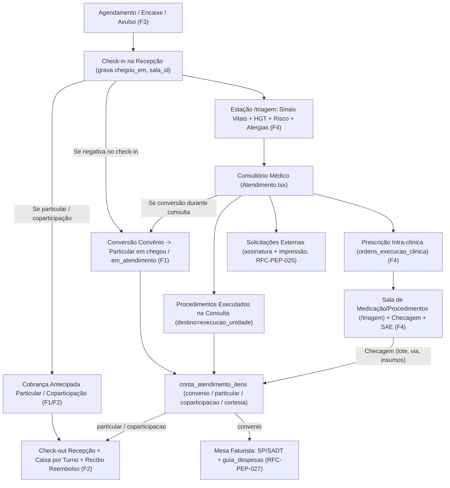
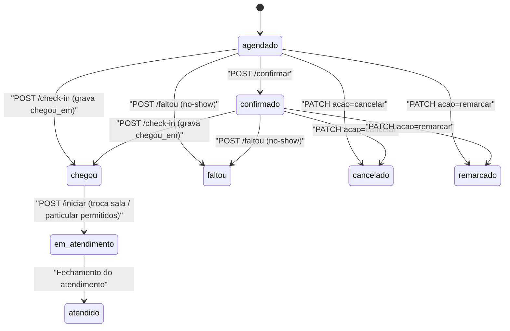
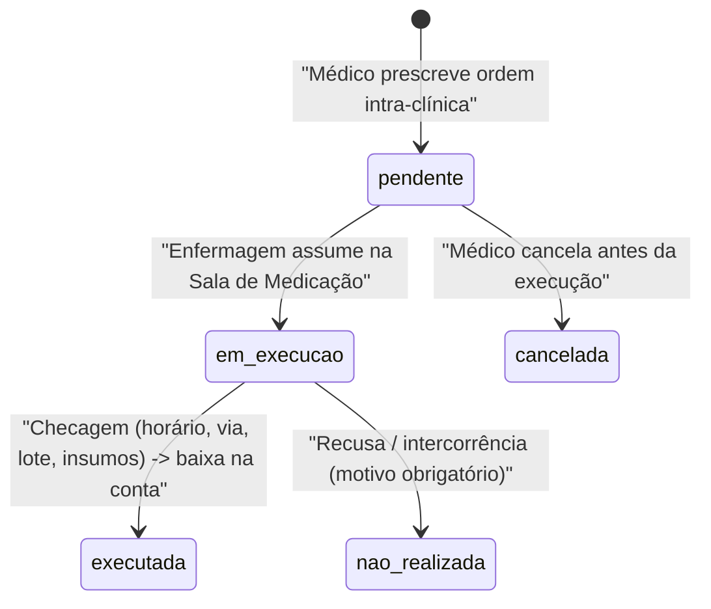
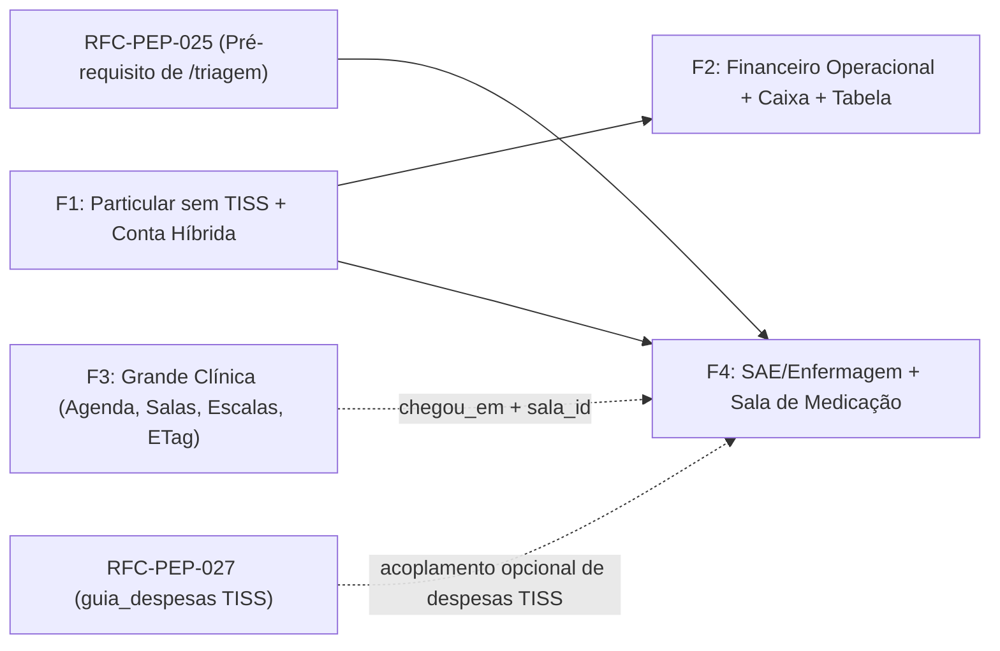

# RFC-PEP-028 — Jornada Híbrida (Particular × Convênio), Operação de Grande Clínica e Processo de Enfermagem (SAE)

**Fase:** P2 — Onda C: Fluxo Híbrido, Grande Clínica e SAE/Enfermagem · **Status:** Implementada
**ADRs:** [[ADR-PEP-0003-postgres-rls-multitenant|ADR-PEP-0003]], [[ADR-PEP-0005-spike-adapter|ADR-PEP-0005]], [[ADR-PEP-0007-prontuario-imutavel|ADR-PEP-0007]], [[ADR-PEP-0014-convenio-e-particular-no-mvp|ADR-PEP-0014]], [[ADR-PEP-0017-orm-drizzle-rls|ADR-PEP-0017]], [[ADR-PEP-0018-monorepo-pnpm-turborepo|ADR-PEP-0018]], [[ADR-PEP-0019-drizzle-kit-migracoes-e-seed|ADR-PEP-0019]], [[ADR-PEP-0024-dados-de-referencia-ans|ADR-PEP-0024]], [[ADR-PEP-0027-indicacao-clinica-unica-por-atendimento|ADR-PEP-0027]], [[ADR-PEP-0030-separacao-pedido-externo-execucao-local-e-retorno|ADR-PEP-0030]], [[ADR-PEP-0031-separacao-papeis-checkout-recepcao-e-triagem|ADR-PEP-0031]], [[ADR-PEP-0035-conta-hibrida-por-item-e-processo-enfermagem-sae|ADR-PEP-0035]]
**Telas:** 03 (`Agenda`), 04 (`Paciente`), 05 (`Atendimento`), 05a (`Prontuario` / Fila do Médico), 20 (`Financeiro`), `/triagem` (`Estação de Enfermagem` + `Sala de Medicação/Procedimentos`) e subtelas operacionais (Tabela Particular, Caixa por Turno, Salas e Escalas)
**Depende de:** [[RFC-PEP-003-agenda|RFC-PEP-003]], [[RFC-PEP-004-prontuario|RFC-PEP-004]], [[RFC-PEP-010-financeiro-e-repasse|RFC-PEP-010]], [[RFC-PEP-022-triagem-e-checkout-recepcao|RFC-PEP-022]], [[RFC-PEP-023-faturamento-clinico-execucao-vs-solicitacao-e-retorno|RFC-PEP-023]], [[RFC-PEP-024-ux-escuta-revisao-e-documentos-clinicos|RFC-PEP-024]], [[RFC-PEP-025-estacao-enfermagem-assinatura-exames-resumo-e-baixa-checkout|RFC-PEP-025]]
**Coordenação paralela:** `RFC-PEP-027` (`guia_despesas` / `<ans:outrasDespesas>` em SP/SADT) e [[SPK-14-sugestao-de-codigos-e-indicacao-a-partir-da-evolucao|SPK-14]] / `SPK-15` (IA assistiva clínica no particular)

---

## 1. Contexto e Motivação

Enquanto a [[RFC-PEP-025-estacao-enfermagem-assinatura-exames-resumo-e-baixa-checkout|RFC-PEP-025]] endereça a entrega imediata da estação `/triagem` (fila básica + registro estruturado de alergias/medicações contínuas), assinatura/impressão de pedidos de exame externos, resumo ao paciente via IA fora da escuta e baixa explícita de check-out, a auditoria do código atual de `@pep/api` e `@pep/ui` revela **lacunas estruturais** que impedem o PEP de operar com fluidez em **clínicas médias e grandes com atendimento híbrido (Particular + Convênio)** e conformidade plena de Enfermagem (SAE/COFEN):

1. **Modelo financeiro particular rígido e binário:**
   - `FinanceiroService.garantirRecebivelParticular` (`apps/api/src/modulos/financeiro/financeiro.service.ts:258-301`) ignora atendimentos com `convenio = true`, só gera recebível quando `status === 'fechado'` e busca apenas um único procedimento (`LIMIT 1`), impedindo somar múltiplos procedimentos executados na mesma consulta ou cobrar itens particulares/coparticipação dentro de um atendimento de convênio.
   - `FinanceiroService.registrarRecebimentoParticular` (`financeiro.service.ts:422-423`) bloqueia recebimento quando `atend.convenio` é `true` ou `atend.status !== 'fechado'`, impossibilitando cobrança antecipada no check-in.
   - `AgendaService.editar` (`apps/api/src/modulos/agenda/agenda.service.ts:258-264`) só permite `acao: 'particular'` em `agendado` e `confirmado`, travando a conversão convênio → particular após `chegou` ou `em_atendimento`.
   - `apps/ui/src/modulos/financeiro/Financeiro.tsx` permanece com dados ilustrativos estáticos, sem gestão visual da `tabela_particular`, sem abertura/fechamento de caixa por turno e sem metadados de parcelamento/cartão ou recibo detalhado para reembolso.
2. **Vazamento de conceitos TISS no atendimento particular:**
   - `Atendimento.tsx` e `PainelIA.tsx` exibem rótulos TISS (`Campo 23 da guia`, `janela contratual`) no particular e `ProntuarioService.adicionarPedido` exige `indicacaoClinica` obrigatória mesmo fora de convênio. Em contrapartida, `Atendimento.tsx:249` desliga `useSugestoesIa` quando `!a.convenio`, retirando sugestões estritamente clínicas do médico particular.
3. **Gargalos operacionais de grande clínica na Agenda e no Prontuário:**
   - `agendamentos` não registra `chegou_em`, fazendo `Prontuario.tsx:107` exibir a hora agendada (`proximo.inicio`) como se fosse o horário de chegada.
   - Os status `confirmado` e `faltou` existem no enum `STATUS_AGENDAMENTO`, mas não há endpoints em `AgendaController` nem ações na UI.
   - `Agenda.tsx:227-243` posiciona agendamentos diretamente em células fixas do CSS Grid, fazendo encaixes no mesmo horário se sobreporem visualmente.
   - Faltam CRUD operacional de `salas`, vínculo `atendimentos.sala_id` com troca pós-check-in, cadastro de `jornadas_profissionais` (escala semanal + bloqueios recorrentes), atendimento avulso/encaixe rápido (`Prontuario.tsx:173` está em prévia), cadastro rápido de paciente inline e autocomplete TUSS em `NovoAgendamento.tsx`, além de controle de concorrência otimista (`versao`/`If-Match`) em `agendamentos`, `pacientes` e `documentos`.
4. **Enfermagem limitada à pré-consulta pontual:**
   - `Paciente.tsx:32` condiciona as abas `Histórico clínico` e `Documentos` a `usePode('prontuario:escrever')`, criando um paradoxo de permissão para `enfermagem` (que detém `prontuario:ler` no RBAC, mas não `prontuario:escrever`).
   - Faltam classificação de risco, alertas automáticos de sinais vitais críticos, glicemia capilar (HGT), histórico comparativo, registros imutáveis de **Processo de Enfermagem (SAE)** com COREN/UF segregados do ato médico (`evolucao_versoes`) e a passagem de bastão estruturada de **prescrições intra-clínicas** (Médico → Sala de Medicação/Enfermagem → Conta Particular ou Despesa TISS).

Esta RFC especifica a implementação completa da [[ADR-PEP-0035-conta-hibrida-por-item-e-processo-enfermagem-sae|ADR-PEP-0035]] em **4 fatias incrementais (`F1..F4`)**.

---

## 2. Objetivo e Escopo

### Dentro do Escopo
- **F1:** Desacoplamento de terminologia/regras TISS no particular, IA assistiva clínica no particular (`SPK-14`/`SPK-15`), política de retorno particular por unidade/profissional, separação visual/API entre procedimentos executados localmente e solicitações externas, tabela `conta_atendimento_itens`, recebível particular somatório, cobrança antecipada no check-in e conversão convênio → particular nos status `chegou` e `em_atendimento`.
- **F2:** Tela `/financeiro` real substituindo dados estáticos, CRUD/UI completo de `tabela_particular` (com suporte a preço por especialidade/profissional e vigência), abertura/fechamento/conferência de caixa por recepcionista/turno (`caixas_turno`), metadados de cartão/parcelamento (`parcelas`, `bandeira_cartao`, `nsu`), gancho estruturado de NFS-e e recibo PDF detalhado para reembolso de operadora.
- **F3:** `agendamentos.chegou_em` e fila real com tempo de espera, transições `confirmado` e `faltou`, layout lado a lado para encaixes no CSS Grid de `Agenda.tsx`, fluxo de atendimento avulso/encaixe rápido e retorno de exames no mesmo dia, CRUD de `salas` + `atendimentos.sala_id` + troca de sala pós-check-in, `jornadas_profissionais` (escala semanal + bloqueios recorrentes), cadastro rápido inline de paciente + autocomplete TUSS em `NovoAgendamento.tsx` e concorrência otimista (`versao`/`If-Match`) em `agendamentos`, `pacientes` e `documentos`.
- **F4:** Evolução da estação `/triagem` (classificação de risco, alertas visuais de sinais vitais críticos, HGT e histórico comparativo), `registros_enfermagem` append-only com COREN/UF e permissão `enfermagem:evoluir` (SAE — Resolução COFEN nº 736/2024 `**[validar]**`), correção de leitura assistencial em `Paciente.tsx` (`prontuario:ler`), e `ordens_execucao_clinica` com aba **"Sala de Medicação/Procedimentos"** em `/triagem`, checagem completa (horário, via, lote, insumos) e baixa automática na conta particular ou em `guia_despesas` (`RFC-PEP-027`).

### Fora do Escopo
- Integração síncrona com prefeituras/emissores externos de NFS-e (nesta RFC entrega-se apenas o modelo estruturado de status/referência e fila de gancho; a emissão municipal fica para RFC dedicada).
- Gestão contábil de estoque/farmácia (controle de saldo em almoxarifado, curva ABC, baixa FEFO de lote em estoque físico); na F4 o lote/insumo é registrado como trilha clínica e item cobrável.
- Integração TEF/POS direta com maquininhas de cartão ou conciliação automática de extrato bancário (OFX/adquirente).
- Fluxos de internação hospitalar, prescrição de enfermagem de alta complexidade em UTI ou guias TISS de Internação/Resumo de Internação.
- Teleconsulta em vídeo (permanece em RFC futura).

---

## 3. Visão de Fluxos e Estados

### 3.1 Fluxo Operacional Integrado (Grande Clínica Híbrida + SAE)



### 3.2 Máquinas de Estado (`agendamentos` e `ordens_execucao_clinica`)





---

## 4. Modelo de Dados (DDL SQL Aditivo, RLS e RBAC)

Todas as migrações seguem estritamente a [[ADR-PEP-0019-drizzle-kit-migracoes-e-seed|ADR-PEP-0019]] (somente aditivas), [[ADR-PEP-0017-orm-drizzle-rls|ADR-PEP-0017]] (sem chaves estrangeiras cross-módulo; integridade validada no serviço) e [[ADR-PEP-0003-postgres-rls-multitenant|ADR-PEP-0003]] (toda tabela nova contém `tenant_id uuid NOT NULL` e recebe automaticamente `ENABLE` + `FORCE ROW LEVEL SECURITY` e política `tenant_isolation` via `apps/api/drizzle/rls/001_tenant_policies.sql` no passo `pnpm db:rls`).

### 4.1 Fatia F1 — Conta Híbrida por Item, Retorno Particular e Flexibilização de Indicação

```sql
-- F1.1: Política de retorno particular configurável por unidade (módulo financeiro)
ALTER TABLE public.config_financeiro
  ADD COLUMN IF NOT EXISTS dias_retorno_particular smallint NOT NULL DEFAULT 15,
  ADD COLUMN IF NOT EXISTS politica_retorno_particular text NOT NULL DEFAULT 'mesmo_profissional';

ALTER TABLE public.config_financeiro
  ADD CONSTRAINT cfg_fin_dias_retorno_part CHECK (dias_retorno_particular BETWEEN 0 AND 180),
  ADD CONSTRAINT cfg_fin_politica_retorno_part CHECK (politica_retorno_particular IN ('mesmo_profissional', 'mesma_especialidade', 'unidade'));

-- F1.2: Override opcional de janela de retorno particular por profissional/unidade
CREATE TABLE public.politicas_retorno_profissional (
  id uuid PRIMARY KEY,
  tenant_id uuid NOT NULL,
  unidade_id uuid NOT NULL,
  profissional_id uuid NOT NULL,
  dias_retorno_particular smallint NOT NULL,
  ativo boolean NOT NULL DEFAULT true,
  atualizado_por uuid NOT NULL,
  atualizado_em timestamptz NOT NULL DEFAULT now(),
  CONSTRAINT pol_ret_prof_dias CHECK (dias_retorno_particular BETWEEN 0 AND 180)
);
CREATE UNIQUE INDEX ux_pol_ret_prof_unidade ON public.politicas_retorno_profissional (unidade_id, profissional_id) WHERE ativo;

-- F1.3: Flexibilização aditiva de indicacao_clinica em pedidos_exame (obrigatória apenas em convênio via serviço)
ALTER TABLE public.pedidos_exame
  ALTER COLUMN indicacao_clinica DROP NOT NULL;

ALTER TABLE public.pedidos_exame
  DROP CONSTRAINT IF EXISTS pedido_indicacao;

ALTER TABLE public.pedidos_exame
  ADD CONSTRAINT pedido_indicacao CHECK (indicacao_clinica IS NULL OR char_length(indicacao_clinica) BETWEEN 1 AND 500);

-- F1.4: Rastreio de conversão convênio -> particular pós-check-in
ALTER TABLE public.agendamentos
  ADD COLUMN IF NOT EXISTS convertido_particular_em timestamptz,
  ADD COLUMN IF NOT EXISTS convertido_particular_por uuid,
  ADD COLUMN IF NOT EXISTS motivo_conversao_particular text;

-- F1.5: Conta itemizada do atendimento (módulo financeiro; sem FK cross-módulo)
CREATE TABLE public.conta_atendimento_itens (
  id uuid PRIMARY KEY,
  tenant_id uuid NOT NULL,
  unidade_id uuid NOT NULL,
  atendimento_id uuid,
  agendamento_id uuid,
  paciente_id uuid NOT NULL,
  profissional_id uuid NOT NULL,
  origem_cobranca text NOT NULL,
  tipo_item text NOT NULL,
  chave_tabela text,
  tuss text,
  descricao text NOT NULL,
  quantidade integer NOT NULL DEFAULT 1,
  valor_unitario_centavos bigint,
  desconto_item_centavos bigint NOT NULL DEFAULT 0,
  pedido_id uuid,
  ordem_execucao_id uuid,
  guia_id uuid,
  status text NOT NULL DEFAULT 'ativo',
  motivo_cancelamento text,
  criado_por uuid NOT NULL,
  criado_em timestamptz NOT NULL DEFAULT now(),
  atualizado_em timestamptz NOT NULL DEFAULT now(),
  CONSTRAINT conta_item_vinculo CHECK (atendimento_id IS NOT NULL OR agendamento_id IS NOT NULL),
  CONSTRAINT conta_item_origem CHECK (origem_cobranca IN ('convenio', 'particular', 'coparticipacao', 'cortesia')),
  CONSTRAINT conta_item_tipo CHECK (tipo_item IN ('consulta', 'procedimento_local', 'insumo_medicacao', 'taxa_sala', 'outro')),
  CONSTRAINT conta_item_qtd CHECK (quantidade BETWEEN 1 AND 999),
  CONSTRAINT conta_item_valor CHECK (valor_unitario_centavos IS NULL OR valor_unitario_centavos >= 0),
  CONSTRAINT conta_item_desc CHECK (desconto_item_centavos >= 0),
  CONSTRAINT conta_item_status CHECK (status IN ('ativo', 'faturado', 'cancelado'))
);

CREATE INDEX ix_conta_item_atend ON public.conta_atendimento_itens (unidade_id, atendimento_id, status);
CREATE INDEX ix_conta_item_agend ON public.conta_atendimento_itens (unidade_id, agendamento_id, status);
CREATE UNIQUE INDEX ux_conta_item_pedido ON public.conta_atendimento_itens (pedido_id) WHERE pedido_id IS NOT NULL AND status <> 'cancelado';
CREATE UNIQUE INDEX ux_conta_item_ordem ON public.conta_atendimento_itens (ordem_execucao_id, coalesce(chave_tabela, descricao)) WHERE ordem_execucao_id IS NOT NULL AND status <> 'cancelado';

-- F1.6: Permitir recebível particular antes do atendimento existir (cobrança antecipada no check-in vinculada ao agendamento)
ALTER TABLE public.recebiveis
  ADD COLUMN IF NOT EXISTS agendamento_id uuid;

ALTER TABLE public.recebiveis
  ALTER COLUMN atendimento_id DROP NOT NULL;

ALTER TABLE public.recebiveis
  ADD CONSTRAINT receb_vinculo_clinico CHECK (atendimento_id IS NOT NULL OR agendamento_id IS NOT NULL);

CREATE UNIQUE INDEX IF NOT EXISTS ux_receb_part_agendamento
  ON public.recebiveis (agendamento_id)
  WHERE origem = 'particular' AND agendamento_id IS NOT NULL;
```

### 4.2 Fatia F2 — Tabela Particular Segmentada, Caixa por Turno, Parcelamento e NFS-e

```sql
-- F2.1: Extensão aditiva da tabela_particular para especialidade / profissional (precedência: profissional > especialidade > unidade)
ALTER TABLE public.tabela_particular
  ADD COLUMN IF NOT EXISTS profissional_id uuid,
  ADD COLUMN IF NOT EXISTS especialidade text,
  ADD COLUMN IF NOT EXISTS ativo boolean NOT NULL DEFAULT true;

CREATE INDEX ix_tab_part_escopo
  ON public.tabela_particular (unidade_id, chave, profissional_id, especialidade, vigencia_inicio DESC)
  WHERE ativo;

-- F2.2: Abertura e fechamento de caixa por recepcionista/turno (módulo financeiro)
CREATE TABLE public.caixas_turno (
  id uuid PRIMARY KEY,
  tenant_id uuid NOT NULL,
  unidade_id uuid NOT NULL,
  operador_id uuid NOT NULL,
  turno text NOT NULL,
  status text NOT NULL DEFAULT 'aberto',
  saldo_inicial_centavos bigint NOT NULL DEFAULT 0,
  total_esperado_por_forma jsonb NOT NULL DEFAULT '{}'::jsonb,
  total_conferido_por_forma jsonb,
  diferenca_centavos bigint,
  observacao_fechamento text,
  aberto_em timestamptz NOT NULL DEFAULT now(),
  fechado_em timestamptz,
  fechado_por uuid,
  CONSTRAINT caixa_turno_val CHECK (turno IN ('manha', 'tarde', 'noite', 'integral')),
  CONSTRAINT caixa_status_val CHECK (status IN ('aberto', 'fechado')),
  CONSTRAINT caixa_saldo_ini CHECK (saldo_inicial_centavos >= 0),
  CONSTRAINT caixa_fechamento_consistente CHECK ((status = 'fechado') = (fechado_em IS NOT NULL))
);

-- Um único caixa aberto simultaneamente por operador na mesma unidade
CREATE UNIQUE INDEX ux_caixa_aberto_operador
  ON public.caixas_turno (unidade_id, operador_id)
  WHERE status = 'aberto';
CREATE INDEX ix_caixa_unidade_data ON public.caixas_turno (unidade_id, aberto_em DESC);

-- F2.3: Sangrias e suprimentos de caixa (append-only)
CREATE TABLE public.caixa_movimentos (
  id uuid PRIMARY KEY,
  tenant_id uuid NOT NULL,
  unidade_id uuid NOT NULL,
  caixa_turno_id uuid NOT NULL REFERENCES public.caixas_turno(id),
  tipo text NOT NULL,
  valor_centavos bigint NOT NULL,
  motivo text NOT NULL,
  criado_por uuid NOT NULL,
  criado_em timestamptz NOT NULL DEFAULT now(),
  CONSTRAINT caixa_mov_tipo CHECK (tipo IN ('suprimento', 'sangria')),
  CONSTRAINT caixa_mov_valor CHECK (valor_centavos > 0),
  CONSTRAINT caixa_mov_motivo CHECK (char_length(motivo) >= 3)
);
CREATE INDEX ix_caixa_mov_turno ON public.caixa_movimentos (caixa_turno_id, criado_em);

-- F2.4: Metadados de cartão/parcelamento, vínculo com caixa e gancho estruturado de NFS-e em recebimentos_particulares
ALTER TABLE public.recebimentos_particulares
  ADD COLUMN IF NOT EXISTS caixa_turno_id uuid REFERENCES public.caixas_turno(id),
  ADD COLUMN IF NOT EXISTS parcelas smallint NOT NULL DEFAULT 1,
  ADD COLUMN IF NOT EXISTS bandeira_cartao text,
  ADD COLUMN IF NOT EXISTS nsu text,
  ADD COLUMN IF NOT EXISTS nfse_status text NOT NULL DEFAULT 'nao_solicitada',
  ADD COLUMN IF NOT EXISTS nfse_numero text,
  ADD COLUMN IF NOT EXISTS nfse_referencia_externa text,
  ADD COLUMN IF NOT EXISTS nfse_atualizada_em timestamptz;

ALTER TABLE public.recebimentos_particulares
  ADD CONSTRAINT rec_part_parcelas CHECK (parcelas BETWEEN 1 AND 24),
  ADD CONSTRAINT rec_part_nfse_status CHECK (nfse_status IN ('nao_solicitada', 'pendente_emissao', 'emitida', 'erro', 'cancelada'));

CREATE INDEX ix_rec_part_caixa ON public.recebimentos_particulares (caixa_turno_id) WHERE caixa_turno_id IS NOT NULL;
```

### 4.3 Fatia F3 — Grande Clínica (Chegada Real, Salas, Escalas/Jornadas e Concorrência Otimista)

```sql
-- F3.1: Chegada real, confirmação e controle de concorrência otimista em agendamentos
ALTER TABLE public.agendamentos
  ADD COLUMN IF NOT EXISTS chegou_em timestamptz,
  ADD COLUMN IF NOT EXISTS confirmado_em timestamptz,
  ADD COLUMN IF NOT EXISTS retorno_exames_mesmo_dia boolean NOT NULL DEFAULT false,
  ADD COLUMN IF NOT EXISTS versao integer NOT NULL DEFAULT 1;

CREATE INDEX ix_agend_fila_espera
  ON public.agendamentos (unidade_id, status, chegou_em ASC)
  WHERE status = 'chegou';

-- F3.2: Extensão de salas e vínculo da sala efetiva no atendimento
ALTER TABLE public.salas
  ADD COLUMN IF NOT EXISTS tipo text NOT NULL DEFAULT 'consultorio',
  ADD COLUMN IF NOT EXISTS ativo boolean NOT NULL DEFAULT true,
  ADD COLUMN IF NOT EXISTS atualizado_em timestamptz NOT NULL DEFAULT now();

ALTER TABLE public.salas
  ADD CONSTRAINT sala_tipo_val CHECK (tipo IN ('consultorio', 'triagem', 'procedimentos', 'medicacao', 'exames'));

ALTER TABLE public.atendimentos
  ADD COLUMN IF NOT EXISTS sala_id uuid;

-- F3.3: Concorrência otimista em pacientes e documentos
ALTER TABLE public.pacientes
  ADD COLUMN IF NOT EXISTS versao integer NOT NULL DEFAULT 1;

ALTER TABLE public.documentos
  ADD COLUMN IF NOT EXISTS versao integer NOT NULL DEFAULT 1;

-- F3.4: Escalas semanais e bloqueios recorrentes (almoço, férias, congresso) por profissional/sala
CREATE TABLE public.jornadas_profissionais (
  id uuid PRIMARY KEY,
  tenant_id uuid NOT NULL,
  unidade_id uuid NOT NULL,
  profissional_id uuid NOT NULL,
  sala_padrao_id uuid,
  tipo_regra text NOT NULL,
  dia_semana smallint,
  hora_inicio time,
  hora_fim time,
  duracao_padrao_min smallint NOT NULL DEFAULT 30,
  data_inicio date NOT NULL,
  data_fim date,
  motivo text,
  ativo boolean NOT NULL DEFAULT true,
  criado_por uuid NOT NULL,
  criado_em timestamptz NOT NULL DEFAULT now(),
  atualizado_em timestamptz NOT NULL DEFAULT now(),
  CONSTRAINT jorn_tipo CHECK (tipo_regra IN ('expediente_semanal', 'bloqueio_recorrente', 'ferias_afastamento')),
  CONSTRAINT jorn_dia_semana CHECK (
    (tipo_regra = 'ferias_afastamento' AND dia_semana IS NULL)
    OR (tipo_regra <> 'ferias_afastamento' AND dia_semana BETWEEN 0 AND 6)
  ),
  CONSTRAINT jorn_horario CHECK (
    (tipo_regra = 'ferias_afastamento')
    OR (hora_inicio IS NOT NULL AND hora_fim IS NOT NULL AND hora_fim > hora_inicio)
  ),
  CONSTRAINT jorn_vigencia CHECK (data_fim IS NULL OR data_fim >= data_inicio),
  CONSTRAINT jorn_duracao CHECK (duracao_padrao_min BETWEEN 5 AND 240)
);

CREATE INDEX ix_jorn_unidade_prof
  ON public.jornadas_profissionais (unidade_id, profissional_id, tipo_regra)
  WHERE ativo;
```

### 4.4 Fatia F4 — SAE / Processo de Enfermagem Imutável e Ordens de Execução Intra-clínica

```sql
-- F4.1: Evolução de triagens com classificação de risco, HGT e alertas vitais críticos
ALTER TABLE public.triagens
  ADD COLUMN IF NOT EXISTS classificacao_risco text,
  ADD COLUMN IF NOT EXISTS protocolo_risco text,
  ADD COLUMN IF NOT EXISTS glicemia_capilar_mg_dl smallint,
  ADD COLUMN IF NOT EXISTS alertas_criticos jsonb NOT NULL DEFAULT '[]'::jsonb;

ALTER TABLE public.triagens
  ADD CONSTRAINT triagem_risco_val CHECK (
    classificacao_risco IS NULL OR classificacao_risco IN ('emergencia', 'muito_urgente', 'urgente', 'pouco_urgente', 'nao_urgente')
  ),
  ADD CONSTRAINT triagem_hgt_val CHECK (glicemia_capilar_mg_dl IS NULL OR glicemia_capilar_mg_dl BETWEEN 20 AND 900);

CREATE INDEX ix_triagem_paciente_hist ON public.triagens (unidade_id, paciente_id, atualizado_em DESC);

-- F4.2: Registros de Enfermagem (SAE - Resolução COFEN nº 736/2024 [validar]) - APPEND-ONLY (ADR-PEP-0007)
CREATE TABLE public.registros_enfermagem (
  id uuid PRIMARY KEY,
  tenant_id uuid NOT NULL,
  unidade_id uuid NOT NULL,
  paciente_id uuid NOT NULL,
  agendamento_id uuid,
  atendimento_id uuid,
  etapa_sae text NOT NULL,
  conteudo jsonb NOT NULL,
  texto_plano text NOT NULL,
  autor_id uuid NOT NULL,
  coren_numero text NOT NULL,
  coren_uf char(2) NOT NULL,
  retifica_registro_id uuid REFERENCES public.registros_enfermagem(id),
  criado_em timestamptz NOT NULL DEFAULT now(),
  CONSTRAINT reg_enf_etapa CHECK (etapa_sae IN ('avaliacao', 'diagnostico', 'planejamento_prescricao', 'evolucao', 'anotacao', 'retificacao')),
  CONSTRAINT reg_enf_texto CHECK (char_length(texto_plano) >= 3),
  CONSTRAINT reg_enf_coren_uf CHECK (coren_uf ~ '^[A-Z]{2}$'),
  CONSTRAINT reg_enf_retifica CHECK ((etapa_sae = 'retificacao') = (retifica_registro_id IS NOT NULL))
);

CREATE INDEX ix_reg_enf_paciente ON public.registros_enfermagem (unidade_id, paciente_id, criado_em DESC);
CREATE INDEX ix_reg_enf_atend ON public.registros_enfermagem (atendimento_id, criado_em ASC) WHERE atendimento_id IS NOT NULL;

-- Trigger de imutabilidade (mesmo padrão de evolucao_versoes / adendos em ADR-PEP-0007)
CREATE OR REPLACE FUNCTION public.bloquear_mutacao_registro_enfermagem()
RETURNS trigger LANGUAGE plpgsql AS $$
BEGIN
  RAISE EXCEPTION 'registros_enfermagem é imutável (append-only): use etapa_sae = retificacao';
END $$;

CREATE TRIGGER trg_reg_enf_imutavel
  BEFORE UPDATE OR DELETE ON public.registros_enfermagem
  FOR EACH ROW EXECUTE FUNCTION public.bloquear_mutacao_registro_enfermagem();

-- F4.3: Ordens de Execução Clínica (Prescrição Médica Intra-clínica -> Sala de Medicação/Enfermagem -> Conta/TISS)
CREATE TABLE public.ordens_execucao_clinica (
  id uuid PRIMARY KEY,
  tenant_id uuid NOT NULL,
  unidade_id uuid NOT NULL,
  atendimento_id uuid NOT NULL,
  paciente_id uuid NOT NULL,
  prescritor_id uuid NOT NULL,
  categoria text NOT NULL,
  tuss text,
  descricao text NOT NULL,
  via_administracao text,
  dose text,
  orientacao_preparo text,
  origem_cobranca text NOT NULL,
  status text NOT NULL DEFAULT 'pendente',
  prioridade text NOT NULL DEFAULT 'rotina',
  assumido_por uuid,
  assumido_em timestamptz,
  executado_por uuid,
  coren_executor_numero text,
  coren_executor_uf char(2),
  executado_em timestamptz,
  lote text,
  validade_lote date,
  local_aplicacao text,
  observacao_execucao text,
  motivo_nao_realizacao text,
  insumos_consumidos jsonb NOT NULL DEFAULT '[]'::jsonb,
  conta_baixada_em timestamptz,
  criado_em timestamptz NOT NULL DEFAULT now(),
  atualizado_em timestamptz NOT NULL DEFAULT now(),
  CONSTRAINT ord_exec_cat CHECK (categoria IN ('medicacao', 'curativo', 'nebulizacao', 'vacina', 'ecg', 'procedimento_enfermagem', 'coleta')),
  CONSTRAINT ord_exec_origem CHECK (origem_cobranca IN ('convenio', 'particular', 'coparticipacao', 'cortesia')),
  CONSTRAINT ord_exec_status CHECK (status IN ('pendente', 'em_execucao', 'executada', 'nao_realizada', 'cancelada')),
  CONSTRAINT ord_exec_prio CHECK (prioridade IN ('imediata', 'urgente', 'rotina')),
  CONSTRAINT ord_exec_fechada CHECK ((status = 'executada') = (executado_em IS NOT NULL AND executado_por IS NOT NULL)),
  CONSTRAINT ord_exec_motivo_nr CHECK (status <> 'nao_realizada' OR char_length(coalesce(motivo_nao_realizacao, '')) >= 5)
);

CREATE INDEX ix_ord_exec_fila ON public.ordens_execucao_clinica (unidade_id, status, prioridade, criado_em ASC);
CREATE INDEX ix_ord_exec_atend ON public.ordens_execucao_clinica (atendimento_id, criado_em ASC);
```

### 4.5 Evolução da Matriz RBAC (`packages/contracts/src/identidade.ts`)

| Permissão Nova (Aditiva) | Perfis Padrão | Finalidade |
| :--- | :--- | :--- |
| `enfermagem:evoluir` | `enfermagem` | Gravar registros imutáveis de Processo de Enfermagem (`registros_enfermagem` com COREN/UF obrigatório) |
| `enfermagem:executar` | `enfermagem`, `medico` | Assumir e checar ordens na Sala de Medicação/Procedimentos (`ordens_execucao_clinica`) |
| `caixa:operar` | `recepcao`, `gestor` | Abrir, movimentar (sangria/suprimento) e fechar caixa do próprio turno (`caixas_turno`) |
| `agenda:configurar` | `admin`, `gestor` | Gerir CRUD de `salas` e escalas/bloqueios recorrentes (`jornadas_profissionais`) |

> **Correção do paradoxo de `Paciente.tsx`:** não é necessário criar permissão nova para leitura clínica da enfermagem. O perfil `enfermagem` **já possui** `prontuario:ler` (`packages/contracts/src/identidade.ts:40`). A F4 corrige `Paciente.tsx:32` e os endpoints de leitura de histórico clínico/documentos do paciente para exigir `prontuario:ler` (em modo estritamente somente leitura, preservando `prontuario:escrever` apenas para ações de criação/edição/assinatura médica).

---

## 5. Contratos HTTP e Schemas Zod (`.strict()`)

Todos os schemas são adicionados em `packages/contracts/src/` com `.strict()` ([[ADR-PEP-0018-monorepo-pnpm-turborepo|ADR-PEP-0018]]), respeitando o formato de erro RFC 9457 (`422` para validação, `409` para conflito de estado, `412 Precondition Failed` para concorrência otimista). Códigos TUSS e CID abaixo usam exclusivamente placeholders ilustrativos (`<TUSS_…>` / `<CID_…>`) em conformidade com a [[ADR-PEP-0024-dados-de-referencia-ans|ADR-PEP-0024]].

### 5.1 Contratos da F1 — Conta Híbrida, Retorno Particular e Conversão Pós-Check-in

| Método & Rota | Permissão | Comportamento |
| :--- | :--- | :--- |
| `GET /api/v1/atendimentos/:id/conta` | `prontuario:ler` \| `financeiro:receber_particular` | Lista itens da conta híbrida (`conta_atendimento_itens`) + totais separados por `origemCobranca` (sem expor SOAP para recepção) |
| `POST /api/v1/atendimentos/:id/conta/itens` | `prontuario:escrever` \| `financeiro:receber_particular` | Adiciona item avulso ou coparticipação à conta e recalcula o recebível particular |
| `PATCH /api/v1/atendimentos/:id/conta/itens/:itemId` | `financeiro:receber_particular` \| `financeiro:escrever` | Altera `origemCobranca` (ex.: `convenio` → `particular`), desconto ou cancela item ainda não faturado |
| `POST /api/v1/agendamentos/:id/conta/antecipar` | `financeiro:receber_particular` | Garante o item base da consulta e o recebível particular no check-in (`status IN ('agendado','confirmado','chegou')`) antes da abertura/fechamento do atendimento |
| `PATCH /api/v1/agendamentos/:id` (`acao: 'particular'`) | `agenda:escrever` | Estendido para aceitar conversão nos status `agendado`, `confirmado`, `chegou` e `em_atendimento` (bloqueia `409` apenas se já houver guia TISS enviada em lote) |
| `PUT /api/v1/financeiro/politica-retorno-particular` | `financeiro:escrever` | Configura `diasRetornoParticular` e `politicaRetornoParticular` da unidade e overrides opcionais por profissional |

```ts
// packages/contracts/src/conta.ts (F1)
import { z } from 'zod'

export const ORIGENS_COBRANCA = ['convenio', 'particular', 'coparticipacao', 'cortesia'] as const
export const TIPOS_ITEM_CONTA = ['consulta', 'procedimento_local', 'insumo_medicacao', 'taxa_sala', 'outro'] as const

export const CriarItemContaSchema = z
  .object({
    origemCobranca: z.enum(ORIGENS_COBRANCA),
    tipoItem: z.enum(TIPOS_ITEM_CONTA),
    chaveTabela: z.string().trim().min(1).max(64).optional(),
    tuss: z.string().regex(/^\d{8}$/, 'TUSS deve ter 8 dígitos').optional(),
    descricao: z.string().trim().min(2).max(200),
    quantidade: z.number().int().min(1).max(999).default(1),
    valorUnitarioCentavos: z.number().int().nonnegative().nullable().optional(),
    descontoItemCentavos: z.number().int().nonnegative().default(0),
  })
  .strict()

export const AlterarItemContaSchema = z
  .object({
    origemCobranca: z.enum(ORIGENS_COBRANCA).optional(),
    valorUnitarioCentavos: z.number().int().nonnegative().optional(),
    descontoItemCentavos: z.number().int().nonnegative().optional(),
    status: z.enum(['ativo', 'cancelado']).optional(),
    motivoCancelamento: z.string().trim().min(3).max(200).optional(),
  })
  .strict()
  .superRefine((v, ctx) => {
    if (v.status === 'cancelado' && !v.motivoCancelamento) {
      ctx.addIssue({ code: 'custom', message: 'informe o motivo do cancelamento', path: ['motivoCancelamento'] })
    }
  })

export const ResumoContaAtendimentoSchema = z
  .object({
    atendimentoId: z.string().uuid().nullable(),
    agendamentoId: z.string().uuid().nullable(),
    modalidadeEntrada: z.enum(['convenio', 'particular']),
    hibrida: z.boolean(),
    totalParticularCentavos: z.number().int().nonnegative(),
    totalCoparticipacaoCentavos: z.number().int().nonnegative(),
    totalConvenioPrevistoCentavos: z.number().int().nonnegative(),
    saldoParticularAbertoCentavos: z.number().int().nonnegative(),
    itens: z.array(
      z
        .object({
          id: z.string().uuid(),
          origemCobranca: z.enum(ORIGENS_COBRANCA),
          tipoItem: z.enum(TIPOS_ITEM_CONTA),
          tuss: z.string().nullable(),
          descricao: z.string(),
          quantidade: z.number().int().positive(),
          valorUnitarioCentavos: z.number().int().nonnegative().nullable(),
          descontoItemCentavos: z.number().int().nonnegative(),
          subtotalCentavos: z.number().int().nonnegative().nullable(),
          pedidoId: z.string().uuid().nullable(),
          ordemExecucaoId: z.string().uuid().nullable(),
          status: z.enum(['ativo', 'faturado', 'cancelado']),
        })
        .strict(),
    ),
  })
  .strict()
```

> **Contrato com `tissia-ia` no Particular ([[ADR-PEP-0005-spike-adapter|ADR-PEP-0005]]):** quando `atendimento` não tiver nenhum item com `origem_cobranca = 'convenio'`, o `SpikeAdapter` **não** invoca `/v1/guias/analisar` (anti-glosa/DUT), mas **pode** invocar os endpoints assistivos clínicos (`SPK-14` sugestões de CID/exames a partir da evolução e `SPK-15`/resumo ao paciente) enviando estritamente `clinica_ref`, `paciente.ref` (HMAC), `paciente.sexo`, `paciente.idade` e o texto clínico livre de PII. Falha ou timeout (6s) degrada silenciosamente sem impactar o atendimento.

### 5.2 Contratos da F2 — Tabela Particular, Caixa por Turno, Parcelamento e Recibo de Reembolso

| Método & Rota | Permissão | Comportamento |
| :--- | :--- | :--- |
| `POST /api/v1/financeiro/tabela-particular` | `financeiro:escrever` | Estendido com `profissionalId?` e `especialidade?` (encerra vigência anterior apenas no mesmo escopo) |
| `PATCH /api/v1/financeiro/tabela-particular/:id/encerrar` | `financeiro:escrever` | Encerra vigência (`vigenciaFim`) sem apagar histórico |
| `GET /api/v1/financeiro/caixa/atual` | `caixa:operar` | Retorna o caixa aberto do operador na unidade + totalizações em tempo real por forma de pagamento |
| `POST /api/v1/financeiro/caixa/abrir` | `caixa:operar` | Abre turno (`manha` \| `tarde` \| `noite` \| `integral`) com fundo de troco (`saldoInicialCentavos`); `409` se já houver caixa aberto |
| `POST /api/v1/financeiro/caixa/:id/movimentos` | `caixa:operar` | Registra `suprimento` ou `sangria` com motivo obrigatório |
| `POST /api/v1/financeiro/caixa/:id/fechar` | `caixa:operar` | Recebe valores conferidos por forma de pagamento, calcula quebra/sobra (`diferencaCentavos`), grava auditoria e fecha o caixa |
| `GET /api/v1/financeiro/caixas` | `financeiro:ler` | Lista histórico de caixas fechados por período/operador (para conciliação do gestor) |
| `POST /api/v1/financeiro/particular/recebimentos` | `financeiro:receber_particular` | Estendido com `agendamentoId?` (para check-in), `parcelas` (1..24), `bandeiraCartao?`, `nsu?`, `solicitarNfse?: boolean` e vínculo automático ao caixa aberto do operador |
| `GET /api/v1/financeiro/particular/recebimentos/:id/recibo.pdf?modelo=reembolso` | `financeiro:receber_particular` | Gera recibo PDF padrão ou **modelo detalhado para reembolso de operadora** (discriminando itens/TUSS, CRM do executante, CNPJ da clínica, CPF mascarado/autorizado do pagador e forma/parcelas) |

```ts
// packages/contracts/src/financeiro.ts (extensões aditivas F2)
export const AbrirCaixaTurnoSchema = z
  .object({
    turno: z.enum(['manha', 'tarde', 'noite', 'integral']),
    saldoInicialCentavos: z.number().int().nonnegative().default(0),
  })
  .strict()

export const MovimentoCaixaSchema = z
  .object({
    tipo: z.enum(['suprimento', 'sangria']),
    valorCentavos: z.number().int().positive(),
    motivo: z.string().trim().min(3).max(200),
  })
  .strict()

export const FecharCaixaTurnoSchema = z
  .object({
    totalConferidoPorForma: z
      .object({
        dinheiro: z.number().int().nonnegative().default(0),
        pix: z.number().int().nonnegative().default(0),
        cartao_debito: z.number().int().nonnegative().default(0),
        cartao_credito: z.number().int().nonnegative().default(0),
        outro: z.number().int().nonnegative().default(0),
      })
      .strict(),
    observacaoFechamento: z.string().trim().max(500).optional(),
  })
  .strict()

export const RegistrarRecebimentoParticularV2Schema = z
  .object({
    atendimentoId: z.string().uuid().optional(),
    agendamentoId: z.string().uuid().optional(),
    valorCentavos: z.number().int().positive(),
    descontoCentavos: z.number().int().nonnegative().default(0),
    forma: z.enum(['dinheiro', 'pix', 'cartao_debito', 'cartao_credito', 'outro']),
    parcelas: z.number().int().min(1).max(24).default(1),
    bandeiraCartao: z.string().trim().min(2).max(40).optional(),
    nsu: z.string().trim().min(3).max(40).optional(),
    solicitarNfse: z.boolean().default(false),
  })
  .strict()
  .refine((v) => Boolean(v.atendimentoId || v.agendamentoId), {
    message: 'informe atendimentoId ou agendamentoId',
    path: ['atendimentoId'],
  })
  .refine((v) => v.forma === 'cartao_credito' || v.parcelas === 1, {
    message: 'parcelamento acima de 1x é permitido apenas em cartão de crédito',
    path: ['parcelas'],
  })
```

### 5.3 Contratos da F3 — Grande Clínica (Agenda, Salas, Jornadas e Concorrência Otimista)

| Método & Rota | Permissão | Comportamento |
| :--- | :--- | :--- |
| `POST /api/v1/agendamentos/:id/confirmar` | `agenda:escrever` | Transiciona `agendado` → `confirmado` (grava `confirmado_em`) |
| `POST /api/v1/agendamentos/:id/faltou` | `agenda:escrever` | Transiciona `agendado` \| `confirmado` → `faltou` (no-show), liberando fila de espera |
| `PATCH /api/v1/agendamentos/:id/sala` | `agenda:escrever` \| `prontuario:escrever` | Troca `salaId` após check-in (`chegou` ou `em_atendimento`), sincronizando `atendimentos.sala_id` e validando exclusividade de sala não compartilhada |
| `POST /api/v1/agendamentos/encaixe-rapido` | `agenda:escrever` \| `prontuario:escrever` | Cria encaixe imediato (ou `retornoExamesMesmoDia: true`) já em `chegou` com `chegou_em = now()` (e opcionalmente inicia atendimento) |
| `GET/POST/PATCH /api/v1/agenda/salas` | `agenda:ler` / `agenda:configurar` | CRUD de salas da unidade (`nome`, `tipo`, `compartilhada`, `ativo`) |
| `GET/POST/PATCH /api/v1/agenda/jornadas` | `agenda:ler` / `agenda:configurar` | Gestão de `jornadas_profissionais` (escala semanal, almoço recorrente, férias/afastamentos) |
| `PATCH /api/v1/agendamentos/:id`, `PATCH /api/v1/pacientes/:id`, `PATCH /api/v1/atendimentos/:id/documentos/:docId` | Existentes | Passam a aceitar `If-Match: "<versao>"` (ou campo opcional `versaoEsperada` no body durante transição); divergência retorna HTTP `412 Precondition Failed` (RFC 9457) e resposta devolve header `ETag: "<novaVersao>"` |

```ts
// packages/contracts/src/agenda.ts (extensões aditivas F3)
export const CriarSalaSchema = z
  .object({
    nome: z.string().trim().min(2).max(80),
    tipo: z.enum(['consultorio', 'triagem', 'procedimentos', 'medicacao', 'exames']).default('consultorio'),
    compartilhada: z.boolean().default(false),
  })
  .strict()

export const CriarJornadaProfissionalSchema = z
  .object({
    profissionalId: z.string().uuid(),
    salaPadraoId: z.string().uuid().nullable().optional(),
    tipoRegra: z.enum(['expediente_semanal', 'bloqueio_recorrente', 'ferias_afastamento']),
    diaSemana: z.number().int().min(0).max(6).nullable().optional(),
    horaInicio: z.string().regex(/^\d{2}:\d{2}$/).nullable().optional(),
    horaFim: z.string().regex(/^\d{2}:\d{2}$/).nullable().optional(),
    duracaoPadraoMin: z.number().int().min(5).max(240).default(30),
    dataInicio: z.string().regex(/^\d{4}-\d{2}-\d{2}$/),
    dataFim: z.string().regex(/^\d{4}-\d{2}-\d{2}$/).nullable().optional(),
    motivo: z.string().trim().max(200).optional(),
  })
  .strict()

export const EncaixeRapidoSchema = z
  .object({
    pacienteId: z.string().uuid(),
    profissionalId: z.string().uuid(),
    salaId: z.string().uuid().optional(),
    tipo: z.enum(['consulta', 'retorno', 'procedimento']).default('consulta'),
    particular: z.boolean().default(false),
    beneficiarioId: z.string().uuid().optional(),
    retornoExamesMesmoDia: z.boolean().default(false),
    duracaoMin: z.number().int().min(10).max(120).default(20),
    iniciarAtendimento: z.boolean().default(false),
  })
  .strict()
```

### 5.4 Contratos da F4 — SAE / Processo de Enfermagem e Ordens de Execução Intra-clínica

| Método & Rota | Permissão | Comportamento |
| :--- | :--- | :--- |
| `PUT /api/v1/triagem/:agendamentoId` | `triagem:escrever` | Estendido com `classificacaoRisco?`, `protocoloRisco?`, `glicemiaCapilarMgDl?`; serviço calcula e persiste `alertasCriticos` determinísticos (SpO₂ < 92%, PA ≥ 180/120, Temp ≥ 38 °C, Dor EVA ≥ 8) |
| `GET /api/v1/pacientes/:id/triagens/historico` | `prontuario:ler` | Retorna série histórica de aferições vitais + IMC + HGT do paciente para visualização comparativa |
| `GET /api/v1/pacientes/:id/enfermagem/registros` | `prontuario:ler` | Lista registros SAE do paciente em ordem cronológica reversa |
| `POST /api/v1/enfermagem/registros` | `enfermagem:evoluir` | Cria registro imutável (`registros_enfermagem`); exige COREN/UF preenchidos nos Dados Profissionais do autor (`422` se ausente) |
| `POST /api/v1/atendimentos/:id/ordens-execucao` | `prontuario:escrever` | Médico prescreve procedimento/medicação intra-clínica (`ordens_execucao_clinica`) |
| `GET /api/v1/enfermagem/sala-medicacao` | `enfermagem:executar` | Fila em tempo real de ordens `pendente` / `em_execucao` (e aba concluídas do dia) na unidade ativa, ordenada por `prioridade` e `criado_em` |
| `POST /api/v1/enfermagem/ordens/:ordemId/assumir` | `enfermagem:executar` | Marca ordem como `em_execucao` pelo profissional logado |
| `POST /api/v1/enfermagem/ordens/:ordemId/checar` | `enfermagem:executar` | Registra execução (horário, via, lote, validade, local, observação, insumos consumidos) e dispara baixa automática na conta particular (`conta_atendimento_itens`) ou em `guia_despesas` (`RFC-PEP-027`) |
| `POST /api/v1/enfermagem/ordens/:ordemId/nao-realizada` | `enfermagem:executar` | Encerra ordem como `nao_realizada` com motivo obrigatório e alerta ao médico |

```ts
// packages/contracts/src/enfermagem.ts (F4)
import { z } from 'zod'

export const CLASSIFICACOES_RISCO = ['emergencia', 'muito_urgente', 'urgente', 'pouco_urgente', 'nao_urgente'] as const
export const ETAPAS_SAE = ['avaliacao', 'diagnostico', 'planejamento_prescricao', 'evolucao', 'anotacao', 'retificacao'] as const
export const CATEGORIAS_ORDEM_CLINICA = ['medicacao', 'curativo', 'nebulizacao', 'vacina', 'ecg', 'procedimento_enfermagem', 'coleta'] as const

export const CriarRegistroEnfermagemSchema = z
  .object({
    pacienteId: z.string().uuid(),
    agendamentoId: z.string().uuid().optional(),
    atendimentoId: z.string().uuid().optional(),
    etapaSae: z.enum(ETAPAS_SAE),
    retificaRegistroId: z.string().uuid().optional(),
    conteudo: z
      .object({
        historicoAvaliacao: z.string().trim().max(4000).optional(),
        diagnosticoEnfermagem: z.string().trim().max(2000).optional(),
        prescricaoCuidados: z.string().trim().max(2000).optional(),
        evolucaoResposta: z.string().trim().max(4000).optional(),
      })
      .strict(),
    textoPlano: z.string().trim().min(3).max(8000),
  })
  .strict()
  .superRefine((v, ctx) => {
    if (v.etapaSae === 'retificacao' && !v.retificaRegistroId) {
      ctx.addIssue({ code: 'custom', message: 'retificação exige retificaRegistroId', path: ['retificaRegistroId'] })
    }
  })

export const CriarOrdemExecucaoSchema = z
  .object({
    categoria: z.enum(CATEGORIAS_ORDEM_CLINICA),
    tuss: z.string().regex(/^\d{8}$/).optional(),
    descricao: z.string().trim().min(3).max(200),
    viaAdministracao: z.string().trim().max(60).optional(),
    dose: z.string().trim().max(80).optional(),
    orientacaoPreparo: z.string().trim().max(500).optional(),
    origemCobranca: z.enum(['convenio', 'particular', 'coparticipacao', 'cortesia']).optional(),
    prioridade: z.enum(['imediata', 'urgente', 'rotina']).default('rotina'),
  })
  .strict()

export const InsumoConsumidoSchema = z
  .object({
    chaveTabela: z.string().trim().max(64).optional(),
    tuss: z.string().regex(/^\d{8}$/).optional(),
    descricao: z.string().trim().min(2).max(160),
    quantidade: z.number().int().min(1).max(99),
    unidadeMedida: z.string().trim().max(20).optional(),
    lote: z.string().trim().max(60).optional(),
  })
  .strict()

export const ChecarOrdemExecucaoSchema = z
  .object({
    executadoEm: z.string().datetime({ offset: true }).optional(),
    viaAdministracao: z.string().trim().max(60).optional(),
    lote: z.string().trim().max(60).optional(),
    validadeLote: z.string().regex(/^\d{4}-\d{2}-\d{2}$/).optional(),
    localAplicacao: z.string().trim().max(80).optional(),
    observacaoExecucao: z.string().trim().max(1000).optional(),
    insumosConsumidos: z.array(InsumoConsumidoSchema).max(30).default([]),
  })
  .strict()
```

---

## 6. Fluxos de UI e Mudanças de Interface

### 6.1 `Atendimento.tsx` e `PainelIA.tsx` (F1 + F4)
- **Modo Particular puro (sem itens `'convenio'`):**
  - Remover rótulos `"Indicação clínica (Campo 23 da guia)"`, `"SP/SADT"` e `"janela contratual"`. Quando houver solicitação externa no particular, exibir campo opcional `"Justificativa clínica (opcional)"` para constar no pedido impresso ao paciente.
  - Exibir aviso de retorno particular baseado em `config_financeiro.dias_retorno_particular` / override do profissional (`"Retorno particular dentro da cortesia de X dias"`).
  - Manter o `PainelIA` ativo em modo **Assistente Clínico** (`Sugestões de CID-10` e `Sugestões de exames/condutas` via `SPK-14`, sem bloco de risco de glosa/DUT de operadora).
- **Separação em duas seções + Prescrição Intra-clínica:**
  1. **Procedimentos executados nesta consulta** (`destino = 'execucao_unidade'`): cada item exibe badge de origem (`Convênio`, `Particular`, `Coparticipação`, `Cortesia`), com opção de alternar a origem do item para casos híbridos e reflexo imediato no card compacto **Resumo da Conta do Atendimento**.
  2. **Solicitações externas** (`destino = 'solicitacao_externa'`): lista independente voltada para assinatura/impressão em `Documentos.tsx` (`RFC-PEP-025`).
  3. **Execução na Clínica / Sala de Medicação (F4):** ação rápida `/medicacao-local` ou botão `"Enviar à Enfermagem"` para criar `ordens_execucao_clinica`, exibindo o status em tempo real (`Pendente`, `Em execução`, `Executada às HH:MM · Lote X` ou `Não realizada`).
- **Aba/Painel de Registros de Enfermagem (F4):** visualização somente leitura das evoluções SAE (com nome + COREN/UF) e dos alertas vitais críticos destacados em banner vermelho/âmbar no topo da evolução médica.

### 6.2 `/financeiro` (`Financeiro.tsx`) e Check-in/Check-out (F1 + F2)
- Substituir o placeholder estático em `apps/ui/src/modulos/financeiro/Financeiro.tsx` por 4 abas funcionais ligadas à API real:
  1. **Caixa do Turno:** card de abertura/fechamento de caixa do operador, botões de Sangria/Suprimento, totalizador em tempo real por forma de pagamento (`Dinheiro`, `PIX`, `Débito`, `Crédito`, `Outro`) e tela de conferência com destaque automático de quebra/sobra.
  2. **Recebíveis Particulares & Híbridos:** listagem real com filtros por status (`aberto`, `pago_parcial`, `pago`), data e paciente; modal de recebimento com suporte a parcelamento (`1x..24x`), bandeira, NSU, flag `"Solicitar NFS-e"` e botão duplo de impressão (**Recibo simples** e **Recibo detalhado p/ reembolso**).
  3. **Tabela de Preços Particular:** CRUD visual completo consumindo `financeiroApi`, com busca por chave/TUSS, segmentação por unidade / especialidade / profissional e histórico de vigências.
  4. **Repasse & Convênios:** mantém gancho para integração progressiva da [[RFC-PEP-010-financeiro-e-repasse|RFC-PEP-010]] (sem dados fictícios enganosos).
- **Check-in na Agenda (`Agenda.tsx`):** para atendimentos particulares (ou com coparticipação/itens antecipados), oferecer botão `"Receber no check-in"` e ação `"Converter para particular"` disponível também nos cards `chegou` e `em_atendimento`.

### 6.3 `Agenda.tsx`, `NovoAgendamento.tsx`, `Prontuario.tsx` e Configurações de Grande Clínica (F3)
- **Layout lado a lado para encaixes (`Agenda.tsx:227-243`):** agrupar agendamentos que se sobrepõem no mesmo `(coluna, faixa horária)` em clusters de colisão e renderizar subcolunas proporcionais (`width: 100%/N`, `left: idx * 100%/N`) dentro do container relativo da coluna — eliminando o empilhamento de cards no CSS Grid.
- **Ações de ciclo de vida na grade:** botões/menu rápido para **Confirmar** (`agendado → confirmado`), **Marcar falta (no-show)** (`agendado/confirmado → faltou`), **Trocar sala** (pós-check-in) e **Encaixe rápido / Retorno de exames hoje**.
- **Fila real de espera (`Prontuario.tsx:107`):** exibir `"Chegou às HH:MM · aguardando há X min"` calculado sobre `agendamentos.chegou_em` (nunca sobre `inicio`), ordenar pacientes `chegou` por `classificacao_risco` (quando triado na F4) e `chegou_em ASC`, e ativar o card `"Atendimento sem agendamento"` (`Prontuario.tsx:173`) chamando `POST /api/v1/agendamentos/encaixe-rapido`.
- **`NovoAgendamento.tsx`:**
  - Quando a busca de paciente não retornar resultados (ou via botão `"+ Novo paciente"`), abrir formulário inline compacto (Nome civil, Nascimento, Sexo TISS, CPF opcional, Celular, Convênio/Particular) que chama `pacientesApi.criar` e já seleciona o paciente criado sem sair do modal.
  - Substituir o input numérico de TUSS (`NovoAgendamento.tsx:146`) pelo componente `BuscaCatalogo` (`tipo="tuss"`).
- **Gestão de Salas e Escalas:** aba/tela sob configurações da unidade para CRUD de `salas` e cadastro visual de `jornadas_profissionais` (grade semanal de expediente + bloqueios recorrentes de almoço/férias refletidos visualmente na `Agenda.tsx`).
- **Tratamento de `412 Precondition Failed`:** ao editar agendamento, cadastro do paciente ou documento desatualizado, exibir diálogo claro `"Este registro foi alterado por outro usuário — recarregar versão atual"` sem perda silenciosa.

### 6.4 `/triagem` e `Paciente.tsx` (F4)
- **Estação `/triagem` em 2 abas principais:**
  1. **Pré-consulta & Triagem (evolução da `RFC-PEP-025`):** adiciona seletor de **Classificação de Risco** (badges coloridos de prioridade + protocolo), campo **Glicemia capilar (HGT mg/dL)**, banners automáticos de alerta para sinais vitais críticos (`SpO₂ < 92%`, `PA ≥ 180/120`, `Temp ≥ 38 °C`, `Dor EVA ≥ 8`), drawer/aba **Histórico comparativo de aferições** (últimas 10 triagens com delta) e painel **Registro de Enfermagem (SAE)** (etapas da SAE + COREN/UF preenchido do perfil).
  2. **Sala de Medicação / Procedimentos:** fila ordenada por prioridade (`Imediata` → `Urgente` → `Rotina`) das `ordens_execucao_clinica`, com ações **Assumir**, **Checar execução** (formulário com horário, via, lote, validade, local de aplicação, observação e seletor de insumos consumidos) e **Não realizada** (com motivo).
- **Correção em `Paciente.tsx:32`:** trocar `const podeDocumentos = usePode('prontuario:escrever')` por `const podeLerProntuario = usePode('prontuario:ler')`, liberando as abas **Histórico clínico** (incluindo evolução SAE) e **Documentos** em modo **somente leitura** para `enfermagem` (mantendo botões de escrita/assinatura condicionados a `prontuario:escrever`).

---

## 7. Divisão em Fatias de Implementação (`F1..F4`)



### Fatia F1 — Desacoplamento TISS no Particular & Conta Híbrida por Item
1. **Banco & RLS:** migração aditiva criando `conta_atendimento_itens` e `politicas_retorno_profissional`, estendendo `config_financeiro`, `agendamentos`, `recebiveis` e flexibilizando `pedidos_exame.indicacao_clinica`; rodar `pnpm db:rls`.
2. **Contratos (`@pep/contracts`):** adicionar `conta.ts` com schemas `.strict()`, atualizar `EditarAgendamentoSchema` e `CriarPedidoExameSchema` (indicação opcional no particular).
3. **Backend (`@pep/api`):**
   - Criar `ContaAtendimentoService` no módulo `financeiro` (sem importar `schema.ts` de `prontuario` ou `agenda`).
   - Refatorar `FinanceiroService.garantirRecebivelParticular` para somar todos os itens ativos `'particular'` e `'coparticipacao'` de `conta_atendimento_itens` (removendo `LIMIT 1`).
   - Remover trava `atend.status !== 'fechado'` e permitir recebível particular para atendimento híbrido (`atend.convenio = true` com itens particulares).
   - Liberar `AgendaService.editar` (`acao: 'particular'`) para status `chegou` e `em_atendimento`, reclassificando itens abertos da conta e gravando auditoria.
   - Ajustar `ProntuarioService.adicionarPedido` (exigir `indicacaoClinica` apenas quando houver item `'convenio'`) e política de retorno particular.
4. **Frontend (`@pep/ui`):** bifurcar labels TISS em `Atendimento.tsx` e `PainelIA.tsx`, ativar `useSugestoesIa` clínico no particular, separar blocos `"Procedimentos executados nesta consulta"` × `"Solicitações externas"`, exibir card de Conta Híbrida e botões de cobrança antecipada / conversão na Agenda.
5. **Testes:** unitários de soma multi-item/híbrido, cobrança antecipada no check-in, conversão pós-check-in, política de retorno particular, isolamento RLS de `conta_atendimento_itens` e testes de componente em `Atendimento.tsx`.

### Fatia F2 — Financeiro Particular Operacional (Tabela de Preços, Caixa e Parcelamento)
1. **Banco & RLS:** migração aditiva criando `caixas_turno` e `caixa_movimentos`, estendendo `tabela_particular` (`profissional_id`, `especialidade`, `ativo`) e `recebimentos_particulares` (`caixa_turno_id`, `parcelas`, `bandeira_cartao`, `nsu`, campos `nfse_*`); rodar `pnpm db:rls`.
2. **Contratos (`@pep/contracts`):** schemas de caixa, movimentos, tabela segmentada, recebimento v2 e permissão `caixa:operar`.
3. **Backend (`@pep/api`):**
   - Implementar resolução hierárquica de preço (`profissional > especialidade > unidade`) em `FinanceiroService`.
   - Implementar `CaixaTurnoService` (abertura, sangria/suprimento, totalização por forma, fechamento com cálculo de diferença e auditoria).
   - Atualizar gerador de PDF de recibo para suportar `modelo=reembolso` discriminando itens da `conta_atendimento_itens`, profissional/CRM e dados do pagamento/parcelas, além do gancho de status `nfse_status = 'pendente_emissao'` via outbox (`RecebimentoNfseSolicitada`).
4. **Frontend (`@pep/ui`):** substituir `Financeiro.tsx` estático pelas abas reais (`Caixa do Turno`, `Recebíveis`, `Tabela Particular`, `Repasse`), atualizar modal de recebimento com parcelamento/bandeira/NSU/NFS-e e opção de recibo para reembolso.
5. **Testes:** fluxo completo abrir caixa → receber (PIX + crédito 3x + dinheiro) → sangria → fechar com quebra e conferência; precedência de tabela particular; geração de PDF reembolso; RLS em `caixas_turno` e `caixa_movimentos`.

### Fatia F3 — Operação de Grande Clínica (Agenda, Salas, Escalas, Fila Real e Concorrência)
1. **Banco & RLS:** migração aditiva criando `jornadas_profissionais`, estendendo `agendamentos` (`chegou_em`, `confirmado_em`, `retorno_exames_mesmo_dia`, `versao`), `salas` (`tipo`, `ativo`), `atendimentos` (`sala_id`), `pacientes` (`versao`) e `documentos` (`versao`); rodar `pnpm db:rls`.
2. **Contratos (`@pep/contracts`):** schemas de salas, jornadas, encaixe rápido, `chegouEm` em `AgendamentoSchema` / fila do médico e permissão `agenda:configurar`.
3. **Backend (`@pep/api`):**
   - Preencher `chegou_em = now()` no `AgendaService.checkIn`; adicionar `confirmar`, `marcarFalta`, `trocarSala`, `encaixeRapido`, CRUD de `salas` e `jornadas_profissionais`.
   - Implementar middleware/helper de concorrência otimista (`If-Match` / `ETag` com incremento atômico `SET versao = versao + 1 WHERE id = $1 AND versao = $2`) em `agendamentos`, `pacientes` e `documentos`, retornando `412 Precondition Failed` em colisão.
4. **Frontend (`@pep/ui`):**
   - Algoritmo de clusters de sobreposição (layout lado a lado) para encaixes em `Agenda.tsx`.
   - Correção de `Prontuario.tsx:107` para usar `chegouEm` + tempo real de espera + desbloqueio do card `"Atendimento sem agendamento"`.
   - Ações `Confirmar`, `Faltou`, `Trocar sala`, cadastro rápido inline de paciente e `BuscaCatalogo` TUSS em `NovoAgendamento.tsx`.
   - Telas de gestão de `salas` e `jornadas_profissionais` + feedback visual de conflito `412`.
5. **Testes:** conflitos de sala após troca pós-check-in, geração de bloqueios recorrentes, testes de colisão `412` concorrente em `agendamentos`/`pacientes`/`documentos`, ordenação por `chegou_em` e renderização lado a lado de encaixes.

### Fatia F4 — Processo de Enfermagem (SAE / COFEN) e Sala de Medicação/Procedimentos Intra-clínicos
1. **Banco & RLS:** migração aditiva criando `registros_enfermagem` (com trigger append-only) e `ordens_execucao_clinica`, e estendendo `triagens` (`classificacao_risco`, `protocolo_risco`, `glicemia_capilar_mg_dl`, `alertas_criticos`); rodar `pnpm db:rls`.
2. **Contratos (`@pep/contracts`):** criar `enfermagem.ts`, adicionar `enfermagem:evoluir` e `enfermagem:executar` em `identidade.ts`.
3. **Backend (`@pep/api`):**
   - Função pura determinística de avaliação de sinais vitais críticos em `@pep/contracts` (SpO₂ < 92%, PA ≥ 180/120 mmHg, Temp ≥ 38,0 °C, Dor EVA ≥ 8) reusada no backend e frontend.
   - `EnfermagemService` (registros SAE validando COREN/UF no perfil do usuário; histórico comparativo de triagens).
   - `OrdensExecucaoService` (prescrição pelo médico, fila em `/triagem`, assumir, checar com lote/via/insumos e disparar evento/chamada de baixa automática em `ContaAtendimentoService` para itens particulares ou gancho de `guia_despesas` da `RFC-PEP-027` para itens de convênio).
   - Revisar guards de leitura do histórico clínico e documentos do paciente para aceitar `prontuario:ler` em rotas GET somente leitura.
4. **Frontend (`@pep/ui`):**
   - Corrigir `Paciente.tsx:32` para `usePode('prontuario:ler')` (modo leitura assistencial sem botões de edição médica).
   - Evoluir `/triagem` com classificação de risco, HGT, alertas críticos, histórico comparativo, aba/painel **Registro SAE (COREN)** e aba **Sala de Medicação / Procedimentos**.
   - Integrar prescrição intra-clínica e visualização de status de checagem + evolução SAE em `Atendimento.tsx`.
5. **Testes:** tentativa de `UPDATE`/`DELETE` em `registros_enfermagem` bloqueada por trigger; bloqueio `422` se usuário sem COREN/UF tentar evoluir SAE; fluxo ponta a ponta Médico prescreve → Enfermagem checa com insumos → item lançado automaticamente em `conta_atendimento_itens` e somado no recebível particular; teste RBAC comprovando que `enfermagem` lê histórico/documentos em `Paciente.tsx` mas recebe `403` em qualquer escrita médica (`prontuario:escrever`).

---

## 8. Critérios de Aceite Verificáveis

### F1 — Particular sem TISS & Conta Híbrida
- [ ] Em atendimento 100% particular, `Atendimento.tsx` e `PainelIA.tsx` não exibem `"Campo 23"`, `"SP/SADT"` nem `"janela contratual"`, e `POST /atendimentos/:id/pedidos` aceita pedido sem `indicacaoClinica`.
- [ ] Em atendimento particular no modo assistido, sugestões clínicas de CID/exames (`SPK-14`) funcionam normalmente sem acionar análise anti-glosa de operadora e sem enviar PII à `tissia-ia`.
- [ ] Atendimento com 1 consulta + 2 procedimentos executados na consulta (`destino = 'execucao_unidade'`) + 1 solicitação externa gera recebível particular com a soma exata da consulta + 2 procedimentos locais (excluindo a solicitação externa).
- [ ] Atendimento de convênio com item adicional particular ou coparticipação permite registrar recebimento particular e emitir recibo sem afetar a guia TISS dos itens de convênio.
- [ ] Recepção consegue cobrar consulta particular antecipadamente no check-in (`status = 'chegou'`, antes de abrir ou fechar o atendimento) e cobrar eventual diferença no check-out.
- [ ] Recepção consegue converter convênio → particular com agendamento em `chegou` ou `em_atendimento`, reclassificando itens abertos da conta com trilha de auditoria.

### F2 — Financeiro Operacional & Caixa
- [ ] Gestor cria, edita vigência e encerra preços na UI de `tabela_particular` com precedência verificada por testes: `profissional > especialidade > unidade`.
- [ ] `/financeiro` não exibe mais nenhum dado ilustrativo estático; recepcionista abre caixa do turno, registra recebimentos (incluindo cartão de crédito parcelado com bandeira/NSU), lança sangria/suprimento e fecha o caixa com apuração exata de diferença por forma de pagamento.
- [ ] Recibo PDF em modo `reembolso` discrimina todos os itens particulares/coparticipação, código TUSS (quando aplicável), profissional com CRM e forma/parcelas; flag `solicitarNfse` persiste `nfse_status = 'pendente_emissao'` e publica evento no outbox.

### F3 — Grande Clínica & Concorrência
- [ ] `checkIn` grava `agendamentos.chegou_em`; `Prontuario.tsx` exibe o horário real de chegada e o tempo de espera em minutos (nunca o horário agendado).
- [ ] Transições `confirmado` e `faltou` funcionam via API e UI; encaixes no mesmo horário/profissional aparecem lado a lado em `Agenda.tsx` sem sobreposição.
- [ ] Fluxo de encaixe rápido/atendimento avulso e retorno de exames no mesmo dia funciona a partir de `Prontuario.tsx` e `Agenda.tsx`.
- [ ] Admin/gestor gerencia `salas` e `jornadas_profissionais` (escala semanal + bloqueios recorrentes); recepção/médico consegue trocar a sala após o check-in com reflexo em `atendimentos.sala_id`.
- [ ] `NovoAgendamento.tsx` permite cadastrar novo paciente inline e selecionar procedimento previsto via autocomplete TUSS.
- [ ] Edições concorrentes em `agendamentos`, `pacientes` ou `documentos` com `If-Match` desatualizado retornam HTTP `412 Precondition Failed`.

### F4 — SAE / Enfermagem & Sala de Medicação
- [ ] Triagem registra classificação de risco e HGT, destaca alertas críticos automaticamente (SpO₂ < 92%, PA ≥ 180/120, Temp ≥ 38 °C, EVA ≥ 8) e exibe histórico comparativo de aferições do paciente.
- [ ] Perfil `enfermagem` registra evolução SAE em `registros_enfermagem` com COREN/UF obrigatório, imutável por trigger no PostgreSQL (correções apenas por `etapa_sae = 'retificacao'`), sem poder escrever em `evolucao_versoes`.
- [ ] Perfil `enfermagem` visualiza abas `Histórico clínico` e `Documentos` em `Paciente.tsx` em modo estritamente somente leitura (`prontuario:ler`).
- [ ] Prescrição intra-clínica médica aparece na aba `"Sala de Medicação/Procedimentos"` em `/triagem`; ao checar com lote/via/insumos, gera baixa automática em `conta_atendimento_itens` (se particular/coparticipação) ou prepara item para `guia_despesas` (se convênio, acoplado à `RFC-PEP-027`).

### Transversais
- [ ] Todas as novas tabelas possuem `tenant_id uuid NOT NULL`, RLS forçada validada por teste automatizado multi-tenant e zero FKs cross-módulo (`pnpm deps`, `pnpm typecheck`, `pnpm test` e `pnpm --filter @pep/api openapi` verdes).

---

## 9. Riscos, Mitigações e Perguntas Abertas

### Riscos e Mitigações

| Risco | Impacto | Mitigação |
| :--- | :--- | :--- |
| **Divergência entre soma da conta híbrida e saldo do recebível após cobrança antecipada** | Saldo negativo ou crédito órfão se item for cancelado/alterado após pagamento no check-in | Recalcular `valor_previsto_centavos` e `saldo_centavos` dentro da mesma transação (`SELECT ... FOR UPDATE` em `recebiveis`); quando o total já pago exceder o novo valor previsto, sinalizar crédito pendente de estorno parcial em vez de permitir saldo negativo |
| **Duplicidade de cobrança entre procedimento local (`pedidos_exame`) e ordem intra-clínica (`ordens_execucao_clinica`)** | Faturar o mesmo ato duas vezes no particular ou na SP/SADT | Índices parciais únicos (`ux_conta_item_pedido` e `ux_conta_item_ordem`) e validação na UI indicando quando o procedimento já foi enviado à Sala de Medicação |
| **Atraso ou mudança de schema na `RFC-PEP-027` (`guia_despesas`)** | Bloqueio da F4 para itens de convênio checados pela enfermagem | Desacoplar via evento de domínio no outbox (`OrdemClinicaExecutada`) e gravação primária em `conta_atendimento_itens` (`origem_cobranca = 'convenio'`); o consumidor de `faturamento` projeta para `guia_despesas` assim que a `RFC-PEP-027` estiver ativa |
| **Atrito de adoção do controle otimista (`412`) por clientes legados** | Quebra de rotas existentes se `If-Match` for obrigatório de imediato | Aceitar `If-Match` opcional na 1ª entrega (validando sempre que enviado e emitindo `ETag` em todos os `GET`), tornando-o obrigatório na UI e em fase posterior para APIs externas |
| **Enfermeiro sem COREN/UF cadastrado bloqueado no primeiro uso da SAE** | Fricção operacional na estação `/triagem` | Exibir aviso claro com link direto para `/perfil/dados-profissionais` (`DadosProfissionais.tsx`) logo ao abrir a aba SAE |

### Perguntas Abertas

1. **Q1 — Conformidade formal SAE / Resolução COFEN nº 736/2024 `**[validar]**`:** para o piloto de grande clínica, as 5 etapas clássicas do Processo de Enfermagem precisam ser obrigatoriamente preenchidas em todo atendimento ou a clínica pode configurar quando exigir SAE completa vs. anotação pontual de procedimento (ex.: aplicação de vacina/medicação)?
2. **Q2 — Assinatura eletrônica da Enfermagem (ICP-Brasil vs. assinatura avançada) `**[validar]**`:** os registros em `registros_enfermagem` e checagens de `ordens_execucao_clinica` exigem assinatura ICP-Brasil (e-CPF) já na F4 ou o carimbo eletrônico autenticado (usuário + COREN/UF + timestamp + hash imutável) atende ao piloto inicial até a ativação de ICP-Brasil para enfermagem ([[RFC-PEP-011-assinatura-icp-brasil|RFC-PEP-011]])?
3. **Q3 — Regra de caixa obrigatório no recebimento particular:** em clínicas menores onde o próprio médico ou gerente recebe fora do balcão, `registrarRecebimentoParticular` deve exigir caixa aberto obrigatoriamente ou permitir configuração por unidade (`exigir_caixa_aberto: boolean`)?
4. **Q4 — Coparticipação e NFS-e `**[validar]**`:** na emissão futura de NFS-e sobre atendimentos híbridos, a nota fiscal ao paciente deve cobrir apenas itens `'particular'` ou também `'coparticipacao'` recebida diretamente pela clínica (conforme regime contratual de cada operadora)?
5. **Q5 — Precificação de insumos consumidos pela enfermagem:** os insumos informados na checagem (`insumos_consumidos`) devem ter preço obrigatório pré-cadastrado na `tabela_particular` ou permitir lançamento com preço zerado/pendente para valorização posterior pela recepção antes do check-out?

---

## 10. Notas de implementação

- Implementada nas 4 fatias (**F1** a **F4**) da **Onda C** (`feat/onda-c-rfc025-rfc028-integrada`, PR `pedro2s/tissia#36`):
  - **F1 (Conta Híbrida e Particular):** tabelas `conta_atendimento_itens` e `tabela_particular`, endpoints de conta do atendimento e tabela particular, e criação automática de `recebiveis` em particular apenas quando há itens particulares valorizados (atendimento particular sem preço em tabela mantém `valorPrevistoCentavos: null`).
  - **F2 (Caixa, Movimentos e Retorno):** `caixas_turno`, `caixa_movimentos` (protegida por trigger de imutabilidade `trg_caixa_movimentos_imutavel`), `movimentos_recebivel` e `politicas_retorno_profissional`.
  - **F3 (Grande Clínica, Jornadas e Salas):** `jornadas_profissionais`, `salas`, suporte multi-profissional em agenda e alocação de salas.
  - **F4 (SAE e Sala de Medicação):** `registros_enfermagem` (protegida por trigger de imutabilidade `trg_reg_enf_imutavel`, exigindo `retificaRegistroId` quando `etapaSae === 'retificacao'`) e `ordens_execucao_clinica`, além do painel da Sala de Medicação em `/triagem`.
  - **Migrations unificadas:** `0054_onda_c_rfc025_rfc028_schema.sql` e `0055_rfc028_triggers_imutabilidade.sql`.
  - **Cobertura de testes:** `rfc028-f1-conta-hibrida-particular.spec.ts`, `rfc028-f2-financeiro-caixa-reembolso.spec.ts`, `rfc028-f3-grande-clinica-agenda-salas.spec.ts` e `rfc028-f4-sae-enfermagem-sala-medicacao.spec.ts` verdes na suíte completa (`59 suítes / 513 testes`).
