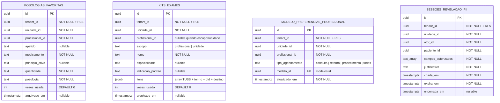
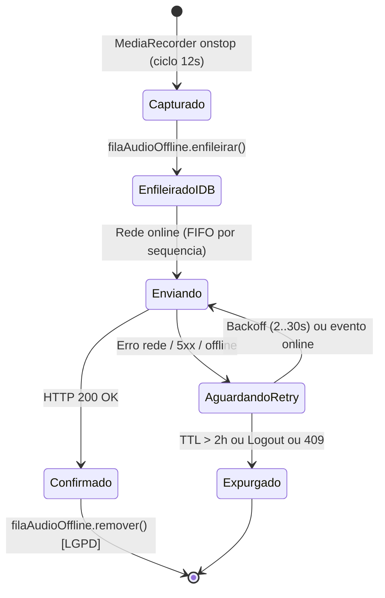

# RFC-PEP-029 — Ergonomia Clínica, Resiliência Anti-Perda e Aceleradores de Produtividade (30–40 Pacientes/Dia)

**Fase:** P2 — Onda D (UX Clínica, Resiliência Anti-Perda e Produtividade 30–40 pac/dia) · **Status:** Implementada
**ADRs relacionadas:** [[ADR-PEP-0003-postgres-rls-multitenant|ADR-PEP-0003]], [[ADR-PEP-0004-frontend|ADR-PEP-0004]], [[ADR-PEP-0007-prontuario-imutavel|ADR-PEP-0007]], [[ADR-PEP-0015-offline-prontuario|ADR-PEP-0015]], [[ADR-PEP-0017-orm-drizzle-rls|ADR-PEP-0017]], [[ADR-PEP-0018-monorepo-pnpm-turborepo|ADR-PEP-0018]], [[ADR-PEP-0019-drizzle-kit-migracoes-e-seed|ADR-PEP-0019]], [[ADR-PEP-0024-dados-de-referencia-ans|ADR-PEP-0024]], [[ADR-PEP-0027-indicacao-clinica-unica-por-atendimento|ADR-PEP-0027]], [[ADR-PEP-0030-separacao-pedido-externo-execucao-local-e-retorno|ADR-PEP-0030]], [[ADR-PEP-0031-separacao-papeis-checkout-recepcao-e-triagem|ADR-PEP-0031]], [[ADR-PEP-0033-governanca-ia-cfm-2454-e-seguranca-prescricao|ADR-PEP-0033]]
**RFCs relacionadas / dependências:** [[RFC-PEP-004-prontuario|RFC-PEP-004]], [[RFC-PEP-013-voz-ambiental|RFC-PEP-013]], [[RFC-PEP-015-frontend|RFC-PEP-015]], [[RFC-PEP-024-ux-escuta-revisao-e-documentos-clinicos|RFC-PEP-024]], [[RFC-PEP-025-estacao-enfermagem-assinatura-exames-resumo-e-baixa-checkout|RFC-PEP-025]], [[RFC-PEP-026-blindagem-regulatoria-autoria-sigilo-e-governanca-ia|RFC-PEP-026]], [[RFC-PEP-028-jornada-hibrida-grande-clinica-e-sae-enfermagem|RFC-PEP-028]]
**Telas impactadas:** 01 (Início), 03 (Agenda / Semana / Check-out / Triagem), 04 (Ficha do Paciente), 05/05a (Fila de Atendimentos e Prontuário), 06 (Escuta Ambiental), 07 (Revisão Pós-Consulta), 08 (Documentos do Atendimento), 09 (Construtor de Modelos), Shell (`Topbar` e `Sidebar`)

---

## 1. Contexto e Diagnóstico Factual

Em ambulatórios e clínicas de alta demanda no Brasil, médicos atendem rotineiramente **30 a 40 pacientes por dia** (~12 a 15 minutos por consulta), alternando entre consultório, exames de rotina, receitas recorrentes, retornos e interrupções simultâneas. Uma auditoria técnica completa sobre `apps/ui/src/` identificou três classes de problemas que hoje degradam a adoção clínica e introduzem risco operacional real:

### 1.1 Riscos concretos de perda silenciosa de dados e ações irreversíveis (auditados no código)

| Local auditado | Comportamento atual | Impacto clínico / operacional |
| :--- | :--- | :--- |
| `Atendimento.tsx:341` | `useEffect(() => () => clearTimeout(timer.current), [])` apenas cancela o timer de debounce no unmount | Alterações digitadas nos últimos `< 2 s` antes de sair da tela são **perdidas silenciosamente** |
| `Atendimento.tsx:472-493` | `Indicação clínica` só salva no clique explícito em `"Salvar indicação"` | Médico edita o Campo 23, navega para Documentos ou fecha a aba e perde o texto |
| `Documentos.tsx` (todo) | Nenhum auto-save em `CartaoReceita`, `CartaoAtestado`, `CartaoEncaminhamento` nem `CartaoResumo` | Queda de sessão, refresh ou troca de tela apaga toda a prescrição em andamento |
| `Atendimento.tsx`, `Documentos.tsx`, `TriagemDrawer.tsx`, `Voz.tsx`, `Construtor.tsx` | Ausência total de `beforeunload` e `useBlocker` (e `providers.tsx:13` usa `<BrowserRouter>`, que não suporta `useBlocker`) | Navegação acidental descarta formulários sujos ou mata gravação de voz ativa |
| `Voz.tsx:49-57` vs `app/offline-audio-queue.ts` | `filaAudioOffline` (IndexedDB) existe mas é **código morto**; `enviar()` apenas dá `toast.error` no `catch` | Queda momentânea de Wi-Fi durante a consulta provoca **perda irreversível do trecho de áudio** |
| `Atendimento.tsx:335` | `if (e.ctrlKey && e.key === 'Enter') fecharRef.current()` dispara fechamento imediato sem confirmação (e ignora `metaKey` no macOS) | Atalho acidental trava o prontuário como imutável (`ADR-PEP-0007`) e gera guia TISS prematuramente |
| `Documentos.tsx:167-175` e `:251-265` | `"Assinar pendentes e finalizar"` assina apenas docs já persistidos (ignora cartões sujos) e envia `{ cobrarConsultaRetorno: false }` hardcoded em retorno dentro da janela | Rascunho digitado na tela fica de fora da assinatura e médico perde a opção de cobrar consulta excepcional no retorno (divergindo de `Atendimento.tsx:375-418`) |
| `SlashMenu.tsx:15-21` e `editor/soap.ts:99-117` | Menu exibe `<Kbd>R/E/A/C</Kbd>`, mas `onKeyDown` não trata letras e `'encaminhamento'.startsWith('c')` é falso | Atalhos anunciados no editor não funcionam |
| `Layout.tsx:177`, `Layout.tsx:198`, `Home.tsx:106`, `Prontuario.tsx:139` | `"Unidade Centro"` hardcoded; botão de Ajuda sem `onClick`; atalhos `N` (`Home`) e `Enter` (`Prontuario`) exibidos em `<Kbd>` mas sem handler | Perda de confiança na interface e contexto incorreto em clínicas multi-unidade |
| `vite.config.ts:13` e `main.tsx:10` | `registerType: 'prompt'` configurado, mas `main.tsx` só chama `register('/sw.js')` sem listener de atualização | Clínicas ficam presas em versões antigas do bundle após deploy |

### 1.2 Atrito de jornada e ausência de aceleradores para alto volume

1. **Contagem real de cliques/rotas hoje:** uma consulta típica com prescrição + pedido de exame + atestado + entrega no balcão exige **27 a 41 cliques** e **4 a 8 trocas de rota** (`Agenda` → `Atendimento` → `Escuta` → `Revisão` → `Documentos` → `/imprimir` × N → `Atendimento` → `Agenda` → `CheckoutDrawer` → `/checkout/documentos/:id/imprimir` × N desmontando o drawer a cada clique).
2. **Sem memória operacional do médico:** não existe repetição de receita anterior em 1 clique, nem puxar problemas ativos da `LinhaDoTempo.tsx:41-42`, nem favoritos de posologia ou kits de exames.
3. **Modelos lentos de preencher:** `AbaModelo.tsx` obriga `<select>` + clique em `"Usar este modelo"` toda consulta; `FormularioModelo.tsx` renderiza qualquer seleção como `<select>` nativo (2 cliques por campo), não tem booleano nem `"Preencher tudo como normal"`, e `Atendimento.tsx:457` esconde completamente o editor SOAP quando a aba de modelo está aberta.
4. **Multi-atendimento e Check-out travados:** `Prontuario.tsx:92-100` mostra só 1 atendimento em andamento (`meusAbertos[0]` em `visoes.ts:189`); `CheckoutDrawer.tsx:103` usa `<Link>` na mesma aba, desmontando o drawer ao imprimir; `Agenda.tsx:38` fixa `ALTURA_LINHA = 160`, `Semana.tsx:135` mostra só `pacienteCodigo` em vez do nome, `Paciente.tsx:187` exige justificativa manual `>= 10` caracteres a cada revelação de telefone/CPF no balcão, e `CartaoExame` em `Documentos.tsx` não permite adicionar/remover pedidos (enquanto `Revisao.tsx:336` fixa `quantidade: 1`).

---

## 2. Objetivo e Métricas-Alvo

Equipar o PEP Tissia para operação real de **30–40 consultas/dia por médico** e balcão de alto fluxo, atingindo:

1. **Redução de atrito:** reduzir a jornada clínica completa padrão de **27–41 cliques / 4–8 trocas de rota** para **≤ 12–15 cliques / ≤ 2 trocas de rota**.
2. **Perda zero de dados clínicos:** 0% de descarte silencioso em unmount, navegação acidental ou queda de Wi-Fi durante gravação de voz ou prescrição.
3. **Prevenção de erros irreversíveis:** 100% das finalizações via teclado exigem confirmação contextual; `"Assinar pendentes e finalizar"` nunca deixa rascunho sujo para trás nem viola regras de retorno ou alergias ([[RFC-PEP-026-blindagem-regulatoria-autoria-sigilo-e-governanca-ia|RFC-PEP-026]]).
4. **Produtividade clínica composta:** repetir prescrição, puxar problemas ativos, aplicar kit de exames ou preencher exame físico normal em **1 clique**.

### 2.1 Jornada Clínica — Antes × Depois

```mermaid
flowchart TD
    subgraph ANTES["Antes — 27 a 41 cliques · 4 a 8 trocas de rota"]
        A1["Agenda (ALTURA_LINHA 160px, rolagem longa)"] --> A2["Atendimento (escolher modelo manualmente)"]
        A2 --> A3["Redigitar CIDs ativos e cada exame TUSS um a um"]
        A3 --> A4["Documentos (digitar cada medicamento + posologia do zero)"]
        A4 --> A5["Salvar cada card + Assinar cada card manualmente"]
        A5 --> A6["Imprimir 1 por 1 saindo da rota /documentos"]
        A6 --> A7["Voltar p/ Atendimento (ou perder rascunho sujo)"]
        A7 --> A8["Check-out: imprimir 1 por 1 desmontando CheckoutDrawer"]
    end

    subgraph DEPOIS["Depois (RFC-PEP-029) — <= 12 a 15 cliques · <= 2 trocas de rota"]
        D1["Agenda compacta ou Fila de Atendimentos (Enter inicia)"] --> D2["Atendimento (modelo padrão auto-carregado + chips 1 clique)"]
        D2 --> D3["Puxar CIDs ativos (1 clique) + Aplicar Kit de Exames (1 clique)"]
        D3 --> D4["Documentos (auto-save contínuo + Repetir última receita / Favoritos)"]
        D4 --> D5["Assinar pendentes e finalizar (flush automático + confirmação única)"]
        D5 --> D6["Imprimir todos (A4 consolidado em modal/nova aba sem perder rota)"]
        D6 --> D7["Check-out: badge de rascunho + Imprimir todos sem desmontar drawer"]
    end
```



---

## 3. Escopo

### 3.1 Dentro do escopo
- **Fatia F1:** auto-save completo (`Atendimento`, indicação clínica, `Documentos`), flush síncrono/keepalive no unmount, migração para Data Router (`createBrowserRouter`) com proteção `beforeunload` + `useBlocker`, integração real de `offline-audio-queue.ts` em `Voz.tsx`, confirmação de fechamento (`Cmd/Ctrl+Enter`) e unificação da regra de retorno em `Documentos.tsx`, `Cmd/Ctrl+S` global, correção do `SlashMenu`, ligação da Ajuda na topbar, nome real da unidade ativa, limpeza de atalhos fantasmas e prompt de atualização PWA.
- **Fatia F2:** repetir última prescrição em 1 clique (com checagem de alergias obrigatória), puxar CIDs/problemas ativos em 1 clique, tabelas multi-tenant e UI de `posologias_favoritas` e `kits_exames`, modelo padrão por profissional/tipo de agendamento, busca em `AbaModelo`, chips/booleano/`"Preencher tudo como normal"`/síntese para SOAP sem ocultar editor cegamente, e `BotaoImprimir` + check-out para `Resumo para o paciente`.
- **Fatia F3:** seletor/barra rápida de múltiplos atendimentos abertos (coordenado com `key={id}` da [[RFC-PEP-026-blindagem-regulatoria-autoria-sigilo-e-governanca-ia|RFC-PEP-026]]), renomeação do menu `/prontuario`, impressão consolidada (`"Imprimir todos"`) sem desmontar `CheckoutDrawer`, badge de rascunho não assinado no check-out, densidade configurável da `Agenda`, nome do paciente na visão `Semana` e alertas, sessão curta auditada de revelação PII no balcão, e componente uniforme de pedidos de exame entre `Atendimento`, `Revisao` e `Documentos`.

### 3.2 Fora do escopo
- Regras de segurança clínica crítica de alergias estruturadas/cruzamento de classes terapêuticas e remount `key={id}` do editor (especificados na [[RFC-PEP-026-blindagem-regulatoria-autoria-sigilo-e-governanca-ia|RFC-PEP-026]], consumidos aqui).
- Estação dedicada de enfermagem `/triagem`, assinatura de pedidos de exame externo, geração de resumo IA fora da escuta e baixa explícita de check-out (especificados na [[RFC-PEP-025-estacao-enfermagem-assinatura-exames-resumo-e-baixa-checkout|RFC-PEP-025]]).
- Certificado ICP-Brasil A3/nuvem ([[RFC-PEP-011-assinatura-icp-brasil|RFC-PEP-011]]) e envio automático de mensagens via WhatsApp.
- Alterações na API do motor `tissia-ia` (toda esta RFC opera estritamente dentro do domínio do `PEP`).

---

## 4. Modelo de Dados (DDL SQL Aditivo + RLS)

Seguindo [[ADR-PEP-0003-postgres-rls-multitenant|ADR-PEP-0003]], [[ADR-PEP-0017-orm-drizzle-rls|ADR-PEP-0017]] e [[ADR-PEP-0019-drizzle-kit-migracoes-e-seed|ADR-PEP-0019]]:
- Todas as alterações são **estritamente aditivas** (nenhuma coluna/tabela existente é removida ou renomeada).
- Toda tabela nova possui `tenant_id uuid NOT NULL`, recebendo automaticamente `ENABLE ROW LEVEL SECURITY`, `FORCE ROW LEVEL SECURITY` e a política `tenant_isolation` pelo script `apps/api/drizzle/rls/001_tenant_policies.sql` executado via `pnpm db:rls`.
- Sem FKs entre módulos distintos (`ADR-PEP-0017`); FKs apenas dentro do mesmo módulo.
- Preferências puramente visuais de densidade da agenda (`confortavel` | `compacta` | `ultra`) ficam no `ui-store.ts` (`localStorage`, sem PII), não exigindo tabela no PostgreSQL.

### 4.1 Diagrama Entidade-Relacionamento (Adições)



### 4.2 DDL SQL Aditivo (Migração Drizzle)

```sql
-- 1. Posologias favoritas por profissional (módulo: documentos)
CREATE TABLE IF NOT EXISTS public.posologias_favoritas (
  id uuid PRIMARY KEY,
  tenant_id uuid NOT NULL,
  unidade_id uuid NOT NULL,
  profissional_id uuid NOT NULL,
  apelido text,
  medicamento text NOT NULL,
  principio_ativo text,
  quantidade text NOT NULL,
  posologia text NOT NULL,
  vezes_usada integer NOT NULL DEFAULT 0,
  criado_em timestamptz NOT NULL DEFAULT now(),
  atualizado_em timestamptz NOT NULL DEFAULT now(),
  arquivado_em timestamptz,
  CONSTRAINT posologia_fav_apelido CHECK (apelido IS NULL OR char_length(apelido) BETWEEN 1 AND 80),
  CONSTRAINT posologia_fav_medicamento CHECK (char_length(medicamento) BETWEEN 1 AND 200),
  CONSTRAINT posologia_fav_quantidade CHECK (char_length(quantidade) BETWEEN 1 AND 60),
  CONSTRAINT posologia_fav_posologia CHECK (char_length(posologia) BETWEEN 1 AND 500),
  CONSTRAINT posologia_fav_vezes CHECK (vezes_usada >= 0)
);

CREATE INDEX IF NOT EXISTS ix_posologia_fav_prof
  ON public.posologias_favoritas (tenant_id, profissional_id, vezes_usada DESC, atualizado_em DESC)
  WHERE arquivado_em IS NULL;

-- 2. Kits de exames / protocolos clínicos (módulo: prontuario)
CREATE TABLE IF NOT EXISTS public.kits_exames (
  id uuid PRIMARY KEY,
  tenant_id uuid NOT NULL,
  unidade_id uuid NOT NULL,
  profissional_id uuid,
  escopo text NOT NULL DEFAULT 'profissional',
  nome text NOT NULL,
  especialidade text,
  indicacao_padrao text,
  itens jsonb NOT NULL,
  vezes_usado integer NOT NULL DEFAULT 0,
  criado_por uuid NOT NULL,
  criado_em timestamptz NOT NULL DEFAULT now(),
  atualizado_em timestamptz NOT NULL DEFAULT now(),
  arquivado_em timestamptz,
  CONSTRAINT kit_exame_escopo CHECK (escopo IN ('profissional', 'unidade')),
  CONSTRAINT kit_exame_dono CHECK ((escopo = 'profissional' AND profissional_id IS NOT NULL) OR (escopo = 'unidade')),
  CONSTRAINT kit_exame_nome CHECK (char_length(nome) BETWEEN 2 AND 100),
  CONSTRAINT kit_exame_indicacao CHECK (indicacao_padrao IS NULL OR char_length(indicacao_padrao) BETWEEN 1 AND 500),
  CONSTRAINT kit_exame_itens_array CHECK (jsonb_typeof(itens) = 'array' AND jsonb_array_length(itens) BETWEEN 1 AND 30),
  CONSTRAINT kit_exame_vezes CHECK (vezes_usado >= 0)
);

CREATE INDEX IF NOT EXISTS ix_kit_exame_consulta
  ON public.kits_exames (tenant_id, unidade_id, escopo, profissional_id, vezes_usado DESC)
  WHERE arquivado_em IS NULL;

-- 3. Preferência de modelo padrão por profissional e tipo de agendamento (módulo: modelos)
CREATE TABLE IF NOT EXISTS public.modelo_preferencias_profissional (
  id uuid PRIMARY KEY,
  tenant_id uuid NOT NULL,
  unidade_id uuid NOT NULL,
  profissional_id uuid NOT NULL,
  tipo_agendamento text NOT NULL DEFAULT 'todos',
  modelo_id uuid NOT NULL REFERENCES public.modelos(id),
  atualizado_em timestamptz NOT NULL DEFAULT now(),
  CONSTRAINT modelo_pref_tipo CHECK (tipo_agendamento IN ('consulta', 'retorno', 'procedimento', 'todos'))
);

CREATE UNIQUE INDEX IF NOT EXISTS ux_modelo_pref_prof_tipo
  ON public.modelo_preferencias_profissional (tenant_id, unidade_id, profissional_id, tipo_agendamento);

-- 4. Sessão curta auditada de revelação PII no balcão (módulo: pacientes)
CREATE TABLE IF NOT EXISTS public.sessoes_revelacao_pii (
  id uuid PRIMARY KEY,
  tenant_id uuid NOT NULL,
  unidade_id uuid NOT NULL,
  ator_id uuid NOT NULL,
  paciente_id uuid NOT NULL REFERENCES public.pacientes(id),
  campos_autorizados text[] NOT NULL,
  justificativa text NOT NULL,
  criada_em timestamptz NOT NULL DEFAULT now(),
  expira_em timestamptz NOT NULL,
  encerrada_em timestamptz,
  CONSTRAINT sessao_rev_justificativa CHECK (char_length(justificativa) BETWEEN 10 AND 300),
  CONSTRAINT sessao_rev_campos CHECK (cardinality(campos_autorizados) >= 1),
  CONSTRAINT sessao_rev_janela CHECK (expira_em > criada_em AND expira_em <= criada_em + interval '15 minutes')
);

CREATE INDEX IF NOT EXISTS ix_sessao_rev_ativa
  ON public.sessoes_revelacao_pii (tenant_id, ator_id, paciente_id, expira_em DESC)
  WHERE encerrada_em IS NULL;
```

> **Nota de RLS:** ao rodar `pnpm --filter @pep/api db:rls`, as quatro tabelas acima são detectadas automaticamente por `001_tenant_policies.sql` por possuírem `tenant_id uuid NOT NULL`. A suíte de testes de isolamento (`rls.spec.ts`) deve cobrir as quatro tabelas verificando que o tenant A nunca lê nem escreve registros do tenant B.

### 4.3 Evolução aditiva em JSONB (`modelo_versoes.definicao`)
Sem migração destrutiva de schema relacional: `CampoModeloSchema` em `packages/contracts/src/modelos.ts` ganha de forma retrocompatível:
- Novo literal em `TIPOS_CAMPO`: `'booleano'` (valores possíveis: `'Normal' | 'Alterado' | 'Não avaliado'` ou `'Sim' | 'Não'`, configurável via `opcoes` opcional com padrão `['Normal', 'Alterado', 'Não avaliado']`).
- `valorNormal?: string` (opcional — valor usado pelo botão `"Preencher tudo como normal"`).
- `secaoSoap?: 's' | 'o' | 'a' | 'p'` (opcional — indica em qual seção do SOAP o campo entra ao acionar `"Inserir síntese no SOAP"`, com default `'o'`).

---

## 5. Contratos HTTP e Schemas Zod `.strict()` (`@pep/contracts`)

Todos os objetos de entrada e saída utilizam Zod `.strict()` em `packages/contracts/src/` e erros em RFC 9457 (`Problem Details`).

### 5.1 Posologias Favoritas (`packages/contracts/src/documentos.ts`)

| Método e Rota | Permissão | Entrada / Saída |
| :--- | :--- | :--- |
| `GET /api/v1/documentos/posologias-favoritas?q=...` | `prontuario:escrever` | `ListaPosologiasFavoritasSchema` (apenas do profissional autenticado) |
| `POST /api/v1/documentos/posologias-favoritas` | `prontuario:escrever` | `CriarPosologiaFavoritaSchema` → `201` `PosologiaFavoritaSchema` |
| `PATCH /api/v1/documentos/posologias-favoritas/:id` | `prontuario:escrever` | `AtualizarPosologiaFavoritaSchema` → `200` `PosologiaFavoritaSchema` |
| `POST /api/v1/documentos/posologias-favoritas/:id/uso` | `prontuario:escrever` | sem corpo → incrementa `vezes_usada` (`204 No Content`) |
| `DELETE /api/v1/documentos/posologias-favoritas/:id` | `prontuario:escrever` | arquivamento lógico (`arquivado_em = now()`, `204`) |

```ts
export const PosologiaFavoritaSchema = z
  .object({
    id: z.string().uuid(),
    apelido: z.string().max(80).nullable(),
    medicamento: z.string().min(1).max(200),
    principioAtivo: z.string().max(200).nullable(),
    quantidade: z.string().min(1).max(60),
    posologia: z.string().min(1).max(500),
    vezesUsada: z.number().int().nonnegative(),
    atualizadoEm: z.string(),
  })
  .strict()

export const CriarPosologiaFavoritaSchema = z
  .object({
    apelido: z.string().trim().min(1).max(80).optional(),
    medicamento: z.string().trim().min(1).max(200),
    principioAtivo: z.string().trim().max(200).optional(),
    quantidade: z.string().trim().min(1).max(60),
    posologia: z.string().trim().min(1).max(500),
  })
  .strict()

export const AtualizarPosologiaFavoritaSchema = CriarPosologiaFavoritaSchema.partial()
  .strict()
  .refine((o) => Object.keys(o).length > 0, 'informe ao menos um campo')
```

### 5.2 Kits de Exames (`packages/contracts/src/prontuario.ts`)

| Método e Rota | Permissão | Entrada / Saída |
| :--- | :--- | :--- |
| `GET /api/v1/atendimentos/kits-exames?q=...` | `prontuario:escrever` | `ListaKitsExamesSchema` (kits do profissional + kits `escopo = 'unidade'` da unidade ativa) |
| `POST /api/v1/atendimentos/kits-exames` | `prontuario:escrever` | `CriarKitExamesSchema` → `201` `KitExamesSchema` |
| `PATCH /api/v1/atendimentos/kits-exames/:kitId` | `prontuario:escrever` | `AtualizarKitExamesSchema` → `200` `KitExamesSchema` (apenas autor ou `gestor`/`admin` em kit de unidade) |
| `DELETE /api/v1/atendimentos/kits-exames/:kitId` | `prontuario:escrever` | arquivamento lógico (`204`) |
| `POST /api/v1/atendimentos/:id/pedidos/aplicar-kit` | `prontuario:escrever` | `AplicarKitExamesSchema` → `200` `AtendimentoSchema` (insere itens não duplicados e preenche indicação se vazia) |

```ts
export const ItemKitExameSchema = z
  .object({
    tuss: z.string().regex(/^\d{8}$/, 'código TUSS deve ter 8 dígitos'),
    termo: z.string().trim().min(1).max(200),
    quantidade: z.number().int().min(1).max(99).default(1),
    destino: DestinoPedidoSchema.default('solicitacao_externa'),
  })
  .strict()

export const CriarKitExamesSchema = z
  .object({
    nome: z.string().trim().min(2).max(100),
    escopo: z.enum(['profissional', 'unidade']).default('profissional'),
    especialidade: z.string().trim().max(60).optional(),
    indicacaoPadrao: z.string().trim().min(1).max(LIMITE_INDICACAO).optional(),
    itens: z.array(ItemKitExameSchema).min(1).max(30),
  })
  .strict()

export const AplicarKitExamesSchema = z
  .object({
    kitId: z.string().uuid(),
    /** Quando o atendimento ainda não tem indicação clínica e o kit não define `indicacaoPadrao`. */
    indicacaoClinica: z.string().trim().min(1).max(LIMITE_INDICACAO).optional(),
    /** Permite sobrescrever o destino padrão de todos os itens na hora da aplicação. */
    destinoOverride: DestinoPedidoSchema.optional(),
  })
  .strict()
```

> **Validação ANS (`ADR-PEP-0024`):** na criação/edição de `kits_exames`, todo código `tuss` informado é validado contra a base TUSS vigente carregada no módulo `referencias`; códigos inexistentes retornam `422 Unprocessable Entity`.

### 5.3 Repetir Última Prescrição (`EmUsoSchema` aditivo em `documentos.ts`)

Evolução estritamente aditiva em `GET /api/v1/pacientes/:id/documentos/em-uso`:

```ts
export const EmUsoItemSchema = z
  .object({
    medicamento: z.string(),
    quantidade: z.string().optional(),
    posologia: z.string(),
    principioAtivo: z.string().nullable().optional(),
    receitadoEm: z.string(),
    atendimentoId: z.string().uuid(),
  })
  .strict()

export const EmUsoSchema = z
  .object({
    itens: z.array(EmUsoItemSchema),
    /** Última receita assinada completa do paciente para repetição em 1 clique (RFC-PEP-029). */
    ultimaReceita: z
      .object({
        documentoId: z.string().uuid(),
        atendimentoId: z.string().uuid(),
        assinadoEm: z.string(),
        itens: z.array(ItemReceitaSchema).min(1).max(20),
      })
      .strict()
      .nullable()
      .optional(),
  })
  .strict()
```

### 5.4 Preferências de Modelo Padrão (`modelos.ts`)

| Método e Rota | Permissão | Entrada / Saída |
| :--- | :--- | :--- |
| `GET /api/v1/modelos/preferencias/padrao` | `prontuario:escrever` | `{ itens: PreferenciaModeloPadrao[] }` |
| `PUT /api/v1/modelos/preferencias/padrao` | `prontuario:escrever` | `DefinirModeloPadraoSchema` → `200` `PreferenciaModeloPadraoSchema` |
| `DELETE /api/v1/modelos/preferencias/padrao/:tipoAgendamento` | `prontuario:escrever` | `204 No Content` |

```ts
export const TipoAgendamentoPreferenciaSchema = z.enum(['consulta', 'retorno', 'procedimento', 'todos'])

export const DefinirModeloPadraoSchema = z
  .object({
    tipoAgendamento: TipoAgendamentoPreferenciaSchema.default('todos'),
    modeloId: z.string().uuid(),
  })
  .strict()
```

### 5.5 Múltiplos Atendimentos Abertos, Check-out Consolidado e Sessão Curta PII

1. **`GET /api/v1/visoes/prontuario-inicio` (`visoes.ts`):** adicionar campo aditivo `emAndamentoLista`:
   ```ts
   export const AtendimentoEmAndamentoResumoSchema = z
     .object({
       atendimentoId: z.string().uuid(),
       pacienteId: z.string().uuid(),
       pacienteCodigo: z.string(),
       pacienteNome: z.string().nullable(),
       iniciadoEm: z.string(),
       documentosRascunhoCount: z.number().int().nonnegative(),
     })
     .strict()
   ```
   Mantém `emAndamento` (`emAndamentoLista[0] ?? null`) para 100% de retrocompatibilidade.

2. **`GET /api/v1/agenda/checkout` (`agenda.ts`):** adicionar campos aditivos em `ItemCheckoutAgendaSchema`:
   - `documentosRascunhoCount: z.number().int().nonnegative()` (default `0`)
   - `documentosRascunhoTipos: z.array(TipoDocumentoSchema)` (default `[]`) — apenas os tipos (`'receita'`, `'atestado'`, `'encaminhamento'`), **sem qualquer conteúdo clínico**.
   - Incluir em `documentosImpressao` o documento `'resumo_paciente'` quando `status === 'revisado'` (além dos documentos com `status === 'assinado'`).

3. **Impressão Consolidada (`CheckoutController`):**
   - `GET /api/v1/agenda/checkout/atendimentos/:atendimentoId/impressao-consolidada` (`@RequerPermissao('agenda:ler')` ou `'financeiro:receber_particular'`) retorna:
     ```ts
     export const ImpressaoConsolidadaCheckoutSchema = z
       .object({
         atendimentoId: z.string().uuid(),
         profissionalNome: z.string(),
         pacienteNome: z.string(),
         pacienteIdade: z.number().int().nonnegative(),
         atendimentoIniciadoEm: z.string(),
         cidAutorizado: z.string().nullable(),
         documentos: z.array(DocumentoSchema),
       })
       .strict()
     ```
     Retornando exclusivamente documentos assinados + resumo revisado (mesmas regras de segurança de `obterParaImpressaoCheckout`, sem SOAP e sem CID não autorizado).

4. **Sessão Curta de Revelação PII (`pacientes.ts`):**
   - Evolução aditiva em `RevelarDadosSchema` (`POST /api/v1/pacientes/:id/revelar`):
     ```ts
     export const MOTIVOS_REVELACAO_RAPIDA = [
       'Conferência de cadastro no check-in',
       'Confirmação de contato para retorno ou aviso',
       'Validação de carteirinha e elegibilidade do convênio',
       'Emissão de recibo ou nota fiscal particular',
     ] as const

     export const RevelarDadosSchema = z
       .object({
         campos: z.array(CampoRevelavelSchema).min(1),
         justificativa: z.string().trim().min(10).max(300).optional(),
         /** Reutiliza sessão curta válida (TTL 10 min) para o mesmo ator + paciente sem redigitar justificativa. */
         sessaoRevelacaoId: z.string().uuid().optional(),
         /** Abre uma sessão curta de 10 minutos para os campos solicitados nesta ficha. */
         abrirSessaoCurta: z.boolean().optional(),
       })
       .strict()
       .refine((o) => !!o.justificativa || !!o.sessaoRevelacaoId, {
         message: 'informe a justificativa ou uma sessão de revelação ativa',
         path: ['justificativa'],
       })
     ```
   - Resposta `RevelacaoSchema` ganha campos opcionais `sessaoRevelacaoId?: string` e `sessaoExpiraEm?: string`.

---

## 6. Divisão em Fatias de Implementação (F1..F3)

---

### Fatia F1 — Resiliência Anti-Perda de Dados, Confirmação de Fechamento e Higiene de Atalhos

**Prioridade:** Crítica (bloqueia riscos de perda de dados em produção).

#### F1.1 Auto-save completo + flush no unmount
- **Correção em `Atendimento.tsx:341`:**
  - Extrair hook `useAutoSaveComFlush` que:
    1. Mantém `sujoRef` e `ultimoPayloadRef` atualizados a cada edição de SOAP, CIDs e campos do modelo.
    2. No cleanup do `useEffect` de unmount (troca de rota SPA), em vez de apenas `clearTimeout(timer.current)`, verifica `if (sujoRef.current && !fechadoRef.current)` e dispara `salvarRef.current()` (com fallback para `cofre.enfileirar` caso a requisição seja abortada).
    3. Registra listener `visibilitychange` (`hidden`) e `pagehide` disparando `fetch(..., { method: 'PUT', keepalive: true, headers, body })` quando houver alterações pendentes, garantindo persistência mesmo se o usuário fechar a aba do navegador.
- **Auto-save em `Indicação clínica` (`Atendimento.tsx:472-493` e `useIndicacaoUnica.ts`):**
  - Adicionar debounce de `1500 ms` + `onBlur` chamando `atendimentoApi.definirIndicacaoPedidos` sempre que `indicacaoTexto.trim().length > 0` e diferente de `(a.indicacaoPedidos ?? '').trim()`.
  - Exibir status discreto ao lado do contador de caracteres: `"Salvando indicação…"`, `"Salva às HH:MM"` ou `"Alterações não salvas"`. Manter botão `"Salvar indicação"` para acionamento imediato ou reenvio após falha.
- **Auto-save em `Documentos.tsx`:**
  - Aplicar debounce (`1800 ms`) + `onBlur` nos quatro cartões (`CartaoReceita`, `CartaoAtestado`, `CartaoEncaminhamento`, `CartaoResumo`) sempre que o documento não estiver assinado (`!ass`) e o estado atual passar na validação Zod do respectivo tipo:
    - `CartaoReceita`: ao menos 1 item completo (`medicamento`, `quantidade`, `posologia`).
    - `CartaoAtestado`: `valido === true`.
    - `CartaoEncaminhamento`: `especialidade.trim()` e `motivo.trim()` preenchidos.
    - `CartaoResumo`: `texto.trim()` preenchido (preservando `revisado: false` até o médico marcar o checkbox explícito).
  - Para cartões **parcialmente preenchidos** (ainda inválidos para o servidor, ex.: digitou medicamento mas ainda falta posologia), marcar o cartão no registro `cartoesSujos` do pai `Documentos.tsx` (disparando proteção de saída suja) e exibir indicador `"Rascunho incompleto — preencha os campos obrigatórios para salvar"`.
  - Suprimir `toast.success('Rascunho salvo')` repetitivo durante auto-save silencioso (usar selo inline `"Salvo HH:MM"` no cabeçalho do cartão; manter toast apenas em clique manual ou assinatura).

#### F1.2 Proteção global contra saída suja (`beforeunload` + `useBlocker`)
- **Pré-requisito arquitetural em `apps/ui/src/app/providers.tsx` e `App.tsx`:**
  - `useBlocker` do `react-router` v7 requer um **Data Router**. Migrar `<BrowserRouter>` em `providers.tsx:13` para `createBrowserRouter` + `<RouterProvider>` envolvendo a árvore de rotas atual em um layout raiz (`<RootLayout />` contendo `<NuqsAdapter>`, `QueryClientProvider`, `CommandPalette`, `BannerAtualizacaoPwa`, `Toaster` e a compatibilidade com `#/rota`).
  - Criar utilitário de teste `renderComDataRouter()` para os testes Vitest/Testing Library continuarem usando `createMemoryRouter`.
- **Hook `useProtecaoSaidaSuja` (`apps/ui/src/app/use-protecao-saida.ts`):**
  - Recebe `{ bloqueado: boolean; titulo?: string; descricao?: string; aoSalvarAntes?: () => Promise<boolean> }`.
  - Liga `window.addEventListener('beforeunload', ...)` quando `bloqueado === true`.
  - Liga `useBlocker(({ currentLocation, nextLocation }) => bloqueado && (currentLocation.pathname !== nextLocation.pathname || currentLocation.search !== nextLocation.search))`.
  - Quando bloqueado, abre `<Dialog>` acessível com três ações:
    1. `"Continuar editando"` (`blocker.reset()`) — foco padrão seguro;
    2. `"Salvar e sair"` (quando `aoSalvarAntes` fornecido: executa flush e só chama `blocker.proceed()` se retornar `true`);
    3. `"Sair sem salvar"` (`blocker.proceed()`, variante destrutiva).
- **Aplicação obrigatória em 5 pontos:**
  1. `Atendimento.tsx`: ativo quando evolução, modelo ou indicação clínica tiverem alterações não confirmadas no servidor.
  2. `Documentos.tsx`: ativo quando qualquer cartão tiver edições não persistidas ou rascunho incompleto.
  3. `TriagemDrawer.tsx` (e futura `EstacaoTriagem` da [[RFC-PEP-025-estacao-enfermagem-assinatura-exames-resumo-e-baixa-checkout|RFC-PEP-025]]): além de `beforeunload`/`useBlocker`, interceptar `onOpenChange(false)` do `<Dialog>` do drawer quando `sujo === true`, pedindo confirmação antes de descartar sinais vitais.
  4. `Voz.tsx`: ativo enquanto `gravando === true`, `enviando > 0` ou houver chunks pendentes em `filaAudioOffline` — texto específico: *"A escuta ambiental está ativa. Sair agora interromperá a captação de áudio."*
  5. `Construtor.tsx`: ativo quando `editavel && sujo`.

#### F1.3 Áudio resiliente offline (`offline-audio-queue.ts` → `Voz.tsx`)
- Evoluir `ChunkAudioPendente` em `apps/ui/src/app/offline-audio-queue.ts` (versão 2 do IndexedDB `tissia-audio-buffer` com upgrade não-destrutivo) para incluir:
  ```ts
  export interface ChunkAudioPendente {
    id: string
    atendimentoId: string
    sessaoId: string
    sequencia: number
    inicioS: number
    estruturar: boolean
    blob: Blob
    criadoEm: number
    tentativas: number
  }
  ```
- **Fluxo de resiliência em `Voz.tsx:49-57`:**
  1. Ao fechar cada ciclo de 12 s (`r.onstop`), gravar imediatamente no IndexedDB (`filaAudioOffline.enfileirar(...)`) antes da chamada HTTP.
  2. Executar dreno sequencial (FIFO por `sequencia`): envia `escutaApi.audio(chunk.sessaoId, ...)`. Em `200 OK`, chama `filaAudioOffline.remover(chunk.id)` e atualiza `sessao`.
  3. Em erro transitório (falha de rede, `offline`, timeout ou `5xx`): **não descartar** o chunk; incrementar `tentativas`, agendar nova tentativa com backoff exponencial (`2s → 4s → 8s → 15s → 30s`) e escutar `window.addEventListener('online', drenarFila)`.
  4. Em erro definitivo de negócio (`404`, `409` sessão já encerrada, `413`): remover o chunk da fila e exibir toast claro.
  5. **Feedback visual (`Voz.tsx:193`):** exibir badge âmbar `"Sem rede · N trecho(s) salvo(s) localmente"` ou `"Sincronizando N trecho(s)…"`.
  6. **Ao acionar `"Encerrar e revisar"`:** se houver chunks pendentes e conexão ativa, drenar toda a fila antes de chamar `escutaApi.encerrar(sessao.id)`; se estiver offline, exibir diálogo informando quantos trechos ainda não subiram e oferecer `"Aguardar reconexão"` (padrão) ou `"Encerrar apenas com trechos já transcritos"`.
  7. **Higiene LGPD (`ADR-PEP-0013` — zero retenção permanente de áudio):**
     - Cada chunk é apagado do IndexedDB no milissegundo seguinte ao `200 OK`.
     - Chunks com idade `> 2 horas` são expurgados automaticamente ao abrir o cofre.
     - `sair()` em `apps/ui/src/auth/sessao.ts` invoca `filaAudioOffline.limparTudo()` no logout.



#### F1.4 Proteção contra ações irreversíveis (`Atendimento.tsx` e `Documentos.tsx`)
- **Diálogo de confirmação no fechamento (`Atendimento.tsx:335` e `:371`):**
  - Corrigir atalho para `(e.ctrlKey || e.metaKey) && e.key === 'Enter'` (atualizando `<Kbd>` conforme plataforma: `⌘ ↵` no macOS, `Ctrl ↵` em Windows/Linux).
  - Tanto o atalho quanto o botão `"Finalizar atendimento"` abrem `<DialogConfirmarFinalizacao />` exibindo:
    - Alerta explícito de imutabilidade (`ADR-PEP-0007`: *"Após finalizar, esta evolução não poderá ser editada — apenas complementada por adendo"*).
    - Resumo conferível: CIDs registrados (ou aviso amarelo se 0 CID em convênio), quantidade de pedidos (`execucao_unidade` vs `solicitacao_externa`), documentos em rascunho ainda não assinados (com checkbox opcional `"Assinar N documento(s) pendente(s) antes de finalizar"`), e `<BannerRetornoJanela />` quando `retornoDentroJanela === true`.
    - Botão primário `"Confirmar e finalizar"` (acionável com `Enter` dentro do diálogo) e `"Cancelar"` (`Esc`).
- **Correção de `"Assinar pendentes e finalizar"` e regra de retorno em `Documentos.tsx:167-175` e `:251-265`:**
  - Criar registro imperativo de handlers de flush dos cartões (`Map<string, () => Promise<ResultadoFlushCartao>>`):
    - Antes de assinar, `Documentos.tsx` executa o flush de todos os cartões sujos.
    - Se algum cartão estiver **incompleto** ou com **conflito de alergia**, aborta a finalização, rola até o cartão com erro e exibe toast explicativo.
    - Só após persistir todos os cartões sujos executa `documentosApi.assinar(id)` (capturando inclusive os recém-salvos) e em seguida `atendimentoApi.fechar(id, payloadRetorno)`.
  - Extrair `<BannerRetornoJanela />` (reaproveitando a UI de `Atendimento.tsx:375-418`) e incluí-lo no fluxo de finalização de `Documentos.tsx`, eliminando o hardcode `{ cobrarConsultaRetorno: false }` de `Documentos.tsx:173`.

#### F1.5 Higiene de atalhos, UI e atualização PWA
- **`Cmd/Ctrl+S` global:** registrar `useHotkeys('mod+s', ..., { enableOnFormTags: true, preventDefault: true })` nas telas com edição (`Atendimento`, `Documentos`, `Construtor`, `TriagemDrawer`), disparando salvamento imediato sem abrir o diálogo nativo "Salvar página como" do navegador.
- **Correção do `SlashMenu.tsx` + `editor/soap.ts`:**
  - Em `editor/soap.ts:117`: atualizar o filtro de `Suggestion.items` para casar tanto por prefixo do `id` quanto pela letra de atalho: `COMANDOS.filter((c) => c.id.startsWith(q) || c.atalho.toLowerCase() === q)`.
  - Em `SlashMenu.tsx:15-21`: suportar `Alt+R`, `Alt+E`, `Alt+A`, `Alt+C` (e disparo imediato por `Enter`/`Tab` sobre o item filtrado) e exibir claramente `<Kbd>/r</Kbd>`, `<Kbd>/e</Kbd>`, `<Kbd>/a</Kbd>`, `<Kbd>/c</Kbd>` — eliminando o atalho quebrado de `C` para `/encaminhamento`.
- **Botão de Ajuda e Modal de Atalhos (`Layout.tsx:198` + `CommandPalette.tsx` + `ui-store.ts`):**
  - Mover estado `ajudaAtalhosAberta` para `ui-store.ts`.
  - Ligar `onClick={() => useUiStore.getState().definirAjudaAtalhos(true)}` no botão `aria-label="Ajuda e atalhos"` de `Layout.tsx:198` e no rodapé `"Atalhos ?"` da `Sidebar` (`Layout.tsx:147-149`).
  - Organizar o modal de ajuda em duas seções: **Navegação global** (`Ctrl/⌘ K`, `G A`, `G P`, `G F`...) e **Tela atual** (ex.: em `Atendimento`: `Ctrl/⌘ S`, `Ctrl/⌘ ↵`, `V`, `/r /e /a /c`; em `Revisão`: `J/K/A/E/D/Shift+A`; em `Voz`: `P/M`).
- **Nome real da unidade ativa (`Layout.tsx:177`):**
  - Extrair hook `useUnidadeAtiva()` (usando `['eu', 'unidades']` e `sessao?.unidadeId`, igual a `BlocoUsuario` em `Layout.tsx:48-49`).
  - Exibir `unidadeAtiva?.nome ?? (oidc ? 'Selecionar unidade' : 'Unidade de demonstração')` no botão `aria-label="Trocar unidade"` da `Topbar`, removendo a string fixa `"Unidade Centro"`.
- **Remoção/implementação de atalhos fantasmas:**
  - `Home.tsx:106`: remover a menção falsa a `<Kbd>N</Kbd> nova evolução` e renderizar apenas os atalhos reais do perfil (incluindo `G T` / `G R` para fila de atendimentos quando tiver `prontuario:escrever` e `G A` para Agenda).
  - `Prontuario.tsx:139`: implementar `useHotkeys('enter', ...)` quando `proximo && !iniciar.isPending` e foco fora de elementos interativos (`input`, `textarea`, `select`, `button`, `a`, `[role="dialog"]`), iniciando o próximo atendimento da fila conforme anunciado pelo `<Kbd>Enter</Kbd>`.
- **Prompt de atualização do Service Worker PWA (`vite.config.ts` + `main.tsx`):**
  - Substituir `navigator.serviceWorker.register('/sw.js')` manual em `main.tsx:10` por `registerSW` de `virtual:pwa-register` (mantendo `registerType: 'prompt'` e zero cache de API conforme `ADR-PEP-0015`).
  - Exibir banner discreto no topo/rodapé (`<BannerAtualizacaoPwa />`) quando `onNeedRefresh` disparar: `"Nova versão da Tissia pronta — Atualizar"`.
  - Se houver formulário clínico sujo ou escuta ativa (`ui-store.ts -> bloqueiosReload > 0`), exibir aviso `"A atualização será aplicada assim que você salvar e concluir esta tela"` e **nunca** recarregar automaticamente.

---

### Fatia F2 — Aceleradores Clínicos para 30–40 Pacientes/Dia

**Prioridade:** Alta (impacto direto no tempo por consulta).

#### F2.1 Repetir última prescrição (1 clique)
- **Em `Documentos.tsx` (`CartaoReceita`):**
  - Consultar `GET /api/v1/pacientes/:id/documentos/em-uso` (reaproveitando cache `['paciente', pacienteId, 'em-uso']`).
  - Quando `ultimaReceita` existir e o cartão atual não estiver assinado, exibir botão `"Repetir última receita (DD/MM)"` no topo do `CartaoReceita`.
  - Ao clicar:
    - Se o cartão estiver vazio, preenche diretamente todos os itens (`medicamento`, `principioAtivo`, `quantidade`, `posologia`) e aciona o auto-save.
    - Se o cartão já tiver itens digitados, abre escolha rápida `"Acrescentar aos itens atuais"` vs `"Substituir itens"`.
    - Executa imediatamente `conflitosAlergia` (incluindo o motor estendido de princípio ativo/classe da [[RFC-PEP-026-blindagem-regulatoria-autoria-sigilo-e-governanca-ia|RFC-PEP-026]]). Se houver alergia recém-registrada na triagem ([[RFC-PEP-025-estacao-enfermagem-assinatura-exames-resumo-e-baixa-checkout|RFC-PEP-025]]), o alerta vermelho aparece no ato e **trava o botão Assinar** até resolução.
- **Em `LinhaDoTempo.tsx:47-49`:**
  - Adicionar ação discreta `"Repetir"` ao lado de cada item de `"Receitado nos últimos 90 dias"` (e botão `"Repetir última receita"` no cabeçalho da subseção) levando para `/atendimento/:id/documentos?foco=receita&repetir=ultima` (ou `repetirItem=...`), pré-carregando o rascunho sem jamais assinar automaticamente.

#### F2.2 Puxar CIDs / Problemas ativos (1 clique)
- **Em `LinhaDoTempo.tsx:41-42`:**
  - Evoluir as props de `LinhaDoTempo` para aceitar `cidsAtuais?: string[]`, `somenteLeitura?: boolean`, `aoAdicionarCid?: (cid: string) => void` e `aoAdicionarTodosCids?: (cids: string[]) => void`.
  - Substituir o `<p>` estático por lista de chips clicáveis (`CID <codigo>`):
    - Ainda não adicionado no atendimento atual: botão com `+` e tooltip `"Adicionar ao atendimento atual"`.
    - Já adicionado: chip com checkmark verde e `aria-pressed="true"` (desabilitado).
  - Quando houver `>= 2` problemas ativos pendentes e `!somenteLeitura`, exibir botão compacto `"Puxar ativos (N)"` que adiciona todos de uma única vez via `mudarCids` (disparando o auto-save da evolução).

#### F2.3 Favoritos do Profissional (`posologias_favoritas` e `kits_exames`)
- **Posologias Favoritas (`CartaoReceita`):**
  - Em cada item preenchido da receita, botão ícone estrela (`☆ Salvar favorito`): abre popover leve com `apelido` opcional (ex.: *"Analgesia padrão adulto"*) e salva em `POST /api/v1/documentos/posologias-favoritas`.
  - No topo do `CartaoReceita`, seletor/popover `"Favoritos (N)"` com filtro instantâneo por apelido, medicamento ou princípio ativo. Um clique insere o item preenchido na receita, dispara `POST .../uso` em segundo plano (melhorando a ordenação por frequência) e executa checagem de alergias.
  - Gerenciamento completo (editar posologia, renomear apelido, arquivar) em modal acessível pelo próprio popover e na aba de preferências em `DadosProfissionais.tsx`.
- **Kits de Exames (`Atendimento.tsx` e `Documentos.tsx`):**
  - Botão `"Aplicar kit de exames"` ao lado de `"+ Pedido de exame"` (abre popover/modal com abas **"Meus kits"** e **"Kits da unidade"** + busca instantânea).
  - Cada kit exibe nome, quantidade de exames (ex.: *"5 exames · solicitação externa"*) e prévia dos termos TUSS oficiais.
  - Em **1 clique**, chama `POST /api/v1/atendimentos/:id/pedidos/aplicar-kit`:
    - Adiciona todos os procedimentos TUSS do kit que ainda não estão no atendimento (evitando duplicatas silenciosamente e avisando `"4 exames adicionados (1 já estava na lista)"`).
    - Se `atendimento.indicacaoPedidos` estiver vazio e o kit tiver `indicacaoPadrao`, pré-preenche e salva a indicação única (editável pelo médico).
    - Botão `"+ Salvar lista atual como kit"` disponível quando o atendimento já possui `>= 1` pedido, permitindo transformar qualquer conjunto recorrente em kit pessoal ou da unidade sem sair da consulta.

#### F2.4 Ergonomia dos Modelos de Especialidade
- **Modelo padrão por profissional / tipo de agendamento:**
  - Na `AbaModelo.tsx`: quando um modelo estiver vinculado, exibir botão `"Usar como padrão"` (com opções `"Para todas as consultas"`, `"Apenas Consultas"`, `"Apenas Retornos"`, `"Apenas Procedimentos"`).
  - Em `ProntuarioService.iniciar`: buscar preferência ativa do profissional para o `tipo` do agendamento (fallback `'todos'`). Se existir e o modelo tiver versão `'publicada'` ativa, preencher automaticamente `atendimentos.modeloVersaoId` na criação do atendimento. O médico continua livre para remover ou trocar o modelo enquanto o atendimento estiver aberto.
- **Busca e seleção em 1 clique em `AbaModelo.tsx:33-40`:**
  - Substituir o `<select>` + botão `"Usar este modelo"` por campo de busca instantânea (`especialidade` ou `nome`) + lista clicável destacando o modelo padrão e os últimos 3 modelos usados pelo profissional. Um único clique vincula o modelo imediatamente.
- **Chips / Segmented Controls em `FormularioModelo.tsx:28-37`:**
  - Se `c.tipo === 'selecao'` e `(c.opcoes?.length ?? 0) <= 4`: renderizar como botões horizontais `role="radiogroup"` (mesma ergonomia visual da escala 0–10 de `FormularioModelo.tsx:19-24`, com toggle para limpar ao clicar novamente se não obrigatório), cortando os cliques pela metade.
  - Se `c.opcoes.length > 4`: manter `<select>` (ou combobox pesquisável se `> 10`).
- **Tipo `'booleano'` e `"Preencher tudo como normal"`:**
  - Adicionar `['booleano', 'Sim / Não / Normal']` na paleta do `Construtor.tsx:15` e na seção de propriedades permitir definir o conjunto de rótulos (`Normal / Alterado / Não avaliado` ou `Sim / Não`) e o campo opcional `valorNormal`.
  - Em `FormularioModelo.tsx`: renderizar `'booleano'` como chips compactos de 1 clique; permitir que `exibirSe` e `vinculos` no `Construtor.tsx` também aceitem campos `'booleano'`.
  - No topo da `AbaModelo.tsx` (quando `!fechado` e o modelo tiver `>= 1` campo com `valorNormal` definido ou tipo `'booleano'`): exibir botão `"Preencher campos vazios como normal"` que preenche em lote **somente os campos atualmente vazios/nulos**, preservando qualquer achado já preenchido pelo médico.
- **Síntese para o SOAP sem ocultar o editor cegamente (`Atendimento.tsx:456-457`):**
  - Em viewports largos (`>= 1280px`), adicionar toggle `"Ver lado a lado"` na barra de abas (`Evolução SOAP | Modelo | Dividir`), exibindo SOAP e Modelo simultaneamente sem `hidden`.
  - Na `AbaModelo.tsx`, adicionar botão `"Inserir síntese no SOAP"`: executa a função pura isomórfica `sintetizarModeloParaSoap(definicao, valores)` (em `@pep/contracts`), gera texto legível agrupado por `secaoSoap` (apenas campos visíveis preenchidos e escores calculados) e anexa no final das seções correspondentes do editor Tiptap sem apagar o que o médico já digitou, com confirmação caso uma síntese anterior já tenha sido inserida.

#### F2.5 Impressão do Resumo para o Paciente e Entrega no Check-out
- Em `Documentos.tsx:862-870` (`CartaoResumo`): adicionar `<BotaoImprimir doc={doc} tipo="resumo_paciente" />` no cabeçalho (mesmo padrão de Receita, Atestado e Encaminhamento).
- Em `FolhaDocumentoImpressao.tsx:82-86`: quando `d.tipo === 'resumo_paciente'`, ajustar o rodapé para exibir *"Resumo revisado por [profissionalNome]"* quando `d.status === 'revisado'` (em vez de tarja vermelha de rascunho não assinado), reservando a tarja de rascunho apenas para `d.status === 'rascunho'`.
- Em `CheckoutService` (`checkout.service.ts`) e `DocumentosService.assinadosPorAtendimentos`: incluir documentos `resumo_paciente` com `status = 'revisado'` na lista `documentosImpressao` do check-out da recepção (alinhado à [[RFC-PEP-025-estacao-enfermagem-assinatura-exames-resumo-e-baixa-checkout|RFC-PEP-025]]).

---

### Fatia F3 — Redução de Cliques na Jornada Clínica, Multi-Atendimento e Check-out Fluido

**Prioridade:** Média-Alta (fluidez ponta a ponta entre consultório e balcão).

#### F3.1 Seletor de múltiplos atendimentos abertos e clareza na navegação lateral
- **API (`apps/api/src/modulos/prontuario/visoes.ts:189-191`):** popular `emAndamentoLista` com todos os atendimentos em `meusAbertos` (ordenados por `iniciadoEm DESC`), incluindo contagem de documentos em rascunho por atendimento.
- **Tela `Prontuario.tsx:92-100`:** substituir o card único por `<CardAtendimentosAbertos />` listando todos os atendimentos abertos do médico (ex.: `"2 atendimentos abertos"`), cada um com nome, tempo decorrido, selo de rascunhos pendentes e botão `"Continuar"`.
- **Alternador rápido na `Topbar` / cabeçalho de `Atendimento.tsx`:** quando o médico possuir `>= 2` atendimentos abertos, exibir pill clicável `"N abertos ▾"` permitindo alternar de paciente em 1 clique sem passar pela fila nem pela agenda. Coordenado com `<Atendimento key={id} />` da [[RFC-PEP-026-blindagem-regulatoria-autoria-sigilo-e-governanca-ia|RFC-PEP-026]] e com o flush automático da F1.1, garantindo **zero contaminação de estado** entre pacientes.
- **Renomeação na `Sidebar` (`Layout.tsx:21`):** alterar o rótulo do item `id: 'prontuario'` de `"Prontuário"` para `"Atendimentos"` (mantendo a rota `/prontuario` e permissão `prontuario:escrever` intactas) e exibir pill discreto com a contagem de atendimentos em aberto do médico quando `> 0`.

#### F3.2 Impressão consolidada (`"Imprimir todos"`) sem desmontar `CheckoutDrawer` + alerta de rascunho
- **Novo componente `<ModalImpressaoConsolidada />` e rota de impressão em lote:**
  - Suporta tanto uso médico (`/atendimento/:id/documentos/imprimir-todos` ou modal inline a partir de `Documentos.tsx`) quanto uso de check-out (`/checkout/atendimentos/:atendimentoId/imprimir-todos` ou modal inline a partir de `CheckoutDrawer.tsx`).
  - Renderiza cada documento em uma `<article className="... print:break-after-page last:print:break-after-auto">` reutilizando a formatação de `FolhaDocumentoImpressao.tsx` (1 página A4 por documento, sem misturar receita com atestado na mesma folha).
  - Permite desmarcar rapidamente algum documento específico antes de acionar `window.print()`.
- **Preservação de contexto no `CheckoutDrawer.tsx:102-108`:**
  - Alterar o botão individual `"Imprimir"` de cada documento e o novo botão primário `"Imprimir todos (N)"` para abrir o `<ModalImpressaoConsolidada />` sobre o drawer (ou em nova aba via `target="_blank" rel="noopener noreferrer"`), **jamais** desmontando o `CheckoutDrawer` nem navegando para fora de `/agenda`.
  - Assim, a recepção conclui pagamento particular, imprime o pacote completo de documentos e agenda o retorno em **um único fluxo contínuo**.
- **Badge de alerta para documentos em rascunho no Check-out:**
  - Em `CheckoutService.listar`: consultar contagem e tipos de documentos com `status = 'rascunho'` nos atendimentos do dia (apenas contagem + tipo, zero texto clínico).
  - Em `PainelCheckoutDia` (`Agenda.tsx:374-378`) e `CheckoutDrawer.tsx:73-78`: quando `item.documentosRascunhoCount > 0`, exibir badge âmbar proeminente: `"⚠ N doc(s) em rascunho — aguardando assinatura médica"` com lista de tipos pendentes (ex.: *"Receita, Atestado"*), evitando retrabalho e constrangimento no balcão.

#### F3.3 Agenda compacta, nomes visíveis e revelação ágil de PII no balcão
- **Densidade configurável da grade (`Agenda.tsx:38` e `:199`):**
  - Adicionar preferência `densidadeAgenda: 'confortavel' | 'compacta' | 'ultra'` em `ui-store.ts` (persistida em `localStorage`, padrão `'compacta'` = `96px`; `'confortavel'` = `160px`; `'ultra'` = `72px`).
  - Controle segmentado discreto na barra da Agenda (`Dia` e `Salas`).
  - Nos modos `'compacta'` e `'ultra'`:
    - Linha 1: `HH:MM · Nome do paciente · Tipo` + badges críticos (`Chegou`, `Triado`, `Inelegível`/`Aut. pendente`).
    - Linha 2: convênio/sala + CTA principal único do estágio atual (`Registrar chegada` | `Triagem` | `Iniciar atendimento` | `Abrir prontuário`) + menu `⋯` (ou clique no card abrindo `DetalheAgendamento`) para `Remarcar` e `Cancelar`.
  - Mantém o cálculo exato da linha de hora atual (`marginTop: ((minAgora % 30) / 30) * alturaLinha`).
- **Nome do paciente na visão `Semana` e painéis de pendência:**
  - `Semana.tsx:135`: trocar `{hora(a.inicio)} · {a.pacienteCodigo}` por `{hora(a.inicio)} · {a.pacienteNome ?? a.pacienteCodigo}` (com `truncate` e `title` completo).
  - `Semana.tsx:196`, `Agenda.tsx:292` e `Agenda.tsx:303`: exibir `{a.pacienteNome ?? a.pacienteCodigo}` acompanhado do código curto em texto secundário (`text-mut`).
- **Sessão curta auditada de revelação de telefone/CPF no balcão (`Paciente.tsx:125-190`):**
  - Em `Paciente.tsx`, adicionar botão de olho inline (`👁`) ao lado dos campos mascarados principais (`CPF`, `Celular`, `Carteirinhas`).
  - Se já existir uma sessão curta ativa (`sessaoRevelacao` em estado React com `expiraEm > agora`), clicar no olho revela o campo imediatamente em 1 clique reutilizando `sessaoRevelacaoId` (o backend valida a sessão, devolve o dado e grava evento `paciente.dado_revelado_sessao` na auditoria).
  - Se não houver sessão ativa, abre popover/modal simplificado com **4 chips de motivo em 1 clique** (`MOTIVOS_REVELACAO_RAPIDA`), opção `"Manter acesso nesta ficha por 10 min"` (marcada por padrão) e campo livre opcional.
  - Exibir selo discreto `"Dados sensíveis visíveis · oculta em MM:SS"` com botão `"Ocultar agora"` (que chama limpeza imediata em memória e encerra a sessão). Ao expirar o timer (10 min) ou desmontar `Paciente.tsx`, os dados em claro são automaticamente limpos da memória.

#### F3.4 Uniformização de Pedidos de Exame (`Atendimento.tsx`, `Revisao.tsx`, `Documentos.tsx`)
- Extrair componente reutilizável `<PedidosExameEditor />` em `apps/ui/src/pages/atendimento/PedidosExameEditor.tsx` consumido em:
  1. `Atendimento.tsx` (seção de pedidos abaixo dos CIDs);
  2. `Revisao.tsx` (painel lateral direito — corrigindo `Revisao.tsx:336` para incluir input numérico `quantidade` `1..99` tanto no pedido manual quanto nos pedidos sugeridos pela escuta);
  3. `Documentos.tsx` (`CartaoExame` — substituindo a visualização hoje estritamente *read-only* de `Documentos.tsx:556-568` por edição completa enquanto `!fechado`: adicionar exame via `BuscaCatalogo tipo="tuss"`, aplicar Kit de Exames da F2, ajustar `quantidade`/`destino` e remover pedido sem precisar voltar para `/atendimento/:id`).
- Manter intacta a regra da [[ADR-PEP-0027-indicacao-clinica-unica-por-atendimento|ADR-PEP-0027]] (indicação clínica única sincronizada por atendimento) e a separação `solicitacao_externa` vs `execucao_unidade` da [[ADR-PEP-0030-separacao-pedido-externo-execucao-local-e-retorno|ADR-PEP-0030]].

---

## 7. Segurança, LGPD e Conformidade CFM

1. **Imutabilidade clínica (`ADR-PEP-0007`):** a confirmação explícita no `Cmd/Ctrl+Enter` e o flush de rascunhos em `Documentos.tsx` previnem fechamentos acidentais sem jamais introduzir qualquer mecanismo de reabertura ou edição pós-fechamento.
2. **Zero retenção permanente de áudio (`ADR-PEP-0013`):** `filaAudioOffline` em IndexedDB é estritamente um buffer de trânsito para tolerância a falhas de rede durante a consulta; cada chunk é removido imediatamente após `200 OK`, tem TTL máximo de 2 h e é apagado integralmente no logout (`sair()`).
3. **Segurança na prescrição ([[RFC-PEP-026-blindagem-regulatoria-autoria-sigilo-e-governanca-ia|RFC-PEP-026]]):** tanto `"Repetir última receita"` quanto a inserção de `posologias_favoritas` geram exclusivamente **rascunhos** e passam obrigatoriamente pela checagem de alergias (nome comercial, DCB/princípio ativo e classes) antes de liberar o botão `"Assinar"`. Nada é assinado sem ação humana deliberada.
4. **Isolamento multi-tenant (`ADR-PEP-0003` / `ADR-PEP-0017`):** todas as tabelas novas (`posologias_favoritas`, `kits_exames`, `modelo_preferencias_profissional`, `sessoes_revelacao_pii`) possuem `tenant_id uuid NOT NULL` com RLS forçada e são acessadas exclusivamente via `Db.comTenant`.
5. **Isolamento de papéis no Check-out (`ADR-PEP-0031`):** o badge de alerta de rascunho no check-out informa apenas quantidade e tipo documental (`"1 Receita em rascunho"`), sem jamais vazar texto clínico, SOAP, alergias ou CIDs não autorizados; a impressão consolidada no check-out respeita exatamente o mesmo filtro de segurança de `obterParaImpressaoCheckout`.
6. **LGPD na revelação de PII no balcão:** a sessão curta de revelação reduz o atrito operacional sem abrir mão de rastreabilidade: exige permissão `pacientes:revelar`, registra motivo, autor, timestamp e janela máxima de 10 minutos (`**[validar]**` duração exata do TTL com o DPO/jurídico antes da liberação em produção), nunca persiste PII em `localStorage`/`IndexedDB` e limpa a memória ao sair da ficha.
7. **Rigidez regulatória ANS (`ADR-PEP-0024`):** nenhum código TUSS ou CID é inventado; `kits_exames` valida cada código TUSS contra a base oficial vigente carregada em `apps/api/ref/`.

---

## 8. Critérios de Aceite Verificáveis

### Fatia F1 — Resiliência e Higiene
- [ ] **AC-F1.1:** Digitar texto no SOAP ou na `Indicação clínica` e navegar imediatamente (`< 500 ms`) para outra rota dispara flush automático e preserva 100% do conteúdo no servidor (sem perda pelo `clearTimeout`).
- [ ] **AC-F1.2:** Editar receita, atestado, encaminhamento ou resumo em `Documentos.tsx` dispara auto-save após debounce/`onBlur` e exibe indicador `"Salvo HH:MM"` sem cliques extras.
- [ ] **AC-F1.3:** Tentar sair de `Atendimento`, `Documentos`, `TriagemDrawer`, `Voz` (gravando) ou `Construtor` com alterações não salvas (via link interno, botão Voltar ou fechamento de aba) bloqueia a saída com diálogo de confirmação (`useBlocker` + `beforeunload`).
- [ ] **AC-F1.4:** Com rede desconectada (`offline`) durante gravação em `Voz.tsx`, chunks de áudio são armazenados em `filaAudioOffline` (IndexedDB), badge mostra contagem pendente e, ao reconectar (`online`), todos os chunks são enviados em ordem e removidos do IndexedDB após `200 OK`; logout limpa o IndexedDB.
- [ ] **AC-F1.5:** Pressionar `Ctrl+Enter` (Windows/Linux) ou `Cmd+Enter` (macOS) em `Atendimento.tsx` abre diálogo de confirmação em vez de fechar o prontuário imediatamente.
- [ ] **AC-F1.6:** Clicar em `"Assinar pendentes e finalizar"` em `Documentos.tsx` com rascunhos locais sujos salva automaticamente todos os cartões válidos antes de assinar, bloqueia se houver conflito de alergia e respeita a opção de cobrança de retorno dentro da janela contratual.
- [ ] **AC-F1.7:** `Cmd/Ctrl+S` salva a tela clínica ativa sem abrir o diálogo do navegador; `/r`, `/e`, `/a`, `/c` no editor selecionam o comando correto; botão de Ajuda na topbar abre o modal de atalhos; `Topbar` exibe o nome real da unidade ativa; atalhos fantasmas removidos/implementados (`Enter` em `Prontuario.tsx` funciona); Service Worker exibe banner de atualização quando há nova versão sem recarregar sobre tela suja.

### Fatia F2 — Aceleradores Clínicos
- [ ] **AC-F2.1:** Em paciente com receita assinada anterior, clicar em `"Repetir última receita"` preenche todos os itens (incluindo quantidade e princípio ativo) em 1 clique e dispara alerta bloqueante caso algum item conflite com alergia registrada.
- [ ] **AC-F2.2:** Na `LinhaDoTempo`, clicar em um problema ativo ou em `"Puxar ativos"` adiciona os CIDs ao atendimento atual em 1 clique sem duplicatas.
- [ ] **AC-F2.3:** Médico consegue salvar, buscar, aplicar em 1 clique e arquivar `posologias_favoritas` e `kits_exames` (pessoais e da unidade), com isolamento multi-tenant comprovado por teste RLS.
- [ ] **AC-F2.4:** Configurar modelo padrão por profissional/tipo de agendamento vincula automaticamente o modelo ao iniciar novo atendimento; `AbaModelo` permite busca e seleção em 1 clique; seleções com `<= 4` opções e campos `booleano` renderizam como chips de 1 clique; `"Preencher campos vazios como normal"` preenche apenas campos vazios; `"Inserir síntese no SOAP"` anexa texto sem sobrescrever digitação prévia e layout dividido exibe SOAP + Modelo em telas `>= 1280px`.
- [ ] **AC-F2.5:** `CartaoResumo` possui `BotaoImprimir`, imprime sem tarja de rascunho quando `revisado = true` e aparece no Check-out da recepção para entrega impressa.

### Fatia F3 — Jornada, Multi-Atendimento e Check-out
- [ ] **AC-F3.1:** Médico com 2 ou mais atendimentos abertos visualiza todos na tela `/prontuario` (menu renomeado para `"Atendimentos"`) e consegue alternar entre eles pelo seletor rápido da `Topbar` sem mistura de dados.
- [ ] **AC-F3.2:** Botão `"Imprimir todos"` em `Documentos.tsx` e `CheckoutDrawer.tsx` gera visualização A4 paginada (`break-after: page`) em modal/nova aba sem desmontar o `CheckoutDrawer` nem sair de `/agenda`.
- [ ] **AC-F3.3:** Quando o médico finaliza um atendimento deixando documento em rascunho não assinado, o `PainelCheckoutDia` e o `CheckoutDrawer` exibem badge âmbar de alerta sem expor conteúdo clínico.
- [ ] **AC-F3.4:** Grade da Agenda alterna entre densidades `Confortável (160px)`, `Compacta (96px)` e `Ultra (72px)` (persistida localmente); visão `Semana` e alertas de elegibilidade/autorização exibem o nome do paciente; revelação de telefone/CPF no balcão funciona em 1 clique dentro de sessão curta de 10 min com registro completo na trilha de auditoria.
- [ ] **AC-F3.5:** Médico consegue adicionar/remover pedidos de exame e editar quantidade (`1..99`) e destino de forma idêntica em `Atendimento.tsx`, `Revisao.tsx` e `Documentos.tsx`.
- [ ] **AC-F3.6 (Métrica macro):** Jornada E2E padrão (abrir paciente da agenda → preencher evolução com modelo padrão/problemas ativos → aplicar kit de exames → repetir/favoritar receita → assinar e finalizar → imprimir pacote no check-out) concluída em **≤ 15 cliques** e **≤ 2 trocas de rota**.

---

## 9. Plano de Validação (Unitário, Integração e E2E)

1. **Testes unitários e de contrato (`packages/contracts` e `apps/ui` — Vitest):**
   - `modelos.test.ts`: validação Zod de campo `booleano`, `valorNormal`, `secaoSoap` e função pura `sintetizarModeloParaSoap`.
   - `AtendimentoFluxo.test.tsx`: flush no unmount antes dos 2 s, confirmação de `Ctrl/Cmd+Enter`, puxar CIDs da linha do tempo, aplicar kit de exames.
   - `DocumentosFluxo.test.tsx`: auto-save de cartões, `"Assinar pendentes e finalizar"` com cartão sujo e retorno dentro da janela, `"Repetir última receita"` bloqueado por alergia, `BotaoImprimir` no resumo, adição/remoção de exames direto em `CartaoExame`.
   - `VozOffline.test.tsx`: simulação de queda de rede com `filaAudioOffline` enfileirando chunks, reconexão drenando em ordem e limpeza pós-ACK/logout.
   - `AgendaTriagemCheckout.test.tsx`: densidade compacta da agenda, nome do paciente na visão `Semana`, `"Imprimir todos"` preservando `CheckoutDrawer` aberto, badge de rascunho não assinado.
2. **Testes de API e RLS (`apps/api` — Jest/Vitest):**
   - CRUD + permissões + isolamento RLS multi-tenant de `posologias_favoritas`, `kits_exames`, `modelo_preferencias_profissional` e `sessoes_revelacao_pii`.
   - Validação de código TUSS contra base oficial vigente ao criar `kits_exames`.
   - Expiração da sessão curta de revelação PII (`> 10 min` retorna `401/410` exigindo nova justificativa) e verificação de eventos na `auditoria_eventos`.
3. **Testes E2E (`pnpm e2e` — Playwright):**
   - Cenário 1 (Resiliência): digitar SOAP + receita → tentar navegar → confirmar bloqueio → salvar → simular offline na escuta → reconectar → verificar integridade.
   - Cenário 2 (Alto volume 30–40 pac/dia): jornada completa com contagem automatizada de cliques (`≤ 15`) e trocas de rota (`≤ 2`), finalizando com impressão consolidada no check-out sem desmontar o drawer.
4. **Verificações obrigatórias de build e fronteiras:**
   - `pnpm typecheck`, `pnpm deps`, `pnpm test`, `pnpm --filter @pep/api openapi` (regenerar snapshot OpenAPI após adicionar rotas de F2/F3).

---

## 10. Riscos, Mitigações e Perguntas Abertas

### 10.1 Riscos e Mitigações

| Risco | Probabilidade | Mitigação |
| :--- | :---: | :--- |
| Migração `<BrowserRouter>` → `createBrowserRouter` quebrar testes de UI que usam `<MemoryRouter>` ou `nuqs` | Média | Criar helper único `renderComDataRouter` (usando `createMemoryRouter`) antes de ativar `useBlocker`; validar compatibilidade com `nuqs/adapters/react-router/v7` logo no início da F1 |
| Auto-save simultâneo de um mesmo documento em duas abas sobrescrever edições | Baixa | Enviar `atualizadoEmEsperado` / controle otimista (HTTP `409`) e exibir toast de recarga, mesmo padrão já adotado em `evolucao_versoes` (`versaoBase`) |
| `keepalive: true` falhar por limite de payload do navegador (~64 KB) em evoluções muito longas | Baixa | Se o payload exceder 48 KB no `pagehide`, gravar imediatamente no `cofre` IndexedDB (`ADR-PEP-0015`) para sincronização na próxima abertura |
| Armazenamento de preferência de densidade em `localStorage` em PCs compartilhados | Baixa | Guardar apenas enum visual (`densidadeAgenda`), zero dado clínico ou PII; chave namespaced por `usuarioId` quando autenticado |
| Bloqueio de popups do navegador ao abrir `"Imprimir todos"` em nova aba | Média | Priorizar `<ModalImpressaoConsolidada />` inline na mesma página (usando portal dedicado de impressão `@media print`) com botão opcional *"Abrir em nova aba"* |

### 10.2 Perguntas Abertas

1. **TTL da sessão curta de revelação PII no balcão (`**[validar]**` DPO/Jurídico):** 10 minutos por ficha é o equilíbrio adequado entre velocidade de recepção e conformidade LGPD, ou o comitê de privacidade prefere 5 minutos ou restrição apenas aos perfis `recepcao` e `faturista`?
2. **Escopo de edição de `kits_exames` da unidade:** qualquer médico da unidade pode publicar um kit com `escopo = 'unidade'`, ou apenas perfis `gestor` / `admin` / médico responsável técnico podem promover um kit pessoal para a unidade?
3. **Compartilhamento de `posologias_favoritas`:** na primeira entrega (F2), manter `posologias_favoritas` estritamente pessoais por profissional (evitando poluição de lista entre especialidades distintas) e avaliar compartilhamento por especialidade em iteração futura?
4. **Rótulo definitivo do menu `/prontuario`:** `"Atendimentos"` (mais curto e direto para fila + abertos) ou `"Fila clínica"` (enfatizando a sequência do dia)?

---

## 11. Notas de implementação

- Implementada integralmente nas 3 fatias (**F1**, **F2** e **F3**) da **Onda D** (`feat/onda-d-rfc029-integrada`, PR `pedro2s/tissia#37`):
  - **F1 (Resiliência anti-perda, confirmação e atalhos):** `useProtecaoSaidaSuja` (`createBrowserRouter` + `useBlocker` + `beforeunload`), auto-save completo com flush `keepalive`, `offline-audio-queue.ts` v2 em IndexedDB com retry/TTL/logout em `Voz.tsx`, confirmação de finalização (`Ctrl/Cmd+Enter`), correção de `"Assinar pendentes e finalizar"` com regra de retorno, `Cmd/Ctrl+S`, `/r /e /a /c` no `SlashMenu`, modal de Ajuda, nome real da unidade na `Topbar` e prompt de atualização PWA (`workbox-window`).
  - **F2 (Aceleradores clínicos):** `"Repetir última receita"` (com checagem de alergias), `"Puxar ativos"` de CIDs na `LinhaDoTempo`, tabelas multi-tenant `posologias_favoritas`, `kits_exames` e `modelo_preferencias_profissional` com RLS, campo `booleano`, chips 1-clique, `"Preencher campos vazios como normal"`, `"Inserir síntese no SOAP"`, visão lado a lado (`xl:`) e impressão/check-out do `resumo_paciente` revisado.
  - **F3 (Jornada, multi-atendimento e check-out):** `emAndamentoLista`, `<AlternadorAtendimentosAbertos />`, menu `"Atendimentos"`, `<ModalImpressaoConsolidada />` sem desmontar `CheckoutDrawer`, badge de documentos em rascunho no check-out, densidade configurável da `Agenda`, nomes visíveis na `Semana`, `sessoes_revelacao_pii` (sessão curta auditada de 10 min) e `<PedidosExameEditor />` uniforme entre `Atendimento`, `Revisao` e `Documentos`.
  - **Banco, OpenAPI e Testes:** migration unificada `0056_onda_d_rfc029_schema.sql`, `apps/api/openapi/openapi.json` atualizado (com `@ApiParam` explícito em `ModelosController.removerPreferenciaPadrao`), `test/documentos.spec.ts` ajustado para `ultimaReceita: null`; suíte completa verde (`pnpm typecheck`, `pnpm deps`, `pnpm build`, `@pep/contracts test`, `@pep/ui test` e `61 suítes / 521 testes` em `@pep/api`).

### Onda P3 — front-end: F1 gatilho semântico das sugestões de IA (2026-11-25)

- `useSugestoesIa` (apps/ui/src/pages/atendimento) deixou a heurística de delta de tamanho (≥ 30 caracteres) e o debounce de 500 ms. Reanalisa quando o texto salvo ganha uma **frase encerrada nova** (`.`, `?`, `!` ou quebra de linha) ou **≥ 3 tokens clínicos novos/alterados**, qualquer que seja o tamanho; troca de CID/pedidos continua reanalisando.
- O gatilho é a versão salva: o `onSuccess` do autosave troca `versao` e texto juntos e a chamada sai na hora (sem 2º debounce). Exemplos cobertos em teste: "lombalgia" → "suspeita de TVP em MIE" e "solicito ECG e troponina".

### Onda P3 — front-end: F2–F4 (2026-11-25)

- **F2 SAE assistida** (`pages/SaeAssistidaDialog.tsx`, aberta por `Triagem.tsx` após checar a execução): rascunho da nota marcado "Sugerido por IA/sistema", editável, assinado só com COREN/UF (`aceitar`); baixa de insumos só no botão explícito, apenas dos itens marcados. Falha de `sugerir-nota` nunca bloqueia a checagem.
- **F3 Ranking de operadoras** (`modulos/financeiro/RankingOperadoras.tsx`, no Painel do gestor): tabela com barra de taxa e motivos recorrentes; "Regras sugeridas" abre diálogo com Aplicar/Rejeitar, exigindo confirmação e motivo (≥ 5 caracteres). A competência `AAAA-MM` do painel vira `AAAA-MM-DD` para a rota. As ações de decisão (`Aplicar regra` / `Rejeitar`) ficam restritas via `usePode('glosas:escrever') || usePode('admin:configurar')`, exibindo nota de somente leitura para perfis apenas com `gestao:ler`.
- **F4 WhatsApp** (`CartaoResumo` em `Documentos.tsx`): botão usa `verificarEnvioResumoWhatsapp` (resumo salvo e revisado + consentimento `whatsapp` vigente em `pacientesApi.consentimentos` + IA não desligada); mostra fila/enviado/falha (polling de 5 s enquanto na fila) e traduz o 409.
- **Contrato do 409 e lista de envios (resolvido):** o back-end passou a documentar `GET /documentos/:id/envios-whatsapp` e a enviar o código de bloqueio dentro de `detail` (o `ProblemDetailsSchema` segue `.strict()`, sem `code`); a UI já lê o código de `detail`. Cliente em `apps/ui/src/api/ondaP3.ts`. Entregas mescladas na `main` via PRs #68 (back-end) e #67 (front-end).
- **Refinos pós-auditoria (2026-11-25, PR #70):** em `PainelIA.tsx` + `Atendimento.tsx`, critérios de DUT ganharam botão `"Documentar no SOAP"` que abre mini-editor inline revisável (nunca inserção automática sem confirmação, CFM 2.454/2026), e procedimentos sugeridos com `tipo === 'realizado'` exibem sub-bloco de despesas acessórias/insumos integrado ao lançamento de despesas do atendimento mediante confirmação humana.
