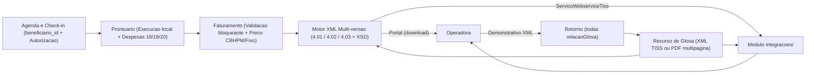

# ADR-PEP-0034 — Evolução do Motor TISS: Autorização Prévia Ponta a Ponta, Fidelidade de Carteirinha, Outras Despesas, Multi-Versão e Precificação CBHPM/AMB

**Status:** Aceita — 21/11/2026
**Relacionadas:** [[ADR-PEP-0012-motor-tiss|ADR-PEP-0012]], [[ADR-PEP-0024-dados-de-referencia-ans|ADR-PEP-0024]], [[ADR-PEP-0027-indicacao-clinica-unica-por-atendimento|ADR-PEP-0027]], [[ADR-PEP-0028-resolvedor-de-dados-da-guia|ADR-PEP-0028]], [[ADR-PEP-0029-consulta-tiss-e-preco-de-contrato-na-guia|ADR-PEP-0029]], [[ADR-PEP-0030-separacao-pedido-externo-execucao-local-e-retorno|ADR-PEP-0030]], [[RFC-PEP-006-guias-e-lotes-tiss|RFC-PEP-006]], [[RFC-PEP-007-retorno-e-glosas|RFC-PEP-007]], [[RFC-PEP-008-contratos|RFC-PEP-008]], [[RFC-PEP-027-motor-tiss-autorizacao-outras-despesas-e-cbhpm|RFC-PEP-027]], [[SPK-09-catalogo-tuss|SPK-09]], [[SPK-15-metadados-modelo-resumo-soap-e-tabelas-tuss-despesas|SPK-15]]

## Contexto

A [[ADR-PEP-0012-motor-tiss|ADR-PEP-0012]] estabeleceu a geração própria de XML TISS 4.03.00 para guias de Consulta e SP/SADT no MVP (P1), deixando webservices por operadora atrás de uma interface no módulo `integracoes/` (`OperadoraGateway`). Posteriormente, as ADRs [[ADR-PEP-0027-indicacao-clinica-unica-por-atendimento|0027]], [[ADR-PEP-0028-resolvedor-de-dados-da-guia|0028]], [[ADR-PEP-0029-consulta-tiss-e-preco-de-contrato-na-guia|0029]] e [[ADR-PEP-0030-separacao-pedido-externo-execucao-local-e-retorno|0030]] corrigiram a composição clínica das guias no fechamento do atendimento.

Contudo, uma auditoria técnica aprofundada no código do PEP (`apps/api/src/modulos/faturamento/`, `contratos/`, `retorno/`, `prontuario/`, `agenda/`, `referencias/` e `packages/contracts/src/validacao-guia.ts`) identificou lacunas estruturais que, em operação real com operadoras de saúde, causariam **glosas imediatas (família 14xx — autorização, 10xx — elegibilidade/carteirinha, 17xx/18xx — procedimento/codificação)** e perda direta de receita em clínicas que executam procedimentos e exames em sala:

1. **Autorização prévia desconectada do XML e não bloqueante:**
   - `agendamentos` armazena apenas `autorizacao_status` (`nao_exige | pendente | aprovada | negada`), sem número da guia na operadora, data de autorização, senha, validade da senha ou código de validação.
   - `DadosGuiaSchema` (`packages/contracts/src/validacao-guia.ts`) guarda somente `senha`, e `lote-xml.ts:guiaSpSadt` **não serializa o bloco `<ans:dadosAutorizacao>`** (`ct_autorizacaoSADT` no XSD 4.03.00).
   - Em `faturamento.service.ts:444-456` (`validarRevisao`), a ausência de senha quando o contrato exige autorização gera apenas `aviso` (não bloqueia liberação nem entrada em lote), usa `dataAtendimento` em vez de `dataSolicitacao` para SP/SADT, fixa `carater = 'eletivo'` ignorando o caráter real da guia e não confere `contratos.validade_senha_dias`.
2. **Perda de fidelidade da carteirinha selecionada no agendamento:**
   - Embora `agendamentos.beneficiario_id` exista no banco (`agenda/schema.ts:31`), `ProntuarioService` (`prontuario.service.ts:130,198,452,508`) ignora o beneficiário escolhido na recepção e recorre sistematicamente a `pac.beneficiarios.find((b) => b.principal)`. Pacientes com dois planos (ex.: plano empresarial + plano odontológico/suplementar) têm atendimentos, análises da IA e guias faturadas contra a operadora errada.
3. **Motor TISS restrito à Tabela 22 fixa e execução simplificada:**
   - `lote-xml.ts:79-84` fixa `<ans:codigoTabela>22</ans:codigoTabela>`, `<ans:reducaoAcrescimo>1.00</ans:reducaoAcrescimo>`, usa fallback `"Procedimento XXXXXXXX"` em `<ans:descricaoProcedimento>`, não suporta horários de execução por item, `viaAcesso`, `tecnicaUtilizada`, `<ans:equipeSadt>` (`grauPart` da Tabela 35) nem `<ans:outrasDespesas>` (Tabelas TUSS **18** Taxas/Diárias, **19** Materiais/OPME e **20** Medicamentos). Clínicas que realizam pequenos procedimentos, infiltrações, endoscopias ou exames com contraste ficam impedidas de cobrar insumos e equipe auxiliar no XML.
4. **Versão TISS hardcoded, precificação limitada a valor fixo e recurso sem XML oficial:**
   - `lote-xml.ts:112`, `lotes.service.ts:137,144` e `tiss-xsd.ts:29` usam a constante `VERSAO_TISS_LOTE` (`4.03.00`), ignorando `contratos.versao_tiss` — embora operadoras em transição ainda operem em `4.01.00` ou `4.02.00` **[validar com operadoras do piloto]**.
   - `contratos` precifica exclusivamente por `valor_centavos` fixo por TUSS, sem suportar tabelas referenciais de mercado (CBHPM, AMB, Brasíndice, Simpro) baseadas em Porte, UCO, CH, m² de Filme e banda percentual (`-20%`, `+15%`).
   - O envio de recurso de glosa (`glosas.service.ts:800-843`) gera apenas um `.zip` de PDFs truncados em 48 linhas × 95 colunas, sem emissão do XML TISS oficial de Recurso de Glosa (`ctm_recursoGlosa` / `RECURSO_GLOSA`), enquanto `retorno-xml.ts:246-247` sobrescreve/ignora múltiplas tags `<relacaoGlosa>` em um mesmo procedimento glosado.

## Decisão

Adotamos quatro decisões arquiteturais complementares, a serem entregues de forma incremental e aditiva na [[RFC-PEP-027-motor-tiss-autorizacao-outras-despesas-e-cbhpm|RFC-PEP-027]]:

### 1. Autorização prévia como entidade de primeira classe ponta a ponta (Agenda → Prontuário → Guia → XML)
- Os atributos TISS de autorização (`numero_guia_operadora`, `data_autorizacao`, `senha`, `data_validade_senha`, `ausencia_cod_validacao`, `cod_validacao`) passam a ser capturados desde o agendamento/check-in (com endpoint dedicado de decisão `aprovada | negada`) e propagados automaticamente para `DadosGuia` (revisão inicial) e para o bloco `<ans:dadosAutorizacao>` (`ct_autorizacaoSADT`) em `lote-xml.ts:guiaSpSadt`.
- Na validação local da guia (`validarRevisao`), a verificação de autorização usa a data de referência correta (`dataSolicitacao` / `dataExecucao` em SP/SADT), o caráter real (`caraterAtendimento`) e `contratos.validade_senha_dias`. Quando o contrato exige autorização prévia para um procedimento da guia, **ausência de senha, ausência de `dataAutorizacao` ou senha vencida na data de execução passam a ser erros bloqueantes (`severidade: 'erro'`)**, impedindo liberação (`validada`) e inclusão em lote XML.

### 2. Fidelidade estrita de carteirinha (`agendamentos.beneficiario_id`)
- O campo `agendamentos.beneficiario_id` torna-se a **fonte única da verdade** do vínculo de convênio para o atendimento.
- `atendimentos` passa a persistir `beneficiario_id` (copiado do agendamento na abertura, ou escolhido explicitamente em atendimento avulso de convênio).
- Elimina-se o uso de `b.principal` como regra primária em `ProntuarioService` (abertura, exibição, cálculo de janela de retorno, contexto da IA e fechamento/geração de guias) e em `DadosGuiaService`: o fallback para `b.principal` só é admitido quando o atendimento não possuir `beneficiario_id` gravado (registros legados).

### 3. Despesas acessórias (`<ans:outrasDespesas>`) e execução completa de SP/SADT
- O motor TISS evolui para emitir, além de `<ans:procedimentosExecutados>` (Tabela 22), o bloco `<ans:outrasDespesas>` (`ct_outrasDespesas`) cobrindo as **Tabelas TUSS 18 (Taxas/Diárias/Gases), 19 (Materiais/OPME) e 20 (Medicamentos)**, com totalização discriminada em `<ans:valorTotal>` (`valorProcedimentos`, `valorTaxasAlugueis`, `valorMateriais`, `valorMedicamentos`, `valorOPME`, `valorGasesMedicinais`, `valorTotalGeral`).
- A captura das despesas ocorre de forma estruturada no atendimento/sala de procedimentos (ou na revisão do faturista), alimentada pela extensão do catálogo TUSS da `tissia-ia` ([[SPK-15-metadados-modelo-resumo-soap-e-tabelas-tuss-despesas|SPK-15]]).
- Cada item de `<ans:procedimentosExecutados>` passa a suportar `dataExecucao` individual, `horaInicial`, `horaFinal`, controle de `quantidadeSolicitada` × `quantidadeAutorizada` × `quantidadeExecutada`, `viaAcesso`, `tecnicaUtilizada`, `reducaoAcrescimo` variável e `<ans:equipeSadt>` (`grauPart` da Tabela 35, conselho, UF e CBO).
- `<ans:descricaoProcedimento>` nunca mais emite texto sintético `"Procedimento XXXXXXXX"`: exige termo oficial proveniente da Tabela 22 (`SPK-09`/`SPK-15`), `pedidos_exame.termo` ou `tabela_negociada_itens.descricao`.

### 4. Multi-versão TISS, precificação referencial CBHPM/AMB, Recurso XML TISS e porta Webservice
- **Multi-versão TISS (`4.01.00`, `4.02.00`, `4.03.00`):** `lote-xml.ts`, `lotes.service.ts` e `tiss-xsd.ts` deixam de depender da constante única `VERSAO_TISS_LOTE` e passam a ler `contratos.versao_tiss` (já previsto na [[ADR-PEP-0012-motor-tiss|ADR-PEP-0012]]), mantendo XSDs oficiais versionados por pasta em `apps/api/ref/tiss/{versao}/` com proveniência e SHA-256 ([[ADR-PEP-0024-dados-de-referencia-ans|ADR-PEP-0024]]) e cache de `XsdValidator` por versão.
- **Precificação referencial CBHPM/AMB/Brasíndice/Simpro:** o módulo `contratos` passa a suportar regras de precificação por fórmula referencial (Porte, UCO, CH, m² de Filme, banda percentual redutora/acréscimo, percentuais de auxiliares pela Tabela 35 e acréscimo de urgência) em convivência com o modelo de valor fixo em centavos (`valor_centavos`), sempre resolvendo o valor final determinístico em centavos inteiros no momento da precificação da guia.
- **Recurso de Glosa em XML TISS + fidelidade de retorno:** `lotes_recurso` passa a suportar emissão real de `formato = 'xml_tiss'` (`ctm_recursoGlosa` / `RECURSO_GLOSA`), validado contra o XSD da versão TISS do contrato, mantendo `pacote_portal` (com gerador PDF multipágina sem truncamento) para operadoras que só aceitam upload documental. `retorno-xml.ts` preserva **todas** as ocorrências de `<relacaoGlosa>` por item glosado.
- **Porta Webservice TISS (`ServicoWebserviceTiss`):** em continuidade à [[ADR-PEP-0012-motor-tiss|ADR-PEP-0012]], o módulo `integracoes/` define a porta hexagonal `ServicoWebserviceTiss` para `verificaElegibilidadeWS`, `loteGuiasWS` e `recursoGlosaWS`, isolando totalmente os módulos `agenda`, `faturamento` e `retorno` da escolha futura entre parceiro homologado ou cliente SOAP direto por operadora.

## Alternativas consideradas

| Alternativa | Por que não |
| :--- | :--- |
| Manter ausência de senha como `aviso` na validação local e delegar o bloqueio ao faturista | A taxa de glosa por falta/vencimento de autorização (grupo 14xx) é uma das principais causas de perda de faturamento ambulatorial; aviso visual é ignorado sob volume |
| Exigir apenas atualização manual de `beneficiario_id` na tela da guia (`EditorGuia`) | A análise da `tissia-ia` e o cálculo de janela de retorno já teriam rodado com a operadora errada durante a consulta; o vínculo correto nasce no agendamento |
| Continuar gerando XML apenas em `4.03.00` até todas as operadoras migrarem | Operadoras regionais e de autogestão mantêm janelas de convivência em `4.01.00`/`4.02.00` **[validar com piloto]**; forçar `4.03.00` impede o faturamento dessas carteiras |
| Embutir materiais e medicamentos como linhas da Tabela 22 em `<ans:procedimentosExecutados>` | Viola frontalmente o XSD da ANS (`dm_tabela` e `ct_outrasDespesas`) e provoca rejeição automática do lote no validador da operadora |
| Construir clientes SOAP específicos de cada operadora diretamente dentro de `faturamento/` e `retorno/` | Acoplaria regras de negócio clínicas/fiscais a variações proprietárias de TLS/WS-Security; contraria a fronteira de `integracoes/` definida na [[ADR-PEP-0012-motor-tiss\|ADR-PEP-0012]] |

## Consequências

- **Positivas:**
  - Elimina glosas evitáveis das famílias 10xx (carteira vencida / operadora incorreta), 14xx (autorização ausente ou vencida), 17xx/18xx (TUSS fora de vigência, descrição sintética, limite por guia excedido) antes da geração do lote.
  - Viabiliza clínicas de procedimentos e SADT (oftalmologia, dermatologia, ortopedia, gastroenterologia, cardiologia, diagnósticos) que dependem de `<ans:outrasDespesas>`, equipe auxiliar e precificação CBHPM/AMB.
  - Prepara o PEP para transmissão automatizada via webservices TISS sem reescrever fluxos de domínio.
- **Custos e compromissos:**
  - Exige manutenção de múltiplos pacotes XSD oficiais em `apps/api/ref/tiss/` (4.01.00, 4.02.00, 4.03.00), todos registrados no manifesto com SHA-256 ([[ADR-PEP-0024-dados-de-referencia-ans|ADR-PEP-0024]]).
  - Aumenta a superfície de validação na liberação de guias: clínicas que hoje faturam sem preencher autorização prévia precisarão parametrizar corretamente `regras_autorizacao` no contrato para evitar travamentos indevidos.
  - Depende da evolução aditiva do catálogo TUSS na `tissia-ia` ([[SPK-15-metadados-modelo-resumo-soap-e-tabelas-tuss-despesas|SPK-15]]) para buscas nas Tabelas 18/19/20 e conferência de vigência por data de referência (com degradação controlada em caso de indisponibilidade da IA, respeitando [[ADR-PEP-0005-spike-adapter|ADR-PEP-0005]]).
  - Todas as migrações de banco derivadas desta ADR devem ser estritamente aditivas ([[ADR-PEP-0019-drizzle-kit-migracoes-e-seed|ADR-PEP-0019]]) e protegidas por `tenant_id` + RLS ([[ADR-PEP-0003-postgres-rls-multitenant|ADR-PEP-0003]], [[ADR-PEP-0017-orm-drizzle-rls|ADR-PEP-0017]]), preservando integralmente guias e lotes históricos já emitidos.
