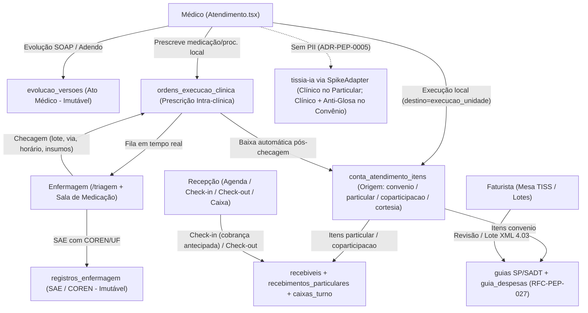

# ADR-PEP-0035 — Conta do atendimento itemizada (híbrida), bifurcação de UX Particular × Convênio e segregação formal do Processo de Enfermagem (SAE)

**Status:** Proposta — 21/11/2026
**Relacionadas:** [[ADR-PEP-0003-postgres-rls-multitenant|ADR-PEP-0003]], [[ADR-PEP-0007-prontuario-imutavel|ADR-PEP-0007]], [[ADR-PEP-0014-convenio-e-particular-no-mvp|ADR-PEP-0014]], [[ADR-PEP-0017-orm-drizzle-rls|ADR-PEP-0017]], [[ADR-PEP-0030-separacao-pedido-externo-execucao-local-e-retorno|ADR-PEP-0030]], [[ADR-PEP-0031-separacao-papeis-checkout-recepcao-e-triagem|ADR-PEP-0031]], [[RFC-PEP-003-agenda|RFC-PEP-003]], [[RFC-PEP-010-financeiro-e-repasse|RFC-PEP-010]], [[RFC-PEP-022-triagem-e-checkout-recepcao|RFC-PEP-022]], [[RFC-PEP-025-estacao-enfermagem-assinatura-exames-resumo-e-baixa-checkout|RFC-PEP-025]], [[RFC-PEP-028-jornada-hibrida-grande-clinica-e-sae-enfermagem|RFC-PEP-028]]

## Contexto

A [[ADR-PEP-0014-convenio-e-particular-no-mvp|ADR-PEP-0014]] viabilizou um MVP ágil combinando convênio TISS completo e particular simples sob uma chave booleana única no atendimento (`atendimentos.convenio: boolean`), enquanto a [[ADR-PEP-0031-separacao-papeis-checkout-recepcao-e-triagem|ADR-PEP-0031]] e a [[RFC-PEP-022-triagem-e-checkout-recepcao|RFC-PEP-022]] introduziram a etapa inicial de pré-consulta (`triagens`) e o check-out na recepção (evoluídos de forma tática na [[RFC-PEP-025-estacao-enfermagem-assinatura-exames-resumo-e-baixa-checkout|RFC-PEP-025]]).

Entretanto, a auditoria do código atual de `@pep/api` e `@pep/ui` frente à operação diária de clínicas médias e grandes — que operam simultaneamente convênio, particular, procedimentos em sala e equipe de enfermagem dedicada — evidenciou **três limitações estruturais** que não podem ser resolvidas apenas com ajustes pontuais de tela:

1. **Modelo binário de cobrança (`atendimentos.convenio: boolean`) incompatível com atendimentos híbridos e rotina de balcão:**
   - Na prática clínica, um paciente de convênio frequentemente realiza no mesmo encontro um item não coberto pelo plano (ex.: vacina, curativo especial, procedimento estético/ambulatorial fora do rol) ou paga coparticipação no balcão; inversamente, um atendimento iniciado como convênio precisa ser convertido para particular após o check-in quando a operadora nega elegibilidade ou senha.
   - Hoje, `FinanceiroService.garantirRecebivelParticular` (`apps/api/src/modulos/financeiro/financeiro.service.ts`) ignora qualquer atendimento com `convenio = true`, exige `status === 'fechado'` e busca apenas o primeiro procedimento (`LIMIT 1`) na `tabela_particular` — perdendo itens adicionais executados na consulta.
   - `FinanceiroService.registrarRecebimentoParticular` bloqueia com HTTP `422` qualquer recebimento quando `atend.convenio === true` ou `atend.status !== 'fechado'`, inviabilizando o modelo amplamente praticado de **cobrança particular antecipada no check-in**.
   - `AgendaService.editar` (`apps/api/src/modulos/agenda/agenda.service.ts`) bloqueia a ação `particular` fora dos status `agendado` e `confirmado`, impedindo a conversão convênio → particular nos status `chegou` e `em_atendimento`.
2. **Vazamento de terminologia e travas TISS no atendimento particular (e desligamento indevido da IA clínica):**
   - `Atendimento.tsx`, `PainelIA.tsx` e `ProntuarioService.adicionarPedido` expõem rótulos e exigências exclusivas de convênio TISS (`Indicação clínica (Campo 23 da guia)`, `SP/SADT`, `janela contratual`) mesmo quando o atendimento é 100% particular.
   - Simultaneamente, `Atendimento.tsx` condiciona `sugestoesIa` a `!!a?.convenio`, privando médicos em consultas particulares da IA assistiva estritamente clínica (sugestões de CID-10, exames/condutas e resumo ao paciente).
   - A seção única `"Pedidos de exame e procedimento"` ainda mistura conceitualmente procedimentos **executados na consulta** (que compõem faturamento imediato da clínica) com **solicitações externas** (que geram documento ao paciente), dificultando a captura de receita no particular e no convênio.
3. **Ausência de Processo de Enfermagem formal (SAE) e de passagem de bastão intra-clínica:**
   - A tabela `triagens` cobre apenas a pré-consulta pontual (sinais vitais e queixa breve) e é editável (`ON CONFLICT DO UPDATE`), não atendendo à imutabilidade nem à estrutura da **Sistematização da Assistência de Enfermagem (SAE) / Processo de Enfermagem** prevista pela Resolução COFEN nº 736/2024 `**[validar]**` (avaliação, diagnóstico, planejamento/prescrição e evolução de enfermagem, assinados com COREN/UF).
   - Por outro lado, a enfermagem não pode escrever em `evolucao_versoes` (ato privativo médico) e tampouco existe entidade para **ordens de execução clínica** (prescrição médica intra-clínica de medicação EV/IM, nebulização, curativo, vacina ou ECG executada na sala de procedimentos pela enfermagem), desconectando a assistência de enfermagem da checagem de segurança (horário, lote, via, insumos) e da respectiva cobrança na conta particular ou nas despesas TISS (`<ans:outrasDespesas>`).

## Decisão

Adotamos três pilares arquiteturais aditivos, especificados em detalhe na [[RFC-PEP-028-jornada-hibrida-grande-clinica-e-sae-enfermagem|RFC-PEP-028]]:

### 1. Conta do Atendimento Itemizada (Híbrida) em substituição ao faturamento binário
- Introduzir a tabela `conta_atendimento_itens` (no módulo `financeiro`, com `tenant_id uuid NOT NULL` + RLS conforme [[ADR-PEP-0003-postgres-rls-multitenant|ADR-PEP-0003]] e [[ADR-PEP-0017-orm-drizzle-rls|ADR-PEP-0017]]), na qual cada item cobrável de um atendimento possui explicitamente:
  - `origem_cobranca`: `'convenio' | 'particular' | 'coparticipacao' | 'cortesia'`
  - identificação do procedimento/serviço (`chave_tabela`, `tuss`, `descricao`), `quantidade`, `valor_unitario_centavos` e vínculo opcional com a origem clínica (`pedido_id`, `ordem_execucao_id` ou `'consulta_base'`, sem FK cross-módulo conforme [[ADR-PEP-0017-orm-drizzle-rls|ADR-PEP-0017]]).
- **Retrocompatibilidade preservada:** `atendimentos.convenio` e `agendamentos.particular` permanecem como **modalidade padrão de entrada** do atendimento (definindo a `origem_cobranca` default dos itens gerados automaticamente) e como flag derivada para consumidores legados, sem quebra de contrato ou migração destrutiva ([[ADR-PEP-0019-drizzle-kit-migracoes-e-seed|ADR-PEP-0019]]).
- **Recebível particular somatório e cobrança antecipada:**
  - `garantirRecebivelParticular` passa a somar **todos** os itens ativos da `conta_atendimento_itens` cuja `origem_cobranca IN ('particular', 'coparticipacao')`, eliminando a limitação `LIMIT 1`.
  - Um atendimento com `atendimentos.convenio = true` **pode** possuir recebível particular concomitante desde que contenha ao menos um item `'particular'` ou `'coparticipacao'` na sua conta.
  - A trava `atend.status !== 'fechado'` em `registrarRecebimentoParticular` é removida para itens já lançados (como a consulta base prevista no check-in), habilitando **recebimento antecipado no check-in** e eventual complemento no check-out caso novos procedimentos/insumos particulares sejam executados durante o atendimento.
- **Conversão convênio → particular pós-check-in:** permitir converter agendamentos/atendimentos de convênio para particular também nos status `chegou` e `em_atendimento` (enquanto nenhuma guia TISS tiver sido enviada em lote), reclassificando automaticamente os itens ainda abertos em `conta_atendimento_itens` de `'convenio'` para `'particular'` com trilha de auditoria.

### 2. Bifurcação real da UX clínica (Particular × Convênio)
- **Atendimento sem itens de convênio (100% particular):**
  - A interface clínica (`Atendimento.tsx` e `PainelIA.tsx`) e a validação de serviço (`ProntuarioService`) **não exibem nem exigem** terminologia ou regras TISS (`Campo 23`, `SP/SADT`, `elegibilidade`, `janela contratual`, alertas de glosa/DUT de operadora).
  - A regra de retorno particular passa a usar política configurável própria da unidade/profissional (`dias_retorno_particular`), com linguagem transparente de balcão (ex.: `"Retorno particular dentro do prazo de cortesia de X dias"`), desvinculada de cláusulas contratuais de operadoras.
  - **IA assistiva clínica preservada:** o médico em consulta particular continua contando com a IA clínica (`SPK-14` / `SPK-15`: sugestões de CID-10, exames/condutas e geração de resumo ao paciente em linguagem simples), sob rigoroso respeito à [[ADR-PEP-0005-spike-adapter|ADR-PEP-0005]] (apenas `clinica_ref`, `paciente.ref` HMAC, sexo, idade e texto clínico scrubbed; sem chamada de avaliação anti-glosa/DUT de operadora).
- **Separação explícita entre Execução Local e Solicitação Externa:**
  - Evoluindo a [[ADR-PEP-0030-separacao-pedido-externo-execucao-local-e-retorno|ADR-PEP-0030]], a tela de atendimento e a API distinguem claramente duas listas:
    1. **Procedimentos executados nesta consulta** (`destino = 'execucao_unidade'`): capturados automaticamente para `conta_atendimento_itens` (como `'particular'` ou `'convenio'` — neste caso compondo guia SP/SADT).
    2. **Solicitações externas** (`destino = 'solicitacao_externa'`): destinadas apenas à emissão de pedido assinado ao paciente (`RFC-PEP-025`), nunca lançadas na conta executante da clínica.

### 3. Segregação formal do Processo de Enfermagem (SAE) e Ordens de Execução Intra-clínica
- **Entidade clínica própria de Enfermagem (append-only):**
  - Criar `registros_enfermagem` (no módulo `triagem`/enfermagem, com `tenant_id uuid NOT NULL` + RLS + trigger append-only nos moldes da [[ADR-PEP-0007-prontuario-imutavel|ADR-PEP-0007]]), completamente segregada de `evolucao_versoes` (ato médico).
  - Todo registro de enfermagem carrega obrigatoriamente identificação profissional (`coren_numero`, `coren_uf`), etapa do Processo de Enfermagem (`avaliacao`, `diagnostico`, `planejamento_prescricao`, `evolucao`, `anotacao`), conteúdo estruturado e texto plano imutável, protegido por permissão granular dedicada `enfermagem:evoluir` (sem conceder `prontuario:escrever`).
  - Manter a conformidade com a Resolução COFEN nº 736/2024 `**[validar]**` (segregação de competências, rastreabilidade de autoria e imutabilidade documental).
- **Passagem de bastão estruturada Médico → Enfermagem → Conta (`ordens_execucao_clinica`):**
  - Criar `ordens_execucao_clinica` para registrar prescrições médicas de execução **intra-clínica** (medicação EV/IM/SC/VO na clínica, nebulização, curativo, vacina, ECG, coleta local).
  - As ordens alimentam em tempo real a aba **"Sala de Medicação/Procedimentos"** na estação `/triagem` da enfermagem.
  - Ao checar a execução (horário efetivo, via, lote/validade quando aplicável, observação e insumos consumidos, sob permissão `enfermagem:executar`), o sistema dispara automaticamente o lançamento correspondente:
    - se origem `'particular'` ou `'coparticipacao'` → cria item em `conta_atendimento_itens` e recalcula o saldo do recebível particular;
    - se origem `'convenio'` → gera lançamento estruturado de despesa/procedimento elegível para `<ans:outrasDespesas>` ou procedimento em guia SP/SADT (acoplado à `guia_despesas` da `RFC-PEP-027`).

## Diagrama de Fronteiras Arquiteturais

## Alternativas consideradas

| Alternativa | Por que não |
| :--- | :--- |
| Manter `atendimentos.convenio: boolean` e abrir dois atendimentos separados no mesmo horário para casos híbridos | Fragmenta o prontuário clínico em dois registros para o mesmo encontro, distorce indicadores de produção/retorno e confunde médico, paciente e auditoria |
| Ocultar termos TISS no particular apenas no CSS/frontend mantendo `indicacao_clinica` obrigatória e `PainelIA` desligado | Mantém bloqueios artificiais no backend (`ProntuarioService.adicionarPedido`) e retira valor clínico da IA assistiva para médicos que atendem particular |
| Gravar evolução e checagem de enfermagem dentro de `evolucao_versoes` ou `adendos` com uma flag de papel | Mistura ato médico (CRM) com Processo de Enfermagem (COREN), viola fronteiras ético-profissionais (CFM/COFEN `**[validar]**`) e cria conflitos de versionamento otimista no editor SOAP médico |
| Lançar insumos/medicações intra-clínicas manualmente pela recepção no check-out | Causa perda silenciosa de receita (receita esquecida de materiais/medicamentos), falta de rastreabilidade de lote/horário e atrito entre sala de procedimentos e balcão |

## Consequências

- **Aderência à clínica híbrida real:** suporta nativamente convênio puro, particular puro, misto (convênio + item particular/coparticipação), pagamento antecipado no check-in e conversão convênio → particular sem reabrir agenda ou duplicar prontuário.
- **Conformidade clínico-regulatória elevada:** separa juridicamente ato médico (`evolucao_versoes` / CRM) de Processo de Enfermagem (`registros_enfermagem` / COREN, SAE — Resolução COFEN nº 736/2024 `**[validar]**`), mantendo ambos append-only e sob RLS por tenant.
- **Fronteiras do monorepo mantidas (`ADR-PEP-0017` / `ADR-PEP-0018`):** `conta_atendimento_itens` pertence ao módulo `financeiro` (consumindo eventos/chamadas de serviço de `prontuario` e `triagem`/enfermagem sem FKs cross-módulo nem imports de `schema.ts` alheios).
- **Segurança e `SpikeAdapter` (`ADR-PEP-0005`):** a habilitação da IA assistiva clínica no particular continua usando estritamente identificadores pseudonimizados (`clinica_ref`, `paciente.ref` HMAC) e scrubber de PII, sem enviar dados financeiros ou cadastrais.
- **Evolução incremental obrigatória:** a introdução destas entidades exige migrações puramente aditivas (`ADR-PEP-0019`), atualização da matriz RBAC em `@pep/contracts` e entrega em fatias isoladas (`F1..F4` na [[RFC-PEP-028-jornada-hibrida-grande-clinica-e-sae-enfermagem|RFC-PEP-028]]).
